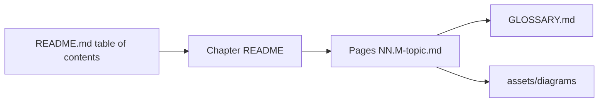

# Contributing to Agentic AI Notes

Thank you for helping. Every fix, from a typo to a new chapter, makes these notes better for the next reader.

## 📑 On this page

- [Ways to help](#-ways-to-help)
- [How the repository works](#-how-the-repository-works)
- [Writing a page](#-writing-a-page)
- [Writing style](#-writing-style)
- [Diagrams](#-diagrams)
- [Code snippets](#-code-snippets)
- [Accuracy and sources](#-accuracy-and-sources)
- [Before you open a pull request](#-before-you-open-a-pull-request)
- [Licensing of contributions](#-licensing-of-contributions)

## 🙌 Ways to help

- **Fix something:** a typo, a wrong fact, a broken link, a code snippet that no longer works. Use the [fix content](.github/ISSUE_TEMPLATE/fix-content.md) issue template, or just send a pull request.
- **Suggest a topic:** use the [suggest a topic](.github/ISSUE_TEMPLATE/suggest-topic.md) template.
- **Improve an explanation:** if a page confused you, tell us where. That feedback is gold.
- **Translate:** open an issue first so we can agree on a structure.

Small fixes need no discussion. For a new page or a large rewrite, please open an issue first.

## 🧩 How the repository works

*The README lists every chapter; each chapter README lists its pages; pages link to the glossary and to shared diagrams.*

| Path | What lives there |
| --- | --- |
| `docs/NN-chapter/` | One chapter: a `README.md` overview plus one file per page, `NN.M-topic-name.md` |
| `assets/diagrams/` | Hand-made SVG diagrams |
| `README.md`, `SUMMARY.md` | The table of contents (detailed and flat) |
| `GLOSSARY.md`, `CHEATSHEET.md`, `ROADMAP.md` | The index of terms, the one-page summary and the learning paths |

**To add or move a page,** update every place that lists it, so readers can always find it:

1. The page itself: the breadcrumb on the first line and the previous/next links in the footer (after `<!-- FOOTER -->`).
2. The footers of its neighbours, whose previous/next links now point to it.
3. The chapter `README.md` page table.
4. The table of contents in `README.md` and the list in `SUMMARY.md`.

## 📝 Writing a page

Use any existing page as your model, for example [1.1 What is an AI agent?](docs/01-foundations/01.1-what-is-an-ai-agent.md). Every page must have:

- the breadcrumb (first line) and the footer (after `<!-- FOOTER -->`);
- a difficulty badge, reading time and prerequisites;
- an **In one sentence** summary;
- a **📑 On this page** list linking to every `##` heading;
- at least one diagram, with an italic caption saying what to notice;
- a worked example, key takeaways, exercises with collapsible answers, and further reading.

**Headings and emoji:** do not use emoji that carry an invisible variation selector (U+FE0F), such as ⚠️ or 🖼️, in headings. Some Markdown renderers keep that character in the anchor and others drop it, so "On this page" links break on one of them.

**Glossary:** the first time a glossary term appears on a page, link it: `[tool](../../GLOSSARY.md#tool)`. Add new terms to [GLOSSARY.md](GLOSSARY.md) in alphabetical order, each linking to the page that explains it.

## 💬 Writing style

- **Plain English.** Short sentences. Active voice. "The agent calls the tool", not "The tool is called by the agent".
- **Define before you use.** No jargon until it has been explained.
- **Concrete first.** Start with a story or scenario, then generalise.
- **Mark opinions.** "In practice, we recommend…" is fine. Presenting an opinion as fact is not.
- **Vendor-neutral.** Where providers differ, show at least two.
- **Relative links only**, so they work on GitHub and in a clone.

## 🎨 Diagrams

1. Prefer **Mermaid** (`flowchart`, `sequenceDiagram`, `stateDiagram-v2`). GitHub renders it.
2. Use **SVG** in `assets/diagrams/` for overview graphics Mermaid cannot draw well. Follow the [diagram style guide](assets/diagrams/README.md).
3. Every image needs **alt text** and an **italic caption** underneath.
4. **Only original work.** Never copy or hot-link images you do not have the rights to.

## 🐍 Code snippets

- Python 3.11+, type hints where they help, short and readable.
- Each snippet shows **one idea**. Keep it self-contained: no imports from files that are not on the page.
- Call providers through their official SDKs. Where providers differ, show both (Anthropic and OpenAI).
- Never put real keys in a snippet. Read them from the environment.
- Pin versions when they matter. Framework pages state `> Last verified: <month year> with <package>==<version>`.
- Run your snippet before you submit it, and say in the pull request which versions you used.

## 🔎 Accuracy and sources

- **Do not invent** facts, benchmark numbers, paper titles or API parameters. If you are not sure, check the official source or leave it out.
- Cite **original sources**: official documentation, the original papers, and well-known engineering posts.
- APIs change quickly. Check current official docs before writing SDK or framework code.

## ✅ Before you open a pull request

- Every relative link and `#anchor` you added opens the right place (preview the page on your fork).
- New pages are listed everywhere (see [How the repository works](#-how-the-repository-works)).
- Code snippets run with the versions you state.

The [pull request template](.github/PULL_REQUEST_TEMPLATE.md) has the full checklist.

## 📜 Licensing of contributions

By contributing, you agree that your contribution is licensed under the same terms as the rest of the repository: **CC BY 4.0** for written content and diagrams ([LICENSE](LICENSE)) and **MIT** for code ([LICENSE-CODE](LICENSE-CODE)). Only contribute work you wrote yourself or have the right to license this way.

Please follow our [Code of Conduct](CODE_OF_CONDUCT.md).
