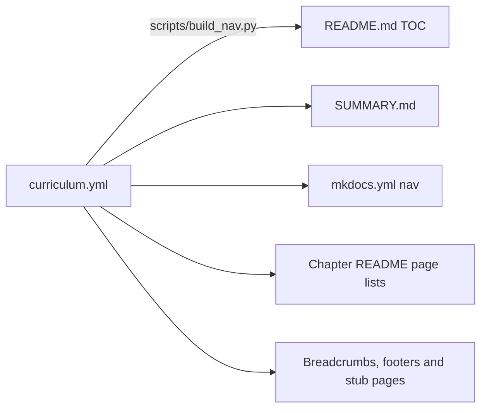

# Contributing to Agentic AI Notes

Thank you for helping. Every fix, from a typo to a new chapter, makes these notes better for the next reader.

## 📑 On this page

- [Ways to help](#-ways-to-help)
- [How the repository works](#-how-the-repository-works)
- [Writing a page](#-writing-a-page)
- [Writing style](#-writing-style)
- [Diagrams](#-diagrams)
- [Code examples](#-code-examples)
- [Accuracy and sources](#-accuracy-and-sources)
- [Before you open a pull request](#-before-you-open-a-pull-request)
- [Licensing of contributions](#-licensing-of-contributions)

## 🙌 Ways to help

- **Fix something:** a typo, a wrong fact, a broken link, an example that no longer runs. Use the [fix content](.github/ISSUE_TEMPLATE/fix-content.md) issue template, or just send a pull request.
- **Suggest a topic:** use the [suggest a topic](.github/ISSUE_TEMPLATE/suggest-topic.md) template.
- **Improve an explanation:** if a page confused you, tell us where. That feedback is gold.
- **Translate:** open an issue first so we can agree on a structure.

Small fixes need no discussion. For a new page or a large rewrite, please open an issue first.

## 🧩 How the repository works



*`curriculum.yml` is the single source of truth for the order of chapters and pages. Never edit the generated parts by hand.*

| Path | What lives there |
| --- | --- |
| `curriculum.yml` | Every chapter and page: slug, title, difficulty, reading time, one-line description |
| `docs/NN-chapter/` | One chapter: a `README.md` overview plus one file per page, `NN.M-topic-name.md` |
| `examples/` | Runnable Python. `examples/common/` holds the shared LLM wrapper and `MockLLM` |
| `assets/diagrams/` | Hand-made SVG diagrams and their `.excalidraw` sources |
| `scripts/` | `build_nav.py` (navigation) and `check_links.py` (link checker) |
| `templates/` | The page template |

**To add or move a page:**

1. Edit `curriculum.yml`.
2. Run `python scripts/build_nav.py`. It updates every navigation surface and creates a stub for any new page.
3. Write the page (see below).
4. Run `python scripts/check_links.py`.

The script only rewrites text between markers (`<!-- TOC:START -->`, `<!-- PAGES:START -->`, `# NAV:START`), the breadcrumb on the first line, and everything after `<!-- FOOTER -->`. Your writing is never touched.

## 📝 Writing a page

Copy [templates/page-template.md](templates/page-template.md). Every page must have:

- the breadcrumb (first line) and the footer (after `<!-- FOOTER -->`), both generated;
- a difficulty badge, reading time and prerequisites;
- an **In one sentence** summary;
- a **📑 On this page** list linking to every `##` heading;
- at least one diagram, with an italic caption saying what to notice;
- a worked example, key takeaways, exercises with collapsible answers, and further reading.

**Headings and emoji:** do not use emoji that carry an invisible variation selector (U+FE0F), such as ⚠️ or 🖼️, in headings. GitHub keeps that character in the anchor and MkDocs drops it, so "On this page" links break on one of them. The template uses safe emoji. `check_links.py` will flag any you miss.

**Glossary:** the first time a glossary term appears on a page, link it: `[tool](../../GLOSSARY.md#tool)`. Add new terms to [GLOSSARY.md](GLOSSARY.md) in alphabetical order, each linking to the page that explains it.

## 💬 Writing style

- **Plain English.** Short sentences. Active voice. "The agent calls the tool", not "The tool is called by the agent".
- **Define before you use.** No jargon until it has been explained.
- **Concrete first.** Start with a story or scenario, then generalise.
- **Mark opinions.** "In practice, we recommend…" is fine. Presenting an opinion as fact is not.
- **Vendor-neutral.** Where providers differ, show at least two.
- **Relative links only**, so they work on GitHub, in a clone and on the website.

## 🎨 Diagrams

1. Prefer **Mermaid** (`flowchart`, `sequenceDiagram`, `stateDiagram-v2`). GitHub and the website both render it.
2. Use **SVG** in `assets/diagrams/` for overview graphics Mermaid cannot draw well. Follow the [diagram style guide](assets/diagrams/README.md).
3. Every image needs **alt text** and an **italic caption** underneath.
4. **Only original work.** Never copy or hot-link images you do not have the rights to.

## 🐍 Code examples

- Python 3.11+, type hints, docstrings, short and readable.
- One folder per example, `examples/NN-example-name/`, numbered to match its chapter, runnable with `python main.py`, with its own `README.md`.
- Use `examples/common/llm.py` so the example works with Anthropic, OpenAI, or `MockLLM`.
- Add pytest tests that use `MockLLM`. **Tests must never need an API key or network access.**
- Never hard-code keys. Use `.env` (ignored by git) and document new variables in `.env.example`.
- Pin versions in `examples/requirements.txt`. Framework pages state `> Last verified: <month year> with <package>==<version>`.

Run the tests:

```bash
cd examples
pytest
```

## 🔎 Accuracy and sources

- **Do not invent** facts, benchmark numbers, paper titles or API parameters. If you are not sure, check the official source or leave it out.
- Cite **original sources**: official documentation, the original papers, and well-known engineering posts.
- APIs change quickly. Check current official docs before writing SDK or framework code.

## ✅ Before you open a pull request

```bash
python scripts/build_nav.py --check   # navigation in sync
python scripts/check_links.py         # internal links and anchors resolve
cd examples && pytest                 # examples pass offline
```

CI runs these plus markdownlint and an external link check (lychee). The [pull request template](.github/PULL_REQUEST_TEMPLATE.md) has the full checklist.

## 📜 Licensing of contributions

By contributing, you agree that your contribution is licensed under the same terms as the rest of the repository: **CC BY 4.0** for written content and diagrams ([LICENSE](LICENSE)) and **MIT** for code ([LICENSE-CODE](LICENSE-CODE)). Only contribute work you wrote yourself or have the right to license this way.

Please follow our [Code of Conduct](CODE_OF_CONDUCT.md).
