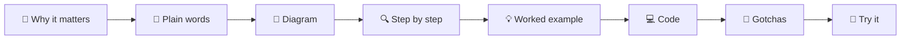

# Agentic AI Notes

[](LICENSE)
[](LICENSE-CODE)
[](https://github.com/YOUR-GITHUB-USERNAME/agentic-ai-notes/actions/workflows/links.yml)
[](https://github.com/YOUR-GITHUB-USERNAME/agentic-ai-notes/actions/workflows/examples.yml)
[](https://github.com/YOUR-GITHUB-USERNAME/agentic-ai-notes/stargazers)
[](CONTRIBUTING.md)

> **From zero to production: a visual, example-driven guide to Agentic AI.**

These are free, open study notes on building AI agents. Start with no knowledge of agents. Finish able to design, build, evaluate and deploy one in production.

Every idea is explained the same way: **plain words first, then a diagram, then a real example, then code.** No term is used before it is defined.

**What's inside:** 19 chapters · 107 pages · 69 runnable examples that work offline · 5 guided projects · a [glossary](GLOSSARY.md) of 160+ terms · a one-page [cheatsheet](CHEATSHEET.md).

## 📑 Contents

- [Who these notes are for](#-who-these-notes-are-for)
- [How to read them](#-how-to-read-them)
- [Run the examples](#-run-the-examples)
- [Table of contents](#-table-of-contents)
- [Licenses](#-licenses)
- [Contributing](#-contributing)
- [Star history](#-star-history)

## 👋 Who these notes are for

- **You know basic Python** and have used ChatGPT or Claude.
- **You have never built an agent**, or you have built one by copying a tutorial and want to understand it properly.
- **You are an experienced engineer** who wants a clear reference on evaluation, safety, observability and production design. The 🔴 Advanced pages are for you.

## 🧭 How to read them

Pick a path. Each one is a list of chapters in order. See [ROADMAP.md](ROADMAP.md) for the full version.

| Path | For | Chapters |
| --- | --- | --- |
| 🟢 **Beginner** | Understand what agents are and build a first one | [00](docs/00-start-here/README.md) → [01](docs/01-foundations/README.md) → [02](docs/02-the-agent-loop/README.md) → [03](docs/03-tools-and-function-calling/README.md) → [Project 1](docs/18-projects/18.1-project-1-weather-and-calculator-agent.md) |
| 🟡 **Builder** | Build useful agents with memory, retrieval and patterns | Beginner path, then [04](docs/04-model-context-protocol/README.md)–[11](docs/11-frameworks/README.md) → Projects 2–4 |
| 🔴 **Production** | Ship agents that are safe, measured and affordable | Builder path, then [12](docs/12-evaluation/README.md)–[17](docs/17-case-studies/README.md) → Project 5 |

Every page has the same shape, so you always know where you are:



*Each page moves from "why should I care?" to "now try it yourself". Skip the code sections on a first read if you like; the ideas stand on their own.*

Difficulty badges: 🟢 Beginner · 🟡 Intermediate · 🔴 Advanced. Unknown word? Check the [Glossary](GLOSSARY.md).

## 💻 Run the examples

All runnable code lives in [`examples/`](examples/README.md). Every example works **without an API key** using a scripted `MockLLM`, so you can run and test everything offline.

```bash
cd examples
python -m venv .venv && source .venv/bin/activate   # Windows: .venv\Scripts\activate
pip install -r requirements.txt
pytest                                              # runs offline with MockLLM
```

To use a real model, copy `.env.example` to `.env` and add an Anthropic or OpenAI key. Full instructions: [0.3 Setup](docs/00-start-here/00.3-setup.md).

## 📚 Table of contents

<!-- TOC:START -->
### [00 · Start Here](docs/00-start-here/README.md)

How these notes work, which path to follow, and how to set up the examples. *(~20 min)*

| Page | What you'll learn | Level |
| --- | --- | --- |
| [0.1 How to use these notes](docs/00-start-here/00.1-how-to-use-these-notes.md) | How the notes are organised, what every page contains, and how to read them. | 🟢 |
| [0.2 Learning paths](docs/00-start-here/00.2-learning-paths.md) | Three routes through the material: Beginner, Builder and Production. | 🟢 |
| [0.3 Setup](docs/00-start-here/00.3-setup.md) | Install Python, add API keys, and run every example offline with MockLLM. | 🟢 |

### [01 · Foundations](docs/01-foundations/README.md)

What an agent is, how it differs from a chatbot, and the parts every agent shares. *(~52 min)*

| Page | What you'll learn | Level |
| --- | --- | --- |
| [1.1 What is an AI agent?](docs/01-foundations/01.1-what-is-an-ai-agent.md) | A precise, plain-language definition of an AI agent. | 🟢 |
| [1.2 Chatbot vs workflow vs agent](docs/01-foundations/01.2-chatbot-vs-workflow-vs-agent.md) | Three kinds of LLM systems and how to tell them apart. | 🟢 |
| [1.3 The autonomy spectrum](docs/01-foundations/01.3-the-autonomy-spectrum.md) | From a single prompt to a fully autonomous agent, one step at a time. | 🟢 |
| [1.4 How LLMs work (just enough)](docs/01-foundations/01.4-how-llms-work.md) | Tokens, context windows, temperature and system prompts. | 🟢 |
| [1.5 Anatomy of an agent](docs/01-foundations/01.5-anatomy-of-an-agent.md) | Model, instructions, tools, memory and loop: the five parts of every agent. | 🟢 |
| [1.6 When NOT to use an agent](docs/01-foundations/01.6-when-not-to-use-an-agent.md) | Signs that a simpler solution will serve you better. | 🟢 |

### [02 · The Agent Loop](docs/02-the-agent-loop/README.md)

The observe–think–act cycle at the heart of every agent, built from scratch. *(~51 min)*

| Page | What you'll learn | Level |
| --- | --- | --- |
| [2.1 The observe–think–act loop](docs/02-the-agent-loop/02.1-the-observe-think-act-loop.md) | The core cycle every agent runs, step by step. | 🟢 |
| [2.2 ReAct explained](docs/02-the-agent-loop/02.2-react-explained.md) | The ReAct pattern, with a full Thought → Action → Observation trace. | 🟢 |
| [2.3 A 50-line agent from scratch](docs/02-the-agent-loop/02.3-a-50-line-agent-from-scratch.md) | Write a working agent with no framework, in about 50 lines of Python. | 🟡 |
| [2.4 Stopping conditions](docs/02-the-agent-loop/02.4-stopping-conditions.md) | Max steps, timeouts and how an agent knows it is done. | 🟡 |
| [2.5 Handling errors in the loop](docs/02-the-agent-loop/02.5-handling-errors-in-the-loop.md) | Tool failures, bad model output and retries, without crashing the run. | 🟡 |

### [03 · Tools & Function Calling](docs/03-tools-and-function-calling/README.md)

How agents act on the world, and how to design tools that models use well. *(~68 min)*

| Page | What you'll learn | Level |
| --- | --- | --- |
| [3.1 What is a tool?](docs/03-tools-and-function-calling/03.1-what-is-a-tool.md) | A function the model can ask you to run, and why that changes everything. | 🟢 |
| [3.2 JSON Schema for tool definitions](docs/03-tools-and-function-calling/03.2-json-schema-for-tools.md) | Describe a tool's inputs so the model calls it correctly. | 🟢 |
| [3.3 How function calling works](docs/03-tools-and-function-calling/03.3-how-function-calling-works.md) | The request → tool call → tool result round trip, for two providers. | 🟢 |
| [3.4 Designing good tools](docs/03-tools-and-function-calling/03.4-designing-good-tools.md) | Names, descriptions, inputs and error messages that models understand. | 🟡 |
| [3.5 Parallel tool calls](docs/03-tools-and-function-calling/03.5-parallel-tool-calls.md) | Several tool calls in one turn, and how to return their results. | 🟡 |
| [3.6 Code execution as a tool](docs/03-tools-and-function-calling/03.6-code-execution-as-a-tool.md) | Let the model write and run code, safely. | 🟡 |
| [3.7 Computer use & browser agents](docs/03-tools-and-function-calling/03.7-computer-use-and-browser-agents.md) | An overview of agents that see screens and click buttons. | 🔴 |

### [04 · Model Context Protocol (MCP)](docs/04-model-context-protocol/README.md)

The open standard for connecting agents to tools and data. *(~64 min)*

| Page | What you'll learn | Level |
| --- | --- | --- |
| [4.1 Why MCP exists](docs/04-model-context-protocol/04.1-why-mcp-exists.md) | The integration problem MCP solves. | 🟢 |
| [4.2 Hosts, clients and servers](docs/04-model-context-protocol/04.2-hosts-clients-and-servers.md) | The three roles in MCP and how they talk. | 🟢 |
| [4.3 Tools, resources and prompts](docs/04-model-context-protocol/04.3-tools-resources-and-prompts.md) | The three things an MCP server can offer. | 🟡 |
| [4.4 Build a simple MCP server](docs/04-model-context-protocol/04.4-build-a-simple-mcp-server.md) | Write and test your first MCP server in Python. | 🟡 |
| [4.5 Connect MCP to an agent](docs/04-model-context-protocol/04.5-connect-mcp-to-an-agent.md) | Use an MCP server's tools from your own agent loop. | 🟡 |
| [4.6 Security for MCP servers](docs/04-model-context-protocol/04.6-mcp-security.md) | Trust, permissions and the risks of third-party servers. | 🔴 |

### [05 · Memory](docs/05-memory/README.md)

How agents remember within a task and across tasks. *(~48 min)*

| Page | What you'll learn | Level |
| --- | --- | --- |
| [5.1 Short-term vs long-term memory](docs/05-memory/05.1-short-term-vs-long-term-memory.md) | The context window versus memory that outlives a conversation. | 🟢 |
| [5.2 Summarisation & context compaction](docs/05-memory/05.2-summarisation-and-context-compaction.md) | Keep long runs inside the context window. | 🟡 |
| [5.3 Vector memory](docs/05-memory/05.3-vector-memory.md) | Store and recall memories by meaning, not keywords. | 🟡 |
| [5.4 Episodic, semantic & procedural memory](docs/05-memory/05.4-episodic-semantic-and-procedural-memory.md) | Three kinds of long-term memory and what each is for. | 🟡 |
| [5.5 Memory design trade-offs](docs/05-memory/05.5-memory-design-trade-offs.md) | What to store, when to recall, and what it costs. | 🔴 |

### [06 · RAG for Agents](docs/06-rag-for-agents/README.md)

Retrieval-augmented generation, and how agents make it smarter. *(~49 min)*

| Page | What you'll learn | Level |
| --- | --- | --- |
| [6.1 RAG in 5 minutes](docs/06-rag-for-agents/06.1-rag-in-5-minutes.md) | Retrieve, then generate: the whole idea in five minutes. | 🟢 |
| [6.2 Embeddings & vector databases](docs/06-rag-for-agents/06.2-embeddings-and-vector-databases.md) | How text becomes numbers you can search. | 🟢 |
| [6.3 Chunking strategies](docs/06-rag-for-agents/06.3-chunking-strategies.md) | How to split documents so retrieval finds the right piece. | 🟡 |
| [6.4 Agentic RAG](docs/06-rag-for-agents/06.4-agentic-rag.md) | The agent decides when, what and how to retrieve. | 🟡 |
| [6.5 Re-ranking & retrieval evaluation](docs/06-rag-for-agents/06.5-re-ranking-and-retrieval-evaluation.md) | Improve and measure the quality of what you retrieve. | 🔴 |

### [07 · Planning & Reasoning](docs/07-planning-and-reasoning/README.md)

How agents think before they act, and recover when plans fail. *(~46 min)*

| Page | What you'll learn | Level |
| --- | --- | --- |
| [7.1 Chain-of-thought & extended thinking](docs/07-planning-and-reasoning/07.1-chain-of-thought-and-extended-thinking.md) | Step-by-step reasoning, from prompting tricks to built-in model thinking. | 🟢 |
| [7.2 Plan-and-execute](docs/07-planning-and-reasoning/07.2-plan-and-execute.md) | Make a plan first, then carry it out step by step. | 🟡 |
| [7.3 Task decomposition](docs/07-planning-and-reasoning/07.3-task-decomposition.md) | Break a big goal into small, checkable tasks. | 🟡 |
| [7.4 Tree-of-thoughts (overview)](docs/07-planning-and-reasoning/07.4-tree-of-thoughts.md) | Explore several lines of reasoning and keep the best. | 🔴 |
| [7.5 Re-planning when things fail](docs/07-planning-and-reasoning/07.5-re-planning-when-things-fail.md) | Notice a broken plan and change course. | 🔴 |

### [08 · Reflection & Self-Correction](docs/08-reflection-and-self-correction/README.md)

Agents that check and improve their own work, and where that breaks down. *(~36 min)*

| Page | What you'll learn | Level |
| --- | --- | --- |
| [8.1 The reflection pattern](docs/08-reflection-and-self-correction/08.1-the-reflection-pattern.md) | Draft, critique, revise. | 🟡 |
| [8.2 The evaluator–optimizer loop](docs/08-reflection-and-self-correction/08.2-evaluator-optimizer-loop.md) | One model generates, another grades, and the loop repeats. | 🟡 |
| [8.3 Self-critique with tests](docs/08-reflection-and-self-correction/08.3-self-critique-with-tests.md) | Use real signals like test results instead of opinions. | 🟡 |
| [8.4 Limits of self-correction](docs/08-reflection-and-self-correction/08.4-limits-of-self-correction.md) | When an agent cannot fix its own mistakes. | 🔴 |

### [09 · Agent Design Patterns](docs/09-agent-design-patterns/README.md)

Reusable building blocks, from simple chains to autonomous agents. *(~54 min)*

| Page | What you'll learn | Level |
| --- | --- | --- |
| [9.1 Prompt chaining](docs/09-agent-design-patterns/09.1-prompt-chaining.md) | Split a task into fixed steps, one LLM call each. | 🟢 |
| [9.2 Routing](docs/09-agent-design-patterns/09.2-routing.md) | Classify the input, then send it to the right handler. | 🟢 |
| [9.3 Parallelisation (sectioning & voting)](docs/09-agent-design-patterns/09.3-parallelisation.md) | Run LLM calls side by side and combine the results. | 🟡 |
| [9.4 Orchestrator–workers](docs/09-agent-design-patterns/09.4-orchestrator-workers.md) | A lead model splits the work and hands it to workers. | 🟡 |
| [9.5 Evaluator–optimizer](docs/09-agent-design-patterns/09.5-evaluator-optimizer.md) | The generate-and-grade pattern as a reusable building block. | 🟡 |
| [9.6 Human-in-the-loop](docs/09-agent-design-patterns/09.6-human-in-the-loop.md) | Pause for a person to approve, correct or decide. | 🟡 |
| [9.7 Choosing a pattern](docs/09-agent-design-patterns/09.7-choosing-a-pattern.md) | A decision flowchart for picking the simplest pattern that works. | 🟡 |

### [10 · Multi-Agent Systems](docs/10-multi-agent-systems/README.md)

Teams of agents, how they coordinate, and when one agent is better. *(~54 min)*

| Page | What you'll learn | Level |
| --- | --- | --- |
| [10.1 Why multiple agents?](docs/10-multi-agent-systems/10.1-why-multiple-agents.md) | What splitting work across agents buys you. | 🟡 |
| [10.2 Supervisor & hierarchical](docs/10-multi-agent-systems/10.2-supervisor-and-hierarchical.md) | A manager agent directs specialist agents. | 🟡 |
| [10.3 Peer-to-peer & handoffs](docs/10-multi-agent-systems/10.3-peer-to-peer-and-handoffs.md) | Agents pass control to each other directly. | 🟡 |
| [10.4 Shared state & communication](docs/10-multi-agent-systems/10.4-shared-state-and-communication.md) | How agents share what they know without stepping on each other. | 🔴 |
| [10.5 Agent-to-agent protocols](docs/10-multi-agent-systems/10.5-agent-to-agent-protocols.md) | An overview of open protocols such as A2A. | 🔴 |
| [10.6 When multi-agent makes things worse](docs/10-multi-agent-systems/10.6-when-multi-agent-makes-things-worse.md) | Cost, latency and coordination failures to watch for. | 🔴 |

### [11 · Frameworks](docs/11-frameworks/README.md)

The major agent frameworks, each rebuilding the same example agent. *(~113 min)*

| Page | What you'll learn | Level |
| --- | --- | --- |
| [11.1 Framework landscape](docs/11-frameworks/11.1-framework-landscape.md) | A comparison table of the main agent frameworks. | 🟢 |
| [11.2 LangGraph](docs/11-frameworks/11.2-langgraph.md) | Agents as graphs of nodes and edges with explicit state. | 🟡 |
| [11.3 CrewAI](docs/11-frameworks/11.3-crewai.md) | Role-based crews of agents working on tasks. | 🟡 |
| [11.4 Microsoft AutoGen & Agent Framework](docs/11-frameworks/11.4-microsoft-autogen-and-agent-framework.md) | Microsoft's multi-agent frameworks. | 🟡 |
| [11.5 OpenAI Agents SDK](docs/11-frameworks/11.5-openai-agents-sdk.md) | Agents, handoffs and guardrails from OpenAI. | 🟡 |
| [11.6 Claude Agent SDK](docs/11-frameworks/11.6-claude-agent-sdk.md) | The Claude Code agent harness as a library. | 🟡 |
| [11.7 LlamaIndex agents](docs/11-frameworks/11.7-llamaindex-agents.md) | Agents built around data and retrieval. | 🟡 |
| [11.8 Pydantic AI](docs/11-frameworks/11.8-pydantic-ai.md) | Type-safe agents with validated inputs and outputs. | 🟡 |
| [11.9 The no-framework approach](docs/11-frameworks/11.9-the-no-framework-approach.md) | When a plain loop over the provider SDK is the best choice. | 🟡 |
| [11.10 How to choose a framework](docs/11-frameworks/11.10-how-to-choose.md) | Questions that point you to the right tool. | 🟢 |

### [12 · Evaluation](docs/12-evaluation/README.md)

How to measure whether an agent works, and keep it working. *(~58 min)*

| Page | What you'll learn | Level |
| --- | --- | --- |
| [12.1 Why evals are hard for agents](docs/12-evaluation/12.1-why-agent-evals-are-hard.md) | Many steps, many valid paths, and non-deterministic output. | 🟡 |
| [12.2 Task, trajectory & tool-use metrics](docs/12-evaluation/12.2-task-trajectory-and-tool-metrics.md) | Measure the result, the path, and the tool calls. | 🟡 |
| [12.3 LLM-as-judge](docs/12-evaluation/12.3-llm-as-judge.md) | Use a model to grade outputs, and check the grader. | 🟡 |
| [12.4 Building an eval dataset](docs/12-evaluation/12.4-building-an-eval-dataset.md) | Collect, label and maintain test cases. | 🟡 |
| [12.5 Regression testing agents in CI](docs/12-evaluation/12.5-regression-testing-in-ci.md) | Catch regressions on every pull request. | 🔴 |
| [12.6 Public benchmarks (overview)](docs/12-evaluation/12.6-public-benchmarks.md) | Well-known agent benchmarks and how to read them. | 🟡 |

### [13 · Safety & Guardrails](docs/13-safety-and-guardrails/README.md)

Threats unique to agents, and the layered defences against them. *(~65 min)*

| Page | What you'll learn | Level |
| --- | --- | --- |
| [13.1 Threat model for agents](docs/13-safety-and-guardrails/13.1-threat-model-for-agents.md) | What can go wrong when a model can take actions. | 🟡 |
| [13.2 Prompt injection & defences](docs/13-safety-and-guardrails/13.2-prompt-injection.md) | Direct and indirect injection, and how to limit the damage. | 🔴 |
| [13.3 Least-privilege tools & sandboxing](docs/13-safety-and-guardrails/13.3-least-privilege-and-sandboxing.md) | Give agents only the access they need. | 🔴 |
| [13.4 Input & output guardrails](docs/13-safety-and-guardrails/13.4-input-and-output-guardrails.md) | Check what goes in and what comes out. | 🟡 |
| [13.5 Human approval for risky actions](docs/13-safety-and-guardrails/13.5-human-approval-for-risky-actions.md) | Require a person to approve irreversible steps. | 🟡 |
| [13.6 Secrets & PII handling](docs/13-safety-and-guardrails/13.6-secrets-and-pii.md) | Keep keys and personal data out of prompts, logs and outputs. | 🔴 |

### [14 · Observability & Debugging](docs/14-observability-and-debugging/README.md)

See what your agent did, and why, so you can fix it. *(~51 min)*

| Page | What you'll learn | Level |
| --- | --- | --- |
| [14.1 Tracing agent runs](docs/14-observability-and-debugging/14.1-tracing-agent-runs.md) | Record every step of a run as a trace. | 🟡 |
| [14.2 Logging tool calls](docs/14-observability-and-debugging/14.2-logging-tool-calls.md) | What to log for every tool call, and what never to log. | 🟢 |
| [14.3 OpenTelemetry for LLM apps](docs/14-observability-and-debugging/14.3-opentelemetry-for-llm-apps.md) | Standard traces and spans for agent systems. | 🔴 |
| [14.4 Tools for tracing](docs/14-observability-and-debugging/14.4-tracing-tools.md) | An overview of LangSmith, Langfuse and Arize Phoenix. | 🟡 |
| [14.5 Debugging a broken agent](docs/14-observability-and-debugging/14.5-debugging-a-broken-agent.md) | A step-by-step method for finding what went wrong. | 🟡 |

### [15 · Production & Deployment](docs/15-production-and-deployment/README.md)

Turn a working prototype into a reliable service. *(~69 min)*

| Page | What you'll learn | Level |
| --- | --- | --- |
| [15.1 Architecture of a production agent](docs/15-production-and-deployment/15.1-production-architecture.md) | The components around the loop that make it reliable. | 🔴 |
| [15.2 Sync vs async & background agents](docs/15-production-and-deployment/15.2-sync-vs-async-agents.md) | Request-response agents versus long-running jobs. | 🔴 |
| [15.3 Queues, retries & idempotency](docs/15-production-and-deployment/15.3-queues-retries-and-idempotency.md) | Retry safely without doing things twice. | 🔴 |
| [15.4 State persistence & resumability](docs/15-production-and-deployment/15.4-state-persistence-and-resumability.md) | Save progress so a run can resume after a crash. | 🔴 |
| [15.5 Rate limits & fallbacks](docs/15-production-and-deployment/15.5-rate-limits-and-fallbacks.md) | Stay up when a provider is slow, busy or down. | 🔴 |
| [15.6 Deploying with FastAPI & Docker](docs/15-production-and-deployment/15.6-deploying-with-fastapi-and-docker.md) | Ship an agent as a containerised web service. | 🔴 |

### [16 · Cost & Performance](docs/16-cost-and-performance/README.md)

Make agents cheaper and faster without making them worse. *(~46 min)*

| Page | What you'll learn | Level |
| --- | --- | --- |
| [16.1 Token cost maths](docs/16-cost-and-performance/16.1-token-cost-maths.md) | Work out what a run costs, with worked examples. | 🟢 |
| [16.2 Prompt caching](docs/16-cost-and-performance/16.2-prompt-caching.md) | Reuse repeated context to cut cost and latency. | 🟡 |
| [16.3 Model routing](docs/16-cost-and-performance/16.3-model-routing.md) | Send easy work to small models and hard work to large ones. | 🟡 |
| [16.4 Latency optimisation](docs/16-cost-and-performance/16.4-latency-optimisation.md) | Where the time goes in an agent run, and how to win it back. | 🔴 |
| [16.5 Budget limits per run](docs/16-cost-and-performance/16.5-budget-limits-per-run.md) | Cap tokens, steps and dollars for every run. | 🟡 |

### [17 · Case Studies](docs/17-case-studies/README.md)

Five real-world agents, from requirements to failure modes. *(~63 min)*

| Page | What you'll learn | Level |
| --- | --- | --- |
| [17.1 Coding agent](docs/17-case-studies/17.1-coding-agent.md) | An agent that reads, edits and tests code. | 🔴 |
| [17.2 Customer support agent](docs/17-case-studies/17.2-customer-support-agent.md) | Answer questions, look up orders, and know when to hand off. | 🟡 |
| [17.3 Research agent](docs/17-case-studies/17.3-research-agent.md) | Search, read, and write a cited report. | 🟡 |
| [17.4 Data analysis agent](docs/17-case-studies/17.4-data-analysis-agent.md) | Ask questions of data in plain language. | 🟡 |
| [17.5 Booking & scheduling agent](docs/17-case-studies/17.5-booking-and-scheduling-agent.md) | Find a time, book it, and confirm it. | 🟡 |

### [18 · Projects](docs/18-projects/README.md)

Five guided, hands-on projects of rising difficulty. *(~270 min)*

| Page | What you'll learn | Level |
| --- | --- | --- |
| [18.1 Project 1: Weather + calculator agent](docs/18-projects/18.1-project-1-weather-and-calculator-agent.md) | Your first tool-using agent. | 🟢 |
| [18.2 Project 2: Personal research assistant](docs/18-projects/18.2-project-2-research-assistant.md) | Web search plus memory across sessions. | 🟡 |
| [18.3 Project 3: RAG agent over your PDFs](docs/18-projects/18.3-project-3-rag-over-your-pdfs.md) | Ask questions of your own documents. | 🟡 |
| [18.4 Project 4: Multi-agent content team](docs/18-projects/18.4-project-4-multi-agent-content-team.md) | A researcher, a writer and an editor working together. | 🔴 |
| [18.5 Project 5: Production-ready support agent](docs/18-projects/18.5-project-5-production-support-agent.md) | Evals, guardrails and tracing, end to end. | 🔴 |
<!-- TOC:END -->

Also available as a flat list in [SUMMARY.md](SUMMARY.md), as a [Glossary](GLOSSARY.md) and as a one-page [Cheatsheet](CHEATSHEET.md).

## 📜 Licenses

This repository uses two licenses, one for words and one for code:

| What | License | File | In short |
| --- | --- | --- | --- |
| Written content (`docs/`, diagrams, all other Markdown) | [Creative Commons Attribution 4.0](https://creativecommons.org/licenses/by/4.0/) | [LICENSE](LICENSE) | Share and adapt freely, including commercially, as long as you give credit and link back. |
| Code (`examples/`, `scripts/`, code snippets in the notes) | [MIT](https://opensource.org/license/mit) | [LICENSE-CODE](LICENSE-CODE) | Use the code in any project. Keep the copyright notice. |

Why two? CC BY 4.0 is designed for prose and images but is not recommended for software. MIT is the simplest permissive license for code. Together they let you reuse anything here with minimal friction.

## 🤝 Contributing

Found a mistake, a broken link or a confusing explanation? Please [open an issue](.github/ISSUE_TEMPLATE/fix-content.md) or send a pull request. Read [CONTRIBUTING.md](CONTRIBUTING.md) first, and follow our [Code of Conduct](CODE_OF_CONDUCT.md).

**How to contribute, in three steps:**

1. Find something to improve: a confusing sentence, an outdated API, a missing topic. Check the [open issues](https://github.com/YOUR-GITHUB-USERNAME/agentic-ai-notes/issues) first.
2. Fork the repo, make your change, and run the three checks in [CONTRIBUTING.md](CONTRIBUTING.md#-before-you-open-a-pull-request).
3. Open a pull request. The template has a short checklist.

First time contributing to open source? Fixing a typo or a broken link is a perfect start.

## ⭐ Star history

If these notes helped you, a star helps others find them.

[](https://star-history.com/#YOUR-GITHUB-USERNAME/agentic-ai-notes&Date)
