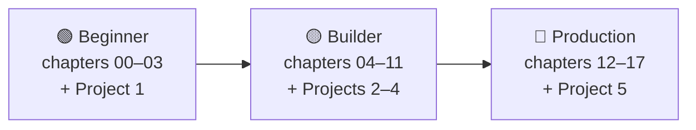

# 🗺 Roadmap: seekhne ke raaste

Notes padhne ke teen raaste hain. Har raasta pichhle wale ko include karta hai aur ek hands-on project par khatam hota hai. Samajh nahi aa raha kaun sa lo? [0.2 Learning paths](docs/00-start-here/00.2-learning-paths.md) padho, ya seedha 🟢 Beginner se shuru karo.

📑 **Is page par**

- [Overview](#-overview)
- [Beginner path](#-beginner-path)
- [Builder path](#-builder-path)
- [Production path](#-production-path)
- [Shortcuts](#-shortcuts)

## 🧭 Overview

*Time matlab padhne ka time plus project. Code snippets chalane aur badalne mein zyada time lagta hai, aur asli seekhna wahin hota hai.*

| Path | Tum yeh kar paoge… | Time |
| --- | --- | --- |
| 🟢 Beginner | Samjha paoge ki agent kya hai, aur tools wala agent zero se likh paoge | ~4 ghante |
| 🟡 Builder | Memory aur retrieval jodna, MCP use karna, patterns aur frameworks chunna, kai agents ko coordinate karna | ~10 ghante aur |
| 🔴 Production | Agent ko evaluate, secure, trace, deploy aur budget karna | ~7 ghante aur |

Socho jaise cricket mein pehle gully cricket, phir club matches, phir proper tournament. Har level pichhle wale ki practice par hi tikta hai.

## 🟢 Beginner path

**Goal:** agents ko samjho aur bina framework ke apna pehla agent banao.

| Step | Padho | Karo | Checkpoint: tum yeh kar sakte ho… |
| --- | --- | --- | --- |
| 1 | [00 · Start Here](docs/00-start-here/README.md) | Python aur ek SDK install karo, aur pehla snippet chalao | Apne code se model call karna |
| 2 | [01 · Foundations](docs/01-foundations/README.md) | [1.5](docs/01-foundations/01.5-anatomy-of-an-agent.md) wali `Agent` class mein paanch parts par label lagao | Chatbot vs workflow vs agent samjhana, aur agent ke paanch parts ke naam batana |
| 3 | [02 · The Agent Loop](docs/02-the-agent-loop/README.md) | Loop zero se likho | ReAct samjhana, aur yeh ki har loop ko limits kyun chahiye |
| 4 | [03 · Tools & Function Calling](docs/03-tools-and-function-calling/README.md) | Apna tool define aur validate karo | Do providers ke liye tool call ka poora round trip trace karna |
| 🏁 | [Project 1: Weather + calculator agent](docs/18-projects/18.1-project-1-weather-and-calculator-agent.md) | Milestone by milestone banao | Tests ke saath ek chalta hua tool-using agent ship karna |

## 🟡 Builder path

**Goal:** aise agents banao jo sach mein kaam aayein: jo yaad rakhein, tumhare documents search karein, plan karein, aur aazmaaye hue patterns use karein.

| Step | Padho | Checkpoint: tum yeh kar sakte ho… |
| --- | --- | --- |
| 5 | [04 · Model Context Protocol (MCP)](docs/04-model-context-protocol/README.md) | MCP server likhna aur uske tools agent se use karna |
| 6 | [05 · Memory](docs/05-memory/README.md) | Lambe runs ko context window ke andar rakhna aur sessions ke beech facts yaad rakhna |
| 7 | [06 · RAG for Agents](docs/06-rag-for-agents/README.md) | Apne documents par sawalon ke jawab dena, aur retrieval quality naapna |
| 8 | [07 · Planning & Reasoning](docs/07-planning-and-reasoning/README.md) | Multi-step tasks ke liye planning aur re-planning use karna |
| 9 | [08 · Reflection & Self-Correction](docs/08-reflection-and-self-correction/README.md) | Critique aur tests se output sudhaarna, aur jaanna ki kab isse fayda nahi hoga |
| 10 | [09 · Agent Design Patterns](docs/09-agent-design-patterns/README.md) | Kisi problem ke liye sabse simple pattern chunna |
| 11 | [10 · Multi-Agent Systems](docs/10-multi-agent-systems/README.md) | Decide karna ki kai agents madad karenge ya nuksaan |
| 12 | [11 · Frameworks](docs/11-frameworks/README.md) | Same agent ko framework mein dobara banana aur wajah ke saath ek framework chunna |
| 🏁 | Projects [2](docs/18-projects/18.2-project-2-research-assistant.md), [3](docs/18-projects/18.3-project-3-rag-over-your-pdfs.md) aur [4](docs/18-projects/18.4-project-4-multi-agent-content-team.md) | Research assistant, document Q&A agent aur multi-agent team ship karna |

**Agar time kam hai**, to pehle 05, 06 aur 09 padho, phir 11.

## 🔴 Production path

**Goal:** agent ko pure bharose ke saath asli users ke saamne rakho.

| Step | Padho | Checkpoint: tum yeh kar sakte ho… |
| --- | --- | --- |
| 13 | [12 · Evaluation](docs/12-evaluation/README.md) | Eval set banana aur CI mein regressions pakadna |
| 14 | [13 · Safety & Guardrails](docs/13-safety-and-guardrails/README.md) | Agent ka threat model banana aur prompt injection se bachaav karna |
| 15 | [14 · Observability & Debugging](docs/14-observability-and-debugging/README.md) | Run ko trace karna aur tarike se debug karna |
| 16 | [15 · Production & Deployment](docs/15-production-and-deployment/README.md) | Aisi agent service deploy karna jo retries, crashes aur rate limits jhel sake |
| 17 | [16 · Cost & Performance](docs/16-cost-and-performance/README.md) | Har task ki cost aur latency ka andaza lagana aur use kam karna |
| 18 | [17 · Case Studies](docs/17-case-studies/README.md) | Agent ko shuru se end tak design karna, uske failure modes samet |
| 🏁 | [Project 5: Production-ready support agent](docs/18-projects/18.5-project-5-production-support-agent.md) | Evals, guardrails aur tracing wala agent ship karna |

**Agar jaldi ship karna hai**, to 12 aur 13 agent likhne se pehle padho, baad mein nahi.

## ⚡ Shortcuts

- **Pehle framework use kar chuke ho?** 01 ko jaldi se dekh lo, phir [02](docs/02-the-agent-loop/README.md) dhyan se padho. Bina framework ke loop dekhne se gaps bhar jaate hain.
- **Sirf ek topic chahiye?** Har chapter README mein uske prerequisites likhe hain; seedha wahan jao.
- **Summary chahiye?** [Cheatsheet](CHEATSHEET.md) mein har pattern aur checklist ek page par hai.

---

⬅️ **Wapas jao:** [Home](README.md) · 🧾 [Cheatsheet](CHEATSHEET.md) · 📖 [Glossary](GLOSSARY.md)
