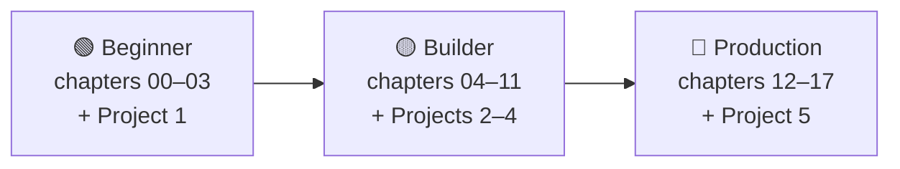

# 🗺 Roadmap: learning paths

Three paths through the notes. Each includes the one before it and ends with a hands-on project. Not sure which to take? Read [0.2 Learning paths](docs/00-start-here/00.2-learning-paths.md), or simply start with 🟢 Beginner.

📑 **On this page**

- [Overview](#-overview)
- [Beginner path](#-beginner-path)
- [Builder path](#-builder-path)
- [Production path](#-production-path)
- [Shortcuts](#-shortcuts)

## 🧭 Overview

*Times are reading time plus the project. Running and changing the examples takes longer, and is where most of the learning happens.*

| Path | You will be able to… | Time |
| --- | --- | --- |
| 🟢 Beginner | Explain what an agent is and write one with tools from scratch | ~4 hours |
| 🟡 Builder | Add memory and retrieval, use MCP, choose patterns and frameworks, coordinate several agents | ~10 more hours |
| 🔴 Production | Evaluate, secure, trace, deploy and budget an agent | ~7 more hours |

## 🟢 Beginner path

**Goal:** understand agents and build your first one without a framework.

| Step | Read | Do | Checkpoint: you can… |
| --- | --- | --- | --- |
| 1 | [00 · Start Here](docs/00-start-here/README.md) | Run `examples/00-check-setup` | Run every example offline |
| 2 | [01 · Foundations](docs/01-foundations/README.md) | Run the three chapter 01 examples | Explain chatbot vs workflow vs agent, and name the five parts of an agent |
| 3 | [02 · The Agent Loop](docs/02-the-agent-loop/README.md) | Write the loop from scratch | Explain ReAct and why every loop needs limits |
| 4 | [03 · Tools & Function Calling](docs/03-tools-and-function-calling/README.md) | Define and validate your own tool | Trace a tool call round trip for two providers |
| 🏁 | [Project 1: Weather + calculator agent](docs/18-projects/18.1-project-1-weather-and-calculator-agent.md) | Build it from the starter code | Ship a working tool-using agent with tests |

## 🟡 Builder path

**Goal:** build agents that are genuinely useful: they remember, search your documents, plan, and use proven patterns.

| Step | Read | Checkpoint: you can… |
| --- | --- | --- |
| 5 | [04 · Model Context Protocol](docs/04-model-context-protocol/README.md) | Write an MCP server and use its tools from an agent |
| 6 | [05 · Memory](docs/05-memory/README.md) | Keep long runs inside the context window and recall facts across sessions |
| 7 | [06 · RAG for Agents](docs/06-rag-for-agents/README.md) | Answer questions over your own documents, and measure retrieval quality |
| 8 | [07 · Planning & Reasoning](docs/07-planning-and-reasoning/README.md) | Use planning and re-planning for multi-step tasks |
| 9 | [08 · Reflection & Self-Correction](docs/08-reflection-and-self-correction/README.md) | Improve output with critique and tests, and know when it won't help |
| 10 | [09 · Agent Design Patterns](docs/09-agent-design-patterns/README.md) | Pick the simplest pattern for a problem |
| 11 | [10 · Multi-Agent Systems](docs/10-multi-agent-systems/README.md) | Decide whether several agents help or hurt |
| 12 | [11 · Frameworks](docs/11-frameworks/README.md) | Rebuild the same agent in a framework and choose one with reasons |
| 🏁 | Projects [2](docs/18-projects/18.2-project-2-research-assistant.md), [3](docs/18-projects/18.3-project-3-rag-over-your-pdfs.md) and [4](docs/18-projects/18.4-project-4-multi-agent-content-team.md) | Ship a research assistant, a document Q&A agent and a multi-agent team |

**If time is short**, prioritise 05, 06 and 09, then 11.

## 🔴 Production path

**Goal:** put an agent in front of real users with confidence.

| Step | Read | Checkpoint: you can… |
| --- | --- | --- |
| 13 | [12 · Evaluation](docs/12-evaluation/README.md) | Build an eval set and catch regressions in CI |
| 14 | [13 · Safety & Guardrails](docs/13-safety-and-guardrails/README.md) | Threat-model an agent and defend against prompt injection |
| 15 | [14 · Observability & Debugging](docs/14-observability-and-debugging/README.md) | Trace a run and debug it methodically |
| 16 | [15 · Production & Deployment](docs/15-production-and-deployment/README.md) | Deploy an agent service that survives retries, crashes and rate limits |
| 17 | [16 · Cost & Performance](docs/16-cost-and-performance/README.md) | Estimate and cut cost and latency per task |
| 18 | [17 · Case Studies](docs/17-case-studies/README.md) | Design an agent end to end, including its failure modes |
| 🏁 | [Project 5: Production-ready support agent](docs/18-projects/18.5-project-5-production-support-agent.md) | Ship an agent with evals, guardrails and tracing |

**If you will ship soon**, read 12 and 13 before you write the agent, not after.

## ⚡ Shortcuts

- **Already used a framework?** Skim 01, then read [02](docs/02-the-agent-loop/README.md) closely: seeing the loop without a framework fills in the gaps.
- **Only need one topic?** Every chapter README lists its prerequisites; jump straight in.
- **Want the summary?** The [Cheatsheet](CHEATSHEET.md) has every pattern and checklist on one page.

---

⬅️ **Back to:** [Home](README.md) · 🧾 [Cheatsheet](CHEATSHEET.md) · 📖 [Glossary](GLOSSARY.md)
