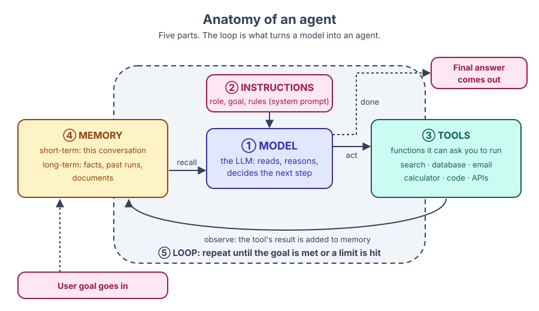

# 🎨 Diagram style guide

Haath se banaye SVG diagrams is folder mein rehte hain. Inhe sirf un overview graphics ke liye use karo jo Mermaid achhe se nahi bana sakta, jaise agent anatomy, memory hierarchy ya autonomy spectrum. Flows, sequences aur state machines ke liye page mein seedha Mermaid use karo.

## File ka naam

`NN-topic-name.svg`, jahan `NN` chapter number hai. Haath se likha SVG khud hi apna source hai. Agar tum Excalidraw jaise kisi tool mein draw karte ho, to editable file SVG ke bagal mein same naam se rakho: `NN-topic-name.excalidraw`.

Example: [`01-anatomy-of-an-agent.svg`](01-anatomy-of-an-agent.svg).

## Palette

Chhe colours, har jagah same matlab ke saath:

| Role | Fill | Stroke / text | Kis ke liye |
| --- | --- | --- | --- |
| Model | `#E0E7FF` | `#3730A3` | LLM, reasoning, "think" steps |
| Tools | `#CCFBF1` | `#115E59` | Tools, actions, external systems |
| Memory & data | `#FEF3C7` | `#92400E` | Memory, documents, vector stores |
| User & human | `#FCE7F3` | `#9D174D` | Users, human approval |
| Risk & errors | `#FEE2E2` | `#991B1B` | Failures, attacks, guardrails |
| Neutral | `#F1F5F9` | `#334155` | Containers, labels, baaki sab kuch |

Jaise traffic signal mein laal ka matlab hamesha "ruko" hota hai, waise hi yahan har colour ka matlab har diagram mein same rehta hai.

## Shapes aur text

- **Background:** har SVG mein content ke peeche fill `#FFFFFF` wala full-size rounded rectangle ho. Isse GitHub dark mode mein bhi woh padhne layak rehta hai. Transparent background par dark page pe dark text aa jaata.
- **Boxes:** rounded corners (`rx="10"`), 2 px stroke.
- **Arrows:** 2 px, stroke `#334155`. Har matlab wale arrow par label ho ("calls", "returns", "stores").
- **Font:** `font-family="Inter, 'Segoe UI', Helvetica, Arial, sans-serif"`. Titles 20 px bold, labels 14 px. 12 px se chhota koi text nahi.
- **Size:** 960 px chauda ya usse kam design karo; `viewBox` set karo taaki woh scale ho.
- **Preview:** SVG ko browser mein kholo, ya headless browser se PNG render karo, aur check karo ki koi line label ko cross na kare.

## Accessibility

- Har SVG ke andar `<title>` aur `<desc>` elements daalo.
- Alt text ke saath embed karo, aur neeche italic caption lagao:

```markdown


*The loop is what turns a model into an agent: it keeps calling the model until the goal is met.*
```

## Rights

Sirf original diagrams. Papers, blogs ya vendor docs ki images ko kabhi trace, copy ya hot-link mat karo. Agar kisi published figure se inspiration mili hai, to apna khud ka version banao aur page ke Further reading mein source cite karo.
