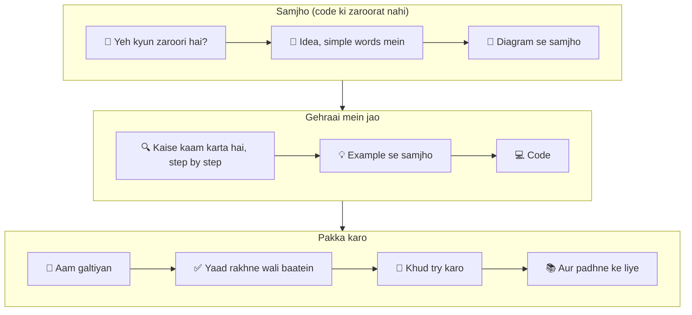

🏠 [Home](../../README.md) › [00 · Start Here](./README.md) › 0.1 In notes ko kaise use karein

# 0.1 In notes ko kaise use karein

> **Level:** 🟢 Beginner · **Padhne ka time:** ~5 min · **Pehle padho:** kuch nahi

**Ek line mein:** Har page ek hi shape follow karta hai, "yeh kyun zaroori hai?" se le kar "ab khud try karo" tak. Isliye tum padh sakte ho, skim kar sakte ho ya koi cheez dhoondh sakte ho, bina kho jaaye.

📑 **Is page par**

- [Yeh kyun zaroori hai?](#-yeh-kyun-zaroori-hai)
- [Idea, simple words mein](#-idea-simple-words-mein)
- [Diagram se samjho](#-diagram-se-samjho)
- [Kaise kaam karta hai, step by step](#-kaise-kaam-karta-hai-step-by-step)
- [Example se samjho](#-example-se-samjho)
- [Code](#-code)
- [Aam galtiyan aur dhyan dene wali baatein](#-aam-galtiyan-aur-dhyan-dene-wali-baatein)
- [Yaad rakhne wali baatein](#-yaad-rakhne-wali-baatein)
- [Khud try karo](#-khud-try-karo)
- [Aur padhne ke liye](#-aur-padhne-ke-liye)

## 🤔 Yeh kyun zaroori hai?

AI agents ke baare mein zyada tar material idhar-udhar bikhra hua hai. Kuch blog posts mein hai, kuch framework docs mein, kuch research papers mein. Har jagah ek hi idea ke liye alag words use hote hain. Aur har source maan ke chalta hai ki tumne baaki sab pehle hi padh liya hai.

Isliye aksar aisa hota hai: tutorial khatam, demo chal raha hai, lekin samajh nahi aaya ki banaya kya hai.

Yeh notes ulta tarika apnaate hain. Ek consistent path, terms ka ek hi set, aur har jagah same page layout. Jab tumhe pata ho ki page par kaunsi information kahan milti hai, tab tum jaldi seekhte ho. Aur baad mein wapas aa ke exactly woh cheez dhoondh lete ho jo chahiye.

## 🧠 Idea, simple words mein

Notes ko ek textbook samjho, jiske peeche ek index hai.

- **Textbook** hai `docs/` folder: 19 chapters, order mein padhne ke liye, har chapter pichle wale par build karta hai.
- **Index** hai [Glossary](../../GLOSSARY.md): har term simple words mein define kiya hua, aur us page se linked jo usse explain karta hai.

Har page mein same sections, same order mein hote hain. Pehle simple words, phir ek diagram, phir details, phir real code. Tum kisi bhi point par ruk sakte ho, aur tab bhi kuch kaam ka seekh ke jaoge.

Socho jaise exam ki taiyari mein tumhari ek favourite guide book hoti hai. Har chapter ka format same: summary, examples, phir questions. Kuch hi din mein tumhe pata chal jaata hai ki revision ke time seedha kahan jaana hai. Yeh notes bhi waise hi bane hain.

## 👀 Diagram se samjho



*Har page ke teen hisse hain. Pehli baar padh rahe ho toh "Diagram se samjho" ke baad ruk sakte ho. Jab build karne ke liye ready ho, tab code ke liye wapas aao.*

## 🔍 Kaise kaam karta hai, step by step

1. **Page ke top par.** Ek breadcrumb dikhata hai ki tum kahan ho (🏠 Home › Chapter › Page). Title ke neeche level, padhne ka time aur woh pages milenge jo tumhe pehle padhne chahiye.
2. **Ek line mein.** Poora page ek hi line mein. Agar woh line tumhe pehle se samajh aa rahi hai, toh aage badh jao.
3. **📑 Is page par.** Har section ke links, taaki tum seedha code ya exercises par jump kar sako.
4. **Body.** Hamesha isi order mein chalti hai: yeh kyun zaroori hai → simple words → diagram → step by step → example → code → aam galtiyan → yaad rakhne wali baatein → exercises → aur padhne ke liye.
5. **Page ke bottom par.** Pichle page, chapter home aur agle page ke links. Chapter ka last page agle chapter ke pehle page se link karta hai.

**Badges aur markers jo tumhe dikhenge:**

| Marker | Matlab |
| --- | --- |
| 🟢 Beginner | Agent ka koi experience nahi chahiye |
| 🟡 Intermediate | Maan ke chalta hai ki tumne pichle chapters padh liye hain |
| 🔴 Advanced | Production wali baatein; experienced engineers ke liye kaam ki |
| Linked term, jaise [agent](../../GLOSSARY.md#agent) | Uski definition [Glossary](../../GLOSSARY.md) mein hai. Kisi page par term pehli baar aata hai, tab link hota hai. |
| "In practice, we recommend…" | Hamari opinion, experience ke basis par. Baaki sab kuch source ke saath hai ya code mein dikhaya gaya hai. |
| `Thought → Action → Observation` block | Ek trace: step-by-step record ki agent ne actually kya kiya |

## 💡 Example se samjho

Maan lo tumhe ReAct samajhna hai, jo ek famous agent pattern hai. Lekin tumhare paas sirf das minute hain.

1. [Table of contents](../../README.md#-table-of-contents) kholo aur **2.2 ReAct explained** dhoondho.
2. **Ek line mein** wali line aur **🧠 simple words** section padho. (Lagbhag 2 minute.)
3. **👀 Diagram se samjho** ke neeche wala diagram dekho aur uska caption padho. (Lagbhag 1 minute.)
4. **💡 Example se samjho** wala trace skim karo, taaki ek real run dikh jaaye. (Lagbhag 3 minute.)
5. **✅ Yaad rakhne wali baatein** padho. (Lagbhag 1 minute.)

Ab tumhe ReAct itna samajh aa gaya hai ki tum uske baare mein baat kar sako. Baad mein jab ek banana ho, tab **🔍 step by step**, **💻 Code** aur **🧪 exercises** ke liye wapas aao.

## 💻 Code

Tum sab kuch GitHub par padh sakte ho. Apni machine par copy rakhni hai toh:

```bash
git clone https://github.com/asmustechno/agentic-ai-notes.git
cd agentic-ai-notes
```

Har page ke **💻 Code** section mein chhote, focused Python snippets hote hain. Unme sirf wahi idea hota hai jo woh page sikhata hai. Try karne ke liye unhe apni file mein copy karo. Python aur model SDKs kaise install karne hain, yeh [0.3 Setup](./00.3-setup.md) mein hai.

## 🚨 Aam galtiyan aur dhyan dene wali baatein

- **Simple words wala section skip karna, kyunki woh bahut easy lagta hai.** Analogies isliye chuni gayi hain taaki aage ke chapters jaldi samajh aayein. Unhe padho, chahe tum experienced ho.
- **Code ko bina chalaye copy karna.** Agents surprise karte hain. Snippets chalao, ek cheez badlo, aur dekho kya hota hai.
- **Pehli baar mein order se hat ke padhna.** Aage ke chapters pichle chapters par depend karte hain. Agar koi 🟡 page mushkil lage, toh uski **Pehle padho** line check karo.
- **Glossary links ko ignore karna.** Koi word naya lage toh us par click karo. Har term ki ek chhoti definition hai.

## ✅ Yaad rakhne wali baatein

- `docs/` folder textbook hai aur [Glossary](../../GLOSSARY.md) index hai.
- Har page mein same sections same order mein hain. Layout ek baar seekh lo, phir har jagah kaam aayega.
- Level badges aur "Pehle padho" line batate hain ki tum us page ke liye ready ho ya nahi.
- Opinions hamesha mark kiye gaye hain. Facts ka source diya gaya hai ya code mein dikhaye gaye hain.

## 🧪 Khud try karo

1. Search use kiye bina woh page dhoondho jo **prompt injection** explain karta hai. Woh kaunse chapter mein hai, aur uska level kya hai?
2. Koi bhi page kholo aur uski **📑 Is page par** list se seedha exercises par jump karo.

<details>
<summary>Answer dekho</summary>

1. [Table of contents](../../README.md#-table-of-contents) ya [Glossary entry](../../GLOSSARY.md#prompt-injection) use karo. Yeh chapter **13 · Safety & Guardrails** mein page **13.2** hai, 🔴 Advanced mark kiya hua.
2. List ka second-last link, **Khud try karo**, seedha exercises par le jaata hai.

</details>

## 📚 Aur padhne ke liye

- [Building effective agents](https://www.anthropic.com/engineering/building-effective-agents) (Anthropic). Un patterns ka chhota, practical overview jo yeh notes detail mein cover karte hain. Abhi padhne layak hai, aur chapter 09 ke baad dobara.
- [LLM Powered Autonomous Agents](https://lilianweng.github.io/posts/2023-06-23-agent/) (Lilian Weng). Agent ke components ka ek mashhoor survey: planning, memory aur tool use.

<!-- FOOTER -->

---

⬅️ **Pichla:** [Home](../../README.md) ·
🏠 [Chapter home](./README.md) ·
➡️ **Agla:** [0.2 Learning paths](./00.2-learning-paths.md)
