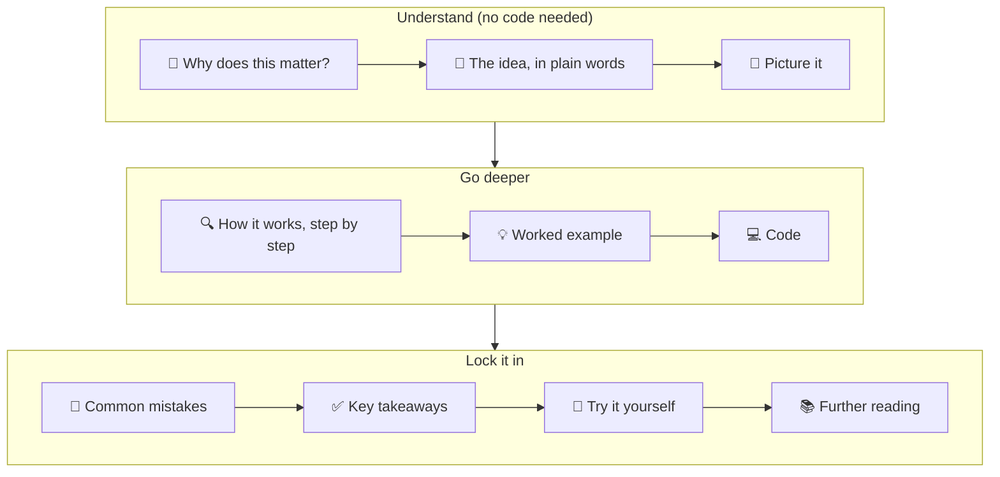

🏠 [Home](../../README.md) › [00 · Start Here](./README.md) › 0.1 How to use these notes

# 0.1 How to use these notes

> **Difficulty:** 🟢 Beginner · **Reading time:** ~5 min · **Prerequisites:** none

**In one sentence:** Every page follows the same shape, from "why should I care?" to "now try it yourself", so you can read, skim or look things up without getting lost.

📑 **On this page**

- [Why does this matter?](#-why-does-this-matter)
- [The idea, in plain words](#-the-idea-in-plain-words)
- [Picture it](#-picture-it)
- [How it works, step by step](#-how-it-works-step-by-step)
- [Worked example](#-worked-example)
- [Code](#-code)
- [Common mistakes & gotchas](#-common-mistakes--gotchas)
- [Key takeaways](#-key-takeaways)
- [Try it yourself](#-try-it-yourself)
- [Further reading](#-further-reading)

## 🤔 Why does this matter?

Most material about AI agents is scattered across blog posts, framework docs and research papers. Each one uses different words for the same idea, and each one assumes you have read the others. It is easy to finish a tutorial with a working demo and still not understand what you built.

These notes take the opposite approach: one consistent path, one set of terms, and the same page layout everywhere. If you know where each kind of information lives on a page, you can learn faster and come back later to find exactly what you need.

## 🧠 The idea, in plain words

Think of the notes as a textbook with a lab attached.

- The **textbook** is the `docs/` folder: 19 chapters, read in order, each building on the last.
- The **lab** is the `examples/` folder: small programs you can run, change and break.
- The **index** is the [Glossary](../../GLOSSARY.md): every term, defined in plain words, linked to the page that explains it.

Every page has the same sections in the same order. Plain words come first, then a picture, then the details, then real code. You can stop at any point and still have learned something useful.

## 👀 Picture it



*Each page has three parts. On a first read you can stop after "Picture it". Come back for the code when you are ready to build.*

## 🔍 How it works, step by step

1. **Top of the page.** A breadcrumb shows where you are (🏠 Home › Chapter › Page). Below the title you'll find the difficulty, the reading time and the pages you should read first.
2. **In one sentence.** The whole page squeezed into a single line. If you already understand that sentence, skip ahead.
3. **📑 On this page.** Links to each section, so you can jump straight to the code or the exercises.
4. **The body.** It always runs in the same order: why it matters → plain words → diagram → step by step → worked example → code → common mistakes → takeaways → exercises → further reading.
5. **Bottom of the page.** Links to the previous page, the chapter home, and the next page. The last page of a chapter links to the first page of the next chapter.

**Badges and markers you'll see:**

| Marker | Meaning |
| --- | --- |
| 🟢 Beginner | No agent experience needed |
| 🟡 Intermediate | Assumes you have read the earlier chapters |
| 🔴 Advanced | Production concerns; useful for experienced engineers |
| A linked term, like [agent](../../GLOSSARY.md#agent) | Its definition in the [Glossary](../../GLOSSARY.md). Terms are linked the first time they appear on a page. |
| "In practice, we recommend…" | Our opinion, based on experience. Everything else is sourced or demonstrated. |
| `Thought → Action → Observation` block | A trace: a step-by-step record of what an agent actually did |

## 💡 Worked example

Say you want to understand ReAct, a famous agent pattern, but you only have ten minutes.

1. Open the [table of contents](../../README.md#-table-of-contents) and find **2.2 ReAct explained**.
2. Read the **In one sentence** line and the **🧠 plain words** section. (About 2 minutes.)
3. Look at the diagram under **👀 Picture it** and read its caption. (About 1 minute.)
4. Skim the **💡 Worked example** trace to see a real run. (About 3 minutes.)
5. Read **✅ Key takeaways**. (About 1 minute.)

You now understand ReAct well enough to talk about it. Later, when you need to build one, come back for the **🔍 step by step**, **💻 Code** and **🧪 exercises**.

## 💻 Code

The notes and the code live in the same repository. To get both:

```bash
git clone https://github.com/YOUR-GITHUB-USERNAME/agentic-ai-notes.git
cd agentic-ai-notes
```

Each page's **💻 Code** section shows a short, focused snippet and links to the full, runnable version in `examples/`. For instance, the setup check used in [0.3 Setup](./00.3-setup.md) lives in [`examples/00-check-setup/main.py`](../../examples/00-check-setup/main.py).

Examples are numbered to match their chapter, so the code for chapter 02 lives in `examples/02-…`.

## 🚨 Common mistakes & gotchas

- **Skipping the plain-words section because it looks too easy.** The analogies are chosen to make later chapters click. Read them, even if you are experienced.
- **Copying code without running it.** Agents surprise you. Run every example and change one thing to see what happens.
- **Reading out of order on a first pass.** Later chapters assume earlier ones. If a 🟡 page feels hard, check its **Prerequisites** line.
- **Ignoring the glossary links.** If a word is unfamiliar, click it. Every term has a short definition.

## ✅ Key takeaways

- The `docs/` folder is the textbook, `examples/` is the lab and the [Glossary](../../GLOSSARY.md) is the index.
- Every page has the same sections in the same order. Learn the layout once and use it everywhere.
- Difficulty badges and prerequisites tell you whether you are ready for a page.
- Opinions are always marked. Facts are sourced or shown in code.

## 🧪 Try it yourself

1. Find the page that explains **prompt injection**, without using search. What chapter is it in, and what is its difficulty?
2. Open any page and use its **📑 On this page** list to jump straight to the exercises.

<details>
<summary>Show answer</summary>

1. Use the [table of contents](../../README.md#-table-of-contents) or the [Glossary entry](../../GLOSSARY.md#prompt-injection). It is page **13.2** in chapter **13 · Safety & Guardrails**, marked 🔴 Advanced.
2. The last-but-one link in the list, **Try it yourself**, jumps to the exercises.

</details>

## 📚 Further reading

- [Building effective agents](https://www.anthropic.com/engineering/building-effective-agents) (Anthropic). A short, practical overview of the patterns these notes cover in depth. Worth reading now and again after chapter 09.
- [LLM Powered Autonomous Agents](https://lilianweng.github.io/posts/2023-06-23-agent/) (Lilian Weng). A well-known survey of agent components: planning, memory and tool use.

<!-- FOOTER -->

---

⬅️ **Previous:** [Home](../../README.md) ·
🏠 [Chapter home](./README.md) ·
➡️ **Next:** [0.2 Learning paths](./00.2-learning-paths.md)
