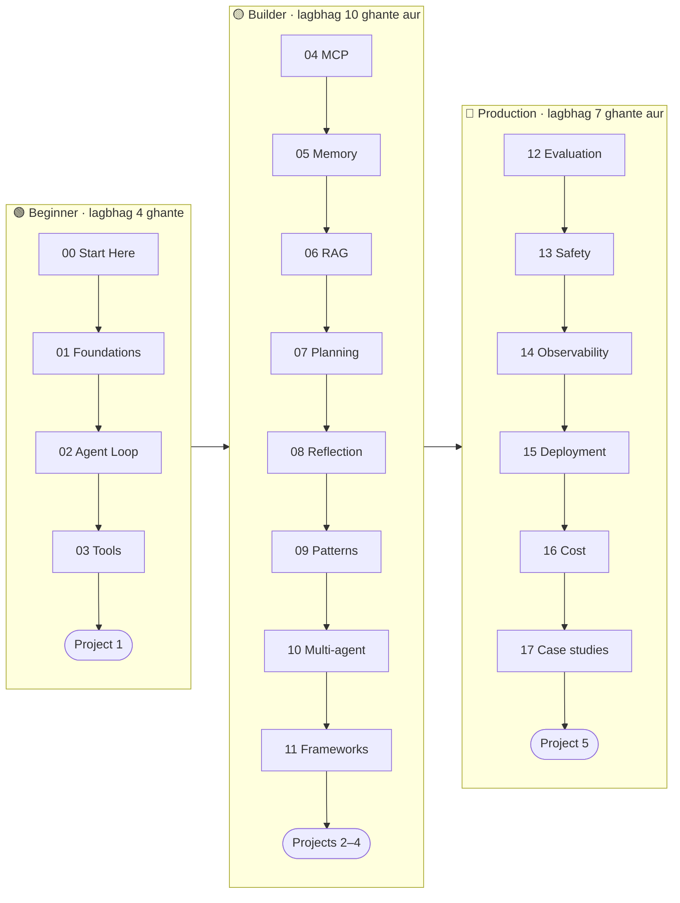

🏠 [Home](../../README.md) › [00 · Start Here](./README.md) › 0.2 Learning paths

# 0.2 Learning paths

> **Level:** 🟢 Beginner · **Padhne ka time:** ~5 min · **Pehle padho:** [0.1 In notes ko kaise use karein](./00.1-how-to-use-these-notes.md)

**Ek line mein:** Teen paths mein se ek chuno (Beginner, Builder ya Production), is basis par ki tum kya kar paana chahte ho, aur uske chapters order mein padho.

📑 **Is page par**

- [Yeh kyun zaroori hai?](#-yeh-kyun-zaroori-hai)
- [Idea, simple words mein](#-idea-simple-words-mein)
- [Diagram se samjho](#-diagram-se-samjho)
- [Kaise kaam karta hai, step by step](#-kaise-kaam-karta-hai-step-by-step)
- [Example se samjho](#-example-se-samjho)
- [Code](#-code)
- [Aam galtiyan aur dhyan dene wali baatein](#-aam-galtiyan-aur-dhyan-dene-wali-baatein)
- [Yaad rakhne wali baatein](#-yaad-rakhne-wali-baatein)
- [Khud try karo](#-khud-try-karo)
- [Aur padhne ke liye](#-aur-padhne-ke-liye)

## 🤔 Yeh kyun zaroori hai?

Yahan 100 se zyada pages hain. Pehle din kisi ko bhi sab nahi chahiye.

Ek product manager jo bas agents samajhna chahta hai, usse alag pages chahiye. Ek engineer jise agle mahine customers ke saamne agent rakhna hai, usse alag.

Ek clear path tumhe do galtiyon se bachata hai. Bahut kam padhna (aur kuch kamzor bana dena). Ya bahut zyada padhna (aur kabhi kuch banana hi nahi).

## 🧠 Idea, simple words mein

Paths ek language course ke levels jaise hain. Har level mein usse pehle wala sab kuch shaamil hai.

- 🟢 **Beginner:** *"Mujhe samajhna hai ki agent kya hota hai, aur ek simple agent banana hai."*
- 🟡 **Builder:** *"Mujhe kaam ke agents banane hain, jinme memory ho, document search ho, aur proven design patterns hon."*
- 🔴 **Production:** *"Mujhe ek aisa agent ship karna hai jo tested, safe, observable aur affordable ho."*

Har path ek hands-on project par khatam hota hai. Matlab tum sirf padh ke nahi, kuch bana ke nikaloge.

Socho jaise driving seekhna. Pehle khaali ground mein gaadi chalana (Beginner). Phir shehar ki sadkon par (Builder). Phir highway par, jahan galti mehngi padti hai (Production). Har stage pichle wale ke upar hi banta hai.

## 👀 Diagram se samjho



*Har path pichle wale par build karta hai. Time ka matlab hai andaazan padhne ka time plus projects. Code snippets chalane aur badalne mein zyada time lagega, aur woh time sahi jagah lag raha hai.*

## 🔍 Kaise kaam karta hai, step by step

1. **Apna path chuno**, neeche wali table dekh ke. Pakka nahi pata toh 🟢 Beginner se shuru karo. Aage hamesha badh sakte ho.
2. **Chapters order mein padho.** Chapter ke andar bhi pages order mein padho; har page apni "Pehle padho" list deta hai.
3. **Padhte-padhte snippets chalao.** Har page ke 💻 Code section mein chhote snippets hain jinhe tum copy kar ke badal sakte ho.
4. **Apne path ke end mein project poora karo.** Projects mein ek spec, milestones, reference code aur stretch goals hote hain.
5. **Agle level par jao** jab ready ho.

| Path | Tum yeh kar paoge… | Chapters | Project | Time |
| --- | --- | --- | --- | --- |
| 🟢 [Beginner](../../ROADMAP.md) | Samjha paoge ki agent kya hai, aur scratch se tools wala agent likh paoge | 00–03 | [Project 1](../18-projects/18.1-project-1-weather-and-calculator-agent.md) | ~4 h |
| 🟡 [Builder](../../ROADMAP.md) | Memory aur retrieval jodna, MCP use karna, patterns aur frameworks chunna | 04–11 | Projects [2](../18-projects/18.2-project-2-research-assistant.md), [3](../18-projects/18.3-project-3-rag-over-your-pdfs.md), [4](../18-projects/18.4-project-4-multi-agent-content-team.md) | ~10 h aur |
| 🔴 [Production](../../ROADMAP.md) | Agent ko evaluate, secure, trace, deploy karna aur uska budget banana | 12–17 | [Project 5](../18-projects/18.5-project-5-production-support-agent.md) | ~7 h aur |

**Experienced readers ke liye shortcuts:**

- Pehle hi kisi framework se agent bana chuke ho? Chapter 01 skim karo, phir [chapter 02](../02-the-agent-loop/README.md) dhyan se padho. Bina framework ke loop dekhne se gaps bhar jaate hain.
- Sirf ek topic mein interest hai, jaise evaluation ya safety? Har chapter README apni prerequisites batata hai, toh tum seedha wahan jump kar sakte ho.

## 💡 Example se samjho

**Amira** ek backend developer hai. Uski team ko ek support assistant chahiye jo orders dhoondh sake aur help-centre articles se sawalon ke jawab de sake. Isse chhe hafte mein launch karna hai.

- **Hafta 1–2:** 🟢 Beginner path (chapters 00–03) aur Project 1. Ab use loop aur tool calling samajh aa gaye hain.
- **Hafta 3–4:** 🟡 Builder path mein se woh in par focus karti hai: [06 RAG](../06-rag-for-agents/README.md) (help-centre articles ke liye), [09 Patterns](../09-agent-design-patterns/README.md) (sawalon ki routing ke liye) aur [11 Frameworks](../11-frameworks/README.md). Multi-agent systems abhi skip karti hai: ek agent kaafi hai.
- **Hafta 5–6:** 🔴 Production path mein se woh [12 Evaluation](../12-evaluation/README.md), [13 Safety](../13-safety-and-guardrails/README.md) aur [17.2 Customer support agent](../17-case-studies/17.2-customer-support-agent.md) padhti hai, phir Project 5 karti hai.

Usne sab kuch nahi padha. Lekin sahi cheezein, sahi order mein padhi.

## 💻 Code

Har chapter README mein uske pages ki ek table hai, padhne ke time ke saath. Yeh snippet repository root se chalao. Yeh Beginner path ka total time jod deta hai:

```python
import re
from pathlib import Path

total = 0
for readme in sorted(Path("docs").glob("0[0-3]-*/README.md")):  # chapters 00–03
    text = readme.read_text(encoding="utf-8")
    title = text.split("\n# ", 1)[1].split("\n", 1)[0]           # jaise "00 · Start Here"
    minutes = sum(int(m) for m in re.findall(r"\| ~(\d+) min \|", text))
    total += minutes
    print(f"{title:<31} {minutes:>3} min")
print(f"{'Total':<31} {total:>3} min")
```

Output:

```text
00 · Start Here                  20 min
01 · Foundations                 52 min
02 · The Agent Loop              51 min
03 · Tools & Function Calling    68 min
Total                           191 min
```

## 🚨 Aam galtiyan aur dhyan dene wali baatein

- **Seedha frameworks par kood jaana.** Frameworks loop ko chhupa dete hain. Kuch toota toh tumhe pata hona chahiye ki neeche kya chal raha hai. Pehle chapters 02 aur 03 karo.
- **Multi-agent systems se shuru karna.** Yeh exciting hain, lekin banana, debug karna aur unka kharcha uthana zyada mushkil hai. Zyada tar problems ek achhe se design kiye gaye agent se solve ho jaati hain. [10.6](../10-multi-agent-systems/10.6-when-multi-agent-makes-things-worse.md) dekho.
- **Evaluation ko "baad mein" ke liye chhod dena.** Evals ke bina tum bata hi nahi sakte ki kisi change se agent behtar hua ya bura. Agar ship karna hai, toh [chapter 12](../12-evaluation/README.md) jaldi padho.
- **Sirf padhna, banana nahi.** Har path ek project par khatam hota hai, aur uski wajah hai.

## ✅ Yaad rakhne wali baatein

- Teen paths: 🟢 Beginner (samjho aur banao), 🟡 Builder (kaam ka banao), 🔴 Production (reliable banao).
- Har path mein pichla path shaamil hai, aur har path ek project par khatam hota hai.
- Pakka nahi pata toh Beginner se shuru karo. Experienced readers ko bhi chapter 02 padhna chahiye.
- Tum seedha kisi topic par jump kar sakte ho; har page apni prerequisites batata hai.

## 🧪 Khud try karo

1. Ek agent likho jo tum banana chahte ho. Uske liye kaunsa path chahiye?
2. Ek aise agent ke liye jo code likhta aur test karta hai, tum kaunse chapters pehle padhoge? (Hint: [case studies](../17-case-studies/README.md) dekho.)

<details>
<summary>Answer dekho</summary>

1. Agar use sirf kuch tools ke saath sawalon ke jawab dene hain, toh shuru karne ke liye 🟢 Beginner kaafi hai. Agar use tumhare apne documents ya memory chahiye, toh 🟡 Builder lo. Agar real users ya real paisa involved hai, toh 🔴 Production ka plan banao.
2. Ek achha order: 02 (loop), 03 (tools, khaas kar [3.6 Code execution ek tool ki tarah](../03-tools-and-function-calling/03.6-code-execution-as-a-tool.md)), 08 ([tests ke saath self-critique](../08-reflection-and-self-correction/08.3-self-critique-with-tests.md)), 13 (sandboxing), 12 (evaluation), phir [17.1 Coding agent](../17-case-studies/17.1-coding-agent.md).

</details>

## 📚 Aur padhne ke liye

- [ROADMAP.md](../../ROADMAP.md): milestones aur checkpoints ke saath saare paths.
- [Building effective agents](https://www.anthropic.com/engineering/building-effective-agents) (Anthropic). Samjhata hai ki sabse simple system jo kaam kare, usse shuru kyun karna chahiye. Yahi principle in paths ke peeche bhi hai.

<!-- FOOTER -->

---

⬅️ **Pichla:** [0.1 In notes ko kaise use karein](./00.1-how-to-use-these-notes.md) ·
🏠 [Chapter home](./README.md) ·
➡️ **Agla:** [0.3 Setup](./00.3-setup.md)
