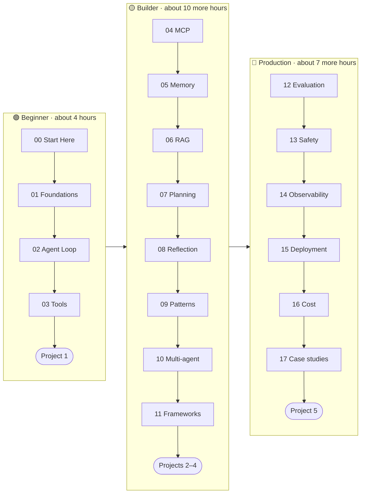

🏠 [Home](../../README.md) › [00 · Start Here](./README.md) › 0.2 Learning paths

# 0.2 Learning paths

> **Difficulty:** 🟢 Beginner · **Reading time:** ~5 min · **Prerequisites:** [0.1 How to use these notes](./00.1-how-to-use-these-notes.md)

**In one sentence:** Pick one of three paths (Beginner, Builder or Production) based on what you want to be able to do, and follow its chapters in order.

📑 **On this page**

- [Why does this matter?](#-why-does-this-matter)
- [The idea, in plain words](#-the-idea-in-plain-words)
- [Picture it](#-picture-it)
- [How it works, step by step](#-how-it-works-step-by-step)
- [Worked example](#-worked-example)
- [Code](#-code)
- [Common mistakes & gotchas](#-common-mistakes--gotchas)
- [Key takeaways](#-key-takeaways)
- [Try it yourself](#-try-it-yourself)
- [Further reading](#-further-reading)

## 🤔 Why does this matter?

There are more than 100 pages here. Nobody needs all of them on day one. A product manager who wants to understand agents needs different pages from an engineer who must put one in front of customers next month. A clear path stops you from reading too little (and building something fragile) or too much (and never building anything).

## 🧠 The idea, in plain words

The paths are like levels in a language course. Each level includes everything before it.

- 🟢 **Beginner:** *"I want to understand what an agent is and build a simple one."*
- 🟡 **Builder:** *"I want to build useful agents with memory, document search and proven design patterns."*
- 🔴 **Production:** *"I need to ship an agent that is tested, safe, observable and affordable."*

Each path ends with a hands-on project, so you finish by building something, not just reading.

## 👀 Picture it



*Each path builds on the one before. Times are estimated reading time plus the projects; running and changing the examples will take longer, and that is time well spent.*

## 🔍 How it works, step by step

1. **Choose your path** using the table below. If you are unsure, start with 🟢 Beginner. You can always continue.
2. **Read the chapters in order.** Within a chapter, read the pages in order too; each one lists its prerequisites.
3. **Run the examples as you go.** Each chapter README lists its examples.
4. **Finish with the project** at the end of your path. Projects have a spec, starter code, a solution and stretch goals.
5. **Move up a level** when you are ready.

| Path | You will be able to… | Chapters | Project | Time |
| --- | --- | --- | --- | --- |
| 🟢 [Beginner](../../ROADMAP.md) | Explain what an agent is, and write one with tools from scratch | 00–03 | [Project 1](../18-projects/18.1-project-1-weather-and-calculator-agent.md) | ~4 h |
| 🟡 [Builder](../../ROADMAP.md) | Add memory and retrieval, use MCP, choose patterns and frameworks | 04–11 | Projects [2](../18-projects/18.2-project-2-research-assistant.md), [3](../18-projects/18.3-project-3-rag-over-your-pdfs.md), [4](../18-projects/18.4-project-4-multi-agent-content-team.md) | ~10 h more |
| 🔴 [Production](../../ROADMAP.md) | Evaluate, secure, trace, deploy and budget an agent | 12–17 | [Project 5](../18-projects/18.5-project-5-production-support-agent.md) | ~7 h more |

**Shortcuts for experienced readers:**

- Already built an agent with a framework? Skim chapter 01, then read [chapter 02](../02-the-agent-loop/README.md) closely. Seeing the loop without a framework fills in gaps.
- Only care about one topic, such as evaluation or safety? Each chapter README lists its prerequisites, so you can jump in.

## 💡 Worked example

**Amira** is a backend developer. Her team wants a support assistant that can look up orders and answer questions from the help-centre articles. It has to launch in six weeks.

- **Weeks 1–2:** the 🟢 Beginner path (chapters 00–03) and Project 1. She now understands the loop and tool calling.
- **Weeks 3–4:** from the 🟡 Builder path, she prioritises [06 RAG](../06-rag-for-agents/README.md) (help-centre articles), [09 Patterns](../09-agent-design-patterns/README.md) (routing questions) and [11 Frameworks](../11-frameworks/README.md). She skips multi-agent systems for now: one agent is enough.
- **Weeks 5–6:** from the 🔴 Production path, she reads [12 Evaluation](../12-evaluation/README.md), [13 Safety](../13-safety-and-guardrails/README.md) and [17.2 Customer support agent](../17-case-studies/17.2-customer-support-agent.md), then works through Project 5.

She did not read everything, but she read the right things in the right order.

## 💻 Code

The order of every chapter and page lives in one file, [`curriculum.yml`](../../curriculum.yml). This snippet, run from the repository root, prints the Beginner path with its reading times:

```python
import yaml  # pip install pyyaml

chapters = yaml.safe_load(open("curriculum.yml", encoding="utf-8"))["chapters"]
total = 0
for ch in chapters[:4]:  # chapters 00–03
    minutes = sum(p["min"] for p in ch["pages"])
    total += minutes
    print(f"{ch['id']} {ch['title']:<28} {minutes:>3} min")
print(f"{'Total':<31} {total:>3} min")
```

Output:

```text
00 Start Here                    20 min
01 Foundations                   52 min
02 The Agent Loop                51 min
03 Tools & Function Calling      68 min
Total                           191 min
```

## 🚨 Common mistakes & gotchas

- **Jumping straight to frameworks.** Frameworks hide the loop. If something breaks, you need to know what is underneath. Do chapters 02 and 03 first.
- **Starting with multi-agent systems.** They are exciting, but they are harder to build, debug and pay for. Most problems are solved by one well-designed agent. See [10.6](../10-multi-agent-systems/10.6-when-multi-agent-makes-things-worse.md).
- **Skipping evaluation "until later".** Without evals you cannot tell whether a change made your agent better or worse. If you will ship, read [chapter 12](../12-evaluation/README.md) early.
- **Reading without building.** Each path ends in a project for a reason.

## ✅ Key takeaways

- Three paths: 🟢 Beginner (understand and build), 🟡 Builder (make it useful), 🔴 Production (make it reliable).
- Each path includes the previous one and ends with a project.
- If unsure, start with Beginner. Experienced readers should still read chapter 02.
- You can jump to a topic; every page lists its prerequisites.

## 🧪 Try it yourself

1. Write down one agent you would like to build. Which path does it need?
2. Which chapters would you prioritise for an agent that writes and tests code? (Hint: look at the [case studies](../17-case-studies/README.md).)

<details>
<summary>Show answer</summary>

1. If it only needs to answer questions with a few tools, 🟢 Beginner is enough to start. If it needs your own documents or memory, take 🟡 Builder. If real users or real money are involved, plan for 🔴 Production.
2. A strong order: 02 (loop), 03 (tools, especially [3.6 code execution](../03-tools-and-function-calling/03.6-code-execution-as-a-tool.md)), 08 ([self-critique with tests](../08-reflection-and-self-correction/08.3-self-critique-with-tests.md)), 13 (sandboxing), 12 (evaluation), then [17.1 Coding agent](../17-case-studies/17.1-coding-agent.md).

</details>

## 📚 Further reading

- [ROADMAP.md](../../ROADMAP.md): the paths with milestones and checkpoints.
- [Building effective agents](https://www.anthropic.com/engineering/building-effective-agents) (Anthropic). Explains why to start with the simplest system that works, the same principle behind these paths.

<!-- FOOTER -->

---

⬅️ **Previous:** [0.1 How to use these notes](./00.1-how-to-use-these-notes.md) ·
🏠 [Chapter home](./README.md) ·
➡️ **Next:** [0.3 Setup](./00.3-setup.md)
