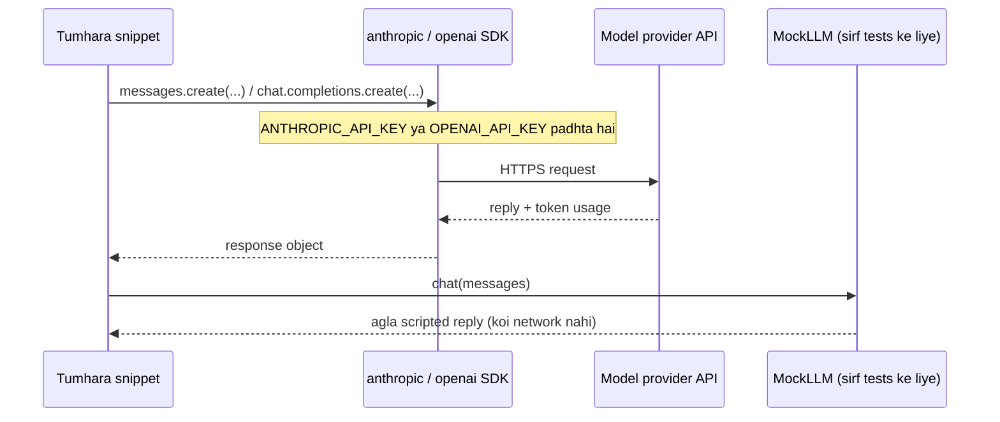

🏠 [Home](../../README.md) › [00 · Start Here](./README.md) › 0.3 Setup

# 0.3 Setup

> **Level:** 🟢 Beginner · **Padhne ka time:** ~10 min · **Pehle padho:** Python 3.11 ya usse naya installed ho ([download](https://www.python.org/downloads/))

**Ek line mein:** Python aur ek model SDK install karo, apni API key ek environment variable mein daalo, aur bas, tum in notes ka har code snippet chala sakte ho.

📑 **Is page par**

- [Yeh kyun zaroori hai?](#-yeh-kyun-zaroori-hai)
- [Idea, simple words mein](#-idea-simple-words-mein)
- [Diagram se samjho](#-diagram-se-samjho)
- [Kaise kaam karta hai, step by step](#-kaise-kaam-karta-hai-step-by-step)
- [Example se samjho](#-example-se-samjho)
- [Code](#-code)
- [Aam galtiyan aur dhyan dene wali baatein](#-aam-galtiyan-aur-dhyan-dene-wali-baatein)
- [Yaad rakhne wali baatein](#-yaad-rakhne-wali-baatein)
- [Khud try karo](#-khud-try-karo)
- [Aur padhne ke liye](#-aur-padhne-ke-liye)

## 🤔 Yeh kyun zaroori hai?

Tum in notes ka har page bina kuch chalaye bhi padh sakte ho. Lekin agent ko ek baar kaam karte dekh lo, toh woh kahin zyada aasani se samajh aata hai. Snippet mein ek chhota sa change, ek aur paragraph se zyada sikhata hai.

Abhi das minute ka setup karoge, toh har **💻 Code** section aisi cheez ban jaayega jo tum khud try kar sakte ho.

## 🧠 Idea, simple words mein

In notes ke snippets plain Python hain. Zyada tar snippets provider ke official SDK ke through model se baat karte hain: Claude ke liye `anthropic` package, aur OpenAI models ke liye `openai` package. SDK ek chhoti library hai jo tumhare Python function call ko provider ke API par ek HTTPS request mein badal deti hai.

API use karne ke liye tumhe ek **key** chahiye. Yeh ek secret string hai jo tumhe aur tumhare bill ko identify karti hai. SDKs key ko environment variable se padhte hain, isliye use kabhi tumhare code mein likhne ki zaroorat nahi padti.

Kuch snippets, zyada tar testing aur evaluation wale chapters mein, real model ki jagah ek [MockLLM](../../GLOSSARY.md#mockllm) use karte hain. Ise script se padhne wala actor samjho. Ek real [large language model](../../GLOSSARY.md#large-language-model-llm) har reply improvise karta hai. Mock wahi lines bolta hai jo use di gayi hain, usi order mein. Isse tests fast, free aur repeatable ban jaate hain. Neeche **💻 Code** section mein tum khud ek likhoge; sirf das lines ka hai.

Socho jaise cricket ki net practice mein bowling machine. Real bowler har ball alag daalta hai. Machine wahi ball daalti hai jo tumne set ki hai. Practice ke liye machine perfect hai, kyunki har baar same cheez test hoti hai.

## 👀 Diagram se samjho



*Real snippets SDK ke through provider tak jaate hain. Test snippets ek mock use karte hain jo kabhi tumhari machine se bahar nahi jaata.*

## 🔍 Kaise kaam karta hai, step by step

**1. Apna Python version check karo.** Tumhe 3.11 ya usse naya chahiye.

```bash
python --version        # kuch systems par: python3 --version
```

**2. Ek virtual environment banao.** Virtual environment in packages ko tumhare baaki system se alag rakhta hai ([Python docs](https://docs.python.org/3/library/venv.html)).

```bash
mkdir agent-playground && cd agent-playground
python -m venv .venv
source .venv/bin/activate          # Windows PowerShell mein: .venv\Scripts\Activate.ps1
```

**3. SDKs install karo.** Tumhe sirf usi provider ka SDK chahiye jo tum use karte ho. Notes inhi versions ke saath check kiye gaye the:

```bash
pip install anthropic==2.8.0 openai==3.49.0
```

**4. Ek API key lo** aur usi console mein ek monthly spend limit set karo.

| Provider | Environment variable | Key kahan milegi |
| --- | --- | --- |
| Anthropic (Claude) | `ANTHROPIC_API_KEY` | [Claude Platform](https://platform.claude.com/) |
| OpenAI | `OPENAI_API_KEY` | [OpenAI Platform](https://platform.openai.com/) |

**5. Key ko environment mein daalo**, current terminal ke liye:

```bash
export ANTHROPIC_API_KEY="sk-ant-..."          # Windows PowerShell mein: $env:ANTHROPIC_API_KEY = "sk-ant-..."
```

**6. Pehla snippet chalao**, neeche wale **💻 Code** section se. Agar woh ek reply aur do token counts print kare, toh tum ready ho.

In notes ke snippets Claude ke liye `claude-opus-5-5` use karte hain. OpenAI ke liye woh `YOUR_OPENAI_MODEL` likhte hain: [OpenAI models page](https://developers.openai.com/api/docs/models) se ek current model ID chuno aur wahan daal do.

## 💡 Example se samjho

Yeh raha Windows PowerShell par pehla run, khaali folder se le kar reply tak:

```text
PS> python --version
Python 3.11.9
PS> python -m venv .venv
PS> .venv\Scripts\Activate.ps1
(.venv) PS> pip install anthropic==2.8.0
...
Successfully installed anthropic-2.8.0 ...
(.venv) PS> $env:ANTHROPIC_API_KEY = "sk-ant-..."
(.venv) PS> python hello.py
Reply:  Hello there, nice to meet you!
Tokens: 16 in, 11 out
```

Do cheezein dhyan se dekho. Pehli: reply improvise hota hai, isliye tumhara reply alag words mein hoga aur [token](../../GLOSSARY.md#token) counts bhi thode alag honge. Dusri: key sirf isi terminal mein hai. Naya terminal khologe toh dobara set karni padegi (ya ek `.env` file use karo, neeche galtiyon wala section dekho).

## 💻 Code

**Claude ko pehli call** (`hello.py`):

```python
import anthropic

client = anthropic.Anthropic()  # environment se ANTHROPIC_API_KEY padhta hai
response = client.messages.create(
    model="claude-opus-5-5",
    max_tokens=200,
    messages=[{"role": "user", "content": "Say hello in one short sentence."}],
)

text = "".join(block.text for block in response.content if block.type == "text")
print("Reply: ", text)
print("Tokens:", response.usage.input_tokens, "in,", response.usage.output_tokens, "out")
```

**Yahi call OpenAI ko:**

```python
from openai import OpenAI

client = OpenAI()  # environment se OPENAI_API_KEY padhta hai
response = client.chat.completions.create(
    model="YOUR_OPENAI_MODEL",
    messages=[{"role": "user", "content": "Say hello in one short sentence."}],
)

print("Reply: ", response.choices[0].message.content)
print("Tokens:", response.usage.prompt_tokens, "in,", response.usage.completion_tokens, "out")
```

Dono APIs mein chhote-chhote farak hain. Claude content blocks ki list return karta hai aur use `max_tokens` chahiye. OpenAI `choices` ki list return karta hai. Token fields ke naam bhi alag hain. Chapter 03 tool calls ke liye yeh farak phir se dikhata hai.

**Tests ke liye ek MockLLM.** Yeh scripted replies order mein return karta hai aur har request record karta hai. Isse test exactly check kar sakta hai ki tumhare code ne kya bheja:

```python
class MockLLM:
    """Ek nakli model: scripted replies order mein return karta hai aur har call record karta hai."""

    def __init__(self, replies: list[str]):
        self.replies = list(replies)
        self.calls: list[list[dict]] = []

    def chat(self, messages: list[dict]) -> str:
        self.calls.append(messages)
        if not self.replies:
            raise RuntimeError("MockLLM ran out of scripted replies")
        return self.replies.pop(0)


llm = MockLLM(["Hi there!"])
assert llm.chat([{"role": "user", "content": "Say hello."}]) == "Hi there!"
assert llm.calls[0][0]["content"] == "Say hello."
```

## 🚨 Aam galtiyan aur dhyan dene wali baatein

- **`ModuleNotFoundError: No module named 'anthropic'`.** Virtual environment active nahi hai. Step 2 wali `activate` command dobara chalao, usi terminal mein.
- **`AuthenticationError` ya "could not resolve authentication method".** Key *is* terminal mein set nahi hai. Dobara set karo, ya use ek `.env` file mein rakho aur [python-dotenv](https://github.com/theskumar/python-dotenv) se load karo (`from dotenv import load_dotenv; load_dotenv()`).
- **Keys ko code mein paste karna.** Code commit hota hai, share hota hai, uske screenshots bante hain. Keys environment variables mein rakho, ya ek `.env` file mein jo `.gitignore` mein listed ho. Agar key leak ho jaaye, toh turant provider ke console mein use revoke karo.
- **Achanak bada bill.** Real model calls mein paisa lagta hai, aur agent loops bahut saari calls karte hain. Experiment karne se pehle monthly spend limit set karo. Chapter 16 mein [cost maths](../16-cost-and-performance/16.1-token-cost-maths.md) hai.
- **Windows PowerShell `Activate.ps1` ko block karta hai.** Ek baar `Set-ExecutionPolicy -Scope CurrentUser RemoteSigned` chalao, ya Command Prompt se `.venv\Scripts\activate.bat` use karo.

## ✅ Yaad rakhne wali baatein

- Tumhe chahiye Python 3.11+, ek virtual environment, aur apne provider ka SDK (`anthropic` ya `openai`).
- SDKs environment se `ANTHROPIC_API_KEY` ya `OPENAI_API_KEY` padhte hain. Keys kabhi code mein nahi jaati.
- Real model par agent loops chalane se pehle spend limit set karo.
- MockLLM real model ka scripted substitute hai. Jo tests ise use karte hain, woh fast aur free hote hain, aur har baar same result dete hain.

## 🧪 Khud try karo

1. Claude wale snippet mein `max_tokens` ko `5` karo aur dobara chalao. Reply ka kya hota hai, aur `response.stop_reason` kya hai?
2. Upar wale `MockLLM` ko `MockLLM(["one", "two"])` ke saath teen baar call karo. Teesri call par kya hota hai, aur tests mein yeh kaam ka kyun hai?

<details>
<summary>Answer dekho</summary>

1. Reply beech sentence mein kat jaata hai aur `stop_reason` hota hai `"max_tokens"`. Agent ko yeh check karna hi chahiye: kata hua reply bhi poora jawab jaisa dikh sakta hai.
2. Teesri call `RuntimeError` raise karti hai. Test mein isse pata chalta hai ki code ne expected se zyada model calls ki, jaise ek agent loop jo kabhi rukta hi nahi.

</details>

## 📚 Aur padhne ke liye

- [venv: creation of virtual environments](https://docs.python.org/3/library/venv.html) (Python docs)
- [Anthropic Python SDK](https://github.com/anthropics/anthropic-sdk-python) aur [OpenAI Python SDK](https://github.com/openai/openai-python)
- [python-dotenv](https://github.com/theskumar/python-dotenv): `.env` file se keys load karne ke liye

<!-- FOOTER -->

---

⬅️ **Pichla:** [0.2 Learning paths](./00.2-learning-paths.md) ·
🏠 [Chapter home](./README.md) ·
➡️ **Agla:** [01 · Foundations → 1.1 AI agent kya hai?](../01-foundations/01.1-what-is-an-ai-agent.md)
