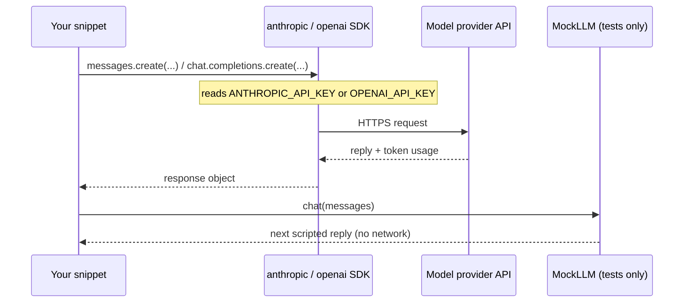

🏠 [Home](../../README.md) › [00 · Start Here](./README.md) › 0.3 Setup

# 0.3 Setup

> **Difficulty:** 🟢 Beginner · **Reading time:** ~10 min · **Prerequisites:** Python 3.11 or newer installed ([download](https://www.python.org/downloads/))

**In one sentence:** Install Python and one model SDK, put your API key in an environment variable, and you can run every code snippet in these notes.

📑 **On this page**

- [Why does this matter?](#-why-does-this-matter)
- [The idea, in plain words](#-the-idea-in-plain-words)
- [Picture it](#-picture-it)
- [How it works, step by step](#-how-it-works-step-by-step)
- [Worked example](#-worked-example)
- [Code](#-code)
- [Common mistakes & gotchas](#-common-mistakes--gotchas)
- [Key takeaways](#-key-takeaways)
- [Try it yourself](#-try-it-yourself)
- [Further reading](#-further-reading)

## 🤔 Why does this matter?

You can read every page of these notes without running anything. But agents are easier to understand once you have watched one work, and a small change to a snippet teaches more than another paragraph. Ten minutes of setup now means every **💻 Code** section becomes something you can try.

## 🧠 The idea, in plain words

The snippets in these notes are plain Python. Most of them talk to a model through the provider's official SDK: the `anthropic` package for Claude, or the `openai` package for OpenAI models. An SDK is a small library that turns a Python function call into an HTTPS request to the provider's API.

To use an API you need a **key**: a secret string that identifies you and your bill. The SDKs read the key from an environment variable, so it never has to appear in your code.

Some snippets, mostly in the testing and evaluation chapters, use a [MockLLM](../../GLOSSARY.md#mockllm) instead of a real model. Think of it as an actor reading from a script: a real [large language model](../../GLOSSARY.md#large-language-model-llm) improvises each reply, while the mock says exactly the lines it was given, in order. That makes tests fast, free and repeatable. You will write one yourself in the **💻 Code** section below; it is ten lines.

## 👀 Picture it



*Real snippets go through the SDK to the provider. Test snippets swap in a mock that never leaves your machine.*

## 🔍 How it works, step by step

**1. Check your Python version.** You need 3.11 or newer.

```bash
python --version        # on some systems: python3 --version
```

**2. Create a virtual environment.** A virtual environment keeps these packages separate from the rest of your system ([Python docs](https://docs.python.org/3/library/venv.html)).

```bash
mkdir agent-playground && cd agent-playground
python -m venv .venv
source .venv/bin/activate          # Windows PowerShell: .venv\Scripts\Activate.ps1
```

**3. Install the SDKs.** You only need the one for the provider you use. These are the versions the notes were checked against:

```bash
pip install anthropic==2.8.0 openai==3.49.0
```

**4. Get an API key** and set a monthly spend limit in the same console.

| Provider | Environment variable | Get a key |
| --- | --- | --- |
| Anthropic (Claude) | `ANTHROPIC_API_KEY` | [Claude Platform](https://platform.claude.com/) |
| OpenAI | `OPENAI_API_KEY` | [OpenAI Platform](https://platform.openai.com/) |

**5. Put the key in your environment** for the current terminal:

```bash
export ANTHROPIC_API_KEY="sk-ant-..."          # Windows PowerShell: $env:ANTHROPIC_API_KEY = "sk-ant-..."
```

**6. Run the first snippet** from the **💻 Code** section below. If it prints a reply and two token counts, you are ready.

Snippets in these notes use `claude-opus-5-5` for Claude. For OpenAI they write `YOUR_OPENAI_MODEL`: pick a current model ID from the [OpenAI models page](https://developers.openai.com/api/docs/models) and put it there.

## 💡 Worked example

Here is a first run on Windows PowerShell, from an empty folder to a reply:

```text
PS> python --version
Python 3.11.9
PS> python -m venv .venv
PS> .venv\Scripts\Activate.ps1
(.venv) PS> pip install anthropic==2.8.0
...
Successfully installed anthropic-2.8.0 ...
(.venv) PS> $env:ANTHROPIC_API_KEY = "sk-ant-..."
(.venv) PS> python hello.py
Reply:  Hello there, nice to meet you!
Tokens: 16 in, 11 out
```

Notice two things. The reply is improvised, so yours will be worded differently and the [token](../../GLOSSARY.md#token) counts will differ a little. And the key only lives in this terminal: open a new one and you must set it again (or use a `.env` file, see the gotchas below).

## 💻 Code

**A first call to Claude** (`hello.py`):

```python
import anthropic

client = anthropic.Anthropic()  # reads ANTHROPIC_API_KEY from the environment
response = client.messages.create(
    model="claude-opus-5-5",
    max_tokens=200,
    messages=[{"role": "user", "content": "Say hello in one short sentence."}],
)

text = "".join(block.text for block in response.content if block.type == "text")
print("Reply: ", text)
print("Tokens:", response.usage.input_tokens, "in,", response.usage.output_tokens, "out")
```

**The same call to OpenAI:**

```python
from openai import OpenAI

client = OpenAI()  # reads OPENAI_API_KEY from the environment
response = client.chat.completions.create(
    model="YOUR_OPENAI_MODEL",
    messages=[{"role": "user", "content": "Say hello in one short sentence."}],
)

print("Reply: ", response.choices[0].message.content)
print("Tokens:", response.usage.prompt_tokens, "in,", response.usage.completion_tokens, "out")
```

The two APIs differ in small ways: Claude returns a list of content blocks and needs `max_tokens`; OpenAI returns a list of `choices`; the token fields have different names. Chapter 03 shows these differences again for tool calls.

**A MockLLM for tests.** It returns scripted replies in order and records every request, so a test can check exactly what your code sent:

```python
class MockLLM:
    """A fake model: returns scripted replies in order and records every call."""

    def __init__(self, replies: list[str]):
        self.replies = list(replies)
        self.calls: list[list[dict]] = []

    def chat(self, messages: list[dict]) -> str:
        self.calls.append(messages)
        if not self.replies:
            raise RuntimeError("MockLLM ran out of scripted replies")
        return self.replies.pop(0)


llm = MockLLM(["Hi there!"])
assert llm.chat([{"role": "user", "content": "Say hello."}]) == "Hi there!"
assert llm.calls[0][0]["content"] == "Say hello."
```

## 🚨 Common mistakes & gotchas

- **`ModuleNotFoundError: No module named 'anthropic'`.** The virtual environment is not active. Run the `activate` command from step 2 again, in the same terminal.
- **`AuthenticationError` or "could not resolve authentication method".** The key is not set in *this* terminal. Set it again, or keep it in a `.env` file and load it with [python-dotenv](https://github.com/theskumar/python-dotenv) (`from dotenv import load_dotenv; load_dotenv()`).
- **Pasting keys into code.** Code gets committed, shared and screenshotted. Keep keys in environment variables or a `.env` file that is listed in `.gitignore`. If a key leaks, revoke it in your provider's console straight away.
- **Surprise bills.** Real model calls cost money, and agent loops make many calls. Set a monthly spend limit before you experiment. Chapter 16 covers [cost maths](../16-cost-and-performance/16.1-token-cost-maths.md).
- **Windows PowerShell blocks `Activate.ps1`.** Run `Set-ExecutionPolicy -Scope CurrentUser RemoteSigned` once, or use `.venv\Scripts\activate.bat` from Command Prompt.

## ✅ Key takeaways

- You need Python 3.11+, a virtual environment and the SDK for your provider (`anthropic` or `openai`).
- The SDKs read `ANTHROPIC_API_KEY` or `OPENAI_API_KEY` from the environment. Keys never go in code.
- Set a spend limit before you run agent loops on a real model.
- A MockLLM is a scripted stand-in for a real model: tests that use one are fast, free and give the same result every time.

## 🧪 Try it yourself

1. Change `max_tokens` in the Claude snippet to `5` and run it again. What happens to the reply, and what is `response.stop_reason`?
2. Call the `MockLLM` above three times with `MockLLM(["one", "two"])`. What happens on the third call, and why is that useful in tests?

<details>
<summary>Show answer</summary>

1. The reply is cut off mid-sentence and `stop_reason` is `"max_tokens"`. An agent must check this: a truncated reply can look like a finished answer.
2. The third call raises `RuntimeError`. In a test, that tells you the code made more model calls than you expected, for example an agent loop that never stops.

</details>

## 📚 Further reading

- [venv: creation of virtual environments](https://docs.python.org/3/library/venv.html) (Python docs)
- [Anthropic Python SDK](https://github.com/anthropics/anthropic-sdk-python) and [OpenAI Python SDK](https://github.com/openai/openai-python)
- [python-dotenv](https://github.com/theskumar/python-dotenv): loading keys from a `.env` file

<!-- FOOTER -->

---

⬅️ **Previous:** [0.2 Learning paths](./00.2-learning-paths.md) ·
🏠 [Chapter home](./README.md) ·
➡️ **Next:** [01 · Foundations → 1.1 What is an AI agent?](../01-foundations/01.1-what-is-an-ai-agent.md)
