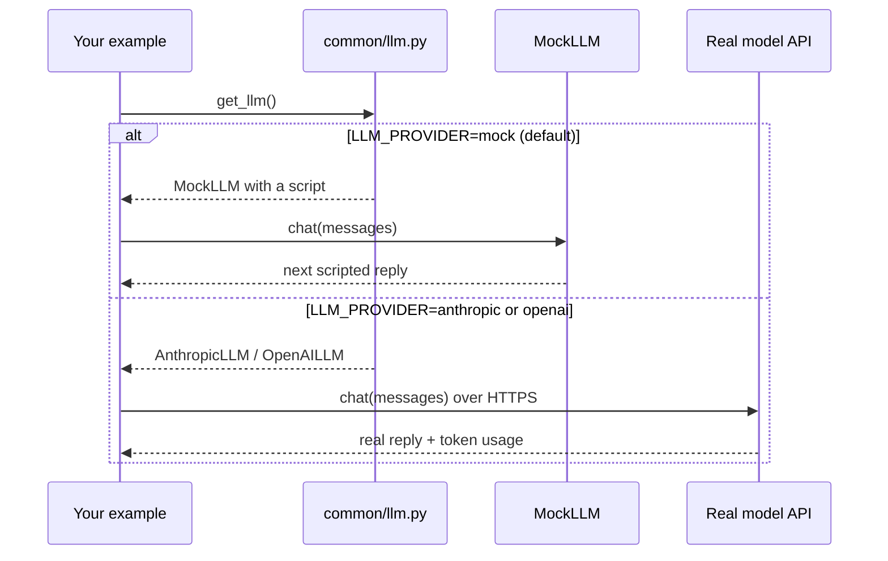

🏠 [Home](../../README.md) › [00 · Start Here](./README.md) › 0.3 Setup

# 0.3 Setup

> **Difficulty:** 🟢 Beginner · **Reading time:** ~10 min · **Prerequisites:** Python 3.11 or newer installed ([download](https://www.python.org/downloads/))

**In one sentence:** Install the examples once, run them offline for free with `MockLLM`, and switch to a real model by changing one line in a `.env` file.

📑 **On this page**

- [Why does this matter?](#-why-does-this-matter)
- [The idea, in plain words](#-the-idea-in-plain-words)
- [Picture it](#-picture-it)
- [How it works, step by step](#-how-it-works-step-by-step)
- [Worked example](#-worked-example)
- [Code](#-code)
- [Common mistakes & gotchas](#-common-mistakes--gotchas)
- [Key takeaways](#-key-takeaways)
- [Try it yourself](#-try-it-yourself)
- [Further reading](#-further-reading)

## 🤔 Why does this matter?

Many agent tutorials start with "paste your API key here". That creates three problems. You must pay before you can learn. Every run gives a different answer, so it is hard to follow along. And tests that call a real model are slow, flaky and cost money every time they run.

These notes avoid all three. Every example runs **offline, for free, with the same output every time**, using a fake model called [MockLLM](../../GLOSSARY.md#mockllm). When you want to see a real model, you change one setting.

## 🧠 The idea, in plain words

Think of `MockLLM` as an actor reading from a script. A real [large language model](../../GLOSSARY.md#large-language-model-llm) improvises each reply. The mock says exactly the lines it was given, in order. That makes it perfect for learning and testing: you know what the "model" will say, so you can focus on what *your code* does with it.

All examples talk to models through one small file, `examples/common/llm.py`. It offers the same interface whether the model behind it is the mock, Anthropic's Claude or an OpenAI model. You pick which one with an environment variable called `LLM_PROVIDER`.

## 👀 Picture it



*Your example code is the same in both branches. Only the setting changes what answers.*

## 🔍 How it works, step by step

**1. Check your Python version.** You need 3.11 or newer.

```bash
python --version        # on some systems: python3 --version
```

**2. Get the code and create a virtual environment.** A virtual environment keeps these packages separate from the rest of your system ([Python docs](https://docs.python.org/3/library/venv.html)).

```bash
git clone https://github.com/YOUR-GITHUB-USERNAME/agentic-ai-notes.git
cd agentic-ai-notes/examples
python -m venv .venv
source .venv/bin/activate          # Windows PowerShell: .venv\Scripts\Activate.ps1
pip install -r requirements.txt
```

**3. Run the setup check.** No key needed.

```bash
python 00-check-setup/main.py
```

**4. Run the tests.** They all use `MockLLM`, so they take well under a second.

```bash
pytest
```

**5. (Optional) Use a real model.** Copy the settings template and fill it in.

```bash
cp .env.example .env               # Windows: copy .env.example .env
```

| To use | Set in `.env` | Get a key |
| --- | --- | --- |
| MockLLM (default) | `LLM_PROVIDER=mock` | No key needed |
| Anthropic (Claude) | `LLM_PROVIDER=anthropic` and `ANTHROPIC_API_KEY=...` | [Claude Platform](https://platform.claude.com/) |
| OpenAI | `LLM_PROVIDER=openai`, `OPENAI_API_KEY=...` and `OPENAI_MODEL=...` | [OpenAI Platform](https://platform.openai.com/) |

With Anthropic the model defaults to `claude-opus-5-5`; change it with `ANTHROPIC_MODEL`. With OpenAI you must choose the model yourself: pick a current model ID from the [OpenAI models page](https://platform.openai.com/docs/models).

**6. Run the setup check again** to confirm the real model answers.

## 💡 Worked example

Here is a first run with the defaults, then the same check with Claude:

```text
$ python 00-check-setup/main.py
Python:   3.11.9
Provider: mock
Model:    mock-model
Reply:    Hello! Your setup works (offline, with MockLLM).
Tokens:   8 in, 12 out

✅ Ready. Next: read docs/01-foundations or run the tests with `pytest`.

$ # edit .env: LLM_PROVIDER=anthropic and ANTHROPIC_API_KEY=sk-ant-...
$ python 00-check-setup/main.py
Python:   3.11.9
Provider: anthropic
Model:    claude-opus-5-5
Reply:    Hello there, nice to meet you!
Tokens:   16 in, 11 out
```

Notice three things. The code did not change. The reply is now improvised, so your reply and token counts will differ from these. And the [token](../../GLOSSARY.md#token) counts are now exact: the mock only estimates them (about four characters per token), while real providers count them with their own tokenizers.

## 💻 Code

This is how every example gets its model. The script passed to `get_llm` is only used when `LLM_PROVIDER=mock`:

```python
from common import get_llm, user

llm = get_llm(mock_responses=["Hello! Your setup works (offline, with MockLLM)."])
reply = llm.chat([user("Say hello in one short sentence.")], max_tokens=200)

print(reply.text)                # the model's answer
print(reply.usage.input_tokens)  # tokens sent
print(reply.usage.output_tokens) # tokens received
```

And this is how tests use `MockLLM` directly. The mock records every request, so a test can check exactly what the code sent:

```python
from common import MockLLM, user

llm = MockLLM(["Hi there!"])
llm.chat([user("Say hello.")])

assert llm.calls[0]["messages"][0]["content"] == "Say hello."
```

Full version: [`examples/00-check-setup/main.py`](../../examples/00-check-setup/main.py). The wrapper itself is [`examples/common/llm.py`](../../examples/common/llm.py), under 400 lines with comments, and reading it is a good way to see what each provider's API looks like.

## 🚨 Common mistakes & gotchas

- **`ModuleNotFoundError: No module named 'anthropic'`.** The virtual environment is not active. Run the `activate` command from step 2 again, in the same terminal.
- **`ModuleNotFoundError: No module named 'common'`.** Run examples from inside the `examples/` folder, or use the exact commands shown in each example's README.
- **Committing your `.env` file.** It holds secret keys. It is listed in `.gitignore`, so git ignores it, but never paste keys into code, issues or screenshots. If a key leaks, revoke it in your provider's console straight away.
- **Setting a key but forgetting `LLM_PROVIDER`.** The default is `mock`, so without it you will keep seeing scripted replies.
- **Surprise bills.** Real model calls cost money. Set a monthly spend limit in your provider's console before you experiment. Chapter 16 covers [cost maths](../16-cost-and-performance/16.1-token-cost-maths.md).
- **Windows PowerShell blocks `Activate.ps1`.** Run `Set-ExecutionPolicy -Scope CurrentUser RemoteSigned` once, or use `.venv\Scripts\activate.bat` from Command Prompt.

## ✅ Key takeaways

- You need Python 3.11+, a virtual environment and `pip install -r requirements.txt`.
- Every example runs offline with `MockLLM`, a scripted stand-in for a real model.
- `LLM_PROVIDER` in `.env` switches between `mock`, `anthropic` and `openai`. Your code stays the same.
- Keys live only in `.env`, which git ignores.
- Tests always use `MockLLM`: they are fast, free and give the same result every time.

## 🧪 Try it yourself

1. Change the mock reply in `examples/00-check-setup/main.py` and run it again. What changes in the token counts?
2. In a Python shell inside `examples/`, create `MockLLM(["one", "two"])` and call `chat` three times. What happens on the third call, and why is that useful in tests?

<details>
<summary>Show answer</summary>

1. The reply text changes, and so does the `out` token count, because the mock estimates tokens from text length (about four characters per token).
2. The third call raises `MockLLMExhausted`. In a test, that tells you the code made more model calls than you expected, for example an agent loop that never stops. You can pass `default="..."` to return a fixed reply instead.

</details>

## 📚 Further reading

- [venv: creation of virtual environments](https://docs.python.org/3/library/venv.html) (Python docs)
- [python-dotenv](https://github.com/theskumar/python-dotenv): how `.env` files are loaded
- [pytest documentation](https://docs.pytest.org/)
- [examples/README.md](../../examples/README.md): how the shared code works and how to add an example

<!-- FOOTER -->

---

⬅️ **Previous:** [0.2 Learning paths](./00.2-learning-paths.md) ·
🏠 [Chapter home](./README.md) ·
➡️ **Next:** [01 · Foundations → 1.1 What is an AI agent?](../01-foundations/01.1-what-is-an-ai-agent.md)
