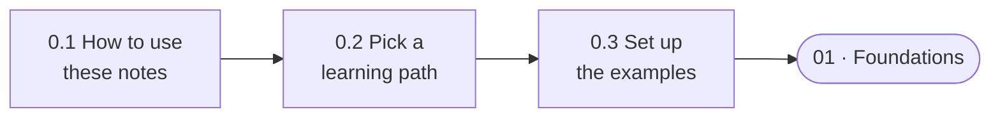

🏠 [Home](../../README.md) › 00 · Start Here

# 00 · Start Here

> **Estimated reading time:** ~20 min · **Difficulty:** 🟢 Beginner · **Prerequisites:** none

Welcome. This short chapter shows you how the notes are built, helps you pick a route through them, and gets the code examples running on your machine, with or without an API key.

## 🎯 What you'll learn

- How every page is laid out, so you always know where to look
- Which of the three learning paths fits your goal
- How to install the examples and run them offline with `MockLLM`
- How to switch to a real model (Anthropic or OpenAI) when you are ready

## 📋 Prerequisites

- Basic Python: functions, lists, dictionaries, `pip install`
- Some experience chatting with ChatGPT, Claude or a similar assistant

That's all. No machine learning background is needed.

## 👀 Chapter overview

*Three short pages, then you're ready for the real content in chapter 01.*

## 📄 Pages in this chapter

<!-- PAGES:START -->
| # | Page | Level | Time |
| --- | --- | --- | --- |
| 0.1 | [How to use these notes](./00.1-how-to-use-these-notes.md) — How the notes are organised, what every page contains, and how to read them. | 🟢 Beginner | ~5 min |
| 0.2 | [Learning paths](./00.2-learning-paths.md) — Three routes through the material: Beginner, Builder and Production. | 🟢 Beginner | ~5 min |
| 0.3 | [Setup](./00.3-setup.md) — Install Python, add API keys, and run every example offline with MockLLM. | 🟢 Beginner | ~10 min |
<!-- PAGES:END -->

## 💻 Examples for this chapter

| Example | What it does |
| --- | --- |
| [`examples/00-check-setup`](../../examples/00-check-setup/README.md) | Confirms Python, packages and your model provider all work |

<!-- FOOTER -->

---

⬅️ **Previous chapter:** [Home](../../README.md) ·
▶️ **Start reading:** [0.1 How to use these notes](./00.1-how-to-use-these-notes.md) ·
➡️ **Next chapter:** [01 · Foundations](../01-foundations/README.md)
