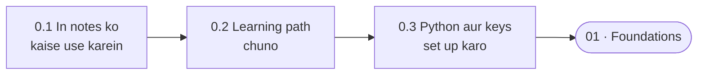

🏠 [Home](../../README.md) › 00 · Start Here

# 00 · Start Here

> **Padhne ka time:** ~20 min · **Level:** 🟢 Beginner · **Pehle padho:** kuch nahi

Welcome! Yeh chhota sa chapter dikhata hai ki notes kaise bane hain. Yeh tumhe unme se apna raasta chunne mein help karta hai. Aur Python ready karwata hai, taaki tum code snippets apni machine par chala sako.

## 🎯 Is chapter mein kya seekhoge

- Har page ka layout kaisa hai, taaki tumhe hamesha pata ho ki kahan dekhna hai
- Teen learning paths mein se kaunsa tumhare goal ke liye sahi hai
- Python aur woh model SDKs kaise install karne hain jo code snippets use karte hain
- API key (Anthropic ya OpenAI) kaise leni hai aur use safe kaise rakhna hai

## 📋 Pehle se kya aana chahiye

- Basic Python: functions, lists, dictionaries, `pip install`
- ChatGPT, Claude ya kisi aise assistant se chat karne ka thoda experience

Bas itna hi. Machine learning ka koi background nahi chahiye.

## 👀 Chapter ek nazar mein

*Teen chhote pages, phir tum chapter 01 ke asli content ke liye ready ho.*

## 📄 Is chapter ke pages

<!-- PAGES:START -->
| # | Page | Level | Time |
| --- | --- | --- | --- |
| 0.1 | [In notes ko kaise use karein](./00.1-how-to-use-these-notes.md) — Notes kaise organise kiye gaye hain, har page mein kya hota hai, aur unhe kaise padhna hai. | 🟢 Beginner | ~5 min |
| 0.2 | [Learning paths](./00.2-learning-paths.md) — Material mein se teen raaste: Beginner, Builder aur Production. | 🟢 Beginner | ~5 min |
| 0.3 | [Setup](./00.3-setup.md) — Python aur model SDKs install karo, API key jodo, aur apna pehla snippet chalao. | 🟢 Beginner | ~10 min |
<!-- PAGES:END -->

<!-- FOOTER -->

---

⬅️ **Pichla chapter:** [Home](../../README.md) ·
▶️ **Padhna shuru karo:** [0.1 In notes ko kaise use karein](./00.1-how-to-use-these-notes.md) ·
➡️ **Agla chapter:** [01 · Foundations](../01-foundations/README.md)
