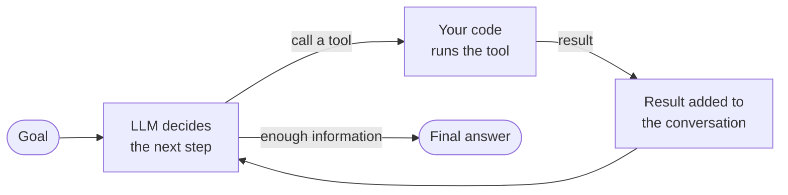

🏠 [Home](../../README.md) › [01 · Foundations](./README.md) › 1.1 What is an AI agent?

# 1.1 What is an AI agent?

> **Difficulty:** 🟢 Beginner · **Reading time:** ~8 min · **Prerequisites:** [0.3 Setup](../00-start-here/00.3-setup.md)

**In one sentence:** An AI agent is a program in which a language model repeatedly decides which action to take, sees the result, and keeps going until the goal is reached.

📑 **On this page**

- [Why does this matter?](#-why-does-this-matter)
- [The idea, in plain words](#-the-idea-in-plain-words)
- [Picture it](#-picture-it)
- [How it works, step by step](#-how-it-works-step-by-step)
- [Worked example](#-worked-example)
- [Code](#-code)
- [Common mistakes & gotchas](#-common-mistakes--gotchas)
- [Key takeaways](#-key-takeaways)
- [Try it yourself](#-try-it-yourself)
- [Further reading](#-further-reading)

## 🤔 Why does this matter?

Ask a chat assistant *"Where is my order 1234? Will it arrive before Friday?"* and it will politely say it cannot see your order. It can only write text. It has no way to look anything up.

Now imagine the same assistant could open the order system, read the tracking number, check the courier, and *then* answer. Nothing about the model changed. What changed is that it was allowed to **act**, see what happened, and decide what to do next. That is the jump from a chatbot to an agent.

"Agent" is one of the most overused words in AI. Vendors call almost anything an agent. A clear definition helps you judge claims, choose the right design, and explain your system to others.

## 🧠 The idea, in plain words

Think of a new intern on their first day. You give them:

- a **goal** ("find out if order 1234 will arrive before Friday"),
- a **toolbox** (access to the order system and the courier website),
- a **checklist** of rules ("never promise a date the courier hasn't confirmed").

A good intern doesn't do everything at once. They look something up, read the result, decide what to check next, and repeat until they can answer. Nobody tells them each step in advance.

An [AI agent](../../GLOSSARY.md#agent) works the same way. A [large language model (LLM)](../../GLOSSARY.md#large-language-model-llm) plays the intern. Your code gives it [tools](../../GLOSSARY.md#tool) and instructions, then runs a loop: the model picks an action, your code carries it out, the result goes back to the model, and the model picks the next action. When the model decides it has enough, it answers.

Many people now sum this up in one line: **an agent runs tools in a loop to achieve a goal.** That phrasing is from [Simon Willison](https://simonwillison.net/2025/Sep/18/agents/); Anthropic draws a similar line, describing agents as systems where the model directs its own process and tool use, in contrast to [workflows](./01.2-chatbot-vs-workflow-vs-agent.md) where code fixes the steps in advance.

## 👀 Picture it



*The defining feature is the arrow back to "LLM decides". The model sees the result of its own action and chooses what to do next. Remove that arrow and you no longer have an agent.*

## 🔍 How it works, step by step

1. **A goal arrives**, usually as a user message.
2. **The model reads everything it has**: its instructions, the goal, the descriptions of the tools it may use, and the conversation so far.
3. **The model decides.** It either asks for a tool to be run (with specific inputs) or writes a final answer.
4. **Your code acts.** If a tool was requested, your code runs it. The model never runs anything itself; it only *asks*.
5. **The result is fed back** into the conversation as an observation.
6. **Repeat** from step 2 until the model gives a final answer or a limit is hit (maximum steps, time or cost).

This cycle is called the [agent loop](../../GLOSSARY.md#agent-loop). Chapter 02 builds it from scratch.

**Three tests for "is this an agent?"** In practice, we use these:

| Question | Agent? |
| --- | --- |
| Does the model choose *which* action to take? | Needed |
| Does it see the *result* and choose again? | Needed |
| Does the model decide *when to stop*? | Needed |
| Does it have long-term memory, a persona or a fancy UI? | Not needed |

## 💡 Worked example

Here is a real trace from the example in [`examples/01-chatbot-workflow-agent`](../../examples/01-chatbot-workflow-agent/README.md). The agent has two tools: `get_order` and `get_tracking`.

```text
User:        Where is my order 1234? Will it arrive before Friday?

Step 1
  Model:     (calls tool) get_order(order_id="1234")
  Result:    {"item": "Desk lamp", "status": "shipped", "carrier": "FastShip", "tracking_id": "FS-998"}

Step 2
  Model:     (calls tool) get_tracking(tracking_id="FS-998")
  Result:    {"location": "Regional depot", "estimated_delivery": "Thursday"}

Step 3
  Model:     Your desk lamp (order 1234) is at the FastShip regional depot and is due on
             Thursday, so it should arrive before Friday.
```

Notice what nobody programmed: *"after looking up the order, check the tracking."* The model worked that out from the first result, because the order contained a tracking id and the goal asked about delivery. That is the model controlling the path.

## 💻 Code

The whole agent loop fits in about a dozen lines. This is the `agent()` function from the example, using the shared wrapper so it runs with `MockLLM`, Anthropic or OpenAI:

```python
from common import tool_result, user

def agent(llm, question, max_steps=5):
    messages = [user(question)]
    for _ in range(max_steps):                      # the loop, with a safety limit
        reply = llm.chat(messages, system=AGENT_SYSTEM, tools=TOOL_SPECS)
        messages.append(reply.to_message())
        if not reply.tool_calls:                    # no tool requested: the model is done
            return reply.text
        for call in reply.tool_calls:               # the model asked for actions
            result = TOOLS[call.name](**call.arguments)   # your code runs them
            messages.append(tool_result(call.id, result)) # the model will see the result
    return "Sorry, I could not finish in time."
```

Run it: `python 01-chatbot-workflow-agent/main.py` from the `examples/` folder. Full code: [`examples/01-chatbot-workflow-agent/main.py`](../../examples/01-chatbot-workflow-agent/main.py).

## 🚨 Common mistakes & gotchas

- **Calling any LLM feature an agent.** A single prompt that writes an email is not an agent, even if it is useful. Neither is a fixed pipeline of prompts. Use the three tests above.
- **Thinking the model runs the tools.** It doesn't. It produces a structured *request*; your code decides whether and how to run it. That gap is where you add safety checks (chapter 13).
- **No stopping limit.** A model can keep calling tools forever. Always cap steps, time and cost. See [2.4 Stopping conditions](../02-the-agent-loop/02.4-stopping-conditions.md).
- **Reaching for an agent first.** Agents are slower, more expensive and less predictable than a fixed workflow. Start simple: see [1.6 When NOT to use an agent](./01.6-when-not-to-use-an-agent.md).

## ✅ Key takeaways

- An agent is an LLM that **chooses actions, sees the results, and chooses again** until it decides it is done.
- Short version: *tools in a loop to achieve a goal*.
- The model only *requests* actions; your code runs them, which is where you keep control.
- Memory, personas and UIs are optional extras; the loop is not.

## 🧪 Try it yourself

1. Which of these are agents? (a) A prompt that summarises a document. (b) A script that calls an LLM to classify an email, then routes it to a team. (c) A coding assistant that edits a file, runs the tests, reads the failures and edits again.
2. In `examples/01-chatbot-workflow-agent/main.py`, change `AGENT_SCRIPT` so the agent answers immediately without calling any tools. What does the answer look like, and why is it worse?

<details>
<summary>Show answer</summary>

1. Only **(c)**. (a) is a single call. (b) has the model make one decision, but code fixes the path and the model never sees a result and chooses again; it is a workflow with a router (see [1.3](./01.3-the-autonomy-spectrum.md)). (c) acts, observes the test results and decides what to do next, in a loop.
2. Replace the script with one plain string. The agent stops after one step because there are no tool calls. Without the tool results, a real model would have to guess or admit it doesn't know, which is exactly the chatbot's problem.

</details>

## 📚 Further reading

- [Building effective agents](https://www.anthropic.com/engineering/building-effective-agents) (Anthropic, 2024). Defines workflows versus agents and argues for starting simple.
- [I think "agent" may finally have a widely enough agreed upon definition to be useful jargon now](https://simonwillison.net/2025/Sep/18/agents/) (Simon Willison, 2025). The "tools in a loop" definition and its history.
- [A practical guide to building agents](https://cdn.openai.com/business-guides-and-resources/a-practical-guide-to-building-agents.pdf) (OpenAI, PDF). OpenAI's definition and design advice.
- [Artificial Intelligence: A Modern Approach](https://aima.cs.berkeley.edu/) (Russell & Norvig). The classic textbook definition of an agent as anything that perceives its environment and acts upon it.

<!-- FOOTER -->

---

⬅️ **Previous:** [0.3 Setup](../00-start-here/00.3-setup.md) ·
🏠 [Chapter home](./README.md) ·
➡️ **Next:** [1.2 Chatbot vs workflow vs agent](./01.2-chatbot-vs-workflow-vs-agent.md)
