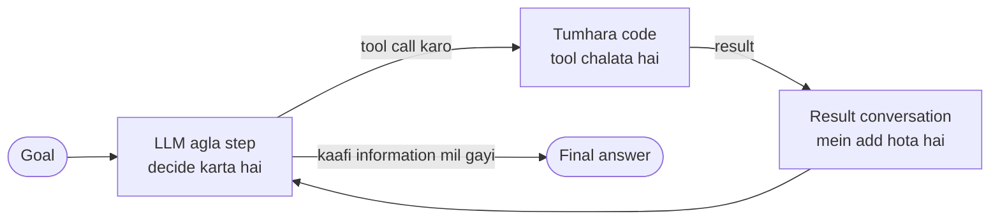

🏠 [Home](../../README.md) › [01 · Foundations](./README.md) › 1.1 AI agent kya hai?

# 1.1 AI agent kya hai?

> **Level:** 🟢 Beginner · **Padhne ka time:** ~8 min · **Pehle padho:** [0.3 Setup](../00-start-here/00.3-setup.md)

**Ek line mein:** AI agent ek aisa program hai jisme language model baar-baar decide karta hai ki kaunsa action lena hai, uska result dekhta hai, aur tab tak chalta rehta hai jab tak goal poora na ho jaaye.

📑 **Is page par**

- [Yeh kyun zaroori hai?](#-yeh-kyun-zaroori-hai)
- [Idea, simple words mein](#-idea-simple-words-mein)
- [Diagram se samjho](#-diagram-se-samjho)
- [Kaise kaam karta hai, step by step](#-kaise-kaam-karta-hai-step-by-step)
- [Example se samjho](#-example-se-samjho)
- [Code](#-code)
- [Aam galtiyan aur dhyan dene wali baatein](#-aam-galtiyan-aur-dhyan-dene-wali-baatein)
- [Yaad rakhne wali baatein](#-yaad-rakhne-wali-baatein)
- [Khud try karo](#-khud-try-karo)
- [Aur padhne ke liye](#-aur-padhne-ke-liye)

## 🤔 Yeh kyun zaroori hai?

Kisi chat assistant se poocho *"Mera order 1234 kahan hai? Kya Friday se pehle aa jaayega?"* Woh politely bolega ki use tumhara order dikh nahi sakta. Woh sirf text likh sakta hai. Uske paas kuch bhi dhoondhne ka koi tarika nahi hai.

Ab socho wahi assistant order system khol sake, tracking number padh sake, courier check kar sake, aur *phir* jawab de. Model mein kuch nahi badla. Badla sirf yeh ki use **act** karne diya gaya, result dekhne diya gaya, aur agla step khud decide karne diya gaya. Yahi chatbot se agent tak ki chhalaang hai.

"Agent" AI ke sabse zyada overuse hone wale words mein se ek hai. Vendors lagbhag har cheez ko agent bol dete hain. Ek clear definition se tum claims ko parakh sakte ho, sahi design chun sakte ho, aur apna system doosron ko samjha sakte ho.

## 🧠 Idea, simple words mein

Socho ek naya intern apne pehle din aaya hai. Tum use dete ho:

- ek **goal** ("pata karo ki order 1234 Friday se pehle aayega ya nahi"),
- ek **toolbox** (order system aur courier website ka access),
- rules ki ek **checklist** ("koi aisi date promise mat karna jo courier ne confirm nahi ki").

Achha intern sab kuch ek saath nahi karta. Woh kuch dhoondhta hai, result padhta hai, decide karta hai ki aage kya check karna hai, aur yahi repeat karta hai jab tak jawab na de sake. Koi use pehle se har step nahi batata.

[AI agent](../../GLOSSARY.md#agent) bhi aise hi kaam karta hai. Intern ka role ek [large language model (LLM)](../../GLOSSARY.md#large-language-model-llm) nibhata hai. Tumhara code use [tools](../../GLOSSARY.md#tool) aur instructions deta hai, phir ek loop chalata hai. Model ek action chunta hai. Tumhara code use execute karta hai. Result wapas model ke paas jaata hai. Model agla action chunta hai. Jab model ko lagta hai ki uske paas kaafi information hai, woh jawab de deta hai.

Aajkal bahut log ise ek line mein kehte hain: **agent ek goal paane ke liye tools ko loop mein chalata hai** ("tools in a loop to achieve a goal"). Yeh phrasing [Simon Willison](https://simonwillison.net/2025/Sep/18/agents/) ki hai. Anthropic bhi kuch aisi hi line kheenchta hai. Uske hisaab se agents woh systems hain jahan model apna process aur tool use khud direct karta hai. Iske ulat [workflows](./01.2-chatbot-vs-workflow-vs-agent.md) mein code pehle se steps fix kar deta hai.

## 👀 Diagram se samjho



*Sabse khaas cheez hai woh arrow jo wapas "LLM decide karta hai" par jaata hai. Model apne hi action ka result dekhta hai aur chunta hai ki aage kya karna hai. Woh arrow hata do, toh woh agent nahi raha.*

## 🔍 Kaise kaam karta hai, step by step

1. **Ek goal aata hai**, aam taur par user message ke roop mein.
2. **Model apne paas ki har cheez padhta hai**: apni instructions, goal, un tools ke descriptions jo woh use kar sakta hai, aur ab tak ki conversation.
3. **Model decide karta hai.** Ya toh woh kisi tool ko chalane ko bolta hai (specific inputs ke saath), ya final answer likhta hai.
4. **Tumhara code act karta hai.** Agar tool maanga gaya hai, toh tumhara code use chalata hai. Model khud kabhi kuch nahi chalata; woh sirf *maangta* hai.
5. **Result wapas** conversation mein ek observation ke roop mein daala jaata hai.
6. **Step 2 se repeat** karo, jab tak model final answer na de de ya koi limit hit na ho jaaye (maximum steps, time ya cost).

Is cycle ko [agent loop](../../GLOSSARY.md#agent-loop) kehte hain. Chapter 02 ise scratch se banata hai.

**"Kya yeh agent hai?" ke liye teen tests.** In practice, hum yeh use karte hain:

| Sawal | Agent ke liye? |
| --- | --- |
| Kya model chunta hai ki *kaunsa* action lena hai? | Zaroori |
| Kya woh *result* dekh ke phir se chunta hai? | Zaroori |
| Kya model decide karta hai ki *kab rukna hai*? | Zaroori |
| Kya uske paas long-term memory, persona ya fancy UI hai? | Zaroori nahi |

## 💡 Example se samjho

Yeh ek chhote support agent ka trace hai. Agent ke paas do tools hain: `get_order` aur `get_tracking`.

```text
User:        Where is my order 1234? Will it arrive before Friday?

Step 1
  Model:     (calls tool) get_order(order_id="1234")
  Result:    {"item": "Desk lamp", "status": "shipped", "carrier": "FastShip", "tracking_id": "FS-998"}

Step 2
  Model:     (calls tool) get_tracking(tracking_id="FS-998")
  Result:    {"location": "Regional depot", "estimated_delivery": "Thursday"}

Step 3
  Model:     Your desk lamp (order 1234) is at the FastShip regional depot and is due on
             Thursday, so it should arrive before Friday.
```

Dekho kya kisi ne program nahi kiya: *"order dekhne ke baad tracking check karo."* Model ne yeh pehle result se khud samjha. Kyunki order mein tracking id thi, aur goal delivery ke baare mein poochh raha tha. Yahi hai model ka path control karna.

Bilkul waise jaise tum food delivery app par order track karte ho. Status dekha "out for delivery", phir rider ki location dekhi, phir decide kiya ki ghar par rukna hai ya nahi. Agla step pichle result se nikla.

## 💻 Code

Poora agent loop lagbhag ek darjan lines mein aa jaata hai. Yahan `llm` kisi bhi chat-model client ke liye hai. [2.3](../02-the-agent-loop/02.3-a-50-line-agent-from-scratch.md) yahi loop seedha Anthropic aur OpenAI SDKs par likh ke dikhata hai:

```python
# llm: koi bhi chat-model client jiske reply mein .text, .tool_calls aur .to_message() ho
# TOOLS tool ke naam ko Python functions se map karta hai; TOOL_SPECS model ko unke baare mein batata hai.
def agent(llm, question, max_steps=5):
    messages = [{"role": "user", "content": question}]
    for _ in range(max_steps):                      # loop, ek safety limit ke saath
        reply = llm.chat(messages, system=AGENT_SYSTEM, tools=TOOL_SPECS)
        messages.append(reply.to_message())
        if not reply.tool_calls:                    # koi tool nahi maanga: model ka kaam ho gaya
            return reply.text
        for call in reply.tool_calls:               # model ne actions maange
            result = TOOLS[call.name](**call.arguments)   # tumhara code unhe chalata hai
            messages.append({"role": "tool", "tool_call_id": call.id, "content": result})  # model result dekhta hai
    return "Sorry, I could not finish in time."
```

## 🚨 Aam galtiyan aur dhyan dene wali baatein

- **Har LLM feature ko agent bolna.** Ek single prompt jo email likhta hai, agent nahi hai, chahe kitna bhi useful ho. Prompts ki fixed pipeline bhi agent nahi hai. Upar wale teen tests use karo.
- **Yeh sochna ki model tools chalata hai.** Nahi chalata. Woh ek structured *request* banata hai; tumhara code decide karta hai ki use chalana hai ya nahi, aur kaise. Isi gap mein tum safety checks lagate ho (chapter 13).
- **Rukne ki koi limit nahi.** Model hamesha ke liye tools call karta reh sakta hai. Steps, time aur cost par hamesha cap lagao. [2.4 Agent kab ruke: stopping conditions](../02-the-agent-loop/02.4-stopping-conditions.md) dekho.
- **Sabse pehle agent ki taraf bhaagna.** Agents fixed workflow se slow, mehenge aur kam predictable hote hain. Simple se shuru karo: [1.6 Agent kab use NAHI karna chahiye](./01.6-when-not-to-use-an-agent.md) dekho.

## ✅ Yaad rakhne wali baatein

- Agent ek LLM hai jo **actions chunta hai, results dekhta hai, aur phir se chunta hai**, jab tak woh khud decide na kare ki kaam ho gaya.
- Short version: *goal paane ke liye tools, loop mein*.
- Model sirf actions *maangta* hai; unhe tumhara code chalata hai. Yahin tumhare haath mein control rehta hai.
- Memory, personas aur UIs optional extras hain; loop optional nahi hai.

## 🧪 Khud try karo

1. Inme se kaun agents hain? (a) Ek prompt jo document summarise karta hai. (b) Ek script jo email classify karne ke liye LLM call karti hai, phir use kisi team ko route karti hai. (c) Ek coding assistant jo file edit karta hai, tests chalata hai, failures padhta hai aur phir se edit karta hai.
2. Socho example wala agent step 1 par hi jawab de deta, bina koi tool call kiye. Jawab kaisa dikhta, aur woh bura kyun hai?

<details>
<summary>Answer dekho</summary>

1. Sirf **(c)**. (a) ek single call hai. (b) mein model ek decision leta hai, lekin path code fix karta hai, aur model kabhi result dekh ke dobara nahi chunta; yeh router wala workflow hai ([1.3](./01.3-the-autonomy-spectrum.md) dekho). (c) act karta hai, test results observe karta hai, aur decide karta hai ki aage kya karna hai, loop mein.
2. Loop ek step ke baad ruk jaata hai kyunki koi tool call nahi hai. Tool results ke bina model ko ya toh guess karna padta, ya maanna padta ki use nahi pata. Yahi toh chatbot wali problem hai.

</details>

## 📚 Aur padhne ke liye

- [Building effective agents](https://www.anthropic.com/engineering/building-effective-agents) (Anthropic, 2024). Workflows aur agents ka farak define karta hai aur simple se shuru karne ki salah deta hai.
- [I think "agent" may finally have a widely enough agreed upon definition to be useful jargon now](https://simonwillison.net/2025/Sep/18/agents/) (Simon Willison, 2025). "Tools in a loop" wali definition aur uski history.
- [A practical guide to building agents](https://cdn.openai.com/business-guides-and-resources/a-practical-guide-to-building-agents.pdf) (OpenAI, PDF). OpenAI ki definition aur design ki salah.
- [Artificial Intelligence: A Modern Approach](https://aima.cs.berkeley.edu/) (Russell & Norvig). Classic textbook definition: agent woh hai jo apne environment ko perceive karta hai aur us par act karta hai.

<!-- FOOTER -->

---

⬅️ **Pichla:** [0.3 Setup](../00-start-here/00.3-setup.md) ·
🏠 [Chapter home](./README.md) ·
➡️ **Agla:** [1.2 Chatbot, workflow aur agent mein farak](./01.2-chatbot-vs-workflow-vs-agent.md)
