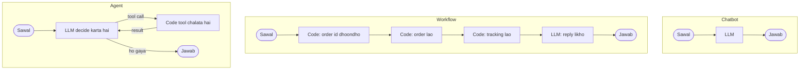

🏠 [Home](../../README.md) › [01 · Foundations](./README.md) › 1.2 Chatbot, workflow aur agent mein farak

# 1.2 Chatbot, workflow aur agent mein farak

> **Level:** 🟢 Beginner · **Padhne ka time:** ~8 min · **Pehle padho:** [1.1 AI agent kya hai?](./01.1-what-is-an-ai-agent.md)

**Ek line mein:** Chatbot sirf baat karta hai, workflow un steps ko follow karta hai jo tumhare code ne pehle se fix kiye hain, aur agent mein model chalte-chalte khud steps chunta hai.

📑 **Is page par**

- [Yeh kyun zaroori hai?](#-yeh-kyun-zaroori-hai)
- [Idea, simple words mein](#-idea-simple-words-mein)
- [Diagram se samjho](#-diagram-se-samjho)
- [Kaise kaam karta hai, step by step](#-kaise-kaam-karta-hai-step-by-step)
- [Example se samjho](#-example-se-samjho)
- [Code](#-code)
- [Aam galtiyan aur dhyan dene wali baatein](#-aam-galtiyan-aur-dhyan-dene-wali-baatein)
- [Yaad rakhne wali baatein](#-yaad-rakhne-wali-baatein)
- [Khud try karo](#-khud-try-karo)
- [Aur padhne ke liye](#-aur-padhne-ke-liye)

## 🤔 Yeh kyun zaroori hai?

Ek team ko bola jaata hai ki customer support mein "AI add karo". Ek engineer chat window bana deta hai. Doosra ek pipeline likhta hai: order number nikalo, order fetch karo, model se reply likhwao. Teesra ek darjan tools wala agent bana deta hai.

Teeno apne system ko "AI assistant" bolte hain. Lekin teeno ka behaviour bahut alag hai, kharcha bahut alag hai, aur fail hone ke tarike bhi alag hain.

Teeno shapes samajh loge, toh sahi wala soch-samajh ke chun paoge, aur apni team ko apna choice samjha bhi paoge.

## 🧠 Idea, simple words mein

Dinner ka intezaam karne ke teen tarike socho.

- **Chatbot = dost se recipe poochhna.** Achhi salah milti hai, lekin real duniya mein kuch nahi hota. Dost tumhara fridge nahi dekh sakta.
- **Workflow = meal kit.** Kisi ne har step pehle se plan kar diya hai: yeh kaato, woh fry karo, serve karo. Achha chalta hai aur har baar same tarike se, lekin sirf usi ek dish ke liye.
- **Agent = tumhari kitchen mein ek chef.** Tum bolte ho "fridge mein jo hai usse kuch bana do." Chef fridge kholta hai, dekhta hai, decide karta hai, chakhta hai, adjust karta hai. Flexible hai, lekin slow hai, mehenga hai, aur pakka nahi pata ki exactly kya milega.

Software ki bhasha mein:

| | Chatbot | Workflow | Agent |
| --- | --- | --- | --- |
| **Steps kaun decide karta hai?** | Koi nahi: ek reply | Tumhara code | Model |
| **Tools ya data use karta hai?** | Nahi | Haan, code call karta hai | Haan, jab model maange tab call hote hain |
| **Har task mein model calls** | 1 | Fixed number | Badalta rehta hai |
| **Predictability** | High | High | Kam |
| **Unexpected cases sambhalta hai?** | Sirf baaton mein | Sirf woh cases jo tumne code kiye | Aksar, agar uske paas sahi tools hon |
| **Cost aur latency** | Sabse kam | Kam se medium | Sabse zyada |
| **Test karna aasan?** | Haan | Haan | Mushkil (chapter 12) |

Ek [workflow](../../GLOSSARY.md#workflow) bahut capable ho sakta hai. Bahut saare successful "AI features" asal mein workflows hi hain. [Agent](../../GLOSSARY.md#agent) word un systems ke liye hai jahan process ko model direct karta hai.

## 👀 Diagram se samjho



*Chatbot ek seedhi line hai, bina data ke. Workflow ek lambi seedhi line hai jo code ne pehle se kheench di. Sirf agent mein loop hai, aur model chunta hai ki kitni baar ghoomna hai.*

## 🔍 Kaise kaam karta hai, step by step

Yeh sawal lo: *"Mera order 1234 kahan hai? Kya Friday se pehle aa jaayega?"*

**Chatbot**

1. Sawal model ko bhejo.
2. Uska reply return karo. Model ke paas order data ka access nahi hai, toh best case mein woh bolega ki use nahi pata. Ek kamzor model shayad koi date [hallucinate](../../GLOSSARY.md#hallucination) kar de.

**Workflow**

1. Code ek regular expression se order id nikalta hai.
2. Code order system call karta hai, phir tracking system.
3. Code data ko prompt mein daalta hai aur model se ek friendly reply likhne ko kehta hai.
4. Reply return karo. Model ne exactly ek call ki aur path ke baare mein kuch bhi decide nahi kiya.

**Agent**

1. Sawal, instructions aur tool descriptions model ko bhejo.
2. Model `get_order("1234")` maangta hai. Code use chalata hai aur result wapas deta hai.
3. Model ko tracking id dikhti hai aur woh `get_tracking("FS-998")` maangta hai. Code use chalata hai.
4. Model ke paas ab jo chahiye woh hai, aur woh jawab likhta hai.

## 💡 Example se samjho

Customer ka wahi sawal, teeno tarikon se jawab:

```text
Customer: Where is my order 1234? Will it arrive before Friday?

1) CHATBOT  (one call, no tools)
   I'm sorry, I can't look up orders. Please check your confirmation email for tracking details.

2) WORKFLOW (code decides the steps)
   Good news! Your desk lamp (order 1234) has shipped with FastShip and is due on Thursday,
   so it should arrive before Friday.

3) AGENT    (the model decides the steps)
   tool: get_order({'order_id': '1234'}) -> {"item": "Desk lamp", ..., "tracking_id": "FS-998"}
   tool: get_tracking({'tracking_id': 'FS-998'}) -> {"location": "Regional depot", "estimated_delivery": "Thursday"}
   Your desk lamp (order 1234) is at the FastShip regional depot and is due on Thursday,
   so it should arrive before Friday.
```

Is sawal ke liye **workflow aur agent dono barabar achhe jawab dete hain, aur workflow sasta hai.**

Ab sawal badlo: *"Maine pichle hafte ek lamp order kiya tha lekin order number kho gaya."* Workflow ka regular expression kuch nahi dhoondh paata, aur woh sirf "Please include your order number" bol sakta hai. Jis agent ke paas `find_orders_by_email` tool ho, woh raasta nikaal sakta hai.

Yahi trade-off hai. Workflows un cases ke liye reliable hain jo tumne plan kiye. Agents un cases ko behtar sambhalte hain jo tumne plan nahi kiye.

Railway ticket counter socho. Normal booking ka form fixed hai, har baar same steps, jaldi ho jaata hai (workflow). Lekin jab koi aata hai "PNR kho gaya, train cancel hui, refund chahiye", tab counter wale bhaiya ko khud sochna padta hai ki kya check karein (agent).

## 💻 Code

Workflow, jisme har step tumne likha hai (`llm` koi bhi chat-model client hai, jaise [1.1](./01.1-what-is-an-ai-agent.md#-code) mein):

```python
def workflow(llm, question):
    match = re.search(r"\b(\d{4,})\b", question)          # step 1: code order id dhoondhta hai
    if not match:
        return "Please include your order number."         # har case code karna padta hai
    order = json.loads(get_order(match.group(1)))          # step 2: code order system call karta hai
    tracking = json.loads(get_tracking(order["tracking_id"]))  # step 3
    prompt = f"Customer question: {question}\nOrder: {order}\nTracking: {tracking}"
    return llm.chat([{"role": "user", "content": prompt}], system="Answer using only the data given.").text  # step 4
```

Ise [1.1](./01.1-what-is-an-ai-agent.md#-code) wale agent loop se compare karo. Agent mein order id ke liye koi `if` nahi hai, aur calls ka koi fixed order nahi hai. Uski jagah woh tool descriptions model ko deta hai:

```python
reply = llm.chat(messages, system=AGENT_SYSTEM, tools=TOOL_SPECS)
```

## 🚨 Aam galtiyan aur dhyan dene wali baatein

- **Agent banana jab steps hamesha same hon.** Agar tum flowchart pehle se bana sakte ho, toh workflow likho. Woh fast, sasta aur test karne mein aasan hoga.
- **Aisa workflow banana jisme sau `if` branches ug aayein.** Agar tum special cases jodte hi ja rahe ho, toh shayad task asal mein open-ended hai, aur overall agent zyada simple pade.
- **Chatbot un sawalon ke jawab de raha hai jinka data uske paas nahi.** Tools ya retrieved data ke bina model sahi-sunne wale lekin bane hue jawab de sakta hai. Use data do, ya use "I don't know" bolne ko kaho.
- **Inhe ek-doosre se bilkul alag maan lena.** Real systems inhe mix karte hain. Workflow ke andar ek mushkil step ke liye agent ho sakta hai, aur agent kisi workflow ko tool ki tarah call kar sakta hai. Chapter 09 yeh patterns cover karta hai.

## ✅ Yaad rakhne wali baatein

- **Chatbot:** ek model call, koi action nahi.
- **Workflow:** steps tumhara code decide karta hai; model kuch hisse bharta hai.
- **Agent:** steps model decide karta hai, loop mein, tools use kar ke.
- Cost, speed aur predictability mein workflows jeet-te hain; open-ended ya unpredictable tasks mein agents.
- Sabse simple shape se shuru karo jo problem solve kar de.

## 🧪 Khud try karo

1. Har ek ko classify karo: (a) ek "is paragraph ko zyada formal bana do" button; (b) ek invoice processor jo fields nikalta hai, unhe validate karta hai, phir file karta hai; (c) ek research assistant jo web search karta rehta hai jab tak sawal ka jawab na de sake.
2. Example mein customer ka sawal badal ke yeh karo: *"Mera lamp kahan hai? Order number kho gaya."* Har approach kya karega?

<details>
<summary>Answer dekho</summary>

1. (a) Chatbot jaisa single call. (b) Workflow: steps pehle se pata hain. (c) Agent: kitne aur kaise searches honge, yeh is par depend karta hai ki use kya milta hai.
2. Chatbot ab bhi help nahi kar sakta. Workflow return karta hai "Please include your order number." Agent, real model par, aam taur par order number maangega ya batayega ki order nahi mil raha, kyunki uske paas item se search karne ka koi tool nahi hai.

</details>

## 📚 Aur padhne ke liye

- [Building effective agents](https://www.anthropic.com/engineering/building-effective-agents) (Anthropic). Workflow aur agent ka farak, aam workflow patterns ke saath.
- [What are agents?](https://huggingface.co/docs/smolagents/conceptual_guides/intro_agents) (Hugging Face smolagents docs). "Agency" ko ek spectrum ki tarah samjhata hai, is basis par ki LLM ka output program flow ko kitna control karta hai.

<!-- FOOTER -->

---

⬅️ **Pichla:** [1.1 AI agent kya hai?](./01.1-what-is-an-ai-agent.md) ·
🏠 [Chapter home](./README.md) ·
➡️ **Agla:** [1.3 Autonomy ka spectrum](./01.3-the-autonomy-spectrum.md)
