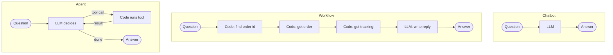

🏠 [Home](../../README.md) › [01 · Foundations](./README.md) › 1.2 Chatbot vs workflow vs agent

# 1.2 Chatbot vs workflow vs agent

> **Difficulty:** 🟢 Beginner · **Reading time:** ~8 min · **Prerequisites:** [1.1 What is an AI agent?](./01.1-what-is-an-ai-agent.md)

**In one sentence:** A chatbot only talks, a workflow follows steps your code fixed in advance, and an agent lets the model choose the steps as it goes.

📑 **On this page**

- [Why does this matter?](#-why-does-this-matter)
- [The idea, in plain words](#-the-idea-in-plain-words)
- [Picture it](#-picture-it)
- [How it works, step by step](#-how-it-works-step-by-step)
- [Worked example](#-worked-example)
- [Code](#-code)
- [Common mistakes & gotchas](#-common-mistakes--gotchas)
- [Key takeaways](#-key-takeaways)
- [Try it yourself](#-try-it-yourself)
- [Further reading](#-further-reading)

## 🤔 Why does this matter?

A team is asked to "add AI" to customer support. One engineer builds a chat window. Another writes a pipeline: extract the order number, fetch the order, ask the model to write a reply. A third builds an agent with a dozen tools. All three call their system "an AI assistant", yet they behave very differently, cost very different amounts, and fail in different ways.

Knowing the three shapes lets you pick the right one on purpose, and explain the choice to your team.

## 🧠 The idea, in plain words

Think of three ways to get dinner.

- **Chatbot = asking a friend for a recipe.** You get good advice, but nothing happens in the real world. The friend can't see your fridge.
- **Workflow = a meal kit.** Someone planned every step in advance: chop this, fry that, serve. It works well and the same way every time, but only for that one meal.
- **Agent = a chef in your kitchen.** You say "make something with what's in the fridge." The chef opens the fridge, looks, decides, tastes, adjusts. Flexible, but slower, more expensive, and you can't be sure exactly what you'll get.

In software terms:

| | Chatbot | Workflow | Agent |
| --- | --- | --- | --- |
| **Who decides the steps?** | Nobody: one reply | Your code | The model |
| **Uses tools or data?** | No | Yes, called by code | Yes, called when the model asks |
| **Model calls per task** | 1 | Fixed number | Varies |
| **Predictability** | High | High | Lower |
| **Handles unexpected cases** | Only in words | Only cases you coded | Often, if it has the right tools |
| **Cost and latency** | Lowest | Low to medium | Highest |
| **Easy to test?** | Yes | Yes | Harder (chapter 12) |

A [workflow](../../GLOSSARY.md#workflow) can be very capable. Many successful "AI features" are workflows. The word [agent](../../GLOSSARY.md#agent) is for systems where the model directs the process.

## 👀 Picture it



*The chatbot is a straight line with no data. The workflow is a longer straight line that code drew in advance. Only the agent has a loop, and the model chooses how many times to go round it.*

## 🔍 How it works, step by step

Take the question *"Where is my order 1234? Will it arrive before Friday?"*

**Chatbot**

1. Send the question to the model.
2. Return its reply. The model has no access to order data, so the best it can do is say it doesn't know. A worse model might [hallucinate](../../GLOSSARY.md#hallucination) a date.

**Workflow**

1. Code extracts the order id with a regular expression.
2. Code calls the order system, then the tracking system.
3. Code puts the data into a prompt and asks the model to write a friendly reply.
4. Return the reply. The model made exactly one call and decided nothing about the path.

**Agent**

1. Send the question, the instructions and the tool descriptions to the model.
2. The model asks for `get_order("1234")`. Code runs it and returns the result.
3. The model sees a tracking id and asks for `get_tracking("FS-998")`. Code runs it.
4. The model has what it needs and writes the answer.

## 💡 Worked example

The same customer question, answered all three ways:

```text
Customer: Where is my order 1234? Will it arrive before Friday?

1) CHATBOT  (one call, no tools)
   I'm sorry, I can't look up orders. Please check your confirmation email for tracking details.

2) WORKFLOW (code decides the steps)
   Good news! Your desk lamp (order 1234) has shipped with FastShip and is due on Thursday,
   so it should arrive before Friday.

3) AGENT    (the model decides the steps)
   tool: get_order({'order_id': '1234'}) -> {"item": "Desk lamp", ..., "tracking_id": "FS-998"}
   tool: get_tracking({'tracking_id': 'FS-998'}) -> {"location": "Regional depot", "estimated_delivery": "Thursday"}
   Your desk lamp (order 1234) is at the FastShip regional depot and is due on Thursday,
   so it should arrive before Friday.
```

For this question, **the workflow and the agent give equally good answers, and the workflow is cheaper.** Now change the question to *"I ordered a lamp last week but lost the order number"*. The workflow's regular expression finds nothing and it can only reply "Please include your order number". An agent with a `find_orders_by_email` tool could work it out. That is the trade: workflows are reliable for the cases you planned; agents cope better with the ones you didn't.

## 💻 Code

The workflow, with every step written by you (`llm` is any chat-model client, as in [1.1](./01.1-what-is-an-ai-agent.md#-code)):

```python
def workflow(llm, question):
    match = re.search(r"\b(\d{4,})\b", question)          # step 1: code finds the order id
    if not match:
        return "Please include your order number."         # every case must be coded
    order = json.loads(get_order(match.group(1)))          # step 2: code calls the order system
    tracking = json.loads(get_tracking(order["tracking_id"]))  # step 3
    prompt = f"Customer question: {question}\nOrder: {order}\nTracking: {tracking}"
    return llm.chat([{"role": "user", "content": prompt}], system="Answer using only the data given.").text  # step 4
```

Compare it with the agent loop in [1.1](./01.1-what-is-an-ai-agent.md#-code). The agent has no `if` for the order id and no fixed order of calls; instead it passes tool descriptions to the model:

```python
reply = llm.chat(messages, system=AGENT_SYSTEM, tools=TOOL_SPECS)
```

## 🚨 Common mistakes & gotchas

- **Building an agent when the steps are always the same.** If you can draw the flowchart in advance, write a workflow. It will be faster, cheaper and easier to test.
- **Building a workflow that grows a hundred `if` branches.** If you keep adding special cases, the task may really be open-ended, and an agent may be simpler overall.
- **A chatbot answering questions it has no data for.** Without tools or retrieved data, a model can make up plausible answers. Give it data or tell it to say "I don't know."
- **Treating these as exclusive.** Real systems mix them: a workflow can contain an agent for one hard step, and an agent can call a workflow as a tool. Chapter 09 covers these patterns.

## ✅ Key takeaways

- **Chatbot:** one model call, no actions.
- **Workflow:** your code decides the steps; the model fills in parts.
- **Agent:** the model decides the steps, in a loop, using tools.
- Workflows win on cost, speed and predictability; agents win on open-ended or unpredictable tasks.
- Start with the simplest shape that solves the problem.

## 🧪 Try it yourself

1. Classify each: (a) a "rewrite this paragraph more formally" button; (b) an invoice processor that extracts fields, validates them, then files them; (c) a research assistant that searches the web until it can answer a question.
2. Change the customer's question in the worked example to *"Where's my lamp? I lost the order number."* What does each approach do?

<details>
<summary>Show answer</summary>

1. (a) Chatbot-style single call. (b) Workflow: the steps are known in advance. (c) Agent: the number and kind of searches depend on what it finds.
2. The chatbot still can't help. The workflow returns "Please include your order number." The agent, on a real model, would usually ask for the order number or explain it can't find the order, because it has no tool to search by item.

</details>

## 📚 Further reading

- [Building effective agents](https://www.anthropic.com/engineering/building-effective-agents) (Anthropic). The workflow versus agent distinction, with common workflow patterns.
- [What are agents?](https://huggingface.co/docs/smolagents/conceptual_guides/intro_agents) (Hugging Face smolagents docs). Describes "agency" as a spectrum based on how much LLM output controls program flow.

<!-- FOOTER -->

---

⬅️ **Previous:** [1.1 What is an AI agent?](./01.1-what-is-an-ai-agent.md) ·
🏠 [Chapter home](./README.md) ·
➡️ **Next:** [1.3 The autonomy spectrum](./01.3-the-autonomy-spectrum.md)
