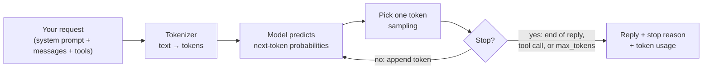

🏠 [Home](../../README.md) › [01 · Foundations](./README.md) › 1.4 How LLMs work (just enough)

# 1.4 How LLMs work (just enough)

> **Difficulty:** 🟢 Beginner · **Reading time:** ~12 min · **Prerequisites:** [1.1 What is an AI agent?](./01.1-what-is-an-ai-agent.md)

**In one sentence:** An LLM reads a sequence of tokens and predicts the next one, over and over; it remembers nothing between calls, so your code must send it everything it needs, every time.

📑 **On this page**

- [Why does this matter?](#-why-does-this-matter)
- [The idea, in plain words](#-the-idea-in-plain-words)
- [Picture it](#-picture-it)
- [How it works, step by step](#-how-it-works-step-by-step)
- [Worked example](#-worked-example)
- [Code](#-code)
- [Common mistakes & gotchas](#-common-mistakes--gotchas)
- [Key takeaways](#-key-takeaways)
- [Try it yourself](#-try-it-yourself)
- [Further reading](#-further-reading)

## 🤔 Why does this matter?

You don't need to understand neural networks to build agents. But a few facts about how models are *used* explain most of the strange behaviour you'll meet:

- Your agent "forgot" something the user said earlier. (The history wasn't sent.)
- A long run got slower and more expensive with every step. (Tokens pile up.)
- The answer stopped mid-sentence. (It hit the output limit.)
- Running the same prompt twice gave two different answers. (Sampling.)

This page covers just those facts, and nothing more.

## 🧠 The idea, in plain words

A [large language model](../../GLOSSARY.md#large-language-model-llm) is a very well-read autocomplete. During training it read a huge amount of text and learned to predict *what comes next*. It was then tuned further to follow instructions, hold conversations and request tools. When you send it a prompt, it predicts the next small piece of text, adds it to the end, predicts the next piece, and so on until it decides to stop.

Those small pieces are called [tokens](../../GLOSSARY.md#token). The model can only look at a limited number of tokens at once, called its [context window](../../GLOSSARY.md#context-window). And each API call is independent: the model has no memory of previous calls. If you want it to "remember" the conversation, you send the whole conversation again.

## 👀 Picture it



*One reply is many small predictions in a row. Everything inside the box happens on the provider's servers; your code only sees the request going in and the reply coming out.*

## 🔍 How it works, step by step

**1. Text becomes tokens.** A [tokenizer](../../GLOSSARY.md#tokenizer) splits text into tokens: often whole words, parts of words, or punctuation. A rough rule for English is **about 4 characters, or ¾ of a word, per token**. Each provider uses its own tokenizer, so the same text gives different counts on different models. Limits and prices are all in tokens.

**2. The model predicts the next token.** Given all the tokens so far, it scores every possible next token. Modern LLMs are based on the [Transformer](../../GLOSSARY.md#transformer) architecture ([Vaswani et al., 2017](https://arxiv.org/abs/1706.03762)), which lets every token "look at" every earlier token when making that prediction.

**3. One token is picked (sampling).** The model doesn't always pick the single most likely token; it [samples](../../GLOSSARY.md#sampling) from the probabilities. A setting called [temperature](../../GLOSSARY.md#temperature) used to control how adventurous that choice is: low is more predictable, high is more varied. Note that **several recent models no longer accept temperature at all**. Current Claude models return an error if you send it, and OpenAI documents similar limits for its reasoning models. Even where it is accepted, a temperature of 0 does not guarantee identical output on every run. Design your agent to cope with variation instead.

**4. Repeat until a stop.** The reply ends when the model produces an end-of-turn signal, decides to call a tool, or hits [`max_tokens`](../../GLOSSARY.md#max-tokens), the output limit you set. The API tells you which one happened in the [**stop reason**](../../GLOSSARY.md#stop-reason). If the reason is "hit the limit", the reply is cut off mid-thought.

**5. Everything must fit in the context window.** The context window is the total number of tokens the model can handle in one call: your instructions, the whole conversation, tool descriptions, tool results, *and* the reply it writes. Context windows today range from tens of thousands of tokens to around a million. Bigger is not free: you pay for every input token, and very long inputs are slower.

**6. Messages have roles.** The request is a list of messages, each from the `user` or the `assistant` (the model's earlier replies). The [system prompt](../../GLOSSARY.md#system-prompt) holds instructions that apply to the whole conversation: the model's role, rules and tone. Anthropic takes it as a separate `system` field; OpenAI's Chat Completions API takes it as the first message, with role `system`.

**7. The API is [stateless](../../GLOSSARY.md#stateless).** The model keeps nothing between calls. A "conversation" is an illusion created by your code resending the full history on every call. For an agent, that history includes every tool call and tool result, so **each step sends more tokens than the last**. (Some providers offer optional server-side conversation storage, but the underlying model still reads the whole history every time.)

**8. Some models think before answering.** Many current models can reason internally before replying, sometimes called *extended thinking* or *reasoning*. That reasoning is billed as output tokens and can be tuned with settings such as an effort level. [7.1](../07-planning-and-reasoning/07.1-chain-of-thought-and-extended-thinking.md) covers it.

## 💡 Worked example

From [`examples/01-how-llms-work`](../../examples/01-how-llms-work/README.md), run offline. The "model" here is a scripted stand-in that, like a real model, can only use what is in the messages it receives:

```text
1) The API is stateless
   Without history: I'm sorry, I don't know your name. You haven't told me.
   With history:    Your name is Sam.

2) The input grows every turn, because we resend everything
   turn 1:    8 input tokens  █
   turn 2:   39 input tokens  ███████
   turn 3:   85 input tokens  █████████████████
```

**Part 1:** the user said "My name is Sam" in the first call. In the second call, without history, the model has never seen that message. With history, the first message is resent, so the model can answer.

**Part 2:** three short questions in one conversation. The input size roughly doubles each turn, because each call includes all earlier questions and answers. Now imagine an agent that runs 50 steps, each adding a tool call and a few hundred tokens of tool output. This is why chapter 05 covers [summarisation and compaction](../05-memory/05.2-summarisation-and-context-compaction.md), and chapter 16 covers [cost](../16-cost-and-performance/16.1-token-cost-maths.md).

## 💻 Code

**One request, two providers.** The raw SDK calls, so you can see what the shared wrapper hides. Both send a system prompt and a message, and both report token usage.

Anthropic ([docs](https://platform.claude.com/docs/en/agents-and-tools/tool-use/overview)):

```python
import anthropic

client = anthropic.Anthropic()  # reads ANTHROPIC_API_KEY
resp = client.messages.create(
    model="claude-opus-5-5",
    max_tokens=1000,                       # output limit
    system="You are a concise assistant.", # system prompt: a separate field
    messages=[{"role": "user", "content": "What is a token?"}],
)
print(resp.content[0].text)
print(resp.stop_reason)                    # "end_turn", "max_tokens", "tool_use", ...
print(resp.usage.input_tokens, resp.usage.output_tokens)
```

OpenAI ([docs](https://platform.openai.com/docs/guides/function-calling)):

```python
from openai import OpenAI

client = OpenAI()  # reads OPENAI_API_KEY
resp = client.chat.completions.create(
    model="YOUR_OPENAI_MODEL",             # a current model ID
    max_completion_tokens=1000,            # output limit
    messages=[
        {"role": "system", "content": "You are a concise assistant."},  # system prompt: first message
        {"role": "user", "content": "What is a token?"},
    ],
)
print(resp.choices[0].message.content)
print(resp.choices[0].finish_reason)       # "stop", "length", "tool_calls", ...
print(resp.usage.prompt_tokens, resp.usage.completion_tokens)
```

OpenAI also offers a newer Responses API; these notes use Chat Completions because many other providers support the same format.

**Counting tokens before you send.** Anthropic has a token counting endpoint ([docs](https://platform.claude.com/docs/en/build-with-claude/token-counting)); for OpenAI models you can count locally with [tiktoken](https://github.com/openai/tiktoken):

```python
count = client.messages.count_tokens(          # Anthropic client from above
    model="claude-opus-5-5",
    messages=[{"role": "user", "content": "What is a token?"}],
)
print(count.input_tokens)
```

The example wraps this in `count_tokens()`, which uses the API when the provider is Anthropic and falls back to the 4-characters rule otherwise: [`examples/01-how-llms-work/main.py`](../../examples/01-how-llms-work/main.py).

## 🚨 Common mistakes & gotchas

- **Assuming the model remembers.** It doesn't. If something matters, it must be in the request: the system prompt, the history, or retrieved data.
- **Letting history grow forever.** Long agent runs can hit the context window or become slow and expensive. Plan for trimming or summarising (chapter 05).
- **Ignoring the stop reason.** If it says the output limit was hit, the reply is incomplete. A tool call cut off this way may have broken arguments. Check it every time.
- **Expecting identical output.** Even at temperature 0, outputs can vary. Test behaviour and properties ("mentions the order id"), not exact strings (chapter 12).
- **Sending `temperature` to a model that rejects it.** Recent models return an error. The shared wrapper never sends it.
- **Using the 4-characters rule for billing.** It's a rough estimate. Use the provider's token counts, which are reported on every response.
- **Putting secrets in prompts.** Everything in the context window is sent to the provider and may appear in logs. See [13.6](../13-safety-and-guardrails/13.6-secrets-and-pii.md).

## ✅ Key takeaways

- An LLM predicts one token at a time; a reply is many predictions in a row.
- Tokens are the unit of limits and cost: roughly 4 characters of English each, but every tokenizer differs.
- The context window holds everything (instructions, history, tools, results and the reply), and every input token is paid for.
- The API is stateless: your code resends the conversation on every call, so agent runs grow with each step.
- Check the stop reason, and don't rely on identical outputs.

## 🧪 Try it yourself

1. Run `python 01-how-llms-work/main.py`. Then add a fourth question to `QUESTIONS` and a fourth answer to `SCRIPTED_ANSWERS`. How many input tokens does turn 4 use?
2. An agent's system prompt and tool descriptions take 2,000 tokens. Each step adds about 500 tokens of tool calls and results. Roughly how many input tokens does step 10 send? How many input tokens in total across all 10 steps?

<details>
<summary>Show answer</summary>

1. It depends on your text, but it will be larger than turn 3, because turn 4 resends all three earlier questions and answers plus the new question.
2. Step *n* sends about 2,000 + 500 × (*n* − 1) tokens, so step 10 sends about 2,000 + 4,500 = **6,500**. The total over 10 steps is 10 × 2,000 + 500 × (0 + 1 + … + 9) = 20,000 + 22,500 = **42,500** input tokens. The fixed prompt is resent every step, which is why [prompt caching](../16-cost-and-performance/16.2-prompt-caching.md) helps so much.

</details>

## 📚 Further reading

- [Attention Is All You Need](https://arxiv.org/abs/1706.03762) (Vaswani et al., 2017). The paper that introduced the Transformer.
- [The Illustrated Transformer](https://jalammar.github.io/illustrated-transformer/) (Jay Alammar). A visual walk-through of how Transformers work.
- [Context windows](https://platform.claude.com/docs/en/build-with-claude/context-windows) and [Token counting](https://platform.claude.com/docs/en/build-with-claude/token-counting) (Anthropic docs).
- [tiktoken](https://github.com/openai/tiktoken) (OpenAI). The tokenizer library for OpenAI models.
- [Effective context engineering for AI agents](https://www.anthropic.com/engineering/effective-context-engineering-for-ai-agents) (Anthropic). Why what you put in the context window matters so much for agents.

<!-- FOOTER -->

---

⬅️ **Previous:** [1.3 The autonomy spectrum](./01.3-the-autonomy-spectrum.md) ·
🏠 [Chapter home](./README.md) ·
➡️ **Next:** [1.5 Anatomy of an agent](./01.5-anatomy-of-an-agent.md)
