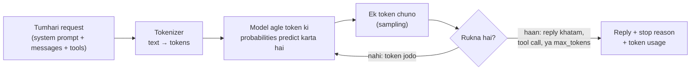

🏠 [Home](../../README.md) › [01 · Foundations](./README.md) › 1.4 LLMs kaise kaam karte hain (bas utna jitna zaroori hai)

# 1.4 LLMs kaise kaam karte hain (bas utna jitna zaroori hai)

> **Level:** 🟢 Beginner · **Padhne ka time:** ~12 min · **Pehle padho:** [1.1 AI agent kya hai?](./01.1-what-is-an-ai-agent.md)

**Ek line mein:** LLM tokens ki ek sequence padhta hai aur agla token predict karta hai, baar-baar. Calls ke beech use kuch yaad nahi rehta, isliye tumhare code ko har baar use woh sab bhejna padta hai jo use chahiye.

📑 **Is page par**

- [Yeh kyun zaroori hai?](#-yeh-kyun-zaroori-hai)
- [Idea, simple words mein](#-idea-simple-words-mein)
- [Diagram se samjho](#-diagram-se-samjho)
- [Kaise kaam karta hai, step by step](#-kaise-kaam-karta-hai-step-by-step)
- [Example se samjho](#-example-se-samjho)
- [Code](#-code)
- [Aam galtiyan aur dhyan dene wali baatein](#-aam-galtiyan-aur-dhyan-dene-wali-baatein)
- [Yaad rakhne wali baatein](#-yaad-rakhne-wali-baatein)
- [Khud try karo](#-khud-try-karo)
- [Aur padhne ke liye](#-aur-padhne-ke-liye)

## 🤔 Yeh kyun zaroori hai?

Agents banane ke liye tumhe neural networks samajhne ki zaroorat nahi hai. Lekin models ko *use* kaise kiya jaata hai, iske kuch facts se zyada tar ajeeb behaviour samajh aa jaata hai:

- Tumhara agent woh "bhool gaya" jo user ne pehle bola tha. (History bheji hi nahi gayi.)
- Ek lamba run har step ke saath slow aur mehenga hota gaya. (Tokens jamaa hote jaate hain.)
- Jawab beech sentence mein ruk gaya. (Output limit hit ho gayi.)
- Same prompt do baar chalaya, do alag jawab mile. (Sampling.)

Yeh page sirf yahi facts cover karta hai, isse zyada kuch nahi.

## 🧠 Idea, simple words mein

[Large language model](../../GLOSSARY.md#large-language-model-llm) ek bahut padha-likha autocomplete hai. Training ke dauraan isne bahut saara text padha aur seekha ki *aage kya aata hai*, yeh predict kaise karna hai. Phir ise aur tune kiya gaya taaki yeh instructions follow kare, conversation kare aur tools maange.

Jab tum ise prompt bhejte ho, toh yeh text ka agla chhota tukda predict karta hai, use end mein jodta hai, phir agla tukda predict karta hai. Aise hi chalta rehta hai jab tak yeh rukne ka decide na kare.

In chhote tukdon ko [tokens](../../GLOSSARY.md#token) kehte hain. Model ek baar mein sirf limited tokens dekh sakta hai. Ise uska [context window](../../GLOSSARY.md#context-window) kehte hain.

Aur har API call independent hai: model ko pichli calls ki koi memory nahi hoti. Agar tum chahte ho ki use conversation "yaad" rahe, toh poori conversation dobara bhejo.

Socho ek chai ki tapri wale bhaiya jo har customer ko pehli baar dekh rahe hain, har baar. Tum roz aate ho, lekin unhe yaad nahi ki tum kam cheeni wali chai peete ho. Toh har baar poora order bolna padta hai: "bhaiya, ek chai, kam cheeni, adrak zyada." LLM ke saath bhi yahi hai: har call mein poori baat dobara bolo.

## 👀 Diagram se samjho



*Ek reply asal mein lagataar bahut saari chhoti predictions hai. Box ke andar ka sab kuch provider ke servers par hota hai. Tumhara code sirf andar jaati request aur bahar aata reply dekhta hai.*

## 🔍 Kaise kaam karta hai, step by step

**1. Text tokens ban jaata hai.** Ek [tokenizer](../../GLOSSARY.md#tokenizer) text ko tokens mein todta hai: aksar poore words, words ke hisse, ya punctuation. English ke liye ek rough rule hai: **har token lagbhag 4 characters, ya ¾ word ka hota hai**. Har provider apna tokenizer use karta hai, isliye same text alag models par alag counts deta hai. Limits aur prices sab tokens mein hote hain.

**2. Model agla token predict karta hai.** Ab tak ke saare tokens dekh ke, yeh har possible agle token ko score deta hai. Modern LLMs [Transformer](../../GLOSSARY.md#transformer) architecture par based hain ([Vaswani et al., 2017](https://arxiv.org/abs/1706.03762)). Isme prediction karte waqt har token apne se pehle wale har token ko "dekh" sakta hai.

**3. Ek token chuna jaata hai (sampling).** Model hamesha sabse likely token nahi chunta; yeh probabilities mein se [sample](../../GLOSSARY.md#sampling) karta hai. [Temperature](../../GLOSSARY.md#temperature) naam ki ek setting pehle control karti thi ki yeh choice kitni adventurous ho: low matlab zyada predictable, high matlab zyada variety.

Dhyan do: **kai recent models ab temperature accept hi nahi karte**. Current Claude models ise bhejne par error return karte hain, aur OpenAI apne reasoning models ke liye aisi hi limits document karta hai. Jahan accept hota bhi hai, wahan bhi temperature 0 har run par same output ki guarantee nahi deta. Isliye apna agent aisa design karo ki woh variation sambhal le.

**4. Rukne tak repeat.** Reply tab khatam hota hai jab model end-of-turn signal deta hai, tool call karne ka decide karta hai, ya [`max_tokens`](../../GLOSSARY.md#max-tokens) hit karta hai, jo output limit tumne set ki hai. In mein se kya hua, yeh API tumhe [**stop reason**](../../GLOSSARY.md#stop-reason) mein batata hai. Agar reason hai "limit hit ho gayi", toh reply beech mein hi kat gaya hai.

**5. Sab kuch context window mein fit hona chahiye.** Context window woh total tokens hain jo model ek call mein handle kar sakta hai: tumhari instructions, poori conversation, tool descriptions, tool results, *aur* jo reply woh likhta hai. Aaj context windows das hazaaron tokens se le kar lagbhag ek million tak hain. Bada free nahi hai: har input token ka paisa lagta hai, aur bahut lambe inputs slow hote hain.

**6. Messages ke roles hote hain.** Request messages ki ek list hai. Har message ya toh `user` ka hai ya `assistant` ka (model ke pichle replies). [System prompt](../../GLOSSARY.md#system-prompt) mein woh instructions hoti hain jo poori conversation par laagu hain: model ka role, rules aur tone. Anthropic ise ek alag `system` field mein leta hai; OpenAI ka Chat Completions API ise pehle message ki tarah leta hai, role `system` ke saath.

**7. API [stateless](../../GLOSSARY.md#stateless) hai.** Model calls ke beech kuch nahi rakhta. "Conversation" ek illusion hai, jo tumhara code har call par poori history dobara bhej ke banata hai. Agent ke liye us history mein har tool call aur tool result shaamil hai, isliye **har step pichle se zyada tokens bhejta hai**. (Kuch providers optional server-side conversation storage dete hain, lekin neeche wala model phir bhi har baar poori history padhta hai.)

**8. Kuch models jawab dene se pehle sochte hain.** Kai current models reply karne se pehle andar hi andar reason kar sakte hain, jise kabhi *extended thinking* ya *reasoning* kehte hain. Us reasoning ka bill output tokens ki tarah lagta hai, aur use effort level jaisi settings se tune kiya ja sakta hai. [7.1](../07-planning-and-reasoning/07.1-chain-of-thought-and-extended-thinking.md) ise cover karta hai.

## 💡 Example se samjho

Do chhote experiments. Yahan "model" ek scripted stand-in hai jo, real model ki tarah, sirf wahi use kar sakta hai jo use mile messages mein hai:

```text
1) The API is stateless
   Without history: I'm sorry, I don't know your name. You haven't told me.
   With history:    Your name is Sam.

2) The input grows every turn, because we resend everything
   turn 1:    8 input tokens  █
   turn 2:   39 input tokens  ███████
   turn 3:   85 input tokens  █████████████████
```

**Part 1:** user ne pehli call mein bola "My name is Sam". Doosri call mein, bina history ke, model ne woh message kabhi dekha hi nahi. History ke saath pehla message dobara bheja jaata hai, toh model jawab de sakta hai.

**Part 2:** ek conversation mein teen chhote sawal. Input size har turn mein lagbhag double ho jaata hai, kyunki har call mein pichle saare sawal-jawab shaamil hain.

Ab socho ek agent jo 50 steps chalta hai, aur har step ek tool call aur kuch sau tokens ka tool output jodta hai. Isi wajah se chapter 05 [summarisation aur compaction](../05-memory/05.2-summarisation-and-context-compaction.md) cover karta hai, aur chapter 16 [cost](../16-cost-and-performance/16.1-token-cost-maths.md) cover karta hai.

## 💻 Code

**Ek request, do providers.** Raw SDK calls, saath-saath. Dono ek system prompt aur ek message bhejte hain, aur dono token usage report karte hain.

Anthropic ([docs](https://platform.claude.com/docs/en/agents-and-tools/tool-use/overview)):

```python
import anthropic

client = anthropic.Anthropic()  # ANTHROPIC_API_KEY padhta hai
resp = client.messages.create(
    model="claude-opus-5-5",
    max_tokens=1000,                       # output limit
    system="You are a concise assistant.", # system prompt: ek alag field
    messages=[{"role": "user", "content": "What is a token?"}],
)
print("".join(b.text for b in resp.content if b.type == "text"))
print(resp.stop_reason)                    # "end_turn", "max_tokens", "tool_use", ...
print(resp.usage.input_tokens, resp.usage.output_tokens)
```

OpenAI ([docs](https://platform.openai.com/docs/guides/function-calling)):

```python
from openai import OpenAI

client = OpenAI()  # OPENAI_API_KEY padhta hai
resp = client.chat.completions.create(
    model="YOUR_OPENAI_MODEL",             # ek current model ID
    max_completion_tokens=1000,            # output limit
    messages=[
        {"role": "system", "content": "You are a concise assistant."},  # system prompt: pehla message
        {"role": "user", "content": "What is a token?"},
    ],
)
print(resp.choices[0].message.content)
print(resp.choices[0].finish_reason)       # "stop", "length", "tool_calls", ...
print(resp.usage.prompt_tokens, resp.usage.completion_tokens)
```

OpenAI ek naya Responses API bhi deta hai. Yeh notes Chat Completions use karte hain kyunki bahut saare doosre providers bhi yahi format support karte hain.

**Bhejne se pehle tokens gino.** Anthropic ka ek token counting endpoint hai ([docs](https://platform.claude.com/docs/en/build-with-claude/token-counting)). OpenAI models ke liye tum [tiktoken](https://github.com/openai/tiktoken) se locally gin sakte ho:

```python
count = client.messages.count_tokens(          # upar wala Anthropic client
    model="claude-opus-5-5",
    messages=[{"role": "user", "content": "What is a token?"}],
)
print(count.input_tokens)
```

Ek chhota `count_tokens()` helper bana sakte ho jo provider Anthropic ho toh yeh API use kare, warna 4-characters wale rule par fall back kare.

## 🚨 Aam galtiyan aur dhyan dene wali baatein

- **Yeh maan lena ki model yaad rakhta hai.** Nahi rakhta. Agar koi cheez zaroori hai, toh woh request mein honi chahiye: system prompt mein, history mein, ya retrieved data mein.
- **History ko hamesha badhne dena.** Lambe agent runs context window hit kar sakte hain, ya slow aur mehenge ho sakte hain. Trimming ya summarising ka plan banao (chapter 05).
- **Stop reason ignore karna.** Agar woh kehta hai ki output limit hit hui, toh reply adhoora hai. Aise kata hua tool call toote hue arguments wala ho sakta hai. Har baar check karo.
- **Same output ki ummeed rakhna.** Temperature 0 par bhi outputs badal sakte hain. Behaviour aur properties test karo ("order id mention karta hai"), exact strings nahi (chapter 12).
- **Aise model ko `temperature` bhejna jo use reject karta hai.** Recent models error return karte hain. Jab tak pakka pata na ho ki model accept karta hai, ise mat bhejo.
- **Billing ke liye 4-characters wala rule use karna.** Yeh rough estimate hai. Provider ke token counts use karo, jo har response mein report hote hain.
- **Prompts mein secrets daalna.** Context window ki har cheez provider ko bheji jaati hai aur logs mein aa sakti hai. [13.6](../13-safety-and-guardrails/13.6-secrets-and-pii.md) dekho.

## ✅ Yaad rakhne wali baatein

- LLM ek baar mein ek token predict karta hai; ek reply lagataar bahut saari predictions hai.
- Limits aur cost ki unit tokens hain: English mein har token lagbhag 4 characters, lekin har tokenizer alag hai.
- Context window mein sab kuch aata hai (instructions, history, tools, results aur reply), aur har input token ka paisa lagta hai.
- API stateless hai: tumhara code har call par conversation dobara bhejta hai, isliye agent runs har step ke saath bade hote jaate hain.
- Stop reason check karo, aur same outputs par bharosa mat karo.

## 🧪 Khud try karo

1. Example ke part 2 mein turns 1 se 3 ne 8, 39 aur 85 input tokens use kiye. Agar tum usi conversation mein chautha sawal poochho, toh turn 4 lagbhag kitne input tokens use karega?
2. Ek agent ka system prompt aur tool descriptions 2,000 tokens lete hain. Har step lagbhag 500 tokens ke tool calls aur results jodta hai. Step 10 lagbhag kitne input tokens bhejta hai? Saare 10 steps mein total kitne input tokens?

<details>
<summary>Answer dekho</summary>

1. Yeh text par depend karta hai, lekin turn 3 ke 85 se kaafi upar hoga, kyunki turn 4 pichle teeno sawal-jawab aur naya sawal dobara bhejta hai.
2. Step *n* lagbhag 2,000 + 500 × (*n* − 1) tokens bhejta hai, toh step 10 lagbhag 2,000 + 4,500 = **6,500** bhejta hai. 10 steps ka total hai 10 × 2,000 + 500 × (0 + 1 + … + 9) = 20,000 + 22,500 = **42,500** input tokens. Fixed prompt har step par dobara bheja jaata hai, isiliye [prompt caching](../16-cost-and-performance/16.2-prompt-caching.md) itni help karti hai.

</details>

## 📚 Aur padhne ke liye

- [Attention Is All You Need](https://arxiv.org/abs/1706.03762) (Vaswani et al., 2017). Woh paper jisne Transformer introduce kiya.
- [The Illustrated Transformer](https://jalammar.github.io/illustrated-transformer/) (Jay Alammar). Transformers kaise kaam karte hain, iska visual walk-through.
- [Context windows](https://platform.claude.com/docs/en/build-with-claude/context-windows) aur [Token counting](https://platform.claude.com/docs/en/build-with-claude/token-counting) (Anthropic docs).
- [tiktoken](https://github.com/openai/tiktoken) (OpenAI). OpenAI models ke liye tokenizer library.
- [Effective context engineering for AI agents](https://www.anthropic.com/engineering/effective-context-engineering-for-ai-agents) (Anthropic). Agents ke liye context window mein kya daalte ho, yeh itna zaroori kyun hai.

<!-- FOOTER -->

---

⬅️ **Pichla:** [1.3 Autonomy ka spectrum](./01.3-the-autonomy-spectrum.md) ·
🏠 [Chapter home](./README.md) ·
➡️ **Agla:** [1.5 Agent ke andar kya-kya hota hai](./01.5-anatomy-of-an-agent.md)
