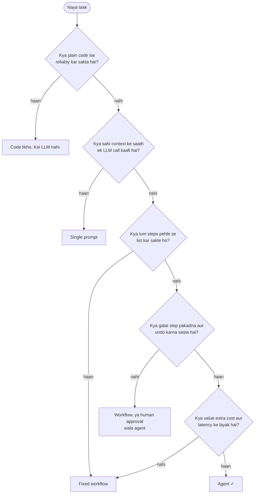

🏠 [Home](../../README.md) › [01 · Foundations](./README.md) › 1.6 Agent kab use NAHI karna chahiye

# 1.6 Agent kab use NAHI karna chahiye

> **Level:** 🟢 Beginner · **Padhne ka time:** ~7 min · **Pehle padho:** [1.3 Autonomy ka spectrum](./01.3-the-autonomy-spectrum.md)

**Ek line mein:** Agar tum steps pehle se likh sakte ho, ya galti mehngi aur pakadne mein mushkil hogi, toh ek simple system (plain code, single prompt ya fixed workflow) aam taur par agent se behtar kaam karega.

📑 **Is page par**

- [Yeh kyun zaroori hai?](#-yeh-kyun-zaroori-hai)
- [Idea, simple words mein](#-idea-simple-words-mein)
- [Diagram se samjho](#-diagram-se-samjho)
- [Kaise kaam karta hai, step by step](#-kaise-kaam-karta-hai-step-by-step)
- [Example se samjho](#-example-se-samjho)
- [Code](#-code)
- [Aam galtiyan aur dhyan dene wali baatein](#-aam-galtiyan-aur-dhyan-dene-wali-baatein)
- [Yaad rakhne wali baatein](#-yaad-rakhne-wali-baatein)
- [Khud try karo](#-khud-try-karo)
- [Aur padhne ke liye](#-aur-padhne-ke-liye)

## 🤔 Yeh kyun zaroori hai?

Ek team do mahine laga ke ek agent banati hai jo monthly sales spreadsheets ko report mein badalta hai. Zyada tar time chalta hai. Lekin kabhi-kabhi woh koi region chhod deta hai ya galat tool call kar deta hai, aur kisi ko har report haath se check karni padti hai.

Ek 40-line ki script aur summary paragraph likhne ke liye ek LLM call se kaam ho jaata. Zyada fast, sasta, aur har baar same tarike se.

Agents powerful hain, isliye unhe har jagah use karne ka mann karta hai. Yeh jaanna ki kab agent *nahi* banana, is field ki sabse kaam ki skills mein se ek hai.

## 🧠 Idea, simple words mein

Tum photocopier chalane ke liye ek creative consultant hire nahi karoge. Consultant open-ended problems mein kamaal ka hai. Lekin ek fixed, repeat hone wale kaam ke liye woh slow hai, mehenga hai, aur shayad woh cheezein "improve" kar de jo tum badalna nahi chahte the.

[Agent](../../GLOSSARY.md#agent) woh consultant hai. Yeh tab chamakta hai jab jawab tak ka raasta pehle se pata nahi hota. Jab raasta *pata hai*, toh use code ya [workflow](../../GLOSSARY.md#workflow) ki tarah likh do, aur model ko sirf un hisson ke liye use karo jahan language skills chahiye.

Jaise mohalle ki kirana dukaan par roz ka doodh-bread lene ke liye tum dukaandaar se lambi charcha nahi karte. Fixed list, fixed kaam. Lekin jab ghar mein shaadi ka saaman lena ho aur kuch pata na ho ki kya-kya chahiye, tab baith ke sochna aur poochhna padta hai.

In practice, hum yeh order recommend karte hain: **plain code → ek LLM call → fixed workflow → agent.** Agle par tabhi jao jab pichla saaf-saaf kaafi na ho. Agents banane par Anthropic ki guidance bhi yahi kehti hai: sabse simple solution dhoondho jo kaam kare, aur complexity tabhi jodo jab usse results behtar hon.

## 👀 Diagram se samjho



*Zyada tar tasks jaldi hi bahar nikal jaate hain. Agent sahi jawab tabhi hai jab steps pehle se plan na ho sakein, galtiyan pakdi ja sakein, aur value cost ko justify kare.*

## 🔍 Kaise kaam karta hai, step by step

Chaar sawal poochho, isi order mein.

**1. Kya task open-ended hai?** Agar tum shuru karne se pehle flowchart bana sakte ho, toh tumhe steps chunne ke liye model ki zaroorat nahi. Agents tab apni keemat vasool karte hain jab agla step is par depend kare ki pichle step mein kya mila: research, debugging, kisi customer issue ki jaanch.

**2. Galti ki keemat kya hai, aur kya tum use pakad sakte ho?** Agents workflows se zyada decisions lete hain, isliye unke galat hone ke chances bhi zyada hain. Yeh tab theek hai jab errors saste aur dikhne wale hon: ek draft jise insaan review karega, code jise tests check karenge, ek action jo undo ho sakta hai. Yeh khatarnaak hai jab errors mehenge aur chupke hon: payments, data delete karna, medical ya legal salah, customers ko messages.

**3. Kya yeh cost aur latency ke layak hai?** Ek agent har task par kai model calls kar sakta hai, aur har call badhti conversation dobara bhejti hai ([1.4](./01.4-how-llms-work.md)). Isme das-bees seconds lag sakte hain aur ek single call se kai guna zyada kharcha ho sakta hai. Jo task insaan ke kai minute bachata ho, uske liye theek hai. Text box mein autocomplete ke liye theek nahi.

**4. Kya tumhe ise predictable ya auditable chahiye?** Regulated processes, financial reports, aur har woh cheez jo tumhe step by step samjhani pade, unke liye fixed workflows behtar hain, jahan har path likha hua hai.

**Zyada steps matlab zyada risk kyun.** Agar har decision probability *p* ke saath sahi hai, aur har step sahi hona zaroori hai, toh *n* steps ka run probability *pⁿ* ke saath successful hota hai:

| Har step ki accuracy | 1 step | 5 steps | 10 steps | 20 steps |
| --- | --- | --- | --- | --- |
| 99% | 99.0% | 95.1% | 90.4% | 81.8% |
| 95% | 95.0% | 77.4% | 59.9% | 35.8% |
| 90% | 90.0% | 59.0% | 34.9% | 12.2% |

Is effect ko [compounding errors](../../GLOSSARY.md#compounding-errors) kehte hain. Yahan model simplified hai: yeh maanta hai ki errors independent aur fatal hain. Ek achha agent kuch galtiyan notice kar ke recover kar sakta hai, aur yeh bhi ek wajah hai ki agents useful hain.

Lekin trend real hai: **decisions ki lambi chains ko ya toh bahut reliable steps chahiye, ya errors pakadne ka koi tarika**, jaise tests, validation ya human review.

## 💡 Example se samjho

Alag-alag teams ki paanch requests, aur har ek ke liye sahi tool:

| Request | Decision | Kyun |
| --- | --- | --- |
| "Convert these 10,000 dates to ISO format" | **Plain code** | Ek deterministic rule. LLM bina fayde ke cost aur risk jodta hai. |
| "Write a friendly reply to this review" | **Single prompt** | Ek step; sirf language skill chahiye. |
| "Turn each support ticket into a summary, a category and a priority" | **Fixed workflow** | Har baar wahi teen steps; har ek ko test karna aasan. |
| "Find out why this customer was charged twice" | **Agent** | Agla lookup is par depend karta hai ki pichle mein kya mila. Errors saste hain agar yeh sirf data padhta hai aur findings par insaan act karta hai. |
| "Automatically refund any customer who complains" | **Human approval wala workflow**, ya automate hi mat karo | Paisa company se bahar jaata hai, aur galtiyan undo karna mushkil hai. Agar agent involved hai, toh use refunds *propose* karne chahiye jinhe koi insaan approve kare ([13.5](../13-safety-and-guardrails/13.5-human-approval-for-risky-actions.md)). |

## 💻 Code

Upar wali table tum Python ki kuch lines se khud bana sakte ho, aur apne numbers bhi try kar sakte ho:

```python
for p in (0.99, 0.95, 0.90):
    row = "  ".join(f"{n:>2} steps {p**n:6.1%}" for n in (1, 5, 10, 20))
    print(f"{p:.0%} per step: {row}")
```

Output:

```text
99% per step:  1 steps  99.0%   5 steps  95.1%  10 steps  90.4%  20 steps  81.8%
95% per step:  1 steps  95.0%   5 steps  77.4%  10 steps  59.9%  20 steps  35.8%
90% per step:  1 steps  90.0%   5 steps  59.0%  10 steps  34.9%  20 steps  12.2%
```

Ek hi task ko code, workflow aur agent ki tarah dekhna hai, toh [1.2](./01.2-chatbot-vs-workflow-vs-agent.md#-code) ka `workflow()` aur [1.1](./01.1-what-is-an-ai-agent.md#-code) ka `agent()` compare karo. Workflow ek model call karta hai; agent teen.

## 🚨 Aam galtiyan aur dhyan dene wali baatein

- **"Agentic" ko hi goal bana lena.** Goal problem solve karna hai. Utni hi kam autonomy use karo jitni se kaam ho jaaye ([1.3](./01.3-the-autonomy-spectrum.md)).
- **Koi baseline nahi.** Agent banane se pehle simple version banao aur use measure karo. Baseline ke bina tum bata hi nahi sakte ki agent behtar hai ya nahi (chapter 12).
- **Agent prompt ke andar workflow chhupana.** Ek system prompt jo kehta hai "pehle A karo, phir B, phir C", asal mein English mein likha workflow hai. Aur yeh use code mein likhne se kam reliable hai.
- **Agent ko bina checks ke irreversible actions dena.** Payments, deletions aur bahar jaane wale messages ke liye approval steps ya strict limits chahiye ([chapter 13](../13-safety-and-guardrails/README.md)).
- **Latency ko ignore karna.** Jab har jawab mein 20 seconds lagte hain, users notice karte hain. Agar speed zaroori hai, toh kam model calls wala design chuno.

## ✅ Yaad rakhne wali baatein

- Pehle simple options try karo: plain code → ek LLM call → fixed workflow → agent.
- Agent tab use karo jab steps pehle se plan na ho sakein, galtiyan pakadna sasta ho, aur value cost ko justify kare.
- In cheezon ke liye agents se bacho: deterministic kaam, bina review ke high-stakes irreversible actions, tight latency budgets, aur aise processes jo poori tarah auditable hone chahiye.
- Zyada decisions matlab galat hone ke zyada chances; lambe agent runs ko errors pakadne ke tarike chahiye.

## 🧪 Khud try karo

1. Har ek ke liye code, single prompt, workflow ya agent chuno: (a) product descriptions ko French mein translate karna; (b) logs aur dashboards se jawab dena ki "kal raat ka outage hamari kaunsi service ki wajah se hua?"; (c) check karna ki har invoice ka total uski lines ke sum ke barabar hai.
2. Tumhare agent ke steps 97% reliable hain aur ek typical task 8 steps leta hai. Lagbhag kitne runs mein har step sahi hoga? Ise improve karne ke do tarike batao.

<details>
<summary>Answer dekho</summary>

1. (a) Har description ke liye single prompt (ya ek simple batch workflow). (b) Agent: jaanch ka raasta is par depend karta hai ki har log kya dikhata hai, aur yeh sirf data padhta hai. (c) Plain code: yeh arithmetic hai.
2. 0.97⁸ ≈ 0.78, toh lagbhag **78%**. Improve karne ke tarike: har step ko zyada reliable banao (behtar tool descriptions, clear instructions, strong model); steps kam karo (tools combine karo, fixed steps code mein le jao); aise checks jodo jo errors pakad ke theek karein (validation, tests, ek review step, human approval).

</details>

## 📚 Aur padhne ke liye

- [Building effective agents](https://www.anthropic.com/engineering/building-effective-agents) (Anthropic). "When (and when not) to use agents", aur simple se shuru kyun karna chahiye.
- [A practical guide to building agents](https://cdn.openai.com/business-guides-and-resources/a-practical-guide-to-building-agents.pdf) (OpenAI, PDF). Isme guidance hai ki kaunse use cases agents ke liye sahi hain.
- [9.7 Sahi pattern kaise chuno](../09-agent-design-patterns/09.7-choosing-a-pattern.md). Ek poora decision flowchart, jab tum patterns jaan jaao.

<!-- FOOTER -->

---

⬅️ **Pichla:** [1.5 Agent ke andar kya-kya hota hai](./01.5-anatomy-of-an-agent.md) ·
🏠 [Chapter home](./README.md) ·
➡️ **Agla:** [02 · The Agent Loop → 2.1 Observe–think–act loop](../02-the-agent-loop/02.1-the-observe-think-act-loop.md)
