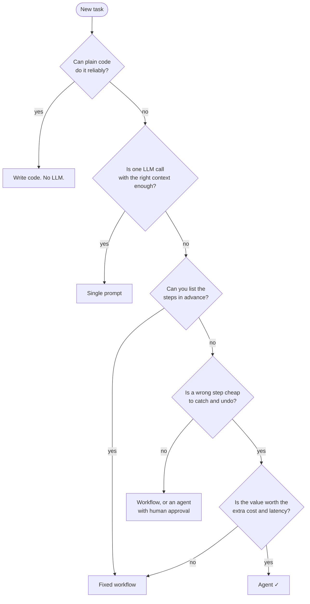

🏠 [Home](../../README.md) › [01 · Foundations](./README.md) › 1.6 When NOT to use an agent

# 1.6 When NOT to use an agent

> **Difficulty:** 🟢 Beginner · **Reading time:** ~7 min · **Prerequisites:** [1.3 The autonomy spectrum](./01.3-the-autonomy-spectrum.md)

**In one sentence:** If you can write the steps down in advance, or a mistake would be costly and hard to catch, a simpler system (plain code, a single prompt or a fixed workflow) will usually serve you better than an agent.

📑 **On this page**

- [Why does this matter?](#-why-does-this-matter)
- [The idea, in plain words](#-the-idea-in-plain-words)
- [Picture it](#-picture-it)
- [How it works, step by step](#-how-it-works-step-by-step)
- [Worked example](#-worked-example)
- [Code](#-code)
- [Common mistakes & gotchas](#-common-mistakes--gotchas)
- [Key takeaways](#-key-takeaways)
- [Try it yourself](#-try-it-yourself)
- [Further reading](#-further-reading)

## 🤔 Why does this matter?

A team spends two months building an agent that turns monthly sales spreadsheets into a report. It works most of the time, but now and then it skips a region or calls the wrong tool, and someone has to check every report by hand. A 40-line script and one LLM call to write the summary paragraph would have done the job, faster, cheaper and the same way every time.

Agents are powerful, and that makes them tempting to use everywhere. Knowing when *not* to build one is one of the most valuable skills in this field.

## 🧠 The idea, in plain words

You wouldn't hire a creative consultant to run a photocopier. The consultant is brilliant at open-ended problems, but for a fixed, repeatable job they're slower, more expensive and might "improve" things you didn't want changed.

An [agent](../../GLOSSARY.md#agent) is the consultant. It shines when the path to the answer isn't known in advance. When the path *is* known, write it down as code or a [workflow](../../GLOSSARY.md#workflow) and use the model only for the parts that need language skills.

In practice, we recommend this order: **plain code → one LLM call → fixed workflow → agent.** Move to the next only when the previous one clearly isn't enough. Anthropic's guidance on building agents makes the same point: find the simplest solution that works, and add complexity only when it improves results.

## 👀 Picture it



*Most tasks exit early. An agent is the right answer only when the steps can't be planned in advance, mistakes can be caught, and the value justifies the cost.*

## 🔍 How it works, step by step

Ask four questions, in this order.

**1. Is the task open-ended?** If you can draw the flowchart before you start, you don't need the model to choose the steps. Agents earn their keep when the next step depends on what the last one found: research, debugging, investigating a customer issue.

**2. What does a mistake cost, and can you catch it?** Agents make more decisions than workflows, so they have more chances to be wrong. That's acceptable if errors are cheap and visible: a draft a human will review, code that tests will check, an action that can be undone. It's dangerous if errors are expensive and silent: payments, deleting data, medical or legal advice, messages to customers.

**3. Is it worth the cost and latency?** An agent may make several model calls per task, each resending the growing conversation ([1.4](./01.4-how-llms-work.md)). It might take tens of seconds and cost many times more than a single call. That's fine for a task worth minutes of human time; it's not fine for autocomplete in a text box.

**4. Do you need it to be predictable or auditable?** Regulated processes, financial reports and anything you must explain step by step suit fixed workflows better, where every path is written down.

**Why more steps means more risk.** If each decision is right with probability *p*, and every step must be right, a run of *n* steps succeeds with probability *pⁿ*:

| Accuracy per step | 1 step | 5 steps | 10 steps | 20 steps |
| --- | --- | --- | --- | --- |
| 99% | 99.0% | 95.1% | 90.4% | 81.8% |
| 95% | 95.0% | 77.4% | 59.9% | 35.8% |
| 90% | 90.0% | 59.0% | 34.9% | 12.2% |

This effect is called [compounding errors](../../GLOSSARY.md#compounding-errors). The model here is simplified: it assumes errors are independent and fatal. A good agent can notice some mistakes and recover, which is part of why agents are useful. But the trend is real: **long chains of decisions need either very reliable steps or a way to catch errors**, such as tests, validation or human review.

## 💡 Worked example

Five requests from different teams, and the right tool for each:

| Request | Decision | Why |
| --- | --- | --- |
| "Convert these 10,000 dates to ISO format" | **Plain code** | A deterministic rule. An LLM adds cost and risk for no benefit. |
| "Write a friendly reply to this review" | **Single prompt** | One step; language skill is the only need. |
| "Turn each support ticket into a summary, a category and a priority" | **Fixed workflow** | Same three steps every time; easy to test each one. |
| "Find out why this customer was charged twice" | **Agent** | The next lookup depends on what the last one found. Errors are cheap if it only reads data and a human acts on the findings. |
| "Automatically refund any customer who complains" | **Workflow with human approval**, or don't automate | Money leaves the company, and mistakes are hard to undo. If an agent is involved, it should *propose* refunds for a person to approve ([13.5](../13-safety-and-guardrails/13.5-human-approval-for-risky-actions.md)). |

## 💻 Code

You can reproduce the table above, and try your own numbers, with a few lines of Python:

```python
for p in (0.99, 0.95, 0.90):
    row = "  ".join(f"{n:>2} steps {p**n:6.1%}" for n in (1, 5, 10, 20))
    print(f"{p:.0%} per step: {row}")
```

Output:

```text
99% per step:  1 steps  99.0%   5 steps  95.1%  10 steps  90.4%  20 steps  81.8%
95% per step:  1 steps  95.0%   5 steps  77.4%  10 steps  59.9%  20 steps  35.8%
90% per step:  1 steps  90.0%   5 steps  59.0%  10 steps  34.9%  20 steps  12.2%
```

For the same task built as code, a workflow and an agent, compare `workflow()` in [1.2](./01.2-chatbot-vs-workflow-vs-agent.md#-code) with `agent()` in [1.1](./01.1-what-is-an-ai-agent.md#-code). The workflow makes one model call; the agent makes three.

## 🚨 Common mistakes & gotchas

- **"Agentic" as a goal.** The goal is solving the problem. Use the least autonomy that does it ([1.3](./01.3-the-autonomy-spectrum.md)).
- **No baseline.** Before building an agent, build the simple version and measure it. Without a baseline you can't tell whether the agent is better (chapter 12).
- **Hiding a workflow inside an agent prompt.** A system prompt that says "first do A, then B, then C" is a workflow written in English, and it's less reliable than writing it in code.
- **Giving an agent irreversible actions with no checks.** Payments, deletions and outgoing messages need approval steps or strict limits ([chapter 13](../13-safety-and-guardrails/README.md)).
- **Ignoring latency.** Users notice when every answer takes 20 seconds. If speed matters, prefer fewer model calls.

## ✅ Key takeaways

- Try simpler options first: plain code → one LLM call → fixed workflow → agent.
- Use an agent when the steps can't be planned in advance, mistakes are cheap to catch, and the value justifies the cost.
- Avoid agents for deterministic jobs, high-stakes irreversible actions without review, tight latency budgets and processes that must be fully auditable.
- More decisions means more chances to go wrong; long agent runs need ways to catch errors.

## 🧪 Try it yourself

1. For each, choose code, single prompt, workflow or agent: (a) translate product descriptions into French; (b) answer "which of our services caused last night's outage?" using logs and dashboards; (c) check that every invoice total equals the sum of its lines.
2. Your agent's steps are 97% reliable and a typical task takes 8 steps. Roughly what fraction of runs get every step right? Name two ways to improve that.

<details>
<summary>Show answer</summary>

1. (a) Single prompt per description (or a simple batch workflow). (b) Agent: the investigation path depends on what each log reveals, and it only reads data. (c) Plain code: it's arithmetic.
2. 0.97⁸ ≈ 0.78, so about **78%**. Ways to improve: make each step more reliable (better tool descriptions, clearer instructions, a stronger model); reduce the number of steps (combine tools, move fixed steps into code); add checks that catch and fix errors (validation, tests, a review step, human approval).

</details>

## 📚 Further reading

- [Building effective agents](https://www.anthropic.com/engineering/building-effective-agents) (Anthropic). "When (and when not) to use agents", and why to start simple.
- [A practical guide to building agents](https://cdn.openai.com/business-guides-and-resources/a-practical-guide-to-building-agents.pdf) (OpenAI, PDF). Includes guidance on which use cases suit agents.
- [9.7 Choosing a pattern](../09-agent-design-patterns/09.7-choosing-a-pattern.md). A fuller decision flowchart, once you know the patterns.

<!-- FOOTER -->

---

⬅️ **Previous:** [1.5 Anatomy of an agent](./01.5-anatomy-of-an-agent.md) ·
🏠 [Chapter home](./README.md) ·
➡️ **Next:** [02 · The Agent Loop → 2.1 The observe–think–act loop](../02-the-agent-loop/02.1-the-observe-think-act-loop.md)
