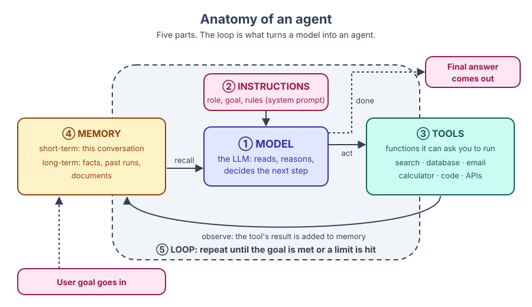

🏠 [Home](../../README.md) › 01 · Foundations

# 01 · Foundations

> **Padhne ka time:** ~52 min · **Level:** 🟢 Beginner · **Pehle padho:** [00 · Start Here](../00-start-here/README.md)

Agent banane se pehle tumhe saaf pata hona chahiye ki agent hota kya hai. Yeh chapter tumhe precise definitions deta hai, LLMs kaise kaam karte hain iska ek simple model deta hai, woh paanch parts dikhata hai jo har agent mein hote hain, aur un cases ki ek imaandaar list deta hai jahan tumhe agent *nahi* banana chahiye.

## 🎯 Is chapter mein kya seekhoge

- AI agent ki ek precise, simple-language definition
- Chatbots, workflows aur agents mein kya farak hai, ek hi task ko teeno tarikon se solve kar ke
- Autonomy spectrum: model ke paas kitna control hai, iske chhe levels
- LLMs ke baare mein bas utna jitna zaroori hai: tokens, context windows, sampling, system prompts, aur API stateless kyun hai
- Har agent ke paanch parts: model, instructions, tools, memory aur loop
- Kab agent galat choice hai, aur uski jagah kya use karna chahiye

## 📋 Pehle se kya aana chahiye

- [0.3 Setup](../00-start-here/00.3-setup.md), taaki tum code snippets chala sako
- Basic Python

## 👀 Chapter ek nazar mein

*Is book ki har cheez isi picture se judi hai. Chapter 01 har part ka introduction deta hai. Aage ke chapters ek-ek part mein gehraai tak jaate hain: loop (02), tools (03, 04), memory (05, 06) aur model ki reasoning (07, 08).*

## 📄 Is chapter ke pages

<!-- PAGES:START -->
| # | Page | Level | Time |
| --- | --- | --- | --- |
| 1.1 | [AI agent kya hai?](./01.1-what-is-an-ai-agent.md) — AI agent ki ek precise, simple-language definition. | 🟢 Beginner | ~8 min |
| 1.2 | [Chatbot, workflow aur agent mein farak](./01.2-chatbot-vs-workflow-vs-agent.md) — LLM systems ke teen type, aur unhe alag kaise pehchanein. | 🟢 Beginner | ~8 min |
| 1.3 | [Autonomy ka spectrum](./01.3-the-autonomy-spectrum.md) — Single prompt se le kar fully autonomous agent tak, ek-ek step kar ke. | 🟢 Beginner | ~7 min |
| 1.4 | [LLMs kaise kaam karte hain (bas utna jitna zaroori hai)](./01.4-how-llms-work.md) — Tokens, context windows, temperature aur system prompts. | 🟢 Beginner | ~12 min |
| 1.5 | [Agent ke andar kya-kya hota hai](./01.5-anatomy-of-an-agent.md) — Model, instructions, tools, memory aur loop: har agent ke paanch parts. | 🟢 Beginner | ~10 min |
| 1.6 | [Agent kab use NAHI karna chahiye](./01.6-when-not-to-use-an-agent.md) — Woh signs jo batate hain ki simple solution tumhare liye behtar rahega. | 🟢 Beginner | ~7 min |
<!-- PAGES:END -->

<!-- FOOTER -->

---

⬅️ **Pichla chapter:** [00 · Start Here](../00-start-here/README.md) ·
▶️ **Padhna shuru karo:** [1.1 AI agent kya hai?](./01.1-what-is-an-ai-agent.md) ·
➡️ **Agla chapter:** [02 · The Agent Loop](../02-the-agent-loop/README.md)
