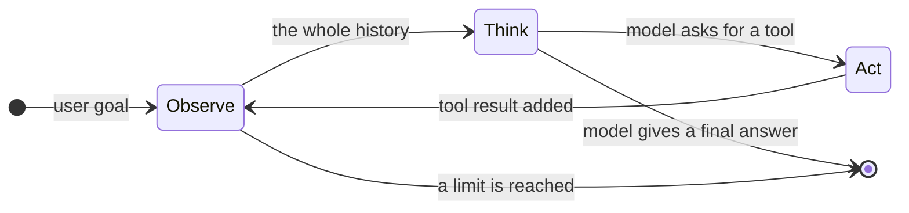
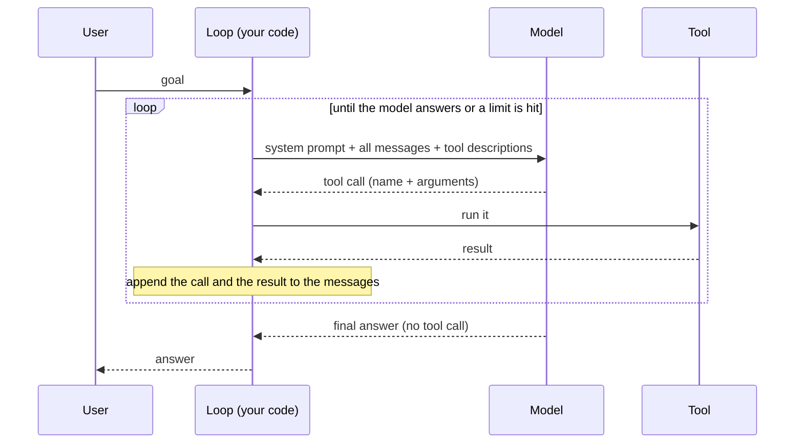

🏠 [Home](../../README.md) › [02 · The Agent Loop](./README.md) › 2.1 The observe–think–act loop

# 2.1 The observe–think–act loop

> **Difficulty:** 🟢 Beginner · **Reading time:** ~8 min · **Prerequisites:** [1.1 What is an AI agent?](../01-foundations/01.1-what-is-an-ai-agent.md), [1.5 Anatomy of an agent](../01-foundations/01.5-anatomy-of-an-agent.md)

**In one sentence:** An agent repeats three steps (observe what it knows, think about what to do next, act on it) until the model says it is done or a limit stops it, and each step is just a few messages added to a list.

📑 **On this page**

- [Why does this matter?](#-why-does-this-matter)
- [The idea, in plain words](#-the-idea-in-plain-words)
- [Picture it](#-picture-it)
- [How it works, step by step](#-how-it-works-step-by-step)
- [Worked example](#-worked-example)
- [Code](#-code)
- [Common mistakes & gotchas](#-common-mistakes--gotchas)
- [Key takeaways](#-key-takeaways)
- [Try it yourself](#-try-it-yourself)
- [Further reading](#-further-reading)

## 🤔 Why does this matter?

Ask a plain chatbot *"Which port does our web server use?"* and it guesses, because all it can do is write one reply. Ask an agent, and it lists the project's files, opens the config file, reads `port = 8080`, and only then answers.

The difference is not a smarter model. It is a small piece of code around the model that lets it look, decide, do something, and look again. That piece of code is the [agent loop](../../GLOSSARY.md#agent-loop). In [1.5](../01-foundations/01.5-anatomy-of-an-agent.md) it was part ⑤ of five. This chapter builds it properly, because:

- **Every agent framework is this loop.** LangGraph, the OpenAI Agents SDK, the Claude Agent SDK: underneath, they all run it. Once you know it, frameworks stop being magic.
- **Most agent bugs live here.** The agent that never stops, the one that forgets a tool result, the one that crashes on the first error: all loop problems.

## 🧠 The idea, in plain words

Think of a cook making soup. They **taste** it (observe), **decide** it needs salt (think), **add** a pinch (act), and then taste again. They don't add salt five times without tasting in between, and they stop when it tastes right, or when dinner is due.

An agent works the same way:

1. **Observe.** Gather everything known so far: the goal, plus the result of every action taken. This is the agent's [short-term memory](../../GLOSSARY.md#short-term-memory).
2. **Think.** Send all of it to the [LLM](../../GLOSSARY.md#large-language-model-llm). The model either answers, or asks for a [tool](../../GLOSSARY.md#tool) to be run.
3. **Act.** Your code runs the tool the model asked for. The result is a new [observation](../../GLOSSARY.md#observation), and the loop goes back to step 1.

The model only ever does step 2. It cannot run anything itself. Your code does the observing and acting, and decides when to stop.

## 👀 Picture it



*There are two exits. The normal one is the model choosing to answer instead of asking for a tool. The safety exit is your code noticing a limit (steps, time, money) before calling the model again.*

The same loop as messages between the parts:



*The loop is the only participant that talks to everyone. The model never talks to the tool directly: it only describes what it wants, and your code decides whether to do it.*

## 🔍 How it works, step by step

**1. Observe: build the context.** Your code holds a list of messages. On the first turn it is just the user's goal. Because the API is [stateless](../../GLOSSARY.md#stateless) ([1.4](../01-foundations/01.4-how-llms-work.md)), the whole list is sent on every call, together with the [system prompt](../../GLOSSARY.md#system-prompt) and the tool descriptions.

**2. Think: one model call.** The model reads everything and replies in one of two ways:

- **A final answer:** ordinary text, and the [stop reason](../../GLOSSARY.md#stop-reason) says the turn ended normally (`end_turn` on Anthropic, `stop` on OpenAI).
- **One or more tool calls:** a structured request such as `read_file(path="config/app.toml")`, and the stop reason says so (`tool_use` on Anthropic, `tool_calls` on OpenAI). Chapter 03 covers the exact format.

**3. Act: run the tool.** Your code looks up the function by name, runs it with the arguments, and captures the output, or the error if it fails.

**4. Observe again: append two things.** First the model's reply (the tool call), then the tool's result, linked to the call by an ID. Both are needed: a result with no matching call is rejected by the API.

**5. Repeat or stop.** Go back to step 2 with the longer list. Stop when the model answers without a tool call, or when one of your limits is hit. [2.4](./02.4-stopping-conditions.md) covers limits; [2.5](./02.5-handling-errors-in-the-loop.md) covers what to do when a step fails.

What each step adds to the conversation, in the shared wrapper's neutral format:

| Step | Who does it | What is added to the messages |
| --- | --- | --- |
| Goal | User | `{"role": "user", "content": "Which port does the web server listen on?"}` |
| Think | Model | `{"role": "assistant", "content": "", "tool_calls": [ToolCall(name="read_file", ...)]}` |
| Act + observe | Your code | `{"role": "tool", "tool_call_id": "call_2", "content": "[server]\nport = 8080"}` |
| Think (last) | Model | `{"role": "assistant", "content": "The web server listens on port 8080."}` |

One trip round the loop is one model call. A single call can ask for several tools at once ([3.5](../03-tools-and-function-calling/03.5-parallel-tool-calls.md)); you run them all before thinking again.

## 💡 Worked example

From [`examples/02-agent-from-scratch`](../../examples/02-agent-from-scratch/README.md): a project assistant with two tools, `list_files` and `read_file`, asked *"Which port does the web server listen on?"*. Here is what goes back and forth on each trip round the loop:

```text
Loop 1  observe  messages = [user: "Which port does the web server listen on?"]
        think    model -> tool call  list_files({})
        act      list_files -> "README.md\nconfig/app.toml\nconfig/db.toml"

Loop 2  observe  messages = [user, assistant(list_files), tool(result)]           3 messages
        think    model -> tool call  read_file({'path': 'config/app.toml'})
        act      read_file -> "[server]\nport = 8080\nworkers = 4"

Loop 3  observe  messages = [user, assistant, tool, assistant(read_file), tool]   5 messages
        think    model -> text "The web server listens on port 8080 (set in config/app.toml)."
        stop     no tool call, so this is the final answer
```

Notice three things:

- **The model chose every step.** Nobody told it to list files first. It saw the tools, read the goal and decided. That is what makes this an [agent](../../GLOSSARY.md#agent) and not a [workflow](../../GLOSSARY.md#workflow).
- **Each observation changed the next decision.** It could only pick `config/app.toml` because loop 1 showed it that file exists.
- **The messages grow every loop.** Loop 3 sends five messages. Long runs get slow and expensive for this reason ([1.4](../01-foundations/01.4-how-llms-work.md#-worked-example)).

## 💻 Code

The loop at the heart of the example, with each step marked. It uses the shared wrapper from [`examples/common`](../../examples/README.md), so the same code runs on `MockLLM`, Anthropic or OpenAI:

```python
from common import tool_result, user

def run_agent(llm, goal, tools, specs, system="", max_steps=10):
    messages = [user(goal)]                                  # OBSERVE: start with the goal
    for _ in range(max_steps):                               # a limit, so it always stops
        reply = llm.chat(messages, system=system, tools=specs)   # THINK: one model call
        messages.append(reply.to_message())                  # remember what the model said
        if not reply.tool_calls:                             # no tool requested:
            return reply.text                                #   this is the final answer
        for call in reply.tool_calls:                        # ACT: run each requested tool
            output = tools[call.name](**call.arguments)
            messages.append(tool_result(call.id, output))    # OBSERVE: add the result
    return "Stopped: reached the step limit."
```

That is the whole idea. [2.3](./02.3-a-50-line-agent-from-scratch.md) turns it into a complete, runnable agent and shows the raw Anthropic and OpenAI versions underneath. Full code: [`examples/02-agent-from-scratch/main.py`](../../examples/02-agent-from-scratch/main.py).

## 🚨 Common mistakes & gotchas

- **Forgetting to append the model's reply.** If you add the tool result but not the assistant message that asked for it, the next request has a result with no matching call. Anthropic rejects it with a 400 error; OpenAI does too. Always append the reply first.
- **Running tools the model did not ask for, or skipping ones it did.** Every tool call needs exactly one result, matched by its ID. If you decide not to run one, send an error result for it instead of leaving it out ([2.5](./02.5-handling-errors-in-the-loop.md)).
- **No limit.** "Loop until the model answers" is fine until the model never answers. Always cap the steps, and usually time and cost too ([2.4](./02.4-stopping-conditions.md)).
- **Trusting text that was cut off.** A reply that stopped because it hit `max_tokens` has no tool call, so a naive loop treats the half-sentence as the final answer. Check the stop reason ([2.4](./02.4-stopping-conditions.md)).
- **Letting the model "observe" its own imagination.** In text-based agents, models sometimes write the tool's result themselves instead of waiting for it. Only results produced by your code may enter the history ([2.2](./02.2-react-explained.md)).

## ✅ Key takeaways

- The agent loop repeats **observe → think → act** until the model answers or a limit stops it.
- The model only thinks. Your code observes, acts, keeps the history and decides when to stop.
- Each trip round the loop is one model call, plus the tool calls it asked for.
- Each step is just messages: the model's reply, then one result per tool call, linked by ID.
- The history grows every loop, so every loop costs more than the last.

## 🧪 Try it yourself

1. In the worked example, how many model calls were made, and how many messages did the last call send?
2. A chatbot that answers in one reply: which of the three steps does it run, and which does it skip?
3. Run `pytest 02-agent-from-scratch` from `examples/`, then change `max_steps` in `test_step_limit` to `1`. What does the agent return, and why?

<details>
<summary>Show answer</summary>

1. Three model calls. The last call sent five messages: the goal, then a tool call and a result for each of the two tools.
2. It runs one *think* step (one model call) on what the user sent. It never *acts* and never *observes* a result, so it can only use what is already in the prompt or in the model's training.
3. It returns `"Stopped: reached the step limit before finishing."` The model's first reply asks for a tool, so after one step the loop has a tool result but no answer, and the limit ends the run.

</details>

## 📚 Further reading

- [Building effective agents](https://www.anthropic.com/engineering/building-effective-agents) (Anthropic). Defines agents as models using tools in a loop, and argues for keeping that loop simple.
- [ReAct: Synergizing Reasoning and Acting in Language Models](https://arxiv.org/abs/2210.03629) (Yao et al., 2022). The paper that made "reason, act, observe" the standard shape of an agent. [2.2](./02.2-react-explained.md) walks through it.
- [LLM Powered Autonomous Agents](https://lilianweng.github.io/posts/2023-06-23-agent/) (Lilian Weng). A wider survey of planning, memory and tool use around the loop.

<!-- FOOTER -->

---

⬅️ **Previous:** [1.6 When NOT to use an agent](../01-foundations/01.6-when-not-to-use-an-agent.md) ·
🏠 [Chapter home](./README.md) ·
➡️ **Next:** [2.2 ReAct explained](./02.2-react-explained.md)
