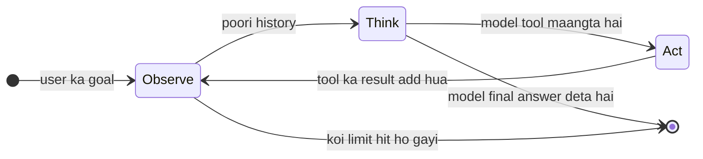
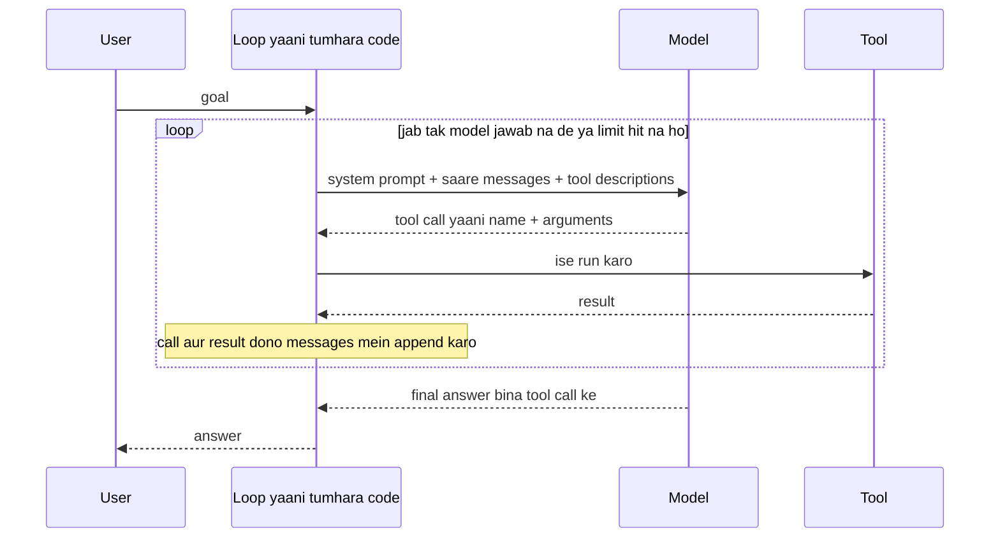

🏠 [Home](../../README.md) › [02 · The Agent Loop](./README.md) › 2.1 Observe–think–act loop

# 2.1 Observe–think–act loop

> **Level:** 🟢 Beginner · **Padhne ka time:** ~8 min · **Pehle padho:** [1.1 AI agent kya hai?](../01-foundations/01.1-what-is-an-ai-agent.md), [1.5 Agent ke andar kya-kya hota hai](../01-foundations/01.5-anatomy-of-an-agent.md)

**Ek line mein:** Agent teen steps baar-baar repeat karta hai (jo pata hai use observe karo, agla kadam kya ho yeh socho, phir act karo), jab tak model khud na bole ki kaam ho gaya ya koi limit use rok na de. Aur har step bas list mein kuch messages add karna hai.

📑 **Is page par**

- [Yeh kyun zaroori hai?](#-yeh-kyun-zaroori-hai)
- [Idea, simple words mein](#-idea-simple-words-mein)
- [Diagram se samjho](#-diagram-se-samjho)
- [Kaise kaam karta hai, step by step](#-kaise-kaam-karta-hai-step-by-step)
- [Example se samjho](#-example-se-samjho)
- [Code](#-code)
- [Aam galtiyan aur dhyan dene wali baatein](#-aam-galtiyan-aur-dhyan-dene-wali-baatein)
- [Yaad rakhne wali baatein](#-yaad-rakhne-wali-baatein)
- [Khud try karo](#-khud-try-karo)
- [Aur padhne ke liye](#-aur-padhne-ke-liye)

## 🤔 Yeh kyun zaroori hai?

Ek simple chatbot se pucho *"Hamara web server kaunsa port use karta hai?"*. Woh guess karega, kyunki woh sirf ek reply likh sakta hai. Yahi sawal agent se pucho. Woh pehle project ki files list karega, config file kholega, `port = 8080` padhega, aur tab jawab dega.

Farak smart model ka nahi hai. Farak ek chhote se code ka hai jo model ke around hota hai. Yeh code model ko dekhne, decide karne, kuch karne, aur phir se dekhne deta hai. Isi code ko [agent loop](../../GLOSSARY.md#agent-loop) kehte hain. [1.5](../01-foundations/01.5-anatomy-of-an-agent.md) mein yeh paanch parts mein se part ⑤ tha. Yeh chapter ise achhe se banata hai, kyunki:

- **Har agent framework yahi loop hai.** LangGraph, OpenAI Agents SDK, Claude Agent SDK: andar se sab yahi loop chalate hain. Ek baar yeh samajh gaye, to frameworks jaadu nahi lagenge.
- **Zyaada tar agent bugs yahin hote hain.** Agent jo kabhi rukta nahi, jo tool ka result bhool jaata hai, jo pehli error pe crash ho jaata hai: yeh sab loop ki problems hain.

## 🧠 Idea, simple words mein

Socho koi soup bana raha hai. Woh pehle **chakhta** hai (observe). Phir **decide** karta hai ki namak kam hai (think). Phir ek chutki namak **daalta** hai (act). Aur phir se chakhta hai. Woh bina chakhe paanch baar namak nahi daalta. Aur woh tab rukta hai jab swaad sahi ho jaaye, ya khaane ka time ho jaaye.

Agent bhi aise hi kaam karta hai:

1. **Observe.** Ab tak jo pata hai sab ikattha karo: goal, aur har action ka result. Yeh agent ki [short-term memory](../../GLOSSARY.md#short-term-memory) hai.
2. **Think.** Yeh sab [LLM](../../GLOSSARY.md#large-language-model-llm) ko bhejo. Model ya to jawab deta hai, ya kisi [tool](../../GLOSSARY.md#tool) ko chalane ke liye bolta hai.
3. **Act.** Model ne jo tool maanga, tumhara code use chalata hai. Uska result ek naya [observation](../../GLOSSARY.md#observation) hai, aur loop wapas step 1 pe jaata hai.

Model sirf step 2 karta hai. Woh khud kuch bhi run nahi kar sakta. Observe aur act tumhara code karta hai. Kab rukna hai, yeh bhi tumhara code decide karta hai.

## 👀 Diagram se samjho



*Bahar nikalne ke do raaste hain. Normal raasta yeh hai ki model tool maangne ki jagah jawab de de. Safety wala raasta yeh hai ki tumhara code model ko dobara call karne se pehle dekh le ki koi limit (steps, time, paisa) poori ho gayi hai.*

Yahi loop, parts ke beech messages ke roop mein:



*Sirf loop hi sabse baat karta hai. Model kabhi seedha tool se baat nahi karta. Woh bas batata hai ki use kya chahiye. Karna hai ya nahi, yeh tumhara code decide karta hai.*

## 🔍 Kaise kaam karta hai, step by step

**1. Observe: context banao.** Tumhare code ke paas messages ki ek list hoti hai. Pehle turn pe usme sirf user ka goal hota hai. API [stateless](../../GLOSSARY.md#stateless) hai ([1.4](../01-foundations/01.4-how-llms-work.md)), isliye har call pe poori list bhejni padti hai. Saath mein [system prompt](../../GLOSSARY.md#system-prompt) aur tool descriptions bhi jaate hain.

**2. Think: ek model call.** Model sab kuch padhta hai aur do mein se ek tarike se reply karta hai:

- **Final answer:** normal text. [Stop reason](../../GLOSSARY.md#stop-reason) batata hai ki turn normal tarike se khatam hua (Anthropic pe `end_turn`, OpenAI pe `stop`).
- **Ek ya zyaada tool calls:** ek structured request, jaise `read_file(path="config/app.toml")`. Stop reason bhi yahi batata hai (Anthropic pe `tool_use`, OpenAI pe `tool_calls`). Exact format chapter 03 mein hai.

**3. Act: tool chalao.** Tumhara code naam se function dhoondhta hai, arguments ke saath use chalata hai, aur output pakad leta hai. Agar fail hua to error pakad leta hai.

**4. Phir se observe: do cheezein append karo.** Pehle model ka reply (tool call), phir tool ka result. Result ko call se ek ID ke through joda jaata hai. Dono zaroori hain. Agar result ke saath matching call nahi hai, to API use reject kar deti hai.

**5. Repeat karo ya ruko.** Lambi list ke saath wapas step 2 pe jao. Jab model bina tool call ke jawab de, ya tumhari koi limit hit ho, tab ruko. Limits [2.4](./02.4-stopping-conditions.md) mein hain. Koi step fail ho to kya karna hai, woh [2.5](./02.5-handling-errors-in-the-loop.md) mein hai.

Har step conversation mein kya add karta hai, ek simple provider-neutral format mein:

| Step | Kaun karta hai | Messages mein kya add hota hai |
| --- | --- | --- |
| Goal | User | `{"role": "user", "content": "Which port does the web server listen on?"}` |
| Think | Model | `{"role": "assistant", "content": "", "tool_calls": [{"id": "call_2", "name": "read_file", ...}]}` |
| Act + observe | Tumhara code | `{"role": "tool", "tool_call_id": "call_2", "content": "[server]\nport = 8080"}` |
| Think (aakhri) | Model | `{"role": "assistant", "content": "The web server listens on port 8080."}` |

Loop ka ek chakkar matlab ek model call. Ek hi call mein model kai tools ek saath maang sakta hai ([3.5](../03-tools-and-function-calling/03.5-parallel-tool-calls.md)). Dobara think karne se pehle tum un sabko run karte ho.

## 💡 Example se samjho

Ek project assistant hai jiske paas do tools hain: `list_files` aur `read_file`. Usse pucha gaya *"Web server kaunse port pe listen karta hai?"*. Loop ke har chakkar mein yeh aana-jaana hota hai:

```text
Loop 1  observe  messages = [user: "Which port does the web server listen on?"]
        think    model -> tool call  list_files({})
        act      list_files -> "README.md\nconfig/app.toml\nconfig/db.toml"

Loop 2  observe  messages = [user, assistant(list_files), tool(result)]           3 messages
        think    model -> tool call  read_file({'path': 'config/app.toml'})
        act      read_file -> "[server]\nport = 8080\nworkers = 4"

Loop 3  observe  messages = [user, assistant, tool, assistant(read_file), tool]   5 messages
        think    model -> text "The web server listens on port 8080 (set in config/app.toml)."
        stop     no tool call, so this is the final answer
```

Teen cheezein dhyan se dekho:

- **Har step model ne khud chuna.** Kisi ne nahi bola ki pehle files list karo. Usne tools dekhe, goal padha aur decide kiya. Isi wajah se yeh [agent](../../GLOSSARY.md#agent) hai, [workflow](../../GLOSSARY.md#workflow) nahi.
- **Har observation ne agla decision badla.** Woh `config/app.toml` tabhi chun paaya kyunki loop 1 ne dikhaya ki yeh file exist karti hai.
- **Har loop mein messages badhte hain.** Loop 3 paanch messages bhejta hai. Isi wajah se lambe runs slow aur mehenge ho jaate hain ([1.4](../01-foundations/01.4-how-llms-work.md#-example-se-samjho)). Jaise kirana dukaan ka hisaab: har din ki list mein pichle din ka saara udhaar bhi likha rehta hai, to list roz lambi hoti jaati hai.

## 💻 Code

Example ke beech wala loop, har step mark kiya hua. `llm` koi bhi chat-model client hai (Anthropic, OpenAI, ya tests mein ek scripted fake). `user()` aur `tool_result()` bas upar table mein dikhaye gaye message dicts banate hain:

```python

def run_agent(llm, goal, tools, specs, system="", max_steps=10):
    messages = [user(goal)]                                  # OBSERVE: goal se shuru karo
    for _ in range(max_steps):                               # ek limit, taaki loop hamesha ruke
        reply = llm.chat(messages, system=system, tools=specs)   # THINK: ek model call
        messages.append(reply.to_message())                  # model ne jo kaha woh yaad rakho
        if not reply.tool_calls:                             # koi tool nahi maanga:
            return reply.text                                #   yahi final answer hai
        for call in reply.tool_calls:                        # ACT: har maanga gaya tool chalao
            output = tools[call.name](**call.arguments)
            messages.append(tool_result(call.id, output))    # OBSERVE: result add karo
    return "Stopped: reached the step limit."
```

Poora idea bas itna hi hai. [2.3](./02.3-a-50-line-agent-from-scratch.md) ise ek complete, runnable agent banata hai aur neeche ke raw Anthropic aur OpenAI versions bhi dikhata hai.

## 🚨 Aam galtiyan aur dhyan dene wali baatein

- **Model ka reply append karna bhool jaana.** Agar tumne tool result add kiya lekin woh assistant message nahi jisne use maanga tha, to agli request mein ek result hoga jiska koi matching call nahi. Anthropic ise 400 error ke saath reject karta hai. OpenAI bhi. Hamesha pehle reply append karo.
- **Woh tools chalana jo model ne maange nahi, ya maange hue skip kar dena.** Har tool call ka exactly ek result chahiye, ID se match kiya hua. Agar tum koi tool nahi chalana chahte, to use chhodo mat. Uske liye ek error result bhejo ([2.5](./02.5-handling-errors-in-the-loop.md)).
- **Koi limit nahi.** "Jab tak model jawab na de, loop chalao" theek hai, jab tak model kabhi jawab na de. Steps pe hamesha cap lagao, aur aksar time aur cost pe bhi ([2.4](./02.4-stopping-conditions.md)).
- **Beech mein kata hua text maan lena.** Jo reply `max_tokens` hit hone se ruka, usme tool call nahi hota. Ek bhola sa loop us aadhe sentence ko final answer samajh leta hai. Stop reason check karo ([2.4](./02.4-stopping-conditions.md)).
- **Model ko apni kalpana "observe" karne dena.** Text-based agents mein model kabhi kabhi tool ka result khud likh deta hai, wait karne ki jagah. History mein sirf wahi results jaane chahiye jo tumhare code ne banaye ([2.2](./02.2-react-explained.md)).

## ✅ Yaad rakhne wali baatein

- Agent loop **observe → think → act** repeat karta hai, jab tak model jawab na de ya koi limit use rok na de.
- Model sirf sochta hai. Observe, act, history sambhalna aur kab rukna hai, yeh sab tumhara code karta hai.
- Loop ka har chakkar ek model call hai, plus woh tool calls jo usne maange.
- Har step bas messages hain: model ka reply, phir har tool call ka ek result, ID se jude hue.
- History har loop mein badhti hai, isliye har loop pichle se zyaada mehenga padta hai.

## 🧪 Khud try karo

1. Example mein kitne model calls hue, aur aakhri call ne kitne messages bheje?
2. Ek chatbot jo ek hi reply mein jawab deta hai: woh teen mein se kaunsa step chalata hai, aur kaunse skip karta hai?
3. Tum upar wala `run_agent` example wale sawal pe `max_steps=1` ke saath call karte ho. Yeh kya return karega, aur kyun?

<details>
<summary>Answer dekho</summary>

1. Teen model calls. Aakhri call ne paanch messages bheje: goal, phir dono tools ke liye ek tool call aur ek result.
2. Woh user ke bheje hue input pe ek *think* step (ek model call) chalata hai. Woh kabhi *act* nahi karta aur kabhi koi result *observe* nahi karta. Isliye woh sirf wahi use kar sakta hai jo prompt mein ya model ki training mein pehle se hai.
3. Yeh `"Stopped: reached the step limit."` return karega. Model ka pehla reply ek tool maangta hai. To ek step ke baad loop ke paas tool result hai lekin jawab nahi, aur limit run khatam kar deti hai.

</details>

## 📚 Aur padhne ke liye

- [Building effective agents](https://www.anthropic.com/engineering/building-effective-agents) (Anthropic). Agents ko aise define karta hai: models jo loop mein tools use karte hain. Aur kehta hai ki loop ko simple rakho.
- [ReAct: Synergizing Reasoning and Acting in Language Models](https://arxiv.org/abs/2210.03629) (Yao et al., 2022). Yahi paper hai jisne "reason, act, observe" ko agent ka standard shape banaya. [2.2](./02.2-react-explained.md) ise detail mein samjhata hai.
- [LLM Powered Autonomous Agents](https://lilianweng.github.io/posts/2023-06-23-agent/) (Lilian Weng). Loop ke around planning, memory aur tool use ka ek bada survey.

<!-- FOOTER -->

---

⬅️ **Pichla:** [1.6 Agent kab use NAHI karna chahiye](../01-foundations/01.6-when-not-to-use-an-agent.md) ·
🏠 [Chapter home](./README.md) ·
➡️ **Agla:** [2.2 ReAct ko samjho](./02.2-react-explained.md)
