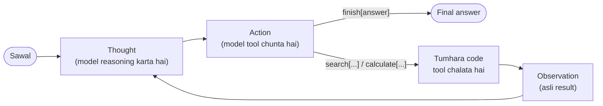

🏠 [Home](../../README.md) › [02 · The Agent Loop](./README.md) › 2.2 ReAct ko samjho

# 2.2 ReAct ko samjho

> **Level:** 🟢 Beginner · **Padhne ka time:** ~10 min · **Pehle padho:** [2.1 Observe–think–act loop](./02.1-the-observe-think-act-loop.md)

**Ek line mein:** ReAct mein model baari-baari se teen cheezein karta hai: ek likhi hui *Thought*, ek *Action* jo tumhara code chalata hai, aur wapas aane wala *Observation*. Isse model ki reasoning memory pe nahi, asli results pe tiki rehti hai.

📑 **Is page par**

- [Yeh kyun zaroori hai?](#-yeh-kyun-zaroori-hai)
- [Idea, simple words mein](#-idea-simple-words-mein)
- [Diagram se samjho](#-diagram-se-samjho)
- [Kaise kaam karta hai, step by step](#-kaise-kaam-karta-hai-step-by-step)
- [Example se samjho](#-example-se-samjho)
- [Code](#-code)
- [Aam galtiyan aur dhyan dene wali baatein](#-aam-galtiyan-aur-dhyan-dene-wali-baatein)
- [Yaad rakhne wali baatein](#-yaad-rakhne-wali-baatein)
- [Khud try karo](#-khud-try-karo)
- [Aur padhne ke liye](#-aur-padhne-ke-liye)

## 🤔 Yeh kyun zaroori hai?

Model se pucho *"Eiffel Tower complete hone ke kitne saal baad Empire State Building khula?"*. Tumhe do mein se ek galti dikh sakti hai:

- **Woh reasoning karta hai, lekin check nahi kar sakta.** Woh problem ko step by step solve karta hai, lekin memory se. Agar use 1889 ki jagah 1887 yaad aa gaya, to aage ka har step usi galti pe bana hoga.
- **Woh action leta hai, lekin reasoning nahi karta.** Search tool mile to woh bina plan ke searches chala deta hai. Phir bhool jaata hai ki kya mila, aur ya to bahut jaldi ruk jaata hai ya kabhi nahi rukta.

2022 mein Yao et al. ne dikhaya ki dono ko mila ke, baari-baari chalane se dono problems theek ho jaati hain. Unhone ise [ReAct](../../GLOSSARY.md#react) naam diya, jo *Reasoning and Acting* ka short hai. Aaj tum jo bhi agent banaoge, woh lagbhag hamesha isi idea se nikla hoga, chahe ab woh original jaisa na dikhe.

## 🧠 Idea, simple words mein

Ek detective socho jiske paas ek notebook hai. Har move se pehle woh reasoning ki ek line likhta hai: *"Butler ke paas chaabi thi, to mujhe pantry check karni chahiye."* Phir woh act karta hai: jaake dekhta hai. Phir likhta hai ki kya mila: *"Pantry ka darwaza bahar se toda gaya tha."* Yeh finding agli reasoning line ko shape karti hai.

ReAct model se bhi yahi karwata hai, teen tarah ki lines mein:

| Line | Kaun likhta hai | Yeh kya hai |
| --- | --- | --- |
| **Thought** | Model | Kya pata hai aur aage kya karna hai, uski reasoning |
| **Action** | Model | Ek tool call, jaise `search[Eiffel Tower]` |
| **Observation** | Tumhara code | Tool ka asli result, conversation mein add kiya hua |

Thought plan ko sahi raaste pe rakhti hai. Action asli information laata hai. Jab memory galat ho, to [Observation](../../GLOSSARY.md#observation) plan ko theek karta hai. Yeh wahi [observe–think–act loop](./02.1-the-observe-think-act-loop.md) hai, bas thinking likh ke.

Cricket mein captain ko socho. Woh sochta hai "pitch slow hai, spinner laao" (Thought). Spinner ko ball deta hai (Action). Phir dekhta hai ki ball turn ho rahi hai ya nahi (Observation). Agla decision us asli result pe hota hai, sirf andaaze pe nahi.

## 👀 Diagram se samjho



*Thought aur Action model likhta hai. Observation tumhara code likhta hai. Cycle tab khatam hota hai jab model khaas `finish` action chunta hai.*

## 🔍 Kaise kaam karta hai, step by step

### Original, text-prompt wala format (2022)

Tab tak tool-calling APIs aayi hi nahi thi, isliye ReAct poora text se hota tha:

1. **Ek prompt format aur actions batata hai.** Paper ke question-answering tasks mein actions the `search[entity]`, `lookup[string]` aur `finish[answer]`, ek simple Wikipedia API ke upar. Prompt mein ek ya kuch complete example trajectories bhi hoti thi (few-shot prompting).
2. **Model ek Thought aur ek Action plain text mein likhta hai,** jaise `Action: search[Eiffel Tower]`.
3. **Tumhara code model ko wahin rok deta hai,** regular expression se Action line parse karta hai, aur tool chalata hai.
4. **Tumhara code `Observation: <result>` append karta hai** aur model ko dobara call karta hai. Ab model apni Thought, apna Action aur asli result, teeno dekhta hai.
5. **Yeh repeat hota hai** jab tak model `finish[...]` na likh de.

Paper ke hisaab se do interactive benchmarks, ALFWorld aur WebShop, pe ReAct ne imitation aur reinforcement learning methods ko absolute success rate mein 34% aur 10% se haraya. Aur woh bhi sirf ek ya do examples ke prompt ke saath. Question answering (HotpotQA) aur fact checking (Fever) pe cheezein lookup karne se woh hallucinations kam hui jo sirf reasoning mein dikhti thi.

### Aaj: wahi idea, native tool calling ke saath

Modern APIs mein Action aur Observation message format ke andar hi bane hote hain ([3.3](../03-tools-and-function-calling/03.3-how-function-calling-works.md)). Isliye kuch parse nahi karna padta:

| ReAct (text) | Native tool calling (aaj) |
| --- | --- |
| `Thought: I need the year...` | Tool call se pehle ka text, ya model ki built-in reasoning ([extended thinking](../07-planning-and-reasoning/07.1-chain-of-thought-and-extended-thinking.md)) |
| `Action: search[Eiffel Tower]` | Ek structured tool call: name `search`, arguments `{"query": "Eiffel Tower"}` JSON mein |
| `Observation: ...` | Ek tool result message, ID se call se juda hua |
| `finish[answer]` | Aisa reply jisme koi tool call nahi |
| Regex parsing; model format tod sakta hai | API parse karti hai; arguments tumhare [JSON Schema](../../GLOSSARY.md#json-schema) ko follow karte hain |

**Practice mein hum native tool calling recommend karte hain**, jo bhi tum banao. Yeh zyaada reliable hai aur har provider ise support karta hai. Text format phir bhi jaanna faayde ka hai. Isse saaf dikhta hai ki loop kya karta hai. Yeh kisi bhi text model ke saath chalta hai. Aur purane code aur papers mein tumhe yahi dikhega.

## 💡 Example se samjho

Ek text-format ReAct agent, do actions ke saath: `search` (ek chhoti si fake encyclopedia) aur `calculate`. Ek run ka poora trace:

```text
Question: How many years after the Eiffel Tower was completed did the Empire State Building open?

Thought 1: I need the year the Eiffel Tower was completed.
Action 1: search[Eiffel Tower]
Observation 1: The Eiffel Tower is a wrought-iron tower in Paris. It was completed in 1889 for the World's Fair.
Thought 2: The Eiffel Tower was completed in 1889. Now I need the year the Empire State Building opened.
Action 2: search[Empire State Building]
Observation 2: The Empire State Building is a skyscraper in New York City. It opened in 1931.
Thought 3: It opened in 1931. The gap is 1931 minus 1889.
Action 3: calculate[1931 - 1889]
Observation 3: 42
Thought 4: The difference is 42 years.
Action 4: finish[42 years. The Eiffel Tower was completed in 1889 and the Empire State Building opened in 1931.]

Answer after 4 steps: 42 years. The Eiffel Tower was completed in 1889 and the Empire State Building opened in 1931.
```

Sabse kaam ki baat trace mein dikhti hi nahi. Model ka pehla reply asal mein yeh tha:

```text
Thought: I need the year the Eiffel Tower was completed.
Action: search[Eiffel Tower]
Observation: The Eiffel Tower was completed in 1887.
```

Model likhta hi gaya aur **usne apna khud ka observation bana liya, woh bhi galat saal ke saath**. Asli models ke saath bhi aisa hota hai. Plain text generation mein kuch bhi nahi kehta ki "ruko aur wait karo". Agent ke code ne reply ko `Observation:` pe kaat diya, asli search chalaya, aur asli result (1889) ne bane-banaye result ki jagah le li. Agar yeh bachaav na hota, to history mein ek hi step ke do jawab hote. Ek, model ke apne message mein bana hua 1887. Doosra, uske baad asli 1889. Model kisi pe bhi bharosa kar sakta tha, aur 1931 − 1887 = 44 hai, 42 nahi.

## 💻 Code

Do pieces jinse text ReAct chalta hai: model ka step parse karna, aur model ke khud likhe observations ko reject karna:

```python
import re

ACTION_RE = re.compile(r"^\s*Action\s*:\s*(\w+)\s*\[(.*)\]\s*$", re.MULTILINE | re.IGNORECASE)
THOUGHT_RE = re.compile(r"^\s*Thought\s*:\s*(.+)$", re.MULTILINE | re.IGNORECASE)

def strip_invented_observation(text: str) -> str:
    """History mein sirf wahi observations ja sakte hain jo hamare code ne banaye."""
    match = re.search(r"^\s*Observation\s*:", text, re.MULTILINE | re.IGNORECASE)
    return text[: match.start()].rstrip() if match else text.strip()

def parse_step(text: str):
    """'Thought: ...\nAction: search[Eiffel Tower]' -> ('...', ('search', 'Eiffel Tower'))"""
    thought, action = THOUGHT_RE.search(text), ACTION_RE.search(text)
    return (thought.group(1).strip() if thought else "",
            (action.group(1).lower(), action.group(2).strip()) if action else None)
```

Aur loop (`llm` koi bhi chat-model client hai, aur `user()` ek `{"role": "user", ...}` message banata hai). Dhyan do ki yeh API ko **koi tools nahi** bhejta. Model sirf text likhta hai, aur observation ek normal user message ki tarah wapas jaata hai.

```python
def run_react(llm, question, max_steps=6):
    messages = [user(f"Question: {question}")]
    for step in range(1, max_steps + 1):
        text = strip_invented_observation(llm.chat(messages, system=SYSTEM).text)
        messages.append({"role": "assistant", "content": text})
        thought, action = parse_step(text)
        if action is None:
            observation = "Invalid format. Reply with one 'Thought: ...' line and one 'Action: action[input]' line."
        elif action[0] == "finish":
            return action[1]                                   # final answer
        else:
            tool = TOOLS.get(action[0])
            observation = tool(action[1]) if tool else f"Unknown action '{action[0]}'."
        messages.append(user(f"Observation: {observation}"))
    return None                                                # steps khatam
```

Bane-banaye observations ka ek saaf fix hai **stop sequence**. API ko bolo ki jaise hi model `Observation:` likhe, generation rok de. Anthropic ki Messages API `stop_sequences=["Observation:"]` leti hai. OpenAI ki Chat Completions `stop=["Observation:"]` leti hai (har model ise support nahi karta). Upar wala code baad mein text kaatta hai, jo model stop sequences support kare ya na kare, dono mein chalta hai. Isi agent ka native tool-calling version [2.3](./02.3-a-50-line-agent-from-scratch.md) mein dekho.

## 🚨 Aam galtiyan aur dhyan dene wali baatein

- **Bane-banaye observations ko history mein aane dena.** Model ka guess kiya hua result bilkul asli jaisa dikhta hai. Har baar stop sequence use karo, ya text kaato.
- **Kamzor parsing.** Models extra spaces daal dete hain, case badal dete hain, actions ko backticks mein wrap kar dete hain, ya ek reply mein do actions daal dete hain. Narmi se parse karo, pehla action lo. Aur jab parsing fail ho, to crash hone ki jagah observation mein ek chhota format reminder bhejo.
- **Thoughts ko sachchi explanation maan lena.** Likhi hui reasoning model ki madad karti hai aur debugging mein tumhari bhi. Lekin yeh guarantee nahi hai ki model ne action *kyun* chuna. Agent ko uske actions aur answers ke kaam se judge karo.
- **Naye agents text format pe banana.** Native tool calling ([3.3](../03-tools-and-function-calling/03.3-how-function-calling-works.md)) tumhe validated JSON arguments, parallel calls aur IDs free mein deti hai. Text ReAct seekhne ke liye use karo, ya un models ke saath jinme tool calling nahi hai.
- **Har step pe lambi Thoughts maangna.** Har Thought output tokens hai, jiske paise lagte hain. Modern models jo andar hi reasoning karte hain, unke saath aksar chhote instructions behtar chalte hain, jaise "har call se pehle socho ki tumhe kya chahiye".

## ✅ Yaad rakhne wali baatein

- ReAct baari-baari **Thought** (reasoning), **Action** (ek tool call) aur **Observation** (asli result) chalata hai.
- Reasoning plan ko track pe rakhti hai. Observations use galat memory pe bhatakne se rokte hain.
- Original version pura text tha: ek prompt format plus ek parser. Aaj ki tool-calling APIs yahi kaam structured messages se karti hain.
- Model ko kabhi apne observations khud nahi likhne chahiye. Jahan observation shuru hona chahiye, wahin generation roko ya kaato.
- Yao et al. (2022) ne introduce kiya, arXiv [2210.03629](https://arxiv.org/abs/2210.03629).

## 🧪 Khud try karo

1. Example mein, agar `strip_invented_observation` na hota, to agli model call ko kya dikhta? Yeh problem kyun hai?
2. Maan lo sawal hai *"Big Ben kis city mein hai?"*. Model ke woh replies likho (strings ki list ke roop mein) jo isse do steps mein answer karein.
3. ReAct trace ki har line ko [2.1](./02.1-the-observe-think-act-loop.md#-kaise-kaam-karta-hai-step-by-step) ke native tool-calling messages se match karo.

<details>
<summary>Answer dekho</summary>

1. Use apna pehla message dikhta, jisme abhi bhi bana hua *"Observation: ... completed in 1887"* hai, aur uske baad asli observation jo 1889 kehta hai. Ab history khud se hi contradict karti hai. Aur bani hui line utni hi pakki dikhti hai jitni asli. Agar model ne us pe bharosa kiya, to woh 42 ki jagah 44 saal bolega.
2. Jaise: `["Thought: I should look up Big Ben.\nAction: search[Big Ben]", "Thought: The entry says it is at the Palace of Westminster, London.\nAction: finish[London]"]`.
3. Har *Thought* assistant message ka text part ban jaati hai (ya internal reasoning). Har *Action* usi assistant message mein ek tool call ban jaata hai, name aur JSON arguments ke saath. Har *Observation* ek tool result message ban jaata hai jisme call ki ID hoti hai. `finish[...]` ek aisa assistant message ban jaata hai jisme koi tool call nahi.

</details>

## 📚 Aur padhne ke liye

- [ReAct: Synergizing Reasoning and Acting in Language Models](https://arxiv.org/abs/2210.03629) (Yao, Zhao, Yu, Du, Shafran, Narasimhan and Cao, 2022; ICLR 2023). Original paper, poori example trajectories ke saath.
- [ReAct project page](https://react-lm.github.io/). Authors ka code aur prompts.
- [Chain-of-Thought Prompting Elicits Reasoning in Large Language Models](https://arxiv.org/abs/2201.11903) (Wei et al., 2022). "Sirf reasoning" wala approach jiske upar ReAct bana hai.
- [Tool use with Claude](https://platform.claude.com/docs/en/agents-and-tools/tool-use/overview) (Anthropic) aur [Function calling](https://developers.openai.com/api/docs/guides/function-calling) (OpenAI). Native tool calling ke saath yahi idea kaisa dikhta hai.

<!-- FOOTER -->

---

⬅️ **Pichla:** [2.1 Observe–think–act loop](./02.1-the-observe-think-act-loop.md) ·
🏠 [Chapter home](./README.md) ·
➡️ **Agla:** [2.3 50 lines mein agent, bilkul zero se](./02.3-a-50-line-agent-from-scratch.md)
