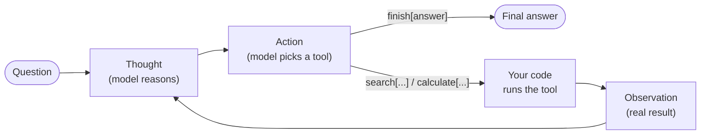

🏠 [Home](../../README.md) › [02 · The Agent Loop](./README.md) › 2.2 ReAct explained

# 2.2 ReAct explained

> **Difficulty:** 🟢 Beginner · **Reading time:** ~10 min · **Prerequisites:** [2.1 The observe–think–act loop](./02.1-the-observe-think-act-loop.md)

**In one sentence:** ReAct makes the model alternate between a written *Thought*, an *Action* your code runs, and the *Observation* that comes back, so its reasoning is grounded in real results instead of memory.

📑 **On this page**

- [Why does this matter?](#-why-does-this-matter)
- [The idea, in plain words](#-the-idea-in-plain-words)
- [Picture it](#-picture-it)
- [How it works, step by step](#-how-it-works-step-by-step)
- [Worked example](#-worked-example)
- [Code](#-code)
- [Common mistakes & gotchas](#-common-mistakes--gotchas)
- [Key takeaways](#-key-takeaways)
- [Try it yourself](#-try-it-yourself)
- [Further reading](#-further-reading)

## 🤔 Why does this matter?

Ask a model *"How many years after the Eiffel Tower was completed did the Empire State Building open?"* and you might see one of two failures:

- **It reasons but cannot check.** It works through the problem step by step, but from memory. If it misremembers 1887 instead of 1889, every later step builds on the mistake.
- **It acts but does not reason.** Given a search tool, it fires off searches without planning, loses track of what it has found, and stops too early or never.

In 2022, Yao et al. showed that interleaving the two fixes both problems. They called it [ReAct](../../GLOSSARY.md#react), short for *Reasoning and Acting*. Almost every agent you will build today is a descendant of this idea, even when it no longer looks like the original.

## 🧠 The idea, in plain words

Picture a detective with a notebook. Before each move they write a line of reasoning: *"The butler had a key, so I should check the pantry."* Then they act: they go and look. Then they write what they found: *"Pantry door forced from outside."* That finding shapes the next line of reasoning.

ReAct asks the model to work the same way, in three kinds of lines:

| Line | Who writes it | What it is |
| --- | --- | --- |
| **Thought** | The model | Reasoning about what is known and what to do next |
| **Action** | The model | One tool call, such as `search[Eiffel Tower]` |
| **Observation** | Your code | The tool's real result, added to the conversation |

The Thought keeps the plan on track. The Action gets real information. The [Observation](../../GLOSSARY.md#observation) corrects the plan when memory was wrong. It is the [observe–think–act loop](./02.1-the-observe-think-act-loop.md) with the thinking written down.

## 👀 Picture it



*The model writes the Thought and the Action; your code writes the Observation. The cycle ends when the model chooses the special `finish` action.*

## 🔍 How it works, step by step

### The original, text-prompted format (2022)

Tool-calling APIs did not exist yet, so ReAct was done entirely with text:

1. **A prompt describes the format and the actions.** In the paper's question-answering tasks, the actions were `search[entity]`, `lookup[string]` and `finish[answer]` over a simple Wikipedia API. The prompt also contained one or a few complete example trajectories (few-shot prompting).
2. **The model writes a Thought and an Action as plain text,** for example `Action: search[Eiffel Tower]`.
3. **Your code stops the model there,** parses the Action line with a regular expression, and runs the tool.
4. **Your code appends `Observation: <result>`** and calls the model again. The model now sees its own Thought, its Action and the real result.
5. **This repeats** until the model writes `finish[...]`.

The paper reported that on two interactive benchmarks, ALFWorld and WebShop, ReAct beat imitation and reinforcement learning methods by an absolute success rate of 34% and 10%, while being prompted with only one or two examples. On question answering (HotpotQA) and fact checking (Fever), looking things up reduced the hallucinations seen with reasoning alone.

### Today: the same idea, with native tool calling

Modern APIs build the Action and Observation into the message format ([3.3](../03-tools-and-function-calling/03.3-how-function-calling-works.md)), so there is nothing to parse:

| ReAct (text) | Native tool calling (today) |
| --- | --- |
| `Thought: I need the year...` | Text before the tool call, or the model's built-in reasoning ([extended thinking](../07-planning-and-reasoning/07.1-chain-of-thought-and-extended-thinking.md)) |
| `Action: search[Eiffel Tower]` | A structured tool call: name `search`, arguments `{"query": "Eiffel Tower"}` as JSON |
| `Observation: ...` | A tool result message linked to the call by ID |
| `finish[answer]` | A reply with no tool call |
| Regex parsing; the model can break the format | The API parses it; arguments follow your [JSON Schema](../../GLOSSARY.md#json-schema) |

**In practice, we recommend native tool calling** for anything you build. It is more reliable and every provider supports it. The text format is still worth knowing: it shows exactly what the loop does, it works with any text model, and you will see it in older code and papers.

## 💡 Worked example

From [`examples/02-react-text-agent`](../../examples/02-react-text-agent/README.md), a text-format ReAct agent with two actions, `search` (a tiny fake encyclopedia) and `calculate`. The full trace, offline with `MockLLM`:

```text
Question: How many years after the Eiffel Tower was completed did the Empire State Building open?

Thought 1: I need the year the Eiffel Tower was completed.
Action 1: search[Eiffel Tower]
Observation 1: The Eiffel Tower is a wrought-iron tower in Paris. It was completed in 1889 for the World's Fair.
Thought 2: The Eiffel Tower was completed in 1889. Now I need the year the Empire State Building opened.
Action 2: search[Empire State Building]
Observation 2: The Empire State Building is a skyscraper in New York City. It opened in 1931.
Thought 3: It opened in 1931. The gap is 1931 minus 1889.
Action 3: calculate[1931 - 1889]
Observation 3: 42
Thought 4: The difference is 42 years.
Action 4: finish[42 years. The Eiffel Tower was completed in 1889 and the Empire State Building opened in 1931.]

Answer after 4 steps: 42 years. The Eiffel Tower was completed in 1889 and the Empire State Building opened in 1931.
```

What the trace does not show is the most instructive part. The model's first reply actually was:

```text
Thought: I need the year the Eiffel Tower was completed.
Action: search[Eiffel Tower]
Observation: The Eiffel Tower was completed in 1887.
```

The model kept writing and **invented its own observation, with the wrong year**. This happens with real models too: nothing in plain text generation says "stop and wait". The agent's code cut the reply at `Observation:`, ran the real search, and the real result (1889) replaced the invented one. Without that defence, the history would hold two answers for the same step: the invented 1887 inside the model's own message, and the real 1889 after it. The model might trust either, and 1931 − 1887 is 44, not 42.

## 💻 Code

The two pieces that make text ReAct work: parsing the model's step, and refusing observations the model wrote itself. From [`examples/02-react-text-agent/main.py`](../../examples/02-react-text-agent/main.py):

```python
import re

ACTION_RE = re.compile(r"^\s*Action\s*:\s*(\w+)\s*\[(.*)\]\s*$", re.MULTILINE | re.IGNORECASE)
THOUGHT_RE = re.compile(r"^\s*Thought\s*:\s*(.+)$", re.MULTILINE | re.IGNORECASE)

def strip_invented_observation(text: str) -> str:
    """Only observations produced by our code may enter the history."""
    match = re.search(r"^\s*Observation\s*:", text, re.MULTILINE | re.IGNORECASE)
    return text[: match.start()].rstrip() if match else text.strip()

def parse_step(text: str):
    """'Thought: ...\nAction: search[Eiffel Tower]' -> ('...', ('search', 'Eiffel Tower'))"""
    thought, action = THOUGHT_RE.search(text), ACTION_RE.search(text)
    return (thought.group(1).strip() if thought else "",
            (action.group(1).lower(), action.group(2).strip()) if action else None)
```

And the loop: note that it sends **no tools** to the API. The model only writes text, and the observation goes back as an ordinary user message.

```python
def run_react(llm, question, max_steps=6):
    messages = [user(f"Question: {question}")]
    for step in range(1, max_steps + 1):
        text = strip_invented_observation(llm.chat(messages, system=SYSTEM).text)
        messages.append({"role": "assistant", "content": text})
        thought, action = parse_step(text)
        if action is None:
            observation = "Invalid format. Reply with one 'Thought: ...' line and one 'Action: action[input]' line."
        elif action[0] == "finish":
            return action[1]                                   # the final answer
        else:
            tool = TOOLS.get(action[0])
            observation = tool(action[1]) if tool else f"Unknown action '{action[0]}'."
        messages.append(user(f"Observation: {observation}"))
    return None                                                # out of steps
```

A cleaner fix for invented observations is a **stop sequence**: ask the API to stop generating as soon as the model writes `Observation:`. Anthropic's Messages API takes `stop_sequences=["Observation:"]`; OpenAI's Chat Completions takes `stop=["Observation:"]` (not every model supports it). The shared wrapper does not expose stop sequences, so the example cuts the text afterwards instead. For the native tool-calling version of the same agent, see [2.3](./02.3-a-50-line-agent-from-scratch.md).

## 🚨 Common mistakes & gotchas

- **Letting invented observations into the history.** The model's guess at a result looks exactly like a real one. Use a stop sequence, or cut the text, every time.
- **Brittle parsing.** Models add extra spaces, change case, wrap actions in backticks or put two actions in one reply. Parse leniently, take the first action, and when parsing fails, reply with a short format reminder as the observation instead of crashing.
- **Treating Thoughts as a faithful explanation.** The written reasoning helps the model and helps you debug, but it is not a guaranteed record of *why* the model chose an action. Judge the agent by what its actions and answers do.
- **Building new agents on the text format.** Native tool calling ([3.3](../03-tools-and-function-calling/03.3-how-function-calling-works.md)) gives you validated JSON arguments, parallel calls and IDs for free. Use text ReAct for learning, or with models that have no tool calling.
- **Asking for long Thoughts on every step.** Every Thought is output tokens you pay for. Modern models that reason internally often do better with brief instructions such as "think about what you need before each call".

## ✅ Key takeaways

- ReAct interleaves **Thought** (reasoning), **Action** (a tool call) and **Observation** (the real result).
- Reasoning keeps the plan on track; observations stop it drifting on wrong memories.
- The original version was pure text: a prompt format plus a parser. Today's tool-calling APIs do the same thing with structured messages.
- The model must never write its own observations. Stop or cut generation where the observation should begin.
- Introduced by Yao et al. (2022), arXiv [2210.03629](https://arxiv.org/abs/2210.03629).

## 🧪 Try it yourself

1. In the worked example, what would the next model call have seen if `strip_invented_observation` were missing? Why is that a problem?
2. Change the example's question to *"In which city is Big Ben?"* and write the scripted replies (`SCRIPT`) the model would need to answer it in two steps.
3. Map each line of the ReAct trace to the native tool-calling messages from [2.1](./02.1-the-observe-think-act-loop.md#-how-it-works-step-by-step).

<details>
<summary>Show answer</summary>

1. Its own first message, still containing the invented *"Observation: ... completed in 1887"*, followed by the real observation saying 1889. The history now contradicts itself, and the invented line looks just as authoritative as the real one. If the model trusts it, it answers 44 years instead of 42.
2. For example: `["Thought: I should look up Big Ben.\nAction: search[Big Ben]", "Thought: The entry says it is at the Palace of Westminster, London.\nAction: finish[London]"]`.
3. Each *Thought* becomes the text part of an assistant message (or internal reasoning). Each *Action* becomes a tool call in that same assistant message, with a name and JSON arguments. Each *Observation* becomes a tool result message carrying the call's ID. `finish[...]` becomes an assistant message with no tool calls.

</details>

## 📚 Further reading

- [ReAct: Synergizing Reasoning and Acting in Language Models](https://arxiv.org/abs/2210.03629) (Yao, Zhao, Yu, Du, Shafran, Narasimhan and Cao, 2022; ICLR 2023). The original paper, with full example trajectories.
- [ReAct project page](https://react-lm.github.io/). Code and prompts from the authors.
- [Chain-of-Thought Prompting Elicits Reasoning in Large Language Models](https://arxiv.org/abs/2201.11903) (Wei et al., 2022). The "reasoning only" approach that ReAct builds on.
- [Tool use with Claude](https://platform.claude.com/docs/en/agents-and-tools/tool-use/overview) (Anthropic) and [Function calling](https://developers.openai.com/api/docs/guides/function-calling) (OpenAI). How the same idea looks with native tool calling.

<!-- FOOTER -->

---

⬅️ **Previous:** [2.1 The observe–think–act loop](./02.1-the-observe-think-act-loop.md) ·
🏠 [Chapter home](./README.md) ·
➡️ **Next:** [2.3 A 50-line agent from scratch](./02.3-a-50-line-agent-from-scratch.md)
