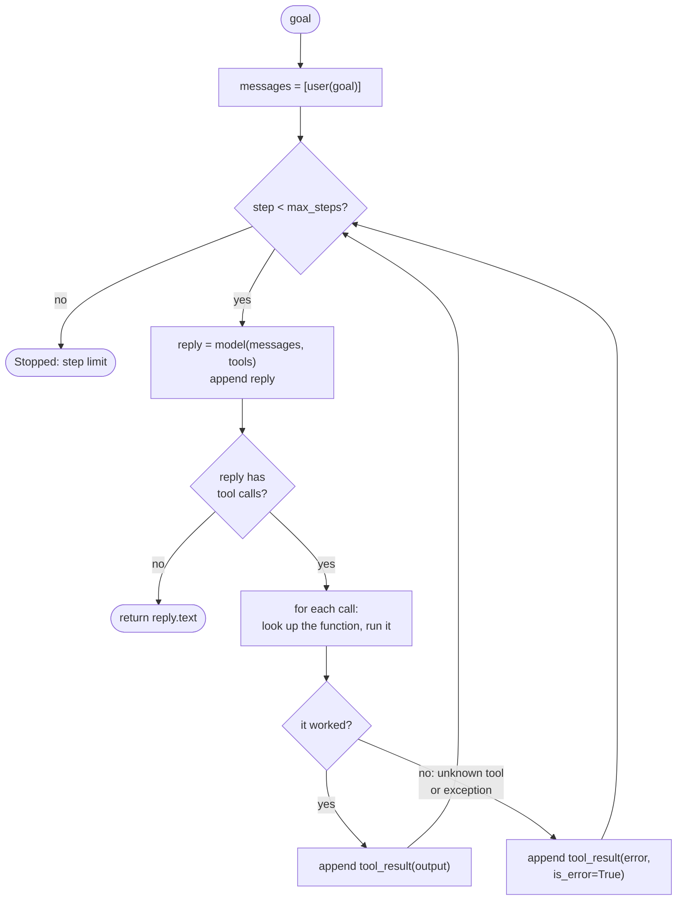

🏠 [Home](../../README.md) › [02 · The Agent Loop](./README.md) › 2.3 A 50-line agent from scratch

# 2.3 A 50-line agent from scratch

> **Difficulty:** 🟡 Intermediate · **Reading time:** ~15 min · **Prerequisites:** [2.1 The observe–think–act loop](./02.1-the-observe-think-act-loop.md), [0.3 Setup](../00-start-here/00.3-setup.md)

**In one sentence:** A working, tool-using agent needs no framework: a list of messages, a few functions with descriptions, and a loop of about 20 lines, which you can write once against the shared wrapper and once against each provider's raw SDK.

📑 **On this page**

- [Why does this matter?](#-why-does-this-matter)
- [The idea, in plain words](#-the-idea-in-plain-words)
- [Picture it](#-picture-it)
- [How it works, step by step](#-how-it-works-step-by-step)
- [Worked example](#-worked-example)
- [Code](#-code)
- [Common mistakes & gotchas](#-common-mistakes--gotchas)
- [Key takeaways](#-key-takeaways)
- [Try it yourself](#-try-it-yourself)
- [Further reading](#-further-reading)

## 🤔 Why does this matter?

Agent frameworks can make agents look complicated: runners, graphs, executors, callbacks. When something goes wrong inside one, it is hard to tell whether the problem is your tool, your prompt, or the framework.

Writing the loop yourself, once, fixes that. You will see that the core of an agent is short enough to read in a minute. After that, every framework is just this loop plus extras, and you can judge whether you need those extras. Anthropic's own guidance on [building effective agents](https://www.anthropic.com/engineering/building-effective-agents) makes the same point: start with the simplest thing that works, and add complexity only when it pays for itself.

## 🧠 The idea, in plain words

You need four things:

1. **A model client** that sends messages and returns a reply.
2. **Tools:** plain Python functions, each with a description the model reads (name, what it does, a [JSON Schema](../../GLOSSARY.md#json-schema) for its inputs).
3. **A list of messages:** the agent's [short-term memory](../../GLOSSARY.md#short-term-memory).
4. **A loop** that calls the model, runs any tools it asks for, adds the results to the list, and repeats.

Think of it like a kitchen order system. The order list (messages) sits on the counter. The chef (the model) reads it and either says "dish is ready" or shouts "I need onions chopped". A kitchen hand (your loop) chops the onions, writes "onions chopped" on the list, and hands it back. Nobody needs a manager to run this.

## 👀 Picture it



*Every box is one or two lines of Python. The only branches are "did the model ask for a tool?" and "did the tool work?", plus the step limit that guarantees the loop ends.*

## 🔍 How it works, step by step

**1. Describe each tool.** A tool is a function plus a spec. The spec is what the model sees; the function is what your code runs. The shared wrapper's neutral spec format is `{"name", "description", "input_schema"}`, which happens to be exactly Anthropic's format; it converts it to OpenAI's for you.

**2. Start the history.** `messages = [user(goal)]`.

**3. Call the model with the history and the tool specs.** One call per step.

**4. Append the reply, always.** Even when it is a tool call. The next request must contain the call so the result has something to answer.

**5. No tool calls? Done.** The reply's text is the final answer. (This minimal version trusts that; [2.4](./02.4-stopping-conditions.md) adds checks for cut-off replies and refusals.)

**6. Otherwise run every tool call.** Look up the function by name. Wrap the call in `try`/`except`: a tool that crashes must become an error message for the model, not a crash of your program.

**7. Append one result per call,** carrying the call's ID and an error flag. Then go back to step 3.

**8. Stop after `max_steps`.** Without this line, a confused model can loop forever and spend your money.

## 💡 Worked example

From [`examples/02-agent-from-scratch`](../../examples/02-agent-from-scratch/README.md). The agent can see a small, in-memory project and is asked which port the web server uses. Offline, with `MockLLM`:

```text
Goal: Which port does the web server listen on?

list_files({}) -> 'README.md\nconfig/app.toml\nconfig/db.toml'
read_file({'path': 'config/app.toml'}) -> '[server]\nport = 8080\nworkers = 4'

Answer: The web server listens on port 8080 (set in config/app.toml).
```

Set `LLM_PROVIDER=anthropic` or `openai` in `examples/.env` and the same file runs on a real model, which makes its own choices. A real model might read both `.toml` files, or skip `list_files` if it guesses the path; the loop handles all of these.

**Is it really 50 lines?** We counted, with a test, so the claim stays honest. "Lines of code" means lines that are not blank, not only a comment and not part of a docstring:

| File | Lines of code | What is in it |
| --- | --- | --- |
| `main.py` | 55 | imports, fake files, two tools and their specs, the loop, a demo script |
| `run_agent` (inside `main.py`) | 18 | the loop itself, including error handling and a trace |
| `raw_anthropic.py` | 43 | the same agent on the `anthropic` SDK, no wrapper |
| `raw_openai.py` | 50 | the same agent on the `openai` SDK, no wrapper |

So: about 50 lines for a whole agent, and under 20 for the loop.

## 💻 Code

### 1. On the shared wrapper (runs offline)

The full agent, from [`examples/02-agent-from-scratch/main.py`](../../examples/02-agent-from-scratch/main.py), minus the demo data:

```python
from common import LLM, tool_result, user

def list_files() -> str:
    return "\n".join(FILES)

def read_file(path: str) -> str:
    return FILES[path]  # an unknown path raises KeyError; the loop turns it into an error result

TOOLS = {
    "list_files": (list_files, {
        "name": "list_files",
        "description": "List every file path in the project.",
        "input_schema": {"type": "object", "properties": {}},
    }),
    "read_file": (read_file, {
        "name": "read_file",
        "description": "Read one file. Use an exact path returned by list_files.",
        "input_schema": {"type": "object", "properties": {"path": {"type": "string"}}, "required": ["path"]},
    }),
}

def run_agent(llm: LLM, goal: str, system: str = "", max_steps: int = 10) -> str:
    messages = [user(goal)]
    specs = [spec for _, spec in TOOLS.values()]
    for _ in range(max_steps):
        reply = llm.chat(messages, system=system, tools=specs)      # think
        messages.append(reply.to_message())
        if not reply.tool_calls:                                     # no tool requested: final answer
            return reply.text
        for call in reply.tool_calls:                                # act
            fn, _ = TOOLS.get(call.name, (None, None))
            try:
                output, failed = (fn(**call.arguments), False) if fn else (f"Unknown tool {call.name!r}", True)
            except Exception as exc:                                 # a failing tool must not crash the run
                output, failed = f"Error: {type(exc).__name__}: {exc}", True
            messages.append(tool_result(call.id, output, is_error=failed))   # observe
    return "Stopped: reached the step limit before finishing."
```

### 2. Straight on the Anthropic SDK

What the wrapper hides. This follows the manual agentic loop in Anthropic's docs; full file: [`raw_anthropic.py`](../../examples/02-agent-from-scratch/raw_anthropic.py). Needs `ANTHROPIC_API_KEY`.

```python
import anthropic

client = anthropic.Anthropic()  # reads ANTHROPIC_API_KEY
messages = [{"role": "user", "content": goal}]
for _ in range(max_steps):
    response = client.messages.create(
        model="claude-opus-5-5",
        max_tokens=16000,
        system="You answer questions about a code project. Use the tools; never guess.",
        tools=TOOLS,                     # [{"name", "description", "input_schema"}, ...]
        messages=messages,
    )
    # Append the assistant turn exactly as received: it holds the tool_use blocks.
    messages.append({"role": "assistant", "content": response.content})
    if response.stop_reason != "tool_use":          # end_turn (or max_tokens, refusal: see 2.4)
        answer = "".join(b.text for b in response.content if b.type == "text")
        break
    results = []
    for block in response.content:
        if block.type == "tool_use":
            output, is_error = run_tool(block.name, block.input)    # block.input is already a dict
            results.append({"type": "tool_result", "tool_use_id": block.id,
                            "content": output, "is_error": is_error})
    messages.append({"role": "user", "content": results})          # ALL results in ONE user message
```

Once you understand this loop, you may not need to write it: the Anthropic Python SDK also offers a **tool runner** (`client.beta.messages.tool_runner(...)`, in beta) that runs it for you from decorated Python functions.

### 3. Straight on the OpenAI SDK

The same loop on Chat Completions; full file: [`raw_openai.py`](../../examples/02-agent-from-scratch/raw_openai.py). Needs `OPENAI_API_KEY` and `OPENAI_MODEL`. The shape is the same; the details differ:

```python
from openai import OpenAI

client = OpenAI()  # reads OPENAI_API_KEY
messages = [{"role": "system", "content": SYSTEM}, {"role": "user", "content": goal}]
for _ in range(max_steps):
    response = client.chat.completions.create(
        model=os.environ["OPENAI_MODEL"], messages=messages, tools=TOOLS, max_completion_tokens=16000
    )
    message = response.choices[0].message
    messages.append(message)                        # the SDK accepts its own message object back
    if not message.tool_calls:
        answer = message.content
        break
    for call in message.tool_calls:
        args = json.loads(call.function.arguments)  # a JSON *string*, not a dict
        messages.append({"role": "tool", "tool_call_id": call.id, "content": run_tool(call.function.name, args)})
```

| | Anthropic Messages API | OpenAI Chat Completions |
| --- | --- | --- |
| System prompt | `system=` parameter | first message, `role: "system"` |
| Tool spec | `{"name", "description", "input_schema"}` | `{"type": "function", "function": {"name", "description", "parameters"}}` |
| "Model wants a tool" | `stop_reason == "tool_use"`, `tool_use` blocks | `finish_reason == "tool_calls"`, `message.tool_calls` |
| Arguments | `block.input`, already a dict | `call.function.arguments`, a JSON string to parse |
| Results | `tool_result` blocks, all in **one** `user` message | one `role: "tool"` message **per** result |
| Error flag | `"is_error": true` | none: say "Error: ..." in the content |

OpenAI's newer Responses API has the same loop with different names: the model returns `function_call` items and you reply with `function_call_output` items that carry the matching `call_id`. [3.3](../03-tools-and-function-calling/03.3-how-function-calling-works.md) shows every payload in full.

## 🚨 Common mistakes & gotchas

- **Rebuilding the assistant message yourself.** On Anthropic, append `response.content` unchanged. It can contain thinking blocks that must be passed back exactly as received; editing or dropping them can make the next request fail. The shared wrapper keeps the raw blocks for you (`reply.to_message()`).
- **Looping on `stop_reason == "end_turn"` only.** If the reply was cut off (`max_tokens`) or refused (`refusal`), there are no tool calls, and a loop that only breaks on `end_turn` sends an empty list of results. Exit on anything that is not `tool_use`, then check why ([2.4](./02.4-stopping-conditions.md)).
- **Putting each Anthropic tool result in its own user message.** Anthropic's docs say all results for one turn belong together in one user message, and that sending them separately teaches the model to make fewer parallel calls ([3.5](../03-tools-and-function-calling/03.5-parallel-tool-calls.md)).
- **Forgetting that OpenAI arguments are a string.** `call.function.arguments` is JSON text and can, rarely, be invalid. Parse it inside `try` ([2.5](./02.5-handling-errors-in-the-loop.md)).
- **Letting an exception escape the loop.** One failing tool should not end the run. Catch it and send the error to the model, which can usually recover.
- **Assuming the step limit is enough.** It stops infinite loops, not expensive ones. Add time and cost limits for anything real ([2.4](./02.4-stopping-conditions.md)).

## ✅ Key takeaways

- An agent is a message list, some described functions, and a loop. No framework required.
- The loop is under 20 lines: call, append, check for tool calls, run them safely, append results, repeat, with a step limit.
- Anthropic and OpenAI have the same loop with different field names; the biggest differences are how results are sent back and that OpenAI arguments arrive as a JSON string.
- Catch tool errors and send them back as results. The model can only fix what it can see.
- Writing the loop once makes every framework easier to understand ([11.9 The no-framework approach](../11-frameworks/11.9-the-no-framework-approach.md)).

## 🧪 Try it yourself

1. Add a third tool, `count_lines(path)`, to `main.py` and ask a real model *"Which config file is longest?"*. How many lines did the tool add?
2. In the tests, `FakeAnthropic` stands in for the real client. What is the minimum a fake needs to provide for `raw_anthropic.run_agent` to work?
3. Why does the Anthropic loop check `stop_reason != "tool_use"` instead of `stop_reason == "end_turn"`?

<details>
<summary>Show answer</summary>

1. About eight: a two-line function and a five-line spec, plus one entry in `TOOLS`. The loop does not change at all; that is the point of keeping tools as data.
2. An object with `messages.create(**params)` that returns something with `.stop_reason` and `.content`, where each content block has `.type`, plus `.text` for text blocks or `.id`, `.name` and `.input` for `tool_use` blocks. That is the whole surface the loop touches.
3. Because `end_turn` is not the only way a turn ends without tools. `max_tokens`, `refusal` and `stop_sequence` also have no tool calls to run. Checking for `tool_use` means "keep going only if there is work to do"; everything else exits, and [2.4](./02.4-stopping-conditions.md) decides what each exit means.

</details>

## 📚 Further reading

- [Tool use with Claude](https://platform.claude.com/docs/en/agents-and-tools/tool-use/overview) (Anthropic). The official guide, including the tool runner and the manual loop.
- [Handle tool calls](https://platform.claude.com/docs/en/agents-and-tools/tool-use/handle-tool-calls) (Anthropic). The exact rules for `tool_result` messages.
- [Function calling](https://developers.openai.com/api/docs/guides/function-calling) (OpenAI). The OpenAI loop, for Chat Completions and the Responses API.
- [Building effective agents](https://www.anthropic.com/engineering/building-effective-agents) (Anthropic). Why simple loops beat complex frameworks for most agents.

<!-- FOOTER -->

---

⬅️ **Previous:** [2.2 ReAct explained](./02.2-react-explained.md) ·
🏠 [Chapter home](./README.md) ·
➡️ **Next:** [2.4 Stopping conditions](./02.4-stopping-conditions.md)
