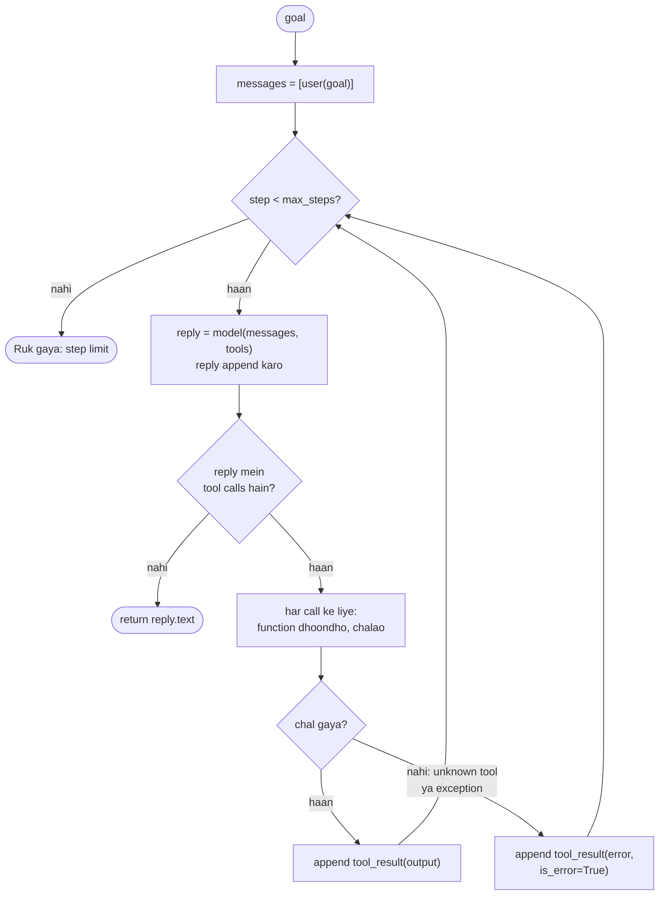

🏠 [Home](../../README.md) › [02 · The Agent Loop](./README.md) › 2.3 50 lines mein agent, bilkul zero se

# 2.3 50 lines mein agent, bilkul zero se

> **Level:** 🟡 Intermediate · **Padhne ka time:** ~15 min · **Pehle padho:** [2.1 Observe–think–act loop](./02.1-the-observe-think-act-loop.md), [0.3 Setup](../00-start-here/00.3-setup.md)

**Ek line mein:** Ek chalte hue, tool use karne wale agent ko kisi framework ki zaroorat nahi. Bas messages ki ek list, descriptions ke saath kuch functions, aur lagbhag 20 lines ka ek loop. Yeh tum ek baar ek chhote provider-neutral client pe likh sakte ho, aur ek baar har provider ke raw SDK pe.

📑 **Is page par**

- [Yeh kyun zaroori hai?](#-yeh-kyun-zaroori-hai)
- [Idea, simple words mein](#-idea-simple-words-mein)
- [Diagram se samjho](#-diagram-se-samjho)
- [Kaise kaam karta hai, step by step](#-kaise-kaam-karta-hai-step-by-step)
- [Example se samjho](#-example-se-samjho)
- [Code](#-code)
- [Aam galtiyan aur dhyan dene wali baatein](#-aam-galtiyan-aur-dhyan-dene-wali-baatein)
- [Yaad rakhne wali baatein](#-yaad-rakhne-wali-baatein)
- [Khud try karo](#-khud-try-karo)
- [Aur padhne ke liye](#-aur-padhne-ke-liye)

## 🤔 Yeh kyun zaroori hai?

Agent frameworks agents ko complicated dikha sakte hain: runners, graphs, executors, callbacks. Jab inke andar kuch galat hota hai, to samajhna mushkil hai ki problem tumhare tool mein hai, prompt mein, ya framework mein.

Loop ek baar khud likh lo, yeh problem khatam. Tum dekhoge ki agent ka core itna chhota hai ki ek minute mein padh lo. Uske baad har framework bas yahi loop plus kuch extras lagega. Aur tum judge kar paoge ki tumhe woh extras chahiye ya nahi. Anthropic ki apni guidance [building effective agents](https://www.anthropic.com/engineering/building-effective-agents) bhi yahi kehti hai: sabse simple cheez se shuru karo jo chal jaaye, aur complexity tabhi add karo jab uska faayda ho.

## 🧠 Idea, simple words mein

Tumhe chaar cheezein chahiye:

1. **Ek model client** jo messages bheje aur reply wapas laaye.
2. **Tools:** simple Python functions, har ek ke saath ek description jo model padhta hai (name, kya karta hai, aur inputs ke liye ek [JSON Schema](../../GLOSSARY.md#json-schema)).
3. **Messages ki ek list:** agent ki [short-term memory](../../GLOSSARY.md#short-term-memory).
4. **Ek loop** jo model ko call kare, jo tools woh maange unhe chalaye, results list mein add kare, aur repeat kare.

Ise ek kitchen order system jaisa socho. Order list (messages) counter pe rakhi hai. Chef (model) use padhta hai. Ya to bolta hai "dish ready hai", ya chillata hai "pyaaz kaat do". Ek helper (tumhara loop) pyaaz kaatta hai, list pe likhta hai "pyaaz kat gaye", aur list wapas de deta hai. Ise chalane ke liye kisi manager ki zaroorat nahi.

## 👀 Diagram se samjho



*Har box Python ki ek ya do lines hai. Sirf do branches hain: "kya model ne tool maanga?" aur "kya tool chala?". Plus step limit, jo guarantee karti hai ki loop khatam hoga.*

## 🔍 Kaise kaam karta hai, step by step

**1. Har tool ko describe karo.** Tool matlab ek function plus ek spec. Spec woh hai jo model dekhta hai. Function woh hai jo tumhara code chalata hai. Is page pe neutral spec format `{"name", "description", "input_schema"}` hai, jo exactly Anthropic ka format hai. OpenAI inhi fields ko alag tarike se wrap karta hai (Code ke neeche table dekho).

**2. History shuru karo.** `messages = [user(goal)]`.

**3. History aur tool specs ke saath model ko call karo.** Har step pe ek call.

**4. Reply hamesha append karo.** Tab bhi jab woh tool call ho. Agli request mein call hona chahiye, taaki result ke paas jawab dene ke liye kuch ho.

**5. Koi tool call nahi? Kaam khatam.** Reply ka text hi final answer hai. (Yeh minimal version is pe bharosa karta hai. [2.4](./02.4-stopping-conditions.md) kate hue replies aur refusals ke checks add karta hai.)

**6. Warna har tool call chalao.** Naam se function dhoondho. Call ko `try`/`except` mein wrap karo. Jo tool crash ho, woh model ke liye ek error message banna chahiye, tumhare program ka crash nahi.

**7. Har call ka ek result append karo,** jisme call ki ID aur ek error flag ho. Phir wapas step 3 pe jao.

**8. `max_steps` ke baad ruko.** Is line ke bina ek confused model hamesha loop karta reh sakta hai aur tumhare paise uda sakta hai.

## 💡 Example se samjho

Agent ek chhota, in-memory project dekh sakta hai. Usse pucha jaata hai ki web server kaunsa port use karta hai. Ek scripted fake model ke saath run aisa dikhta hai:

```text
Goal: Which port does the web server listen on?

list_files({}) -> 'README.md\nconfig/app.toml\nconfig/db.toml'
read_file({'path': 'config/app.toml'}) -> '[server]\nport = 8080\nworkers = 4'

Answer: The web server listens on port 8080 (set in config/app.toml).
```

Asli model apne faisle khud leta hai. Woh dono `.toml` files padh sakta hai, ya path guess karke `list_files` skip kar sakta hai. Loop in sab cases ko handle karta hai.

**Kya sach mein 50 lines hai?** Humne is agent ke complete versions gine jo yeh notes banate waqt likhe gaye the, har ek ke saath ek chhota demo script. "Lines of code" matlab woh lines jo blank nahi, sirf comment nahi, aur docstring ka hissa nahi:

| Version | Lines of code | Isme kya hai |
| --- | --- | --- |
| Poora agent, provider-neutral | 55 | imports, fake files, do tools aur unke specs, loop, ek demo script |
| Sirf `run_agent` | 18 | khud loop, error handling aur ek trace ke saath |
| `anthropic` SDK pe poora agent | 43 | wahi agent, bina neutral client ke |
| `openai` SDK pe poora agent | 50 | wahi agent, bina neutral client ke |

To: poore agent ke liye lagbhag 50 lines, aur loop ke liye 20 se kam.

## 💻 Code

### 1. Provider-neutral client pe

Poora agent, demo data ke bina (`FILES` path se file text ka ek dict hai). `llm` koi bhi chat-model client hai jiska `.chat()` ek reply return kare jisme `.text`, `.tool_calls` (har ek mein `.id`, `.name` aur dict ke roop mein `.arguments`) aur `.to_message()` ho. Tests mein scripted fake ke liye bhi yahi client shape chalta hai:

```python
def user(text: str) -> dict:
    return {"role": "user", "content": text}

def tool_result(call_id: str, content: str, is_error: bool = False) -> dict:
    return {"role": "tool", "tool_call_id": call_id, "content": content, "is_error": is_error}

def list_files() -> str:
    return "\n".join(FILES)

def read_file(path: str) -> str:
    return FILES[path]  # unknown path KeyError raise karta hai; loop use error result bana deta hai

TOOLS = {
    "list_files": (list_files, {
        "name": "list_files",
        "description": "List every file path in the project.",
        "input_schema": {"type": "object", "properties": {}},
    }),
    "read_file": (read_file, {
        "name": "read_file",
        "description": "Read one file. Use an exact path returned by list_files.",
        "input_schema": {"type": "object", "properties": {"path": {"type": "string"}}, "required": ["path"]},
    }),
}

def run_agent(llm, goal: str, system: str = "", max_steps: int = 10) -> str:
    messages = [user(goal)]
    specs = [spec for _, spec in TOOLS.values()]
    for _ in range(max_steps):
        reply = llm.chat(messages, system=system, tools=specs)      # think
        messages.append(reply.to_message())
        if not reply.tool_calls:                                     # koi tool nahi maanga: final answer
            return reply.text
        for call in reply.tool_calls:                                # act
            fn, _ = TOOLS.get(call.name, (None, None))
            try:
                output, failed = (fn(**call.arguments), False) if fn else (f"Unknown tool {call.name!r}", True)
            except Exception as exc:                                 # fail hone wala tool run ko crash na kare
                output, failed = f"Error: {type(exc).__name__}: {exc}", True
            messages.append(tool_result(call.id, output, is_error=failed))   # observe
    return "Stopped: reached the step limit before finishing."
```

### 2. Seedha Anthropic SDK pe

Provider-neutral client kya chhupata hai, woh yahan dikhta hai. Yeh Anthropic ke docs ke manual agentic loop ko follow karta hai. `ANTHROPIC_API_KEY` chahiye.

```python
import anthropic

client = anthropic.Anthropic()  # ANTHROPIC_API_KEY padhta hai
messages = [{"role": "user", "content": goal}]
for _ in range(max_steps):
    response = client.messages.create(
        model="claude-opus-5-5",
        max_tokens=16000,
        system="You answer questions about a code project. Use the tools; never guess.",
        tools=TOOLS,                     # [{"name", "description", "input_schema"}, ...]
        messages=messages,
    )
    # Assistant turn ko bilkul waisa hi append karo jaisa mila: isme tool_use blocks hain.
    messages.append({"role": "assistant", "content": response.content})
    if response.stop_reason != "tool_use":          # end_turn (ya max_tokens, refusal: 2.4 dekho)
        answer = "".join(b.text for b in response.content if b.type == "text")
        break
    results = []
    for block in response.content:
        if block.type == "tool_use":
            output, is_error = run_tool(block.name, block.input)    # block.input pehle se dict hai
            results.append({"type": "tool_result", "tool_use_id": block.id,
                            "content": output, "is_error": is_error})
    messages.append({"role": "user", "content": results})          # SAARE results EK user message mein
```

Jab yeh loop samajh aa jaaye, to shayad tumhe ise likhna bhi na pade. Anthropic Python SDK ek **tool runner** bhi deta hai (`client.beta.messages.tool_runner(...)`, beta mein) jo decorated Python functions se yeh loop tumhare liye chala deta hai.

### 3. Seedha OpenAI SDK pe

Chat Completions pe wahi loop. `OPENAI_API_KEY` aur `OPENAI_MODEL` chahiye. Shape same hai, details alag hain:

```python
from openai import OpenAI

client = OpenAI()  # OPENAI_API_KEY padhta hai
messages = [{"role": "system", "content": SYSTEM}, {"role": "user", "content": goal}]
for _ in range(max_steps):
    response = client.chat.completions.create(
        model=os.environ["OPENAI_MODEL"], messages=messages, tools=TOOLS, max_completion_tokens=16000
    )
    message = response.choices[0].message
    messages.append(message)                        # SDK apna message object wapas accept kar leta hai
    if not message.tool_calls:
        answer = message.content
        break
    for call in message.tool_calls:
        args = json.loads(call.function.arguments)  # yeh JSON *string* hai, dict nahi
        messages.append({"role": "tool", "tool_call_id": call.id, "content": run_tool(call.function.name, args)})
```

| | Anthropic Messages API | OpenAI Chat Completions |
| --- | --- | --- |
| System prompt | `system=` parameter | pehla message, `role: "system"` |
| Tool spec | `{"name", "description", "input_schema"}` | `{"type": "function", "function": {"name", "description", "parameters"}}` |
| "Model ko tool chahiye" | `stop_reason == "tool_use"`, `tool_use` blocks | `finish_reason == "tool_calls"`, `message.tool_calls` |
| Arguments | `block.input`, pehle se dict | `call.function.arguments`, ek JSON string jise parse karna hai |
| Results | `tool_result` blocks, sab **ek** `user` message mein | **har** result ke liye ek `role: "tool"` message |
| Error flag | `"is_error": true` | koi nahi: content mein "Error: ..." likho |

OpenAI ki nayi Responses API mein bhi yahi loop hai, bas naam alag hain. Model `function_call` items return karta hai, aur tum `function_call_output` items se reply karte ho jisme matching `call_id` hoti hai. [3.3](../03-tools-and-function-calling/03.3-how-function-calling-works.md) har payload poora dikhata hai.

## 🚨 Aam galtiyan aur dhyan dene wali baatein

- **Assistant message khud se dobara banana.** Anthropic pe `response.content` bina badle append karo. Usme thinking blocks ho sakte hain jo bilkul waise hi wapas bhejne hote hain jaise mile. Unhe edit ya drop kiya to agli request fail ho sakti hai. Agar tum provider-neutral client likhte ho, to uska `reply.to_message()` tumhare liye raw blocks sambhal ke rakhe.
- **Sirf `stop_reason == "end_turn"` pe loop todna.** Agar reply kat gaya (`max_tokens`) ya refuse hua (`refusal`), to koi tool calls nahi hote. Jo loop sirf `end_turn` pe tootta hai, woh results ki khaali list bhej deta hai. Jo bhi `tool_use` nahi hai, us pe bahar niklo, phir check karo kyun ([2.4](./02.4-stopping-conditions.md)).
- **Har Anthropic tool result ko alag user message mein daalna.** Anthropic ke docs kehte hain ki ek turn ke saare results ek hi user message mein saath jaane chahiye. Alag bhejne se model kam parallel calls karna seekh jaata hai ([3.5](../03-tools-and-function-calling/03.5-parallel-tool-calls.md)).
- **Bhool jaana ki OpenAI arguments string hain.** `call.function.arguments` JSON text hai aur kabhi kabhi invalid bhi ho sakta hai. Ise `try` ke andar parse karo ([2.5](./02.5-handling-errors-in-the-loop.md)).
- **Exception ko loop se bahar nikalne dena.** Ek tool fail ho to poora run khatam nahi hona chahiye. Use pakdo aur error model ko bhejo. Model aksar sambhal leta hai.
- **Maan lena ki step limit kaafi hai.** Yeh infinite loops rokti hai, mehenge loops nahi. Kisi bhi real cheez ke liye time aur cost limits bhi lagao ([2.4](./02.4-stopping-conditions.md)).

## ✅ Yaad rakhne wali baatein

- Agent matlab ek message list, kuch described functions, aur ek loop. Framework ki zaroorat nahi.
- Loop 20 lines se kam hai: call karo, append karo, tool calls check karo, unhe safely chalao, results append karo, repeat karo, ek step limit ke saath.
- Anthropic aur OpenAI ka loop same hai, field names alag hain. Sabse bade farak: results wapas kaise bheje jaate hain, aur OpenAI arguments JSON string ki tarah aate hain.
- Tool errors pakdo aur unhe results ki tarah wapas bhejo. Model sirf wahi theek kar sakta hai jo use dikhta hai.
- Ek baar loop likh lo, to har framework samajhna aasaan ho jaata hai ([11.9 Bina framework wala tarika](../11-frameworks/11.9-the-no-framework-approach.md)).

## 🧪 Khud try karo

1. Upar wale pehle snippet mein ek teesra tool `count_lines(path)` add karo, aur ek real model se pucho *"Kaunsi config file sabse lambi hai?"*. Tool ne kitni lines add ki?
2. Upar wale Anthropic loop ko bina network ke test karne ke liye tum `anthropic.Anthropic()` ki jagah ek fake client dete ho. Loop chalane ke liye fake ko kam se kam kya dena hoga?
3. Anthropic loop `stop_reason == "end_turn"` ki jagah `stop_reason != "tool_use"` kyun check karta hai?

<details>
<summary>Answer dekho</summary>

1. Lagbhag aath: do line ka function aur paanch line ka spec, plus `TOOLS` mein ek entry. Loop bilkul nahi badalta. Tools ko data ki tarah rakhne ka yahi faayda hai.
2. Ek object jisme `messages.create(**params)` ho, jo kuch aisa return kare jisme `.stop_reason` aur `.content` ho. Har content block mein `.type` ho, plus text blocks ke liye `.text`, ya `tool_use` blocks ke liye `.id`, `.name` aur `.input`. Loop bas itna hi touch karta hai.
3. Kyunki bina tools ke turn khatam hone ka sirf `end_turn` hi tarika nahi hai. `max_tokens`, `refusal` aur `stop_sequence` mein bhi chalane ke liye koi tool calls nahi hote. `tool_use` check karne ka matlab hai "aage tabhi badho jab koi kaam baaki ho". Baaki sab pe bahar niklo, aur har exit ka matlab [2.4](./02.4-stopping-conditions.md) decide karta hai.

</details>

## 📚 Aur padhne ke liye

- [Tool use with Claude](https://platform.claude.com/docs/en/agents-and-tools/tool-use/overview) (Anthropic). Official guide, tool runner aur manual loop dono ke saath.
- [Handle tool calls](https://platform.claude.com/docs/en/agents-and-tools/tool-use/handle-tool-calls) (Anthropic). `tool_result` messages ke exact rules.
- [Function calling](https://developers.openai.com/api/docs/guides/function-calling) (OpenAI). OpenAI loop, Chat Completions aur Responses API dono ke liye.
- [Building effective agents](https://www.anthropic.com/engineering/building-effective-agents) (Anthropic). Zyaada tar agents ke liye simple loops complex frameworks se behtar kyun hain.

<!-- FOOTER -->

---

⬅️ **Pichla:** [2.2 ReAct ko samjho](./02.2-react-explained.md) ·
🏠 [Chapter home](./README.md) ·
➡️ **Agla:** [2.4 Agent kab ruke: stopping conditions](./02.4-stopping-conditions.md)
