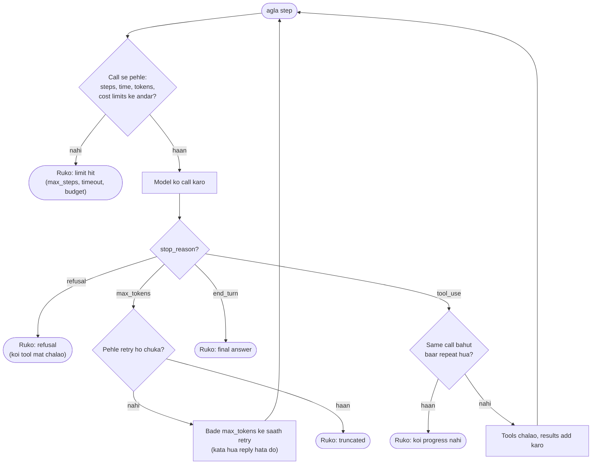

🏠 [Home](../../README.md) › [02 · The Agent Loop](./README.md) › 2.4 Agent kab ruke: stopping conditions

# 2.4 Agent kab ruke: stopping conditions

> **Level:** 🟡 Intermediate · **Padhne ka time:** ~8 min · **Pehle padho:** [2.3 50 lines mein agent, bilkul zero se](./02.3-a-50-line-agent-from-scratch.md), [1.4 LLMs kaise kaam karte hain (bas utna jitna zaroori hai)](../01-foundations/01.4-how-llms-work.md)

**Ek line mein:** Agent ko rukne ki ek hi achhi wajah honi chahiye (model ne complete final answer de diya). Baaki kai safety wajahein hain jo tumhara code lagu karta hai: bahut zyaada steps, bahut zyaada time, bahut zyaada paisa, koi progress nahi, kata hua reply, ya refusal.

📑 **Is page par**

- [Yeh kyun zaroori hai?](#-yeh-kyun-zaroori-hai)
- [Idea, simple words mein](#-idea-simple-words-mein)
- [Diagram se samjho](#-diagram-se-samjho)
- [Kaise kaam karta hai, step by step](#-kaise-kaam-karta-hai-step-by-step)
- [Example se samjho](#-example-se-samjho)
- [Code](#-code)
- [Aam galtiyan aur dhyan dene wali baatein](#-aam-galtiyan-aur-dhyan-dene-wali-baatein)
- [Yaad rakhne wali baatein](#-yaad-rakhne-wali-baatein)
- [Khud try karo](#-khud-try-karo)
- [Aur padhne ke liye](#-aur-padhne-ke-liye)

## 🤔 Yeh kyun zaroori hai?

Socho ek agent ko aisi file dhoondhni hai jo exist hi nahi karti. Woh search karta hai, kuch nahi milta. Thoda alag search try karta hai, kuch nahi milta. Phir pehla search dobara try karta hai. Koi limit na ho to yeh poori raat chalta rahega. Aur har step poori badhti hui history dobara bhejta hai ([1.4](../01-foundations/01.4-how-llms-work.md)), isliye har step pichle se zyaada mehenga padta hai.

Ab ulta bug socho. Model ka reply aadhe sentence pe output limit hit kar deta hai. Usme koi tool call nahi hai. To ek bhola loop *"The total comes to"* ko final answer maan ke user ko dikha deta hai.

Dono stopping ki problems hain. Inhe sahi karna hi agent ko bina nigrani ke chalne laayak safe banata hai.

## 🧠 Idea, simple words mein

Ek auto-rickshaw ki ride socho. Normally ride tab khatam hoti hai jab tum **pahunch** jaate ho. Lekin tum tab bhi rukoge jab meter tumhari jeb se aage nikal jaaye, ride bahut lambi khinch jaaye, ya driver ek hi gali ke chakkar lagata rahe. Aur agar driver bol de "wahan nahi jaaunga", to bhi ride khatam.

Agent ke paas bhi yahi do tarah ke exits hain:

- **Achha exit:** model decide karta hai ki kaam ho gaya aur complete answer deta hai.
- **Safety exits:** tumhara code decide karta hai ki run khatam hona chahiye, model chahe jo soche. Yeh [stopping conditions](../../GLOSSARY.md#stopping-condition) hain jo tum pehle se chunte ho: steps, time, tokens ya dollars, repeat hote calls.

Aur API ke do signals jinhe khaas handling chahiye: [`max_tokens`](../../GLOSSARY.md#max-tokens) pe **kata hua** reply, aur **refusal**. Dono normal successful responses ki tarah aate hain. Isliye tumhe tabhi pata chalega jab tum [stop reason](../../GLOSSARY.md#stop-reason) padhoge.

## 👀 Diagram se samjho



*Budget checks har call se **pehle** hote hain, kyunki tabhi tum kharcha bacha sakte ho. Stop-reason checks har call ke **baad** hote hain, kyunki sirf reply hi batata hai ki woh complete hai ya nahi.*

## 🔍 Kaise kaam karta hai, step by step

Har condition, use kya trigger karta hai, aur user ko kya batana hai:

| Condition | Kaise pakdoge | Kya return karoge |
| --- | --- | --- |
| **Final answer** | Koi tool calls nahi, aur stop reason `end_turn` (Anthropic) ya `stop` (OpenAI) | Answer |
| **Max steps** | Model calls ka ek counter | "N steps mein khatam nahi kar paaya", plus ab tak jo mila |
| **Wall-clock timeout** | Shuru mein `time.monotonic()`, har call se pehle check | "Time khatam ho gaya", plus adhure results |
| **Token ya cost budget** | Har reply ka `usage` jodte jao | "Budget limit pe ruk gaya" |
| **Koi progress nahi** | Same tool, same arguments ke saath, baar-baar | "Main gol-gol ghoom raha hoon", plus kya try kiya |
| **Kata hua reply** | Stop reason `max_tokens` (Anthropic) ya finish reason `length` (OpenAI) | Bade limit ke saath ek baar retry; phir report karo |
| **Refusal** | Stop reason `refusal` (Anthropic); `message.refusal` ya finish reason `content_filter` (OpenAI) | Refusal, saaf mark karke; koi tool mat chalao |

Kuch details zaroori hain:

**1. Steps model calls ginte hain, tool calls nahi.** Ek reply ek saath paanch tools maang sakta hai. Round trips gino, kyunki time aur tokens wahi khaate hain.

**2. Time ke do layers hain.** Tumhare loop ki wall-clock limit poore run ko cover karti hai. Har request ka SDK mein apna timeout bhi hota hai. Anthropic aur OpenAI dono Python SDKs mein default 10 minute per request hai, aur tum ise kam kar sakte ho, jaise `anthropic.Anthropic(timeout=60.0)`. Tool bhi atak sakta hai, isliye slow tools ko unke apne timeouts do ([3.6](../03-tools-and-function-calling/03.6-code-execution-as-a-tool.md) mein `subprocess` ke saath ek example hai).

**3. Budget `usage` se aata hai.** Har reply input aur output tokens report karta hai. Inhe apne model ki prices se multiply karo. Claude Opus 5.5 ke liye ($4 per million input tokens aur $20 per million output tokens, November 2026 tak): ek 10-step run jisme har step pe average 20,000 input aur 500 output tokens hon, uska kharcha hai 200,000 × $4/1M + 5,000 × $20/1M = $0.80 + $0.10 = **$0.90**. Dekho ki input hi zyaada hai, kyunki history har step pe dobara bheji jaati hai. Ghar ke budget jaisa socho: har mahine ka bill chhota lagta hai, lekin saal bhar ka jodo to asli kharcha dikhta hai. [16.5](../16-cost-and-performance/16.5-budget-limits-per-run.md) isme aur gehrai mein jaata hai.

**4. Koi progress nahi matlab khud ko repeat karna.** Sabse simple check: har `(tool name, arguments)` pair ko gino, aur jab koi ek, maan lo, do se zyaada baar aaye to ruko. Ek naram version pehle model ko ek error result bhejta hai "tum yeh pehle hi try kar chuke ho", aur tabhi rukta hai jab woh phir repeat kare.

**5. Kata hua reply adhura hai, isliye us pe kabhi act mat karo.** Uska text beech sentence mein ruk jaata hai. Aur agar woh tool call ke beech mein tha, to arguments adhure ho sakte hain. Anthropic mein `model_context_window_exceeded` bhi hai, jiska matlab hai reply ne poori context window bhar di. Ise bhi waise hi treat karo. Aam fix: us step ko bade `max_tokens` ke saath retry karo, aur kata hua reply history mein add mat karo.

**6. Refusal ek normal response hai, error nahi.** Anthropic `stop_reason: "refusal"` HTTP status 200 ke saath return karta hai, to koi exception raise nahi hota. Refusal tool call ko bhi beech mein kaat sakta hai, isliye refused turn ke tools kabhi mat chalao. Anthropic ke docs refused requests ko ek fallback model pe retry karne ka tarika batate hain ([Refusals and fallback](https://platform.claude.com/docs/en/build-with-claude/refusals-and-fallback)). Warna ruko aur saaf batao.

**Ek stop reason jo asal mein stop nahi hai:** Anthropic ke *server-side* tools ke saath, jaise web search ya code execution ([3.6](../03-tools-and-function-calling/03.6-code-execution-as-a-tool.md)), ek lamba turn `pause_turn` pe khatam ho sakta hai. Iska matlab hai "conversation wapas bhejo, main continue karunga", "ho gaya" nahi. Tumhare apne client-side tools yeh kabhi nahi dete.

## 💡 Example se samjho

Har condition ke liye ek chhota scripted scenario, har ek scripted fake model ke against chalaya gaya (timeout ek fake clock use karta hai jo har reading pe 50 second aage koodti hai, isliye turant chalta hai):

```text
   scenario             stopped_because  steps
   answers              final_answer     1
   keeps calling tools  max_steps        3
   slow tools           timeout          2
   token budget         token_budget     8
   cost budget          cost_budget      2
   repeats itself       no_progress      3
   cut off once         final_answer     2
   cut off twice        max_tokens       2
   refuses              refusal          1
```

Kuch rows padhte hain:

- **slow tools:** limit 120 second thi. Step 3 se pehle wale check ne dekha ki 150 second ja chuke hain, aur ruk gaya, teesri call ke paise dene se *pehle*.
- **repeats itself:** model ne har baar `get_rate(GBP, USD)` maanga. Pehli do calls allowed thi (`max_identical_calls=2`). Teesri same call ne run rok diya.
- **cut off once:** pehla reply `max_tokens` pe khatam hua. Loop ne use phenk diya, `max_tokens` ko 4,000 se double karke 8,000 kiya aur retry kiya. Doosra reply complete answer tha.
- **refuses:** scripted refusal mein ek tool call bhi tha. Loop use chalaye bina ruk gaya.

## 💻 Code

Stopping logic, thoda simplified. Saari limits ek hi jagah:

```python
@dataclass
class Limits:
    max_steps: int = 10                # har run mein model calls
    max_seconds: float = 120.0         # har run ka wall-clock time
    max_total_tokens: int = 200_000    # input + output, poore run mein
    max_cost_usd: float = 1.00
    max_identical_calls: int = 2       # same tool + same arguments
    max_output_tokens: int = 4_000     # har reply ke liye max_tokens
    max_truncation_retries: int = 1
    input_price_per_mtok: float = 4.00     # Claude Opus 5.5, USD per million tokens (Nov 2026)
    output_price_per_mtok: float = 20.00
```

Loop ke andar ke checks:

```python
while step < limits.max_steps:
    # Call se PEHLE: kya ek aur step afford kar sakte hain?
    if clock() - started > limits.max_seconds:
        return stop("timeout")
    if usage.input_tokens + usage.output_tokens >= limits.max_total_tokens:
        return stop("token_budget")
    if cost() >= limits.max_cost_usd:
        return stop("cost_budget")

    step += 1
    reply = llm.chat(messages, system=system, tools=specs, max_tokens=max_tokens)
    usage = Usage(usage.input_tokens + reply.usage.input_tokens,
                  usage.output_tokens + reply.usage.output_tokens)

    # Call ke BAAD: kya reply complete aur kaam ka hai?
    if reply.stop_reason == "refusal":
        return stop("refusal", reply.text or None)       # refused turn ke tools kabhi mat chalao
    if reply.stop_reason == "max_tokens":
        if truncation_retries < limits.max_truncation_retries:
            truncation_retries += 1
            max_tokens *= 2
            continue                                    # retry; kata hua reply NAHI rakha jaata
        return stop("max_tokens", reply.text or None)

    messages.append(reply.to_message())
    if not reply.tool_calls:
        return stop("final_answer", reply.text)

    for call in reply.tool_calls:
        key = (call.name, json.dumps(call.arguments, sort_keys=True))
        seen[key] += 1
        if seen[key] > limits.max_identical_calls:
            return stop("no_progress")
        ...                                             # tool chalao (2.5 dekho)
return stop("max_steps")
```

`clock` ek parameter hai (default `time.monotonic`), taaki tests wait karne ki jagah fake clock de sakein. `llm` koi bhi chat-model client hai jiske reply mein `.stop_reason`, `.usage` aur `.tool_calls` hon. `Usage` input aur output tokens ki ek chhoti dataclass hai. Agar client har provider ke stop reason ko ek neutral set (`end_turn`, `tool_use`, `max_tokens`, `refusal`, `other`) mein map kar de, to yeh code Anthropic aur OpenAI dono pe bina badle chalta hai.

## 🚨 Aam galtiyan aur dhyan dene wali baatein

- **Budget sirf call ke baad check karna.** Tab tak paisa kharch ho chuka hota hai. Har call se pehle check karo. Aakhri step phir bhi thoda zyaada kharch kar sakta hai, isliye limit thodi gunjaish ke saath set karo.
- **Timeouts ke liye `time.time()` use karna.** System clock jump kar sakti hai (time sync, daylight saving). `time.monotonic()` sirf aage badhti hai.
- **Kate hue reply ko answer maan lena.** Tool calls nahi hain, iska matlab kaam khatam nahi. Pehle stop reason check karo, phir tool calls.
- **Same calls ko bahut sakhti ya bahut dheel se ginna.** Kuch repeats theek hain, jaise kisi job ka status baar-baar check karna. Kuch loops badalte arguments ke peeche chhupe hote hain, jaise `page=1, 2, 3...` hamesha ke liye. Har tool ke hisaab se check tune karo, aur `max_steps` ko backstop ki tarah rakho.
- **Chupchaap ruk jaana.** User ko kuch na dikhe to woh nahi samajh paata ki "jawab hai hi nahi" ya "agent ne haar maan li". Batao kaunsi limit hit hui, aur jo mila woh return karo.
- **Prices hard-code karna.** Prices badalti hain aur har model ki alag hoti hain. Inhe configuration mein rakho, aur [pricing page](https://platform.claude.com/docs/en/about-claude/pricing) check karo.

## ✅ Yaad rakhne wali baatein

- Ek achha exit (complete final answer) aur kai safety exits (steps, time, tokens, cost, koi progress nahi).
- Budgets har call se **pehle** check karo, aur stop reasons uske **baad**.
- `max_tokens` aur `refusal` successful responses ki tarah aate hain: inhe sirf stop reason padh ke hi pakad sakte ho.
- Kate hue ya refused reply pe kabhi act mat karo. Kate hue ko zyaada jagah ke saath ek baar retry karo. Refusal ko report karo.
- User ko hamesha batao ki run kyun ruka, aur agar adhure results hain to woh bhi do.

## 🧪 Khud try karo

1. Ek run Claude Opus 5.5 pe 6 steps chalta hai, har step pe average 30,000 input tokens aur 800 output tokens. Kitna kharcha hua? Kya $0.50 ka `max_cost_usd` ise rokega?
2. Loop kate hue reply ko append karke model se continue karne ko kehne ki jagah use phenk kyun deta hai?
3. Socho ek model hamesha do alag calls ke beech baari-baari ghoomta hai (A, B, A, B, ...). Upar wale loop mein kaunsi condition ise rokegi, aur kitne steps ke baad?

<details>
<summary>Answer dekho</summary>

1. Input: 6 × 30,000 = 180,000 tokens × $4/1M = $0.72. Output: 6 × 800 = 4,800 tokens × $20/1M = $0.096. Total lagbhag $0.82. Haan: har step se pehle wala check ise tab rok dega jab running total $0.50 paar kar jaaye, jo chauthe step ke baad hota hai (4 × $0.136 ≈ $0.54).
2. Plain text ke liye append karna possible hai (tum model ko continue karne bol sakte ho). Lekin agar reply tool call ke andar kata, to uske arguments adhure ho sakte hain aur unhe kabhi nahi chalana chahiye. Poore step ko zyaada jagah ke saath retry karna sabse simple rule hai jo hamesha safe hai.
3. `no_progress`. Har pair alag se gina jaata hai, to A step 5 pe apni teesri call tak pahunchta hai aur run wahin ruk jaata hai (A, B, A, B, A). `max_identical_calls=2` ke saath, alag-alag calls ka koi bhi cycle lagbhag teen cycles ke andar pakda jaata hai. Warna `max_steps` ise pakad leta.

</details>

## 📚 Aur padhne ke liye

- [Stop reasons and fallback](https://platform.claude.com/docs/en/build-with-claude/handling-stop-reasons) (Anthropic). Har stop reason, `pause_turn`, `refusal` aur `model_context_window_exceeded` samet, aur har ek ko kaise handle karein.
- [Refusals and fallback](https://platform.claude.com/docs/en/build-with-claude/refusals-and-fallback) (Anthropic). Refusal kaisa dikhta hai aur doosre model pe retry kaise karein.
- [Function calling](https://developers.openai.com/api/docs/guides/function-calling) (OpenAI). OpenAI side pe tool calls aur `finish_reason`.
- [Pricing](https://platform.claude.com/docs/en/about-claude/pricing) (Anthropic). Budget limits ke liye current per-token prices.

<!-- FOOTER -->

---

⬅️ **Pichla:** [2.3 50 lines mein agent, bilkul zero se](./02.3-a-50-line-agent-from-scratch.md) ·
🏠 [Chapter home](./README.md) ·
➡️ **Agla:** [2.5 Loop mein errors kaise sambhalein](./02.5-handling-errors-in-the-loop.md)
