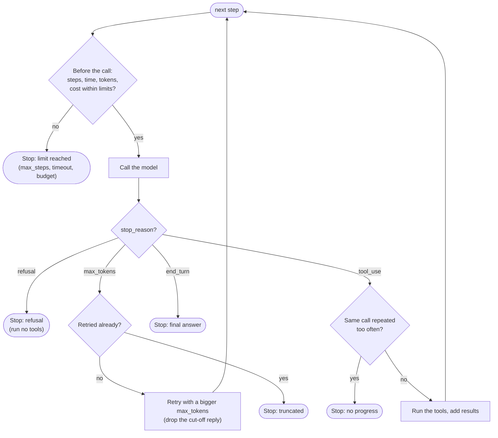

🏠 [Home](../../README.md) › [02 · The Agent Loop](./README.md) › 2.4 Stopping conditions

# 2.4 Stopping conditions

> **Difficulty:** 🟡 Intermediate · **Reading time:** ~8 min · **Prerequisites:** [2.3 A 50-line agent from scratch](./02.3-a-50-line-agent-from-scratch.md), [1.4 How LLMs work](../01-foundations/01.4-how-llms-work.md)

**In one sentence:** An agent should stop for exactly one good reason (the model gave a complete final answer) and for several safety reasons your code enforces: too many steps, too much time, too much money, no progress, a cut-off reply, or a refusal.

📑 **On this page**

- [Why does this matter?](#-why-does-this-matter)
- [The idea, in plain words](#-the-idea-in-plain-words)
- [Picture it](#-picture-it)
- [How it works, step by step](#-how-it-works-step-by-step)
- [Worked example](#-worked-example)
- [Code](#-code)
- [Common mistakes & gotchas](#-common-mistakes--gotchas)
- [Key takeaways](#-key-takeaways)
- [Try it yourself](#-try-it-yourself)
- [Further reading](#-further-reading)

## 🤔 Why does this matter?

Imagine an agent asked to find a file that does not exist. It searches, finds nothing, tries a slightly different search, finds nothing, and tries the first search again. With no limits it will keep going all night, and because each step resends the whole growing history ([1.4](../01-foundations/01.4-how-llms-work.md)), every step costs more than the last.

Now imagine the opposite bug: the model's reply hits the output limit halfway through a sentence. It contains no tool call, so a naive loop treats *"The total comes to"* as the final answer and shows it to the user.

Both are stopping problems. Getting them right is what makes an agent safe to leave running.

## 🧠 The idea, in plain words

Think of a taxi ride. It normally ends when you **arrive**. But you also stop if the meter passes what you can pay, if the ride is taking far too long, or if the driver keeps circling the same block. And if the driver says "I won't drive there", the ride is over too.

An agent has the same two kinds of exit:

- **The good exit:** the model decides it is done and gives a complete answer.
- **Safety exits:** your code decides the run must end, whatever the model thinks. These are [stopping conditions](../../GLOSSARY.md#stopping-condition) you choose in advance: steps, time, tokens or dollars, repeated calls.

And two signals from the API that need special handling: a reply **cut off** at [`max_tokens`](../../GLOSSARY.md#max-tokens), and a **refusal**. Both arrive as ordinary successful responses, so you only notice them if you read the [stop reason](../../GLOSSARY.md#stop-reason).

## 👀 Picture it



*Budget checks happen **before** each call, because that is when you can still avoid spending. Stop-reason checks happen **after** each call, because only the reply tells you whether it is complete.*

## 🔍 How it works, step by step

Each condition, what triggers it, and what to tell the user:

| Condition | How you detect it | What to return |
| --- | --- | --- |
| **Final answer** | No tool calls, and stop reason `end_turn` (Anthropic) or `stop` (OpenAI) | The answer |
| **Max steps** | A counter of model calls | "I couldn't finish in N steps", plus what was found so far |
| **Wall-clock timeout** | `time.monotonic()` at the start, checked before each call | "Ran out of time", plus partial results |
| **Token or cost budget** | Add up `usage` from every reply | "Stopped at the budget limit" |
| **No progress** | The same tool with the same arguments, again and again | "I'm going round in circles", plus what was tried |
| **Cut-off reply** | Stop reason `max_tokens` (Anthropic) or finish reason `length` (OpenAI) | Retry once with a bigger limit; then report it |
| **Refusal** | Stop reason `refusal` (Anthropic); `message.refusal` or finish reason `content_filter` (OpenAI) | The refusal, clearly marked; run no tools |

A few details matter:

**1. Steps count model calls, not tool calls.** One reply can ask for five tools at once. Count the round trips, because that is what costs time and tokens.

**2. Time has two layers.** Your loop's wall-clock limit covers the whole run. Each request also has its own timeout in the SDK: both the Anthropic and OpenAI Python SDKs default to 10 minutes per request, and you can lower it, for example `anthropic.Anthropic(timeout=60.0)`. A tool can also hang, so give slow tools their own timeouts ([3.6](../03-tools-and-function-calling/03.6-code-execution-as-a-tool.md) shows one with `subprocess`).

**3. Budgets come from `usage`.** Every reply reports input and output tokens. Multiply by your model's prices. For Claude Opus 5.5 ($4 per million input tokens and $20 per million output tokens, as of November 2026): a 10-step run averaging 20,000 input and 500 output tokens per step costs 200,000 × $4/1M + 5,000 × $20/1M = $0.80 + $0.10 = **$0.90**. Notice that input dominates, because the history is resent every step. [16.5](../16-cost-and-performance/16.5-budget-limits-per-run.md) goes deeper.

**4. No progress means repeating yourself.** The simplest check is to count each `(tool name, arguments)` pair and stop when one appears more than, say, twice. A softer version first sends the model an error result saying "you already tried this", and stops only if it repeats again.

**5. A cut-off reply is incomplete, so never act on it.** Its text stops mid-sentence, and if it was in the middle of a tool call, the arguments may be partial. Anthropic also has `model_context_window_exceeded`, which means the reply filled the whole context window; treat it the same way. The usual fix is to retry the step with a larger `max_tokens`, without adding the cut-off reply to the history.

**6. A refusal is a normal response, not an error.** Anthropic returns `stop_reason: "refusal"` with HTTP status 200, so no exception is raised. A refusal can also cut a tool call off part-way, so never run tools from a refused turn. Anthropic's docs describe retrying refused requests on a fallback model ([Refusals and fallback](https://platform.claude.com/docs/en/build-with-claude/refusals-and-fallback)); otherwise, stop and say so.

**One stop reason that is not a stop:** with Anthropic's *server-side* tools, such as web search or code execution ([3.6](../03-tools-and-function-calling/03.6-code-execution-as-a-tool.md)), a long turn can end with `pause_turn`. That means "send the conversation back and I will continue", not "done". Your own client-side tools never produce it.

## 💡 Worked example

[`examples/02-robust-loop`](../../examples/02-robust-loop/README.md) runs one short scripted scenario per condition. Offline, with `MockLLM` (the timeout uses a fake clock that jumps 50 seconds per reading, so it runs instantly):

```text
   scenario             stopped_because  steps
   answers              final_answer     1
   keeps calling tools  max_steps        3
   slow tools           timeout          2
   token budget         token_budget     8
   cost budget          cost_budget      2
   repeats itself       no_progress      3
   cut off once         final_answer     2
   cut off twice        max_tokens       2
   refuses              refusal          1
```

Reading a few rows:

- **slow tools:** the limit was 120 seconds. The check before step 3 saw 150 seconds gone and stopped, *before* paying for a third call.
- **repeats itself:** the model asked for `get_rate(GBP, USD)` every time. The first two calls were allowed (`max_identical_calls=2`); the third identical call stopped the run.
- **cut off once:** the first reply ended at `max_tokens`. The loop discarded it, doubled `max_tokens` from 4,000 to 8,000 and retried, and the second reply was a complete answer.
- **refuses:** the scripted refusal also contained a tool call. The loop stopped without running it.

## 💻 Code

The stopping logic from [`examples/02-robust-loop/main.py`](../../examples/02-robust-loop/main.py), slightly simplified. All limits live in one place:

```python
@dataclass
class Limits:
    max_steps: int = 10                # model calls per run
    max_seconds: float = 120.0         # wall-clock time per run
    max_total_tokens: int = 200_000    # input + output, across the run
    max_cost_usd: float = 1.00
    max_identical_calls: int = 2       # same tool + same arguments
    max_output_tokens: int = 4_000     # max_tokens for each reply
    max_truncation_retries: int = 1
    input_price_per_mtok: float = 4.00     # Claude Opus 5.5, USD per million tokens (Nov 2026)
    output_price_per_mtok: float = 20.00
```

The checks inside the loop:

```python
while step < limits.max_steps:
    # BEFORE the call: can we afford another step?
    if clock() - started > limits.max_seconds:
        return stop("timeout")
    if usage.input_tokens + usage.output_tokens >= limits.max_total_tokens:
        return stop("token_budget")
    if cost() >= limits.max_cost_usd:
        return stop("cost_budget")

    step += 1
    reply = llm.chat(messages, system=system, tools=specs, max_tokens=max_tokens)
    usage = Usage(usage.input_tokens + reply.usage.input_tokens,
                  usage.output_tokens + reply.usage.output_tokens)

    # AFTER the call: is the reply complete and usable?
    if reply.stop_reason == "refusal":
        return stop("refusal", reply.text or None)       # never run tools from a refused turn
    if reply.stop_reason == "max_tokens":
        if truncation_retries < limits.max_truncation_retries:
            truncation_retries += 1
            max_tokens *= 2
            continue                                    # retry; the cut-off reply is NOT kept
        return stop("max_tokens", reply.text or None)

    messages.append(reply.to_message())
    if not reply.tool_calls:
        return stop("final_answer", reply.text)

    for call in reply.tool_calls:
        key = (call.name, json.dumps(call.arguments, sort_keys=True))
        seen[key] += 1
        if seen[key] > limits.max_identical_calls:
            return stop("no_progress")
        ...                                             # run the tool (see 2.5)
return stop("max_steps")
```

`clock` is a parameter (default `time.monotonic`), so tests can pass a fake clock instead of waiting. The wrapper already maps each provider's stop reason to one neutral set (`end_turn`, `tool_use`, `max_tokens`, `refusal`, `other`), so this code works unchanged on Anthropic and OpenAI.

## 🚨 Common mistakes & gotchas

- **Only checking the budget after the call.** By then you have already spent it. Check before each call; the last step can still overshoot a little, so set the limit with some headroom.
- **Using `time.time()` for timeouts.** The system clock can jump (time sync, daylight saving). `time.monotonic()` only moves forward.
- **Treating a cut-off reply as the answer.** No tool calls does not mean done. Check the stop reason first, then the tool calls.
- **Counting identical calls too strictly or too loosely.** Some repeats are fine, such as polling a job's status. Some loops hide behind changing arguments, such as `page=1, 2, 3...` forever. Tune the check per tool, and keep `max_steps` as the backstop.
- **Stopping silently.** A user who sees nothing cannot tell "no answer exists" from "the agent gave up". Say which limit was hit and return what was found.
- **Hard-coding prices.** Prices change and differ by model. Keep them in configuration, and check the [pricing page](https://platform.claude.com/docs/en/about-claude/pricing).

## ✅ Key takeaways

- One good exit (a complete final answer) and several safety exits (steps, time, tokens, cost, no progress).
- Check budgets **before** each call and stop reasons **after** it.
- `max_tokens` and `refusal` arrive as successful responses: you only notice them by reading the stop reason.
- Never act on a cut-off or refused reply. Retry a cut-off once with more room; report a refusal.
- Always tell the user why the run stopped, and return partial results when you have them.

## 🧪 Try it yourself

1. A run uses Claude Opus 5.5 for 6 steps, averaging 30,000 input tokens and 800 output tokens per step. What does it cost? Would a `max_cost_usd` of $0.50 stop it?
2. Why does the loop drop a cut-off reply instead of appending it and asking the model to continue?
3. In [`02-robust-loop`](../../examples/02-robust-loop/README.md), add a scenario where the model alternates between two different calls forever (A, B, A, B, ...). Which condition stops it, and after how many steps?

<details>
<summary>Show answer</summary>

1. Input: 6 × 30,000 = 180,000 tokens × $4/1M = $0.72. Output: 6 × 800 = 4,800 tokens × $20/1M = $0.096. Total about $0.82. Yes: the check before each step would stop it once the running total passed $0.50, which happens after the fourth step (4 × $0.136 ≈ $0.54).
2. Appending it is possible for plain text (you can ask the model to continue), but if the reply was cut off inside a tool call, its arguments may be incomplete and must never be run. Retrying the whole step with more room is the simplest rule that is always safe.
3. `no_progress`. Each pair is counted separately, so A reaches its third call at step 5 and the run stops there (A, B, A, B, A). With `max_identical_calls=2`, any cycle of distinct calls is caught within about three cycles; `max_steps` would catch it otherwise.

</details>

## 📚 Further reading

- [Stop reasons and fallback](https://platform.claude.com/docs/en/build-with-claude/handling-stop-reasons) (Anthropic). Every stop reason, including `pause_turn`, `refusal` and `model_context_window_exceeded`, and how to handle each.
- [Refusals and fallback](https://platform.claude.com/docs/en/build-with-claude/refusals-and-fallback) (Anthropic). What a refusal looks like and how to retry on another model.
- [Function calling](https://developers.openai.com/api/docs/guides/function-calling) (OpenAI). Tool calls and `finish_reason` on the OpenAI side.
- [Pricing](https://platform.claude.com/docs/en/about-claude/pricing) (Anthropic). Current per-token prices for budget limits.

<!-- FOOTER -->

---

⬅️ **Previous:** [2.3 A 50-line agent from scratch](./02.3-a-50-line-agent-from-scratch.md) ·
🏠 [Chapter home](./README.md) ·
➡️ **Next:** [2.5 Handling errors in the loop](./02.5-handling-errors-in-the-loop.md)
