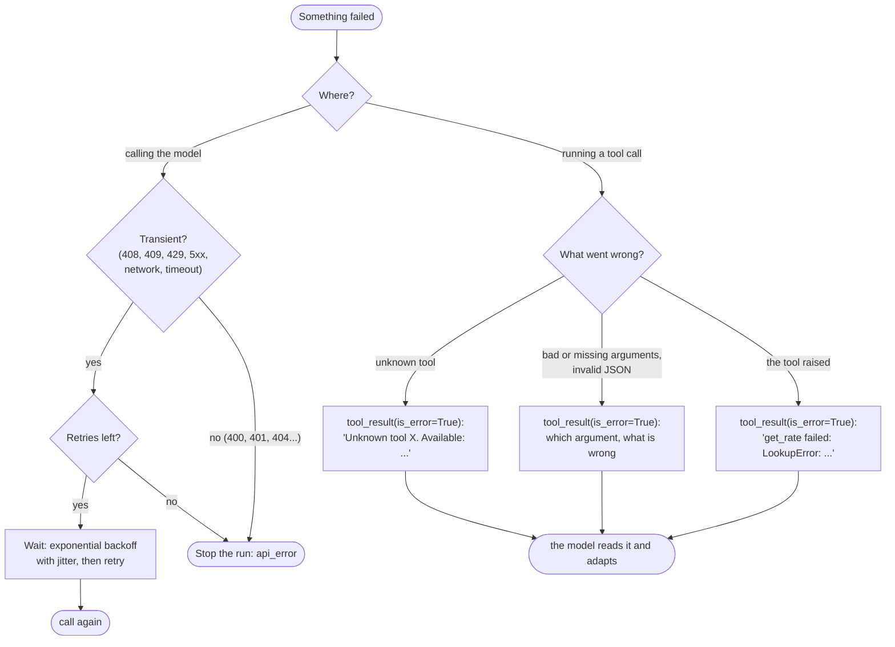

🏠 [Home](../../README.md) › [02 · The Agent Loop](./README.md) › 2.5 Handling errors in the loop

# 2.5 Handling errors in the loop

> **Difficulty:** 🟡 Intermediate · **Reading time:** ~10 min · **Prerequisites:** [2.3 A 50-line agent from scratch](./02.3-a-50-line-agent-from-scratch.md), [2.4 Stopping conditions](./02.4-stopping-conditions.md)

**In one sentence:** Most failures inside an agent loop should become messages the model can read and fix (an error result), and only failures the model cannot fix, such as a provider outage, should be retried or stop the run.

📑 **On this page**

- [Why does this matter?](#-why-does-this-matter)
- [The idea, in plain words](#-the-idea-in-plain-words)
- [Picture it](#-picture-it)
- [How it works, step by step](#-how-it-works-step-by-step)
- [Worked example](#-worked-example)
- [Code](#-code)
- [Common mistakes & gotchas](#-common-mistakes--gotchas)
- [Key takeaways](#-key-takeaways)
- [Try it yourself](#-try-it-yourself)
- [Further reading](#-further-reading)

## 🤔 Why does this matter?

In a real run, things go wrong all the time. The model calls `get_exchange_rate` when the tool is called `get_rate`. It forgets a required argument. A tool raises because a record does not exist. The provider returns "overloaded" for a few seconds. None of these should end the run.

A loop that crashes on the first exception is fragile. A loop that hides errors is worse: the model never learns its call failed and confidently answers from nothing. A good loop does neither. It **shows the model what went wrong**, so the model can try again, and it **retries or stops cleanly** when the problem is outside the model's control.

## 🧠 The idea, in plain words

Think of a sat-nav. When a road is closed, it does not switch itself off. It says "road closed, recalculating" and picks another route. But if it loses the GPS signal, recalculating will not help; it waits for the signal to come back, and tells you if it can't.

Agent errors split the same way:

| Kind | Examples | Who fixes it | How |
| --- | --- | --- | --- |
| **The model can fix it** | Unknown tool, bad or missing arguments, invalid JSON, a tool that raised | The model | Send an **error result** explaining what went wrong |
| **Nobody can fix it right now** | Rate limit, overload, server error, dropped connection | Time | **Retry** with backoff, then stop if it keeps failing |
| **Nobody can fix it at all** | Invalid API key, malformed request, model not found | You, the developer | **Stop** and report; retrying will never help |

The first kind is the most common, and the fix is always the same: answer the tool call with a [tool result](../../GLOSSARY.md#tool-result) marked as an error.

## 👀 Picture it



*Errors on the left are about the connection to the model, and your code handles them. Errors on the right are about one tool call, and the model handles them, as long as you tell it clearly.*

## 🔍 How it works, step by step

**1. Every tool call gets exactly one result, even on failure.** The API links calls and results by ID. If you skip a call because it failed, or because you chose not to run it, the next request has an unanswered call and is rejected. Send an error result instead.

**2. Mark failures as errors.** On Anthropic, set `"is_error": true` on the `tool_result` block. OpenAI's tool messages have no such flag, so say it in the text, starting with "Error:". The shared wrapper does both for you from `tool_result(id, content, is_error=True)`.

**3. Catch tool exceptions.** Wrap every tool call in `try`/`except Exception`. Report the exception type and message, not the full traceback: tracebacks are long, cost tokens, and can leak file paths or secrets.

**4. Validate arguments before running the tool.** Models sometimes leave out a required argument, use the wrong type, or invent one. Check the arguments against the tool's [JSON Schema](../../GLOSSARY.md#json-schema), or a pydantic model ([3.4](../03-tools-and-function-calling/03.4-designing-good-tools.md)), and say exactly which argument is wrong. [Strict mode](../../GLOSSARY.md#strict-mode) makes schema-valid arguments guaranteed on both providers ([3.2](../03-tools-and-function-calling/03.2-json-schema-for-tools.md)), but you still need to check business rules such as "this order exists".

**5. Handle unknown tool names.** List the real tools in the error. The model nearly always picks the right one next time.

**6. Handle arguments that are not valid JSON.** OpenAI sends arguments as a JSON string, which can occasionally fail to parse. The shared wrapper then sets `ToolCall.error` and passes empty arguments; send that error back rather than running the tool. (With Anthropic, `input` normally arrives already parsed. If you turn on eager input streaming, Anthropic's docs say to validate the input yourself and return unparseable input as an error result.)

**7. Retry transient API errors, with backoff.** [Rate limits](../../GLOSSARY.md#rate-limit) (429), overload (Anthropic's 529), server errors (5xx), request timeouts (408), conflicts (409) and dropped connections usually clear up by themselves. Wait and try again, waiting longer each time: **[exponential backoff](../../GLOSSARY.md#exponential-backoff)**, with random **[jitter](../../GLOSSARY.md#jitter)** so many clients do not all retry at the same instant. Never retry permanent errors: 400 (bad request), 401 (bad key), 403 (not allowed), 404 (unknown model).

**8. Know that the SDKs already retry.** Both the Anthropic and OpenAI Python SDKs automatically retry connection errors, 408, 409, 429 and 5xx responses **twice by default**, with exponential backoff, and honour the server's `retry-after` header. Set `max_retries` on the client to change it. A loop-level retry like the one below sits on top of that, so keep it small, or set `max_retries=0` on the client and do all retrying in one place.

**9. Keep tool output to a sensible size.** A tool that returns a 2 MB log will fill the [context window](../../GLOSSARY.md#context-window) and cost a fortune. Truncate long output and say that you did, so the model can ask for less ([3.4](../03-tools-and-function-calling/03.4-designing-good-tools.md)).

**10. Cut-off replies and loops are stopping problems,** covered in [2.4](./02.4-stopping-conditions.md): never run tools from a reply cut off at `max_tokens`, and stop when the same call keeps repeating.

## 💡 Worked example

From [`examples/02-robust-loop`](../../examples/02-robust-loop/README.md): *"How many US dollars is 250 euros today?"*, with two tools, `get_rate(base, quote)` and `multiply(a, b)`. The scripted model makes four bad calls in a row, and the provider fails once. Offline, with `MockLLM`:

```text
   API call failed with a transient error (529 overloaded_error); retry 1/3 after 0.3s
   step 1: get_rate({'base': 'EUR'}) -> ERROR Invalid arguments for get_rate: missing required argument 'quote'. Fix them and call again.
   step 2: get_exchange_rate({'base': 'EUR', 'quote': 'USD'}) -> ERROR Unknown tool 'get_exchange_rate'. Available tools: get_rate, multiply.
   step 3: get_rate({}) -> ERROR Your arguments for get_rate were not valid JSON (Invalid JSON arguments: Expecting ',' delimiter: line 1 column 16 (char 15)). Send the call again.
   step 4: get_rate({'base': 'USD', 'quote': 'EUR'}) -> ERROR get_rate failed: LookupError: no rate for USD->EUR; supported pairs: EUR->USD, GBP->USD
   step 5: get_rate({'base': 'EUR', 'quote': 'USD'}) -> 1.08
   step 6: multiply({'a': 250, 'b': 1.08}) -> 270.0
   step 7: final answer
   stop: final_answer

   Answer: 250 euros is about 270 US dollars today (rate 1.08).
```

Five failures, five different kinds, and the run still finishes:

| Step | Failure | Handled by | What made recovery possible |
| --- | --- | --- | --- |
| before 1 | 529 overloaded | Retry with backoff | It was transient: the second attempt worked |
| 1 | Missing argument | Validation | The message named the missing argument |
| 2 | Wrong tool name | Lookup | The message listed the real tool names |
| 3 | Invalid JSON | `ToolCall.error` | The tool was never run with empty arguments |
| 4 | The tool raised | `try`/`except` | The exception text said which pairs exist |

Real models rarely make this many mistakes in one run, but each one on its own is common.

## 💻 Code

Running one tool call so that it never raises, from [`examples/02-robust-loop/main.py`](../../examples/02-robust-loop/main.py):

```python
def execute_tool(call: ToolCall, tools: dict[str, Tool], max_chars: int) -> tuple[str, bool]:
    """Run one tool call and return (content, is_error). Never raises."""
    if call.error:                                    # arguments were not valid JSON
        return f"Your arguments for {call.name} were not valid JSON ({call.error}). Send the call again.", True
    tool = tools.get(call.name)
    if tool is None:
        return f"Unknown tool '{call.name}'. Available tools: {', '.join(tools)}.", True
    problems = validate_args(tool.input_schema, call.arguments)   # required, types, enum, extra keys
    if problems:
        return f"Invalid arguments for {call.name}: {'; '.join(problems)}. Fix them and call again.", True
    try:
        output = str(tool.fn(**call.arguments))
    except Exception as exc:                          # the tool's own failure
        return f"{call.name} failed: {type(exc).__name__}: {exc}", True
    if len(output) > max_chars:
        output = output[:max_chars] + f"\n[truncated: showing {max_chars} of {len(output)} characters]"
    return output, False

# in the loop:
content, is_error = execute_tool(call, registry, limits.max_tool_output_chars)
messages.append(tool_result(call.id, content, is_error=is_error))
```

Retrying transient API errors with exponential backoff and "full jitter" (a random wait between zero and the current cap):

```python
RETRYABLE_STATUS = {408, 409, 429}                    # plus every 5xx, including Anthropic's 529

def is_transient(exc: BaseException) -> bool:
    status = getattr(exc, "status_code", None)        # set on the SDKs' APIStatusError subclasses
    if isinstance(status, int):
        return status in RETRYABLE_STATUS or status >= 500
    return isinstance(exc, CONNECTION_ERRORS)         # ConnectionError, TimeoutError, SDK APIConnectionError

def call_with_retries(fn, *, max_retries: int, sleep=time.sleep, base_delay=1.0, max_delay=30.0):
    for attempt in range(max_retries + 1):
        try:
            return fn()
        except Exception as exc:
            if not is_transient(exc) or attempt == max_retries:
                raise                                 # permanent, or out of retries
            sleep(random.uniform(0, min(max_delay, base_delay * 2**attempt)))
```

With the raw SDKs, catch their typed exceptions, most specific first. The class names are the same in `anthropic` and `openai`:

```python
import anthropic

try:
    response = client.messages.create(...)
except anthropic.RateLimitError:          # 429: back off and retry (the SDK already tried twice)
    ...
except anthropic.InternalServerError:     # 5xx, including 529 overloaded: retry later
    ...
except anthropic.APIStatusError as e:     # any other HTTP error (400, 401, 404...): do not retry
    print(e.status_code, e.message)
except anthropic.APIConnectionError:      # network failure or timeout (APITimeoutError is a subclass)
    ...
```

## 🚨 Common mistakes & gotchas

- **Letting exceptions escape the loop.** One bad tool call should not end the run. Catch it and report it as a result.
- **Swallowing errors.** Returning `""` or `"None"` on failure tells the model nothing, and it may treat the empty result as real data. Say what failed.
- **Sending full tracebacks.** They are long and can leak paths, hostnames or keys. Send the exception type and message; log the traceback for yourself ([14.2](../14-observability-and-debugging/14.2-logging-tool-calls.md)).
- **Retrying tools that change things.** Retrying `send_email` or `charge_card` after a timeout can do it twice. Only retry actions that are safe to repeat, or make them safe with an idempotency key ([15.3](../15-production-and-deployment/15.3-queues-retries-and-idempotency.md)).
- **Retrying permanent errors.** A 401 will fail forever. Check the status before retrying.
- **Stacking retries.** Three loop retries on top of the SDK's two means up to 12 attempts per step. Pick one layer, or keep both small.
- **Retrying with no wait, or a fixed wait.** Immediate retries make overload worse. Back off exponentially and add jitter.

## ✅ Key takeaways

- Failures the model can fix become **error results**: always one result per tool call, marked `is_error` on Anthropic or "Error:" on OpenAI.
- Make error messages specific: which tool, which argument, what was expected, what to do next.
- Validate arguments before running a tool, and catch every tool exception.
- Retry **transient** API errors (408, 409, 429, 5xx, network) with exponential backoff and jitter; never retry permanent ones.
- The SDKs already retry twice by default. Know your total retry budget.

## 🧪 Try it yourself

1. A tool call fails and you decide not to run the remaining two calls from the same reply. What must you still send?
2. Classify each error as "error result", "retry" or "stop": (a) `anthropic.NotFoundError` for the model ID, (b) a tool raises `KeyError: 'order 99'`, (c) `openai.RateLimitError`, (d) the model calls `search` with `{"query": 5}` when `query` must be a string.
3. In `02-robust-loop`, change `ERRORS_SCRIPT` so the model calls `multiply` with `{"a": "250", "b": 1.08}` and run `main.py`. Which error message does the model get?

<details>
<summary>Show answer</summary>

1. A result for **every** call in that reply: the real result (or error) for the ones you ran, and an error result such as *"Not executed: an earlier call in this turn failed."* for the ones you skipped. Anthropic's parallel tool use docs recommend exactly this.
2. (a) Stop: a wrong model ID is permanent. (b) Error result: the model can try another ID or ask the user. (c) Retry with backoff (after the SDK's own retries). (d) Error result: *"'query' must be a string, got int 5"*.
3. `Invalid arguments for multiply: 'a' must be a number, got str '250'. Fix them and call again.` The JSON Schema says `"type": "number"`, and the string `"250"` is not a number, even though it looks like one.

</details>

## 📚 Further reading

- [Handle tool calls](https://platform.claude.com/docs/en/agents-and-tools/tool-use/handle-tool-calls) (Anthropic). Formatting `tool_result` blocks, including `is_error`.
- [Claude API errors](https://platform.claude.com/docs/en/api/errors) (Anthropic). Every HTTP error code and which are worth retrying.
- [Parallel tool use](https://platform.claude.com/docs/en/agents-and-tools/tool-use/parallel-tool-use) (Anthropic). What to send for calls you chose not to run.
- [Function calling](https://developers.openai.com/api/docs/guides/function-calling) (OpenAI). Handling tool calls and their results on the OpenAI side.
- [Writing effective tools for AI agents](https://www.anthropic.com/engineering/writing-tools-for-agents) (Anthropic). Why helpful error messages make agents better.

<!-- FOOTER -->

---

⬅️ **Previous:** [2.4 Stopping conditions](./02.4-stopping-conditions.md) ·
🏠 [Chapter home](./README.md) ·
➡️ **Next:** [03 · Tools & Function Calling → 3.1 What is a tool?](../03-tools-and-function-calling/03.1-what-is-a-tool.md)
