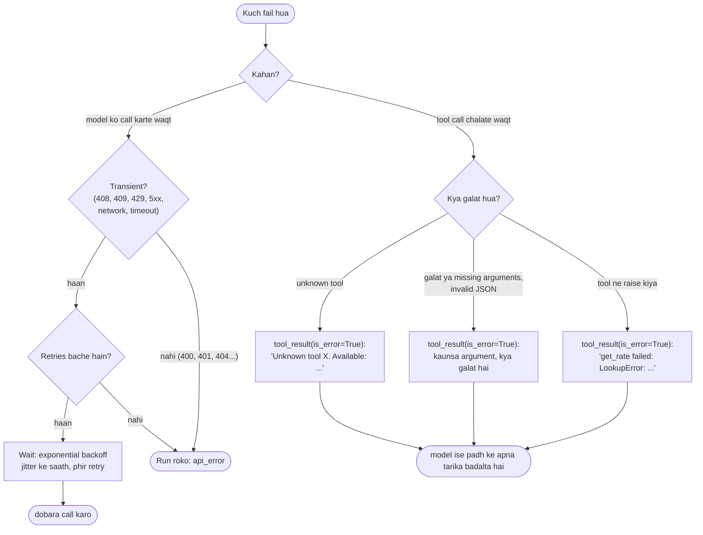

🏠 [Home](../../README.md) › [02 · The Agent Loop](./README.md) › 2.5 Loop mein errors kaise sambhalein

# 2.5 Loop mein errors kaise sambhalein

> **Level:** 🟡 Intermediate · **Padhne ka time:** ~10 min · **Pehle padho:** [2.3 50 lines mein agent, bilkul zero se](./02.3-a-50-line-agent-from-scratch.md), [2.4 Agent kab ruke: stopping conditions](./02.4-stopping-conditions.md)

**Ek line mein:** Agent loop ke andar zyaada tar failures aise messages ban jaane chahiye jinhe model padh ke theek kar sake (ek error result). Sirf woh failures jo model theek nahi kar sakta, jaise provider ka down hona, unhe retry karna chahiye ya run rokna chahiye.

📑 **Is page par**

- [Yeh kyun zaroori hai?](#-yeh-kyun-zaroori-hai)
- [Idea, simple words mein](#-idea-simple-words-mein)
- [Diagram se samjho](#-diagram-se-samjho)
- [Kaise kaam karta hai, step by step](#-kaise-kaam-karta-hai-step-by-step)
- [Example se samjho](#-example-se-samjho)
- [Code](#-code)
- [Aam galtiyan aur dhyan dene wali baatein](#-aam-galtiyan-aur-dhyan-dene-wali-baatein)
- [Yaad rakhne wali baatein](#-yaad-rakhne-wali-baatein)
- [Khud try karo](#-khud-try-karo)
- [Aur padhne ke liye](#-aur-padhne-ke-liye)

## 🤔 Yeh kyun zaroori hai?

Asli run mein cheezein baar-baar galat hoti hain. Tool ka naam `get_rate` hai, lekin model `get_exchange_rate` call karta hai. Woh ek zaroori argument bhool jaata hai. Ek tool raise karta hai kyunki record exist nahi karta. Provider kuch second ke liye "overloaded" return karta hai. In mein se kisi se bhi run khatam nahi hona chahiye.

Jo loop pehli exception pe crash ho jaaye, woh kamzor hai. Jo loop errors chhupa le, woh aur bura hai. Model ko kabhi pata hi nahi chalta ki uski call fail hui, aur woh hawa mein confidence se jawab de deta hai. Achha loop dono nahi karta. Woh **model ko dikhata hai ki kya galat hua**, taaki model dobara try kar sake. Aur jab problem model ke control ke bahar ho, to woh **retry karta hai ya saaf tarike se rukta hai**.

## 🧠 Idea, simple words mein

Ek sat-nav (Google Maps jaisa) socho. Jab road band hota hai, to woh khud ko band nahi kar deta. Woh bolta hai "road band hai, naya route dhoondh raha hoon" aur doosra raasta chunta hai. Lekin agar GPS signal chala jaaye, to naya route dhoondhne se kuch nahi hoga. Woh signal wapas aane ka wait karta hai, aur agar nahi aaya to tumhe bata deta hai.

Agent errors bhi aise hi baante jaate hain:

| Kism | Examples | Kaun theek karta hai | Kaise |
| --- | --- | --- | --- |
| **Model theek kar sakta hai** | Unknown tool, galat ya missing arguments, invalid JSON, tool ne raise kiya | Model | Ek **error result** bhejo jo bataye kya galat hua |
| **Abhi koi theek nahi kar sakta** | Rate limit, overload, server error, connection toota | Time | Backoff ke saath **retry** karo, aur fail hota rahe to ruko |
| **Koi bhi theek nahi kar sakta** | Invalid API key, galat bani request, model nahi mila | Tum, developer | **Ruko** aur report karo; retry se kabhi faayda nahi hoga |

Pehli kism sabse common hai, aur fix hamesha same hai: tool call ka jawab ek [tool result](../../GLOSSARY.md#tool-result) se do jo error mark kiya hua ho.

## 👀 Diagram se samjho



*Left wale errors model se connection ke baare mein hain, aur unhe tumhara code sambhalta hai. Right wale errors ek tool call ke baare mein hain, aur unhe model sambhalta hai, bas tum use saaf saaf batao.*

## 🔍 Kaise kaam karta hai, step by step

**1. Har tool call ko exactly ek result milta hai, fail hone pe bhi.** API calls aur results ko ID se jodti hai. Agar tum koi call skip karte ho kyunki woh fail hui, ya tumne use na chalane ka faisla kiya, to agli request mein ek bina jawab wali call hogi aur woh reject ho jaayegi. Iski jagah ek error result bhejo.

**2. Failures ko error mark karo.** Anthropic pe `tool_result` block pe `"is_error": true` set karo. OpenAI ke tool messages mein aisa koi flag nahi hai, isliye text mein bolo, "Error:" se shuru karke. Ek chhota helper jaise `tool_result(id, content, is_error=True)` dono kaam tumhare liye kar sakta hai.

**3. Tool exceptions pakdo.** Har tool call ko `try`/`except Exception` mein wrap karo. Exception ka type aur message report karo, poora traceback nahi. Tracebacks lambe hote hain, tokens khaate hain, aur file paths ya secrets leak kar sakte hain.

**4. Tool chalane se pehle arguments validate karo.** Models kabhi kabhi zaroori argument chhod dete hain, galat type use karte hain, ya koi naya bana lete hain. Arguments ko tool ke [JSON Schema](../../GLOSSARY.md#json-schema), ya ek pydantic model ([3.4](../03-tools-and-function-calling/03.4-designing-good-tools.md)), ke against check karo. Aur exactly batao ki kaunsa argument galat hai. [Strict mode](../../GLOSSARY.md#strict-mode) dono providers pe schema-valid arguments guarantee karta hai ([3.2](../03-tools-and-function-calling/03.2-json-schema-for-tools.md)). Lekin business rules, jaise "yeh order exist karta hai", tumhe phir bhi check karne padenge.

**5. Unknown tool names handle karo.** Error mein asli tools ki list do. Model lagbhag hamesha agli baar sahi wala chun leta hai.

**6. Woh arguments handle karo jo valid JSON nahi hain.** OpenAI arguments ko JSON string ki tarah bhejta hai, jo kabhi kabhi parse nahi hoti. Ise `try` ke andar parse karo. Agar parsing fail ho, to error ko call pe record karo (neeche code mein `call.error`) aur tool chalane ki jagah woh error wapas bhejo. (Anthropic ke saath `input` normally pehle se parsed aata hai. Agar tum eager input streaming on karte ho, to Anthropic ke docs kehte hain ki input khud validate karo aur jo parse na ho use error result ki tarah return karo.)

**7. Transient API errors ko backoff ke saath retry karo.** [Rate limits](../../GLOSSARY.md#rate-limit) (429), overload (Anthropic ka 529), server errors (5xx), request timeouts (408), conflicts (409) aur toote connections aksar apne aap theek ho jaate hain. Wait karo aur dobara try karo, har baar thoda zyaada wait karke: yeh hai **[exponential backoff](../../GLOSSARY.md#exponential-backoff)**. Saath mein random **[jitter](../../GLOSSARY.md#jitter)** daalo, taaki bahut saare clients ek hi pal mein retry na karein. Socho Tatkal booking ke time sab log ek saath refresh dabaate hain to server aur atak jaata hai; thoda alag-alag time pe try karo to sabka kaam jaldi hota hai. Permanent errors ko kabhi retry mat karo: 400 (bad request), 401 (galat key), 403 (allowed nahi), 404 (unknown model).

**8. Yaad rakho ki SDKs pehle se retry karte hain.** Anthropic aur OpenAI dono Python SDKs connection errors, 408, 409, 429 aur 5xx responses ko **default se do baar** automatically retry karte hain, exponential backoff ke saath, aur server ka `retry-after` header maante hain. Ise badalne ke liye client pe `max_retries` set karo. Neeche wale jaisa loop-level retry uske upar baithta hai. Isliye use chhota rakho, ya client pe `max_retries=0` set karke saara retrying ek hi jagah karo.

**9. Tool output ka size theek rakho.** Jo tool 2 MB ka log return kare, woh [context window](../../GLOSSARY.md#context-window) bhar dega aur bahut mehenga padega. Lamba output truncate karo aur batao ki truncate kiya, taaki model kam maang sake ([3.4](../03-tools-and-function-calling/03.4-designing-good-tools.md)).

**10. Kate hue replies aur loops stopping problems hain,** jo [2.4](./02.4-stopping-conditions.md) mein cover hain. `max_tokens` pe kate reply ke tools kabhi mat chalao, aur jab same call baar-baar repeat ho to ruko.

## 💡 Example se samjho

*"Aaj 250 euro kitne US dollar hain?"*, do tools ke saath: `get_rate(base, quote)` aur `multiply(a, b)`. Scripted model lagaatar chaar galat calls karta hai, aur provider ek baar fail hota hai:

```text
   API call failed with a transient error (529 overloaded_error); retry 1/3 after 0.3s
   step 1: get_rate({'base': 'EUR'}) -> ERROR Invalid arguments for get_rate: missing required argument 'quote'. Fix them and call again.
   step 2: get_exchange_rate({'base': 'EUR', 'quote': 'USD'}) -> ERROR Unknown tool 'get_exchange_rate'. Available tools: get_rate, multiply.
   step 3: get_rate({}) -> ERROR Your arguments for get_rate were not valid JSON (Invalid JSON arguments: Expecting ',' delimiter: line 1 column 16 (char 15)). Send the call again.
   step 4: get_rate({'base': 'USD', 'quote': 'EUR'}) -> ERROR get_rate failed: LookupError: no rate for USD->EUR; supported pairs: EUR->USD, GBP->USD
   step 5: get_rate({'base': 'EUR', 'quote': 'USD'}) -> 1.08
   step 6: multiply({'a': 250, 'b': 1.08}) -> 270.0
   step 7: final answer
   stop: final_answer

   Answer: 250 euros is about 270 US dollars today (rate 1.08).
```

Paanch failures, paanch alag kism ke, aur run phir bhi poora hota hai:

| Step | Failure | Kisne sambhala | Recovery kis wajah se possible hui |
| --- | --- | --- | --- |
| 1 se pehle | 529 overloaded | Backoff ke saath retry | Yeh transient tha: doosri koshish chal gayi |
| 1 | Missing argument | Validation | Message ne missing argument ka naam bataya |
| 2 | Galat tool name | Lookup | Message ne asli tool names ki list di |
| 3 | Invalid JSON | `call.error` | Tool khaali arguments ke saath kabhi chala hi nahi |
| 4 | Tool ne raise kiya | `try`/`except` | Exception text ne bataya ki kaunse pairs exist karte hain |

Asli models ek run mein itni galtiyan kam hi karte hain, lekin in mein se har ek alag se common hai.

## 💻 Code

Ek tool call aise chalana ki woh kabhi raise na kare. Yahan `ToolCall` ek chhota record hai jisme `.id`, `.name`, `.arguments` aur `.error` hain (`.error` tab set hota hai jab arguments valid JSON nahi the). `Tool` ek function aur uska input schema rakhta hai:

```python
def execute_tool(call: ToolCall, tools: dict[str, Tool], max_chars: int) -> tuple[str, bool]:
    """Ek tool call chalao aur (content, is_error) return karo. Kabhi raise nahi karta."""
    if call.error:                                    # arguments valid JSON nahi the
        return f"Your arguments for {call.name} were not valid JSON ({call.error}). Send the call again.", True
    tool = tools.get(call.name)
    if tool is None:
        return f"Unknown tool '{call.name}'. Available tools: {', '.join(tools)}.", True
    problems = validate_args(tool.input_schema, call.arguments)   # required, types, enum, extra keys
    if problems:
        return f"Invalid arguments for {call.name}: {'; '.join(problems)}. Fix them and call again.", True
    try:
        output = str(tool.fn(**call.arguments))
    except Exception as exc:                          # tool ki apni failure
        return f"{call.name} failed: {type(exc).__name__}: {exc}", True
    if len(output) > max_chars:
        output = output[:max_chars] + f"\n[truncated: showing {max_chars} of {len(output)} characters]"
    return output, False

# loop ke andar:
content, is_error = execute_tool(call, registry, limits.max_tool_output_chars)
messages.append(tool_result(call.id, content, is_error=is_error))
```

Transient API errors ko exponential backoff aur "full jitter" (zero aur current cap ke beech ek random wait) ke saath retry karna:

```python
RETRYABLE_STATUS = {408, 409, 429}                    # plus har 5xx, Anthropic ke 529 samet

def is_transient(exc: BaseException) -> bool:
    status = getattr(exc, "status_code", None)        # SDKs ki APIStatusError subclasses pe set hota hai
    if isinstance(status, int):
        return status in RETRYABLE_STATUS or status >= 500
    return isinstance(exc, CONNECTION_ERRORS)         # ConnectionError, TimeoutError, SDK APIConnectionError

def call_with_retries(fn, *, max_retries: int, sleep=time.sleep, base_delay=1.0, max_delay=30.0):
    for attempt in range(max_retries + 1):
        try:
            return fn()
        except Exception as exc:
            if not is_transient(exc) or attempt == max_retries:
                raise                                 # permanent hai, ya retries khatam
            sleep(random.uniform(0, min(max_delay, base_delay * 2**attempt)))
```

Raw SDKs ke saath unke typed exceptions pakdo, sabse specific pehle. Class names `anthropic` aur `openai` dono mein same hain:

```python
import anthropic

try:
    response = client.messages.create(...)
except anthropic.RateLimitError:          # 429: ruko aur retry karo (SDK pehle hi do baar try kar chuka)
    ...
except anthropic.InternalServerError:     # 5xx, 529 overloaded samet: baad mein retry karo
    ...
except anthropic.APIStatusError as e:     # koi aur HTTP error (400, 401, 404...): retry mat karo
    print(e.status_code, e.message)
except anthropic.APIConnectionError:      # network failure ya timeout (APITimeoutError iski subclass hai)
    ...
```

## 🚨 Aam galtiyan aur dhyan dene wali baatein

- **Exceptions ko loop se bahar nikalne dena.** Ek kharab tool call se run khatam nahi hona chahiye. Use pakdo aur result ki tarah report karo.
- **Errors ko nigal jaana.** Failure pe `""` ya `"None"` return karna model ko kuch nahi batata, aur woh khaali result ko asli data samajh sakta hai. Batao kya fail hua.
- **Poore tracebacks bhejna.** Yeh lambe hote hain aur paths, hostnames ya keys leak kar sakte hain. Exception ka type aur message bhejo. Traceback apne liye log karo ([14.2](../14-observability-and-debugging/14.2-logging-tool-calls.md)).
- **Cheezein badalne wale tools ko retry karna.** Timeout ke baad `send_email` ya `charge_card` retry kiya to woh do baar ho sakta hai. Jaise UPI payment atak jaaye aur tum dobara pay daba do, to paise do baar kat sakte hain. Sirf woh actions retry karo jo repeat karne pe safe hain, ya unhe idempotency key se safe banao ([15.3](../15-production-and-deployment/15.3-queues-retries-and-idempotency.md)).
- **Permanent errors ko retry karna.** 401 hamesha fail hoga. Retry se pehle status check karo.
- **Retries ke upar retries.** SDK ke do ke upar teen loop retries matlab har step pe 12 tak attempts. Ek layer chuno, ya dono ko chhota rakho.
- **Bina wait ya fixed wait ke retry karna.** Turant retry overload ko aur bura bana deta hai. Exponentially back off karo aur jitter add karo.

## ✅ Yaad rakhne wali baatein

- Jo failures model theek kar sakta hai, woh **error results** bante hain: har tool call ka hamesha ek result, Anthropic pe `is_error` se mark kiya hua ya OpenAI pe "Error:" se.
- Error messages specific rakho: kaunsa tool, kaunsa argument, kya expected tha, aage kya karna hai.
- Tool chalane se pehle arguments validate karo, aur har tool exception pakdo.
- **Transient** API errors (408, 409, 429, 5xx, network) ko exponential backoff aur jitter ke saath retry karo. Permanent wale kabhi retry mat karo.
- SDKs default se pehle hi do baar retry karte hain. Apna total retry budget pata hona chahiye.

## 🧪 Khud try karo

1. Ek tool call fail hoti hai aur tum same reply ki baaki do calls na chalane ka faisla karte ho. Tumhe phir bhi kya bhejna padega?
2. Har error ko "error result", "retry" ya "stop" mein classify karo: (a) model ID ke liye `anthropic.NotFoundError`, (b) ek tool `KeyError: 'order 99'` raise karta hai, (c) `openai.RateLimitError`, (d) model `search` ko `{"query": 5}` ke saath call karta hai jabki `query` string honi chahiye.
3. Model `multiply` ko `{"a": "250", "b": 1.08}` ke saath call karta hai. Upar wale `execute_tool` ke hisaab se model ko kaunsa error message milega?

<details>
<summary>Answer dekho</summary>

1. Us reply ki **har** call ka ek result: jo chalayi unka asli result (ya error), aur jo skip ki unke liye ek error result jaise *"Not executed: an earlier call in this turn failed."*. Anthropic ke parallel tool use docs exactly yahi recommend karte hain.
2. (a) Stop: galat model ID permanent hai. (b) Error result: model doosri ID try kar sakta hai ya user se pooch sakta hai. (c) Backoff ke saath retry (SDK ke apne retries ke baad). (d) Error result: *"'query' must be a string, got int 5"*.
3. `Invalid arguments for multiply: 'a' must be a number, got str '250'. Fix them and call again.` JSON Schema kehta hai `"type": "number"`, aur string `"250"` number nahi hai, chahe number jaisi dikhe.

</details>

## 📚 Aur padhne ke liye

- [Handle tool calls](https://platform.claude.com/docs/en/agents-and-tools/tool-use/handle-tool-calls) (Anthropic). `tool_result` blocks ki formatting, `is_error` samet.
- [Claude API errors](https://platform.claude.com/docs/en/api/errors) (Anthropic). Har HTTP error code aur kaunse retry karne laayak hain.
- [Parallel tool use](https://platform.claude.com/docs/en/agents-and-tools/tool-use/parallel-tool-use) (Anthropic). Jo calls tumne nahi chalayi unke liye kya bhejna hai.
- [Function calling](https://developers.openai.com/api/docs/guides/function-calling) (OpenAI). OpenAI side pe tool calls aur unke results handle karna.
- [Writing effective tools for AI agents](https://www.anthropic.com/engineering/writing-tools-for-agents) (Anthropic). Madadgaar error messages agents ko behtar kyun banate hain.

<!-- FOOTER -->

---

⬅️ **Pichla:** [2.4 Agent kab ruke: stopping conditions](./02.4-stopping-conditions.md) ·
🏠 [Chapter home](./README.md) ·
➡️ **Agla:** [03 · Tools & Function Calling → 3.1 Tool kya hota hai?](../03-tools-and-function-calling/03.1-what-is-a-tool.md)
