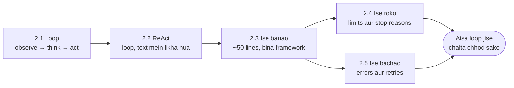

🏠 [Home](../../README.md) › 02 · The Agent Loop

# 02 · The Agent Loop

> **Padhne ka time:** ~51 min · **Level:** 🟢 Beginner se 🟡 Intermediate · **Pehle padho:** [01 · Foundations](../01-foundations/README.md)

Loop hi woh cheez hai jo ek model ko agent banati hai. Model ko call karo, jo tools woh maange unhe chalao, use results dikhao, aur jab tak kaam khatam na ho tab tak repeat karo. Yeh chapter yahi loop bilkul zero se banata hai. Tum observe–think–act cycle ko simple messages ki tarah dekhoge. Phir ReAct pattern ko trace karoge, jisne ise famous banaya. Phir bina framework ke lagbhag 50 lines mein ek complete agent likhoge. Aur aakhir mein use mazboot banaoge: kab rukna hai yeh jaanna, aur har asli run mein aane wale errors se bach nikalna.

## 🎯 Is chapter mein kya seekhoge

- Observe–think–act cycle, aur har step conversation mein kya add karta hai
- ReAct pattern (Thought → Action → Observation) apne original text form mein, aur native tool calling ne iski jagah kaise li
- Python ki lagbhag 50 lines mein ek chalta hua agent kaise likhein, ek chhote provider-neutral client pe aur raw Anthropic aur OpenAI SDKs pe
- Run ke rukne ki har wajah: final answer, step limit, timeout, token aur cost budgets, koi progress nahi, kate hue replies aur refusals
- Tool failures, galat arguments aur unknown tools ko aise messages mein kaise badlein jinhe model theek kar sake, aur API errors ko safely retry kaise karein

## 📋 Pehle se kya aana chahiye

- [1.4 LLMs kaise kaam karte hain (bas utna jitna zaroori hai)](../01-foundations/01.4-how-llms-work.md): stop reasons, `max_tokens` aur API stateless kyun hai
- [1.5 Agent ke andar kya-kya hota hai](../01-foundations/01.5-anatomy-of-an-agent.md): paanch parts, loop samet
- [0.3 Setup](../00-start-here/00.3-setup.md), taaki tum code snippets chala sako

## 👀 Chapter ek nazar mein

*Pehle do pages idea samjhate hain, teesra use banata hai, aur aakhri do use safe banate hain. Code bhi aise hi badhta hai: text-based ReAct agent se, ek minimal agent tak, aur phir ek mazboot loop tak jo har failure sambhalta hai.*

## 📄 Is chapter ke pages

<!-- PAGES:START -->
| # | Page | Level | Time |
| --- | --- | --- | --- |
| 2.1 | [Observe–think–act loop](./02.1-the-observe-think-act-loop.md) — Woh core cycle jo har agent chalata hai, step by step. | 🟢 Beginner | ~8 min |
| 2.2 | [ReAct ko samjho](./02.2-react-explained.md) — ReAct pattern, ek poore Thought → Action → Observation trace ke saath. | 🟢 Beginner | ~10 min |
| 2.3 | [50 lines mein agent, bilkul zero se](./02.3-a-50-line-agent-from-scratch.md) — Bina framework ke, Python ki lagbhag 50 lines mein ek chalta hua agent likho. | 🟡 Intermediate | ~15 min |
| 2.4 | [Agent kab ruke: stopping conditions](./02.4-stopping-conditions.md) — Max steps, timeouts, aur agent ko kaise pata chalta hai ki kaam ho gaya. | 🟡 Intermediate | ~8 min |
| 2.5 | [Loop mein errors kaise sambhalein](./02.5-handling-errors-in-the-loop.md) — Tool failures, model ka galat output aur retries, bina run crash kiye. | 🟡 Intermediate | ~10 min |
<!-- PAGES:END -->

<!-- FOOTER -->

---

⬅️ **Pichla chapter:** [01 · Foundations](../01-foundations/README.md) ·
▶️ **Padhna shuru karo:** [2.1 Observe–think–act loop](./02.1-the-observe-think-act-loop.md) ·
➡️ **Agla chapter:** [03 · Tools & Function Calling](../03-tools-and-function-calling/README.md)
