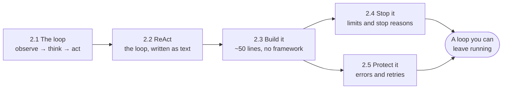

🏠 [Home](../../README.md) › 02 · The Agent Loop

# 02 · The Agent Loop

> **Estimated reading time:** ~51 min · **Difficulty:** 🟢 Beginner to 🟡 Intermediate · **Prerequisites:** [01 · Foundations](../01-foundations/README.md)

The loop is what turns a model into an agent: call the model, run the tools it asks for, show it the results, and repeat until it is done. This chapter builds that loop from scratch. You will see the observe–think–act cycle as plain messages, trace the ReAct pattern that made it famous, write a complete agent in about 50 lines with no framework, and then make it robust: knowing when to stop, and surviving the errors that every real run hits.

## 🎯 What you'll learn

- The observe–think–act cycle, and what each step adds to the conversation
- The ReAct pattern (Thought → Action → Observation) in its original text form, and how native tool calling replaced it
- How to write a working agent in about 50 lines of Python, on a small provider-neutral client and on the raw Anthropic and OpenAI SDKs
- Every reason a run should stop: final answer, step limit, timeout, token and cost budgets, no progress, cut-off replies and refusals
- How to turn tool failures, bad arguments and unknown tools into messages the model can fix, and how to retry API errors safely

## 📋 Prerequisites

- [1.4 How LLMs work](../01-foundations/01.4-how-llms-work.md): stop reasons, `max_tokens` and why the API is stateless
- [1.5 Anatomy of an agent](../01-foundations/01.5-anatomy-of-an-agent.md): the five parts, including the loop
- [0.3 Setup](../00-start-here/00.3-setup.md), so you can run the code snippets

## 👀 Chapter overview

*The first two pages explain the idea, the third builds it, and the last two make it safe. The code grows the same way: from a text-based ReAct agent, to a minimal agent, to a robust loop that handles every failure.*

## 📄 Pages in this chapter

<!-- PAGES:START -->
| # | Page | Level | Time |
| --- | --- | --- | --- |
| 2.1 | [The observe–think–act loop](./02.1-the-observe-think-act-loop.md) — The core cycle every agent runs, step by step. | 🟢 Beginner | ~8 min |
| 2.2 | [ReAct explained](./02.2-react-explained.md) — The ReAct pattern, with a full Thought → Action → Observation trace. | 🟢 Beginner | ~10 min |
| 2.3 | [A 50-line agent from scratch](./02.3-a-50-line-agent-from-scratch.md) — Write a working agent with no framework, in about 50 lines of Python. | 🟡 Intermediate | ~15 min |
| 2.4 | [Stopping conditions](./02.4-stopping-conditions.md) — Max steps, timeouts and how an agent knows it is done. | 🟡 Intermediate | ~8 min |
| 2.5 | [Handling errors in the loop](./02.5-handling-errors-in-the-loop.md) — Tool failures, bad model output and retries, without crashing the run. | 🟡 Intermediate | ~10 min |
<!-- PAGES:END -->

<!-- FOOTER -->

---

⬅️ **Previous chapter:** [01 · Foundations](../01-foundations/README.md) ·
▶️ **Start reading:** [2.1 The observe–think–act loop](./02.1-the-observe-think-act-loop.md) ·
➡️ **Next chapter:** [03 · Tools & Function Calling](../03-tools-and-function-calling/README.md)
