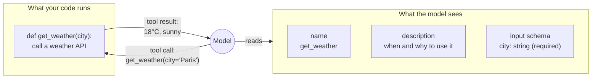

🏠 [Home](../../README.md) › [03 · Tools & Function Calling](./README.md) › 3.1 What is a tool?

# 3.1 What is a tool?

> **Difficulty:** 🟢 Beginner · **Reading time:** ~6 min · **Prerequisites:** [2.1 The observe–think–act loop](../02-the-agent-loop/02.1-the-observe-think-act-loop.md)

**In one sentence:** A tool is a function your code exposes to the model, described by a name, a description and an input schema, which the model can ask you to run but can never run itself.

📑 **On this page**

- [Why does this matter?](#-why-does-this-matter)
- [The idea, in plain words](#-the-idea-in-plain-words)
- [Picture it](#-picture-it)
- [How it works, step by step](#-how-it-works-step-by-step)
- [Worked example](#-worked-example)
- [Code](#-code)
- [Common mistakes & gotchas](#-common-mistakes--gotchas)
- [Key takeaways](#-key-takeaways)
- [Try it yourself](#-try-it-yourself)
- [Further reading](#-further-reading)

## 🤔 Why does this matter?

On its own, a language model is a brain in a jar. It knows a lot about the world up to its training date, but it cannot check today's weather, look up your customer's order, add up a spreadsheet reliably, or send an email. Ask it anyway and it will often answer confidently, and wrongly: a [hallucination](../../GLOSSARY.md#hallucination).

Tools change that. With a `get_order` tool it can look the order up. With a `send_email` tool it can act. Every agent in this book is, at heart, a model plus a set of tools plus a loop ([chapter 02](../02-the-agent-loop/README.md)). The tools decide what the agent can do; how you describe them decides how well it does it.

## 🧠 The idea, in plain words

Think of a restaurant. The customer (the model) reads the **menu** (the tool descriptions) and orders: *"the soup of the day, no croutons"*. The **kitchen** (your code) cooks it and sends it out. The customer never walks into the kitchen, never touches the stove, and can only order what is on the menu.

A [tool](../../GLOSSARY.md#tool) has two halves:

- **What the model sees:** a **name** (`get_weather`), a **description** ("Get the current weather for one city..."), and an **input schema**, a [JSON Schema](../../GLOSSARY.md#json-schema) that says which arguments exist and what type each one is ([3.2](./03.2-json-schema-for-tools.md)).
- **What your code runs:** an ordinary function. The model never sees this code.

When the model wants a tool, it replies with a **[tool call](../../GLOSSARY.md#tool-call)**: the tool's name and the arguments, as structured data. This ability is called [function calling](../../GLOSSARY.md#function-calling) (or tool use). Your code runs the function and sends back a **[tool result](../../GLOSSARY.md#tool-result)**. [3.3](./03.3-how-function-calling-works.md) shows the exact messages.

## 👀 Picture it



*The model only ever touches the left box. Everything it knows about your tool comes from three short pieces of text, which is why [3.4](./03.4-designing-good-tools.md) is a whole page on writing them well.*

## 🔍 How it works, step by step

**1. You describe the tool** in the request: name, description, input schema. These descriptions count as input [tokens](../../GLOSSARY.md#token) on every call.

**2. The model decides** whether a tool would help. If so, it replies with a tool call instead of (or as well as) text. It may ask for several at once ([3.5](./03.5-parallel-tool-calls.md)).

**3. Your code decides whether to run it.** This is your chance to check the arguments, ask a human for approval, or refuse ([13.5](../13-safety-and-guardrails/13.5-human-approval-for-risky-actions.md)).

**4. Your code runs it and returns the result,** or an error message if it failed ([2.5](../02-the-agent-loop/02.5-handling-errors-in-the-loop.md)).

Tools come in three broad kinds, with very different risks:

| Kind | Examples | Risk if the model misuses it |
| --- | --- | --- |
| **Read** | `search_docs`, `get_order`, `get_weather` | Low: wasted tokens, maybe leaked data |
| **Compute** | `calculator`, `run_python` ([3.6](./03.6-code-execution-as-a-tool.md)) | Medium: depends on the sandbox |
| **Act** (side effects) | `send_email`, `refund_order`, `delete_file`, clicking a screen ([3.7](./03.7-computer-use-and-browser-agents.md)) | High: real, possibly irreversible changes |

And they can run in three places:

| Where it runs | Who executes it | Examples |
| --- | --- | --- |
| **Your code** (client tools) | You, in your loop | Every tool you write yourself, like `get_weather` below |
| **The provider's servers** ([server tools](../../GLOSSARY.md#server-tool)) | Anthropic or OpenAI, inside the API call | Web search, code execution ([3.6](./03.6-code-execution-as-a-tool.md)) |
| **Another program** (MCP servers) | A separate server your app connects to | [Chapter 04](../04-model-context-protocol/README.md) |

## 💡 Worked example

A travel assistant with one tool. The user asks *"Do I need an umbrella in Paris today?"*

```text
You send:     the question + the tool description for get_weather(city)
Model calls:  get_weather({"city": "Paris"})              <- structured data, not text
You run:      get_weather("Paris") -> {"temp_c": 18, "sky": "light rain"}
You send:     the tool result
Model says:   "Yes, take one: it's 18°C with light rain in Paris."
```

Notice what the model did and did not do. It *chose* the tool, *filled in* `city` from the question, and *interpreted* the result. It did not fetch any weather. If `get_weather` had returned stale data, the model would have repeated it with confidence. Tools make an agent better informed, not automatically correct.

## 💻 Code

A tool is a function plus a description. Here it is in Anthropic's format:

```python
import json

def get_weather(city: str) -> str:
    """The function your code runs. The model never sees this."""
    data = {"city": city, "temp_c": 18, "sky": "light rain"}   # call a real weather API here
    return json.dumps(data)

WEATHER_TOOL = {                                               # what the model sees
    "name": "get_weather",
    "description": "Get the current weather for one city. Call this whenever the user asks "
                   "about weather, temperature or rain.",
    "input_schema": {
        "type": "object",
        "properties": {"city": {"type": "string", "description": "City name, e.g. 'Paris'."}},
        "required": ["city"],
    },
}
```

Passing it to a model and handling the call, on the Anthropic SDK:

```python
import anthropic

client = anthropic.Anthropic()                                 # reads ANTHROPIC_API_KEY
messages = [{"role": "user", "content": "Do I need an umbrella in Paris today?"}]

reply = client.messages.create(model="claude-opus-5-5", max_tokens=1000, tools=[WEATHER_TOOL], messages=messages)
call = next(b for b in reply.content if b.type == "tool_use")  # name='get_weather', input={'city': 'Paris'}
messages += [
    {"role": "assistant", "content": reply.content},
    {"role": "user", "content": [{"type": "tool_result", "tool_use_id": call.id,
                                  "content": get_weather(**call.input)}]},
]
final = client.messages.create(model="claude-opus-5-5", max_tokens=1000, tools=[WEATHER_TOOL], messages=messages)
print(final.content[-1].text)
```

OpenAI wraps the same description as `{"type": "function", "function": {"name", "description", "parameters"}}`. [3.3](./03.3-how-function-calling-works.md) shows both providers' payloads side by side.

## 🚨 Common mistakes & gotchas

- **Thinking the model runs the tool.** It only asks. Your code runs it, so your code is responsible for checking arguments and permissions.
- **Giving tools more power than the task needs.** A `run_sql(query)` tool with write access to production can do anything SQL can. Prefer narrow tools (`get_order(order_id)`) and least privilege ([13.3](../13-safety-and-guardrails/13.3-least-privilege-and-sandboxing.md)).
- **Vague names and descriptions.** "data", "Gets data." The model chooses tools by reading their text. Say what the tool does and when to use it ([3.4](./03.4-designing-good-tools.md)).
- **Too many tools.** Every description costs tokens on every call, and overlapping tools confuse the model. Start with a few.
- **Trusting tool output as instructions.** A tool that returns web pages or emails can return text written by an attacker ([prompt injection](../../GLOSSARY.md#prompt-injection)). Treat results as data.

## ✅ Key takeaways

- A tool = a function your code runs + a description the model reads (name, description, input schema).
- The model only requests tool calls; your code decides whether to run them and sends back the results.
- Read, compute and act tools carry very different risks. Be most careful with tools that change things.
- Tools can run in your code, on the provider's servers, or in a separate MCP server.
- The description is part of the interface: the model knows only what it says.

## 🧪 Try it yourself

1. For a "book a meeting room" agent, list two read tools and one act tool, each with a name and a one-line description.
2. Why is `execute_sql(query)` a riskier tool than `get_bookings(room_id, date)`, even if both read from the same database?

<details>
<summary>Show answer</summary>

1. One possible answer. Read: `find_free_rooms(start, end, min_capacity)`: "List rooms free for the whole time range with at least this many seats." Read: `get_room(room_id)`: "Get one room's name, floor, capacity and equipment." Act: `book_room(room_id, start, end, title)`: "Book a room. Only call this after the user has confirmed the room and time."
2. `execute_sql` accepts any query, so the model (or an attacker who injects text into the conversation) can read every table, or write and delete if the connection allows it. `get_bookings` can only ever run one fixed, safe query with two validated parameters. Narrow tools limit what can go wrong.

</details>

## 📚 Further reading

- [Tool use with Claude](https://platform.claude.com/docs/en/agents-and-tools/tool-use/overview) (Anthropic). How tools work on the Claude API, including client and server tools.
- [Function calling](https://developers.openai.com/api/docs/guides/function-calling) (OpenAI). The same idea on the OpenAI API.
- [Writing effective tools for AI agents](https://www.anthropic.com/engineering/writing-tools-for-agents) (Anthropic). Tools as "a contract between deterministic systems and non-deterministic agents".
- [Toolformer: Language Models Can Teach Themselves to Use Tools](https://arxiv.org/abs/2302.04761) (Schick et al., 2023). An early paper on training models to decide when to call tools.

<!-- FOOTER -->

---

⬅️ **Previous:** [2.5 Handling errors in the loop](../02-the-agent-loop/02.5-handling-errors-in-the-loop.md) ·
🏠 [Chapter home](./README.md) ·
➡️ **Next:** [3.2 JSON Schema for tool definitions](./03.2-json-schema-for-tools.md)
