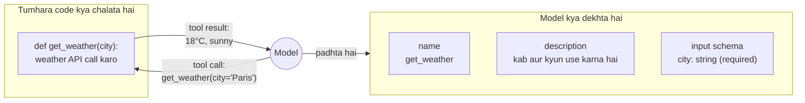

🏠 [Home](../../README.md) › [03 · Tools & Function Calling](./README.md) › 3.1 Tool kya hota hai?

# 3.1 Tool kya hota hai?

> **Level:** 🟢 Beginner · **Padhne ka time:** ~6 min · **Pehle padho:** [2.1 Observe–think–act loop](../02-the-agent-loop/02.1-the-observe-think-act-loop.md)

**Ek line mein:** Tool ek function hai jo tumhara code model ke saamne rakhta hai, ek name, description aur input schema ke saath. Model tumse use chalane ko keh sakta hai, lekin khud kabhi nahi chala sakta.

📑 **Is page par**

- [Yeh kyun zaroori hai?](#-yeh-kyun-zaroori-hai)
- [Idea, simple words mein](#-idea-simple-words-mein)
- [Diagram se samjho](#-diagram-se-samjho)
- [Kaise kaam karta hai, step by step](#-kaise-kaam-karta-hai-step-by-step)
- [Example se samjho](#-example-se-samjho)
- [Code](#-code)
- [Aam galtiyan aur dhyan dene wali baatein](#-aam-galtiyan-aur-dhyan-dene-wali-baatein)
- [Yaad rakhne wali baatein](#-yaad-rakhne-wali-baatein)
- [Khud try karo](#-khud-try-karo)
- [Aur padhne ke liye](#-aur-padhne-ke-liye)

## 🤔 Yeh kyun zaroori hai?

Akela language model ek "brain in a jar" jaisa hai. Usse apni training date tak duniya ke baare mein bahut kuch pata hai. Lekin woh aaj ka weather check nahi kar sakta. Tumhare customer ka order nahi dekh sakta. Spreadsheet ka total bharose se nahi jod sakta. Email nahi bhej sakta. Phir bhi poochoge to aksar confidence se jawab dega, aur galat dega. Isko [hallucination](../../GLOSSARY.md#hallucination) kehte hain.

Tools yeh sab badal dete hain. `get_order` tool ho to woh order dekh sakta hai. `send_email` tool ho to woh kaam kar sakta hai. Is book ka har agent asal mein model + tools ka set + ek loop hai ([chapter 02](../02-the-agent-loop/README.md)). Tools decide karte hain ki agent kya kar sakta hai. Aur tum unhe kaise describe karte ho, woh decide karta hai ki agent kitna achha karega.

## 🧠 Idea, simple words mein

Ek restaurant socho. Customer (model) **menu** (tool descriptions) padhta hai aur order deta hai: *"aaj ka soup, croutons ke bina"*. **Kitchen** (tumhara code) use banata hai aur bahar bhejta hai. Customer kabhi kitchen mein nahi jaata, stove ko haath nahi lagata, aur sirf wahi order kar sakta hai jo menu par hai.

Ek [tool](../../GLOSSARY.md#tool) ke do hisse hote hain:

- **Model kya dekhta hai:** ek **name** (`get_weather`), ek **description** ("Get the current weather for one city..."), aur ek **input schema**. Input schema ek [JSON Schema](../../GLOSSARY.md#json-schema) hai jo batata hai ki kaun se arguments hain aur har ek ka type kya hai ([3.2](./03.2-json-schema-for-tools.md)).
- **Tumhara code kya chalata hai:** ek normal function. Model yeh code kabhi nahi dekhta.

Jab model ko tool chahiye, woh **[tool call](../../GLOSSARY.md#tool-call)** ke saath reply karta hai. Isme tool ka name aur arguments hote hain, structured data ke roop mein. Is ability ko [function calling](../../GLOSSARY.md#function-calling) (ya tool use) kehte hain. Tumhara code function chalata hai aur **[tool result](../../GLOSSARY.md#tool-result)** wapas bhejta hai. Exact messages [3.3](./03.3-how-function-calling-works.md) mein dekho.

## 👀 Diagram se samjho



*Model sirf left wale box ko touch karta hai. Tumhare tool ke baare mein use jo bhi pata hai, woh teen chhote text pieces se aata hai. Isiliye [3.4](./03.4-designing-good-tools.md) poora ek page hai inhe achhe se likhne par.*

## 🔍 Kaise kaam karta hai, step by step

**1. Tum tool describe karte ho** request mein: name, description, input schema. Yeh descriptions har call par input [tokens](../../GLOSSARY.md#token) mein count hoti hain.

**2. Model decide karta hai** ki tool se madad milegi ya nahi. Agar haan, to woh text ki jagah (ya text ke saath) tool call bhejta hai. Woh ek saath kai tools bhi maang sakta hai ([3.5](./03.5-parallel-tool-calls.md)).

**3. Tumhara code decide karta hai ki chalana hai ya nahi.** Yahi mauka hai arguments check karne ka, kisi insaan se approval lene ka, ya mana karne ka ([13.5](../13-safety-and-guardrails/13.5-human-approval-for-risky-actions.md)).

**4. Tumhara code use chalata hai aur result wapas deta hai.** Fail hua to error message deta hai ([2.5](../02-the-agent-loop/02.5-handling-errors-in-the-loop.md)).

Tools mote taur par teen tarah ke hote hain, aur sabke risk bahut alag hain:

| Type | Examples | Model galat use kare to risk |
| --- | --- | --- |
| **Read** | `search_docs`, `get_order`, `get_weather` | Kam: tokens waste, shayad data leak |
| **Compute** | `calculator`, `run_python` ([3.6](./03.6-code-execution-as-a-tool.md)) | Medium: sandbox par depend karta hai |
| **Act** (side effects) | `send_email`, `refund_order`, `delete_file`, screen par click karna ([3.7](./03.7-computer-use-and-browser-agents.md)) | High: asli, shayad wapas na hone wale changes |

Socho kirana dukaan ka naukar. Rate list padhna (read) safe hai. Hisaab lagana (compute) thoda dhyan maangta hai. Lekin galle se paise nikaal ke dena (act) wapas nahi hota. Isliye act wale kaam par sabse zyada nazar rakho.

Aur tools teen jagah chal sakte hain:

| Kahan chalta hai | Kaun execute karta hai | Examples |
| --- | --- | --- |
| **Tumhara code** (client tools) | Tum, apne loop mein | Har tool jo tum khud likhte ho, jaise neeche wala `get_weather` |
| **Provider ke servers** ([server tools](../../GLOSSARY.md#server-tool)) | Anthropic ya OpenAI, API call ke andar | Web search, code execution ([3.6](./03.6-code-execution-as-a-tool.md)) |
| **Koi aur program** (MCP servers) | Ek alag server jisse tumhara app connect hota hai | [Chapter 04](../04-model-context-protocol/README.md) |

## 💡 Example se samjho

Ek travel assistant, jiske paas ek tool hai. User poochta hai *"Do I need an umbrella in Paris today?"*

```text
You send:     the question + the tool description for get_weather(city)
Model calls:  get_weather({"city": "Paris"})              <- structured data, not text
You run:      get_weather("Paris") -> {"temp_c": 18, "sky": "light rain"}
You send:     the tool result
Model says:   "Yes, take one: it's 18°C with light rain in Paris."
```

Dekho model ne kya kiya aur kya nahi kiya. Usne tool *choose* kiya, sawal se `city` *bhara*, aur result ko *samjha*. Usne khud koi weather fetch nahi kiya. Agar `get_weather` ne purana data diya hota, to model use bhi confidence se repeat kar deta. Tools agent ko zyada informed banate hain, apne aap sahi nahi.

## 💻 Code

Tool = ek function + ek description. Yeh raha Anthropic ke format mein:

```python
import json

def get_weather(city: str) -> str:
    """Yeh function tumhara code chalata hai. Model ise kabhi nahi dekhta."""
    data = {"city": city, "temp_c": 18, "sky": "light rain"}   # yahan asli weather API call karo
    return json.dumps(data)

WEATHER_TOOL = {                                               # yeh model dekhta hai
    "name": "get_weather",
    "description": "Get the current weather for one city. Call this whenever the user asks "
                   "about weather, temperature or rain.",
    "input_schema": {
        "type": "object",
        "properties": {"city": {"type": "string", "description": "City name, e.g. 'Paris'."}},
        "required": ["city"],
    },
}
```

Ise model ko dena aur call handle karna, Anthropic SDK par:

```python
import anthropic

client = anthropic.Anthropic()                                 # ANTHROPIC_API_KEY padhta hai
messages = [{"role": "user", "content": "Do I need an umbrella in Paris today?"}]

reply = client.messages.create(model="claude-opus-5-5", max_tokens=1000, tools=[WEATHER_TOOL], messages=messages)
call = next(b for b in reply.content if b.type == "tool_use")  # name='get_weather', input={'city': 'Paris'}
messages += [
    {"role": "assistant", "content": reply.content},
    {"role": "user", "content": [{"type": "tool_result", "tool_use_id": call.id,
                                  "content": get_weather(**call.input)}]},
]
final = client.messages.create(model="claude-opus-5-5", max_tokens=1000, tools=[WEATHER_TOOL], messages=messages)
print(final.content[-1].text)
```

OpenAI yahi description `{"type": "function", "function": {"name", "description", "parameters"}}` mein wrap karta hai. Dono providers ke payloads side by side [3.3](./03.3-how-function-calling-works.md) mein hain.

## 🚨 Aam galtiyan aur dhyan dene wali baatein

- **Yeh sochna ki model tool chalata hai.** Woh sirf maangta hai. Chalata tumhara code hai. Isliye arguments aur permissions check karna tumhare code ki zimmedari hai.
- **Tools ko kaam se zyada power dena.** Production par write access wala `run_sql(query)` tool woh sab kar sakta hai jo SQL kar sakta hai. Narrow tools (`get_order(order_id)`) aur least privilege use karo ([13.3](../13-safety-and-guardrails/13.3-least-privilege-and-sandboxing.md)).
- **Vague names aur descriptions.** "data", "Gets data." Model tools ka text padh ke hi choose karta hai. Saaf likho ki tool kya karta hai aur kab use karna hai ([3.4](./03.4-designing-good-tools.md)).
- **Bahut saare tools.** Har description har call par tokens khaati hai. Overlap karne wale tools model ko confuse karte hain. Kuch tools se shuru karo.
- **Tool output ko instructions maan lena.** Web pages ya emails lautane wala tool attacker ka likha text bhi la sakta hai ([prompt injection](../../GLOSSARY.md#prompt-injection)). Results ko sirf data samjho.

## ✅ Yaad rakhne wali baatein

- Tool = ek function jo tumhara code chalata hai + ek description jo model padhta hai (name, description, input schema).
- Model sirf tool calls maangta hai. Chalana hai ya nahi, yeh tumhara code decide karta hai, aur wahi results wapas bhejta hai.
- Read, compute aur act tools ke risk bahut alag hain. Jo tools cheezein badalte hain, unke saath sabse zyada dhyan rakho.
- Tools tumhare code mein, provider ke servers par, ya alag MCP server mein chal sakte hain.
- Description bhi interface ka hissa hai: model ko sirf utna pata hai jitna usme likha hai.

## 🧪 Khud try karo

1. "Meeting room book karo" wale agent ke liye do read tools aur ek act tool likho. Har ek ka name aur ek line ki description do.
2. `execute_sql(query)` tool `get_bookings(room_id, date)` se zyada risky kyun hai, chahe dono same database se padhte hon?

<details>
<summary>Answer dekho</summary>

1. Ek possible jawab. Read: `find_free_rooms(start, end, min_capacity)`: "List rooms free for the whole time range with at least this many seats." Read: `get_room(room_id)`: "Get one room's name, floor, capacity and equipment." Act: `book_room(room_id, start, end, title)`: "Book a room. Only call this after the user has confirmed the room and time."
2. `execute_sql` koi bhi query leta hai. To model (ya koi attacker jo conversation mein text inject kare) har table padh sakta hai. Connection allow kare to write aur delete bhi kar sakta hai. `get_bookings` hamesha sirf ek fixed, safe query chalata hai, do validated parameters ke saath. Narrow tools limit karte hain ki kya galat ho sakta hai.

</details>

## 📚 Aur padhne ke liye

- [Tool use with Claude](https://platform.claude.com/docs/en/agents-and-tools/tool-use/overview) (Anthropic). Claude API par tools kaise kaam karte hain, client aur server tools dono.
- [Function calling](https://developers.openai.com/api/docs/guides/function-calling) (OpenAI). Yahi idea OpenAI API par.
- [Writing effective tools for AI agents](https://www.anthropic.com/engineering/writing-tools-for-agents) (Anthropic). Tools ko "a contract between deterministic systems and non-deterministic agents" ki tarah dekhta hai.
- [Toolformer: Language Models Can Teach Themselves to Use Tools](https://arxiv.org/abs/2302.04761) (Schick et al., 2023). Ek shuruaati paper, models ko yeh sikhane par ki tools kab call karne hain.

<!-- FOOTER -->

---

⬅️ **Pichla:** [2.5 Loop mein errors kaise sambhalein](../02-the-agent-loop/02.5-handling-errors-in-the-loop.md) ·
🏠 [Chapter home](./README.md) ·
➡️ **Agla:** [3.2 Tool definitions ke liye JSON Schema](./03.2-json-schema-for-tools.md)
