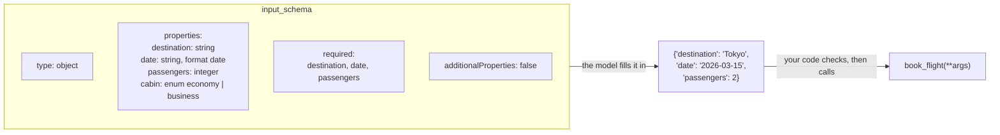

🏠 [Home](../../README.md) › [03 · Tools & Function Calling](./README.md) › 3.2 JSON Schema for tool definitions

# 3.2 JSON Schema for tool definitions

> **Difficulty:** 🟢 Beginner · **Reading time:** ~10 min · **Prerequisites:** [3.1 What is a tool?](./03.1-what-is-a-tool.md)

**In one sentence:** A tool's input schema is a JSON Schema that tells the model which arguments exist, their types, which are required and which values are allowed, and with strict mode both Anthropic and OpenAI guarantee the model's arguments match it.

📑 **On this page**

- [Why does this matter?](#-why-does-this-matter)
- [The idea, in plain words](#-the-idea-in-plain-words)
- [Picture it](#-picture-it)
- [How it works, step by step](#-how-it-works-step-by-step)
- [Worked example](#-worked-example)
- [Code](#-code)
- [Common mistakes & gotchas](#-common-mistakes--gotchas)
- [Key takeaways](#-key-takeaways)
- [Try it yourself](#-try-it-yourself)
- [Further reading](#-further-reading)

## 🤔 Why does this matter?

You give the model a `book_flight` tool with one argument, `details`, described as "the booking details". The model sends `{"details": "2 people to Tokyo on the 15th"}`. Now your code has to parse English. Next time it sends `{"details": {"to": "TYO", "pax": "two"}}`. Your function crashes.

The schema is the contract between the model and your function. A precise schema gets you precise arguments: `{"destination": "Tokyo", "date": "2026-03-15", "passengers": 2}`. A vague one gets you guesswork.

## 🧠 The idea, in plain words

A [JSON Schema](../../GLOSSARY.md#json-schema) is like a well-designed paper form:

- Each **field** has a label and a type: a text box, a number box, a tick box.
- Some fields are marked **required** (\*).
- Some fields are **dropdowns**: you can only pick one of the listed options.
- Each field has **help text** underneath: "Date of travel, e.g. 2026-03-15".
- There is no space to write anything else.

The model fills in the form. Your function receives the completed form as a dictionary. The clearer the form, the fewer mistakes.

## 👀 Picture it



*Each part of the schema closes off one kind of mistake: types stop "two" instead of 2, `required` stops missing fields, `enum` stops invented values, and `additionalProperties: false` stops invented fields.*

## 🔍 How it works, step by step

**1. The top level is always an object.** Tool arguments are a set of named fields, so the schema starts `{"type": "object", "properties": {...}}`. A tool with no arguments still has `{"type": "object", "properties": {}}`.

**2. Give every property a type.** The JSON types are `string`, `integer`, `number`, `boolean`, `array`, `object` and `null`. Use `integer` for counts, `number` for amounts that can have decimals. Arrays say what they contain with `items`; nested objects have their own `properties`.

**3. Describe every property.** The `description` is what the model reads to decide what to put there. Include the format and an example: `"Date of travel in YYYY-MM-DD format, e.g. 2026-03-15."` Strings can also declare a `format`, such as `date`, `date-time` or `email`.

**4. List the required fields.** `"required": ["destination", "date"]` is a list at the object level, not a flag on each property. Leave out fields that have a sensible default, and say the default in the description.

**5. Use `enum` for fixed choices.** `{"type": "string", "enum": ["economy", "business"]}`. This beats a description saying "economy or business", because the model cannot invent `"premium"`.

**6. Close the object with `"additionalProperties": false`.** It says "no other fields". Strict mode on both providers requires it on every object.

**7. Remember `default` is documentation.** A schema `default` tells the model what happens if it leaves a field out, but nothing fills it in for you. Your function must apply the default itself.

### Strict mode

Without strict mode, the model *tries* to follow the schema, and nearly always does. With [strict mode](../../GLOSSARY.md#strict-mode), the provider constrains the model's output so the arguments are **guaranteed** to match.

| | Anthropic | OpenAI |
| --- | --- | --- |
| How to turn it on | `"strict": true` at the top level of the tool, next to `name` and `input_schema` | `"strict": true` inside `function`, next to `name` and `parameters` |
| `additionalProperties: false` | Required on every object | Required on every object |
| Optional fields | Leave them out of `required` | **Every** field must be in `required`; make a field optional by allowing `null`: `"type": ["string", "null"]` |
| Default | Off unless you set it | Off in Chat Completions; the Responses API tries to make schemas strict when you leave `strict` out |
| Not supported | Numeric limits (`minimum`, `maximum`, `multipleOf`), string length limits, recursive schemas (sending them gives a 400 error) | A documented subset of JSON Schema; `minimum`, `maximum`, `pattern` and some others are supported |

Two practical notes. On Claude Opus 5.5 and Claude Sonnet 5.5, forcing a call with `tool_choice` `{"type": "any"}` or `{"type": "tool"}` returns a 400 error; Anthropic recommends `auto`, an instruction in the prompt, and `strict: true` to keep the schema guarantee ([3.3](./03.3-how-function-calling-works.md)). And strict mode guarantees the *shape*, not the *meaning*: an order ID can be a valid string and still not exist. Keep validating in your code ([2.5](../02-the-agent-loop/02.5-handling-errors-in-the-loop.md)).

## 💡 Worked example

Building a `book_flight` schema in three rounds, and the arguments a model might send for *"Book 2 seats to Tokyo on March 15th"*:

| Round | Schema | Typical arguments | Problem |
| --- | --- | --- | --- |
| 1 | `{"details": {"type": "string"}}` | `{"details": "2 people to Tokyo, Mar 15"}` | Your code must parse English |
| 2 | `destination`, `date`, `passengers` as strings | `{"destination": "Tokyo", "date": "March 15th", "passengers": "2"}` | Date format and number type vary |
| 3 | Typed, described, `required`, `enum`, closed | `{"destination": "Tokyo", "date": "2026-03-15", "passengers": 2, "cabin": "economy"}` | None: ready to use |

Round 3 is the schema in the Code section below. The [`03-tool-design`](../../examples/03-tool-design/README.md) example generates a schema like this from a pydantic model, and shows what happens when the model sends `"status": "shiped"`: validation catches it and returns *"status: Input should be 'pending', 'shipped', 'delivered' or 'cancelled' (you sent 'shiped')"*.

## 💻 Code

### The schema by hand

```python
BOOK_FLIGHT = {
    "name": "book_flight",
    "description": "Book a flight for the user. Only call this after the user has confirmed "
                   "the destination, date and number of passengers.",
    "input_schema": {
        "type": "object",
        "properties": {
            "destination": {"type": "string", "description": "City or airport code, e.g. 'Tokyo' or 'HND'."},
            "date": {"type": "string", "format": "date", "description": "Departure date, YYYY-MM-DD."},
            "passengers": {"type": "integer", "description": "Number of seats, 1 to 9."},
            "cabin": {"type": "string", "enum": ["economy", "premium_economy", "business"],
                      "description": "Cabin class. Defaults to economy if omitted."},
        },
        "required": ["destination", "date", "passengers"],
        "additionalProperties": False,
    },
}
```

### Strict mode, Anthropic

Add one key. The schema already closes every object, and it avoids `minimum`/`maximum` (the limit "1 to 9" lives in the description, and in your validation code).

```python
import anthropic

client = anthropic.Anthropic()  # needs ANTHROPIC_API_KEY
response = client.messages.create(
    model="claude-opus-5-5",
    max_tokens=16000,
    tools=[{**BOOK_FLIGHT, "strict": True}],
    messages=[{"role": "user", "content": "Book 2 seats to Tokyo on 2026-03-15. I've confirmed."}],
)
```

### Strict mode, OpenAI

OpenAI's strict mode needs every property listed in `required`, so the optional `cabin` field becomes "string or null":

```python
from openai import OpenAI

schema = BOOK_FLIGHT["input_schema"]
strict_schema = {
    **schema,
    "properties": {**schema["properties"],
                   "cabin": {**schema["properties"]["cabin"], "type": ["string", "null"]}},   # as in OpenAI's docs
    "required": ["destination", "date", "passengers", "cabin"],       # all of them
}
client = OpenAI()  # needs OPENAI_API_KEY
response = client.chat.completions.create(
    model="YOUR_OPENAI_MODEL",
    messages=[{"role": "user", "content": "Book 2 seats to Tokyo on 2026-03-15. I've confirmed."}],
    tools=[{"type": "function", "function": {"name": BOOK_FLIGHT["name"],
                                             "description": BOOK_FLIGHT["description"],
                                             "strict": True, "parameters": strict_schema}}],
)
```

### Generating the schema with pydantic

Writing schemas by hand gets tedious. [pydantic](https://docs.pydantic.dev/latest/) can generate one from a class and validate the model's arguments with the same class, from [`examples/03-tool-design/main.py`](../../examples/03-tool-design/main.py):

```python
from typing import Literal
from pydantic import BaseModel, ConfigDict, Field, ValidationError

class SearchOrdersInput(BaseModel):
    model_config = ConfigDict(extra="forbid")          # -> "additionalProperties": false
    customer_email: str = Field(description="The customer's email address, e.g. 'sam@example.com'.")
    status: Literal["pending", "shipped", "delivered", "cancelled"] | None = Field(
        default=None, description="Only return orders with this status. Omit to return every status.")
    page_size: int = Field(default=5, ge=1, le=20, description="Orders per page, 1 to 20. Default 5.")

schema = SearchOrdersInput.model_json_schema()        # use as input_schema (the example strips "title" keys)
try:
    args = SearchOrdersInput.model_validate({"customer_email": "sam@example.com", "page_size": 50})
except ValidationError as exc:
    print(exc.errors()[0]["msg"])                     # Input should be less than or equal to 20
```

`ge=1, le=20` become `minimum` and `maximum` in the schema. That is fine without strict mode, but Anthropic's strict mode rejects them. The `anthropic` package has a helper, `anthropic.transform_schema(SearchOrdersInput)`, that moves unsupported limits into the field descriptions (for example `"{default: 5, maximum: 20, minimum: 1}"`) so you can send the schema strictly and keep checking the limits with pydantic.

## 🚨 Common mistakes & gotchas

- **Putting `required: true` on a property.** That is not JSON Schema. `required` is a list of names on the object.
- **No descriptions.** A property named `q` or `id` with no description leaves the model guessing. Describe every field, with an example.
- **Strings for everything.** `"passengers": {"type": "string"}` invites `"two"`. Use `integer`, `number`, `boolean` and `enum`.
- **Relying on `default`.** Nothing fills it in. If the model leaves `cabin` out, your function receives no `cabin`.
- **Sending one schema to both providers in strict mode.** OpenAI's strict mode needs every field in `required` (with `null` for optional ones); Anthropic's rejects `minimum`/`maximum`. Generate the strict variant per provider, or keep strict off and validate yourself.
- **Huge, deeply nested schemas.** Every schema is sent on every call and costs tokens. If a tool needs a 40-field nested object, it is probably several tools.

## ✅ Key takeaways

- The input schema is the contract: types, descriptions, `required`, `enum` and `additionalProperties: false`.
- Describe every property, with a format and an example; the model reads them.
- `default` is a hint to the model; your code must apply it.
- Strict mode guarantees schema-valid arguments on both providers, with different rules: OpenAI wants every field required (use `null` for optional ones); Anthropic rejects numeric and length limits.
- Strict mode checks shape, not meaning. Keep validating values in your code.

## 🧪 Try it yourself

1. Write a schema for `set_reminder(text, when, repeat)` where `repeat` is optional and one of `none`, `daily`, `weekly`.
2. Make it OpenAI-strict.
3. A model sends `{"text": "Call mum", "when": "tomorrow 9am"}` to your schema from question 1. Is it valid? Is it useful?

<details>
<summary>Show answer</summary>

1. `{"type": "object", "properties": {"text": {"type": "string", "description": "What to remind the user about."}, "when": {"type": "string", "format": "date-time", "description": "When to remind, ISO 8601, e.g. 2026-11-14T09:00:00Z."}, "repeat": {"type": "string", "enum": ["none", "daily", "weekly"], "description": "Defaults to none."}}, "required": ["text", "when"], "additionalProperties": false}`.
2. Add `"repeat"` to `required`, change its type to `["string", "null"]` (the model sends `null` to mean "not set"), then set `"strict": true` in the `function` object.
3. Without strict mode it may pass, because many validators treat `format` as a hint and do not check it. It is not useful: "tomorrow 9am" is not a timestamp, and your code does not know the user's time zone. `date-time` is one of the string formats Anthropic's strict mode supports, so with strict mode on the model should be held to a real timestamp. Either way, validate `when` in your code and return a clear error if it does not parse.

</details>

## 📚 Further reading

- [Understanding JSON Schema](https://json-schema.org/understanding-json-schema) (json-schema.org). A friendly reference for every keyword used here.
- [Define tools](https://platform.claude.com/docs/en/agents-and-tools/tool-use/implement-tool-use) (Anthropic). Tool definitions, descriptions and examples for Claude.
- [Strict tool use](https://platform.claude.com/docs/en/agents-and-tools/tool-use/strict-tool-use) and [Structured outputs](https://platform.claude.com/docs/en/build-with-claude/structured-outputs) (Anthropic). How strict mode works, and the supported subset of JSON Schema.
- [Function calling: strict mode](https://developers.openai.com/api/docs/guides/function-calling) (OpenAI). OpenAI's strict mode rules, including required fields and `null`.
- [JSON Schema](https://docs.pydantic.dev/latest/concepts/json_schema/) (pydantic docs). Generating schemas from Python classes.

<!-- FOOTER -->

---

⬅️ **Previous:** [3.1 What is a tool?](./03.1-what-is-a-tool.md) ·
🏠 [Chapter home](./README.md) ·
➡️ **Next:** [3.3 How function calling works](./03.3-how-function-calling-works.md)
