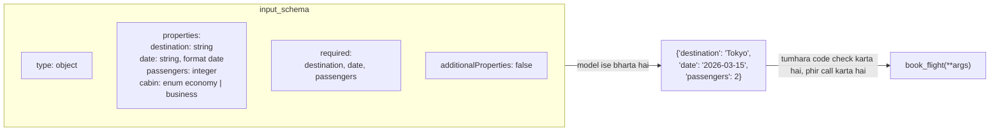

🏠 [Home](../../README.md) › [03 · Tools & Function Calling](./README.md) › 3.2 Tool definitions ke liye JSON Schema

# 3.2 Tool definitions ke liye JSON Schema

> **Level:** 🟢 Beginner · **Padhne ka time:** ~10 min · **Pehle padho:** [3.1 Tool kya hota hai?](./03.1-what-is-a-tool.md)

**Ek line mein:** Tool ka input schema ek JSON Schema hai jo model ko batata hai ki kaun se arguments hain, unke types kya hain, kaun se required hain aur kaun si values allowed hain. Strict mode on karo to Anthropic aur OpenAI dono guarantee karte hain ki model ke arguments is schema se match karenge.

📑 **Is page par**

- [Yeh kyun zaroori hai?](#-yeh-kyun-zaroori-hai)
- [Idea, simple words mein](#-idea-simple-words-mein)
- [Diagram se samjho](#-diagram-se-samjho)
- [Kaise kaam karta hai, step by step](#-kaise-kaam-karta-hai-step-by-step)
- [Example se samjho](#-example-se-samjho)
- [Code](#-code)
- [Aam galtiyan aur dhyan dene wali baatein](#-aam-galtiyan-aur-dhyan-dene-wali-baatein)
- [Yaad rakhne wali baatein](#-yaad-rakhne-wali-baatein)
- [Khud try karo](#-khud-try-karo)
- [Aur padhne ke liye](#-aur-padhne-ke-liye)

## 🤔 Yeh kyun zaroori hai?

Socho tumne model ko ek `book_flight` tool diya. Usme ek hi argument hai, `details`, jiski description hai "the booking details". Model bhejta hai `{"details": "2 people to Tokyo on the 15th"}`. Ab tumhare code ko English parse karni padegi. Agli baar woh bhejta hai `{"details": {"to": "TYO", "pax": "two"}}`. Tumhara function crash ho jaata hai.

Schema model aur tumhare function ke beech ka contract hai. Precise schema do, to precise arguments milte hain: `{"destination": "Tokyo", "date": "2026-03-15", "passengers": 2}`. Vague schema do, to sirf andaaze milte hain.

## 🧠 Idea, simple words mein

[JSON Schema](../../GLOSSARY.md#json-schema) ek achhe se bane paper form jaisa hai. Jaise train ticket ka reservation form:

- Har **field** ka ek label aur type hota hai: text box, number box, tick box.
- Kuch fields **required** (\*) mark hote hain.
- Kuch fields **dropdown** hote hain: sirf di gayi options mein se ek chun sakte ho (jaise Sleeper, 3A, 2A).
- Har field ke neeche **help text** hota hai: "Date of travel, e.g. 2026-03-15".
- Kuch aur likhne ki jagah hi nahi hoti.

Model form bharta hai. Tumhare function ko bhara hua form ek dictionary ki tarah milta hai. Form jitna saaf, galtiyan utni kam.

## 👀 Diagram se samjho



*Schema ka har hissa ek tarah ki galti band karta hai. Types "two" ko 2 ki jagah aane se rokte hain. `required` missing fields rokta hai. `enum` banayi hui values rokta hai. Aur `additionalProperties: false` banaye hue fields rokta hai.*

## 🔍 Kaise kaam karta hai, step by step

**1. Top level hamesha object hota hai.** Tool arguments naam wale fields ka set hote hain. Isliye schema `{"type": "object", "properties": {...}}` se shuru hota hai. Bina arguments wale tool mein bhi `{"type": "object", "properties": {}}` hota hai.

**2. Har property ko type do.** JSON types hain `string`, `integer`, `number`, `boolean`, `array`, `object` aur `null`. Ginti ke liye `integer` use karo. Decimal wali amounts ke liye `number`. Arrays `items` se batate hain ki unke andar kya hai. Nested objects ki apni `properties` hoti hain.

**3. Har property describe karo.** Model `description` padh ke hi decide karta hai ki wahan kya daalna hai. Format aur ek example zaroor do: `"Date of travel in YYYY-MM-DD format, e.g. 2026-03-15."` Strings ek `format` bhi declare kar sakti hain, jaise `date`, `date-time` ya `email`.

**4. Required fields ki list do.** `"required": ["destination", "date"]` object level par ek list hai. Yeh har property par flag nahi hai. Jin fields ka sensible default hai, unhe bahar rakho, aur default description mein likh do.

**5. Fixed choices ke liye `enum` use karo.** `{"type": "string", "enum": ["economy", "business"]}`. Yeh "economy or business" likhi description se better hai, kyunki model `"premium"` jaisi value bana hi nahi sakta.

**6. Object ko `"additionalProperties": false` se band karo.** Iska matlab hai "koi aur field nahi". Dono providers ka strict mode har object par ise maangta hai.

**7. Yaad rakho, `default` sirf documentation hai.** Schema ka `default` model ko batata hai ki field chhod diya to kya hoga. Lekin koi use tumhare liye bharta nahi. Default tumhare function ko khud lagana padega.

### Strict mode

Strict mode ke bina model schema follow karne ki *koshish* karta hai, aur lagbhag hamesha karta bhi hai. [Strict mode](../../GLOSSARY.md#strict-mode) mein provider model ke output ko constrain karta hai, taaki arguments schema se **guaranteed** match karein.

| | Anthropic | OpenAI |
| --- | --- | --- |
| On kaise karein | Tool ke top level par `"strict": true`, `name` aur `input_schema` ke saath | `function` ke andar `"strict": true`, `name` aur `parameters` ke saath |
| `additionalProperties: false` | Har object par required | Har object par required |
| Optional fields | Unhe `required` se bahar rakho | **Har** field `required` mein hona chahiye. Field ko optional banane ke liye `null` allow karo: `"type": ["string", "null"]` |
| Default | Off, jab tak tum set na karo | Chat Completions mein off. `strict` chhod do to Responses API schemas ko strict banane ki koshish karta hai |
| Support nahi hai | Numeric limits (`minimum`, `maximum`, `multipleOf`), string length limits, recursive schemas (bhejoge to 400 error milega) | JSON Schema ka ek documented subset. `minimum`, `maximum`, `pattern` aur kuch aur supported hain |

Do practical baatein. Pehli: Claude Opus 5.5 aur Claude Sonnet 5.5 par `tool_choice` `{"type": "any"}` ya `{"type": "tool"}` se call force karoge to 400 error aayega. Anthropic recommend karta hai `auto`, prompt mein ek instruction, aur schema guarantee ke liye `strict: true` ([3.3](./03.3-how-function-calling-works.md)). Dusri: strict mode *shape* guarantee karta hai, *matlab* nahi. Order ID ek valid string ho sakti hai aur phir bhi exist na kare. Apne code mein validate karte raho ([2.5](../02-the-agent-loop/02.5-handling-errors-in-the-loop.md)).

## 💡 Example se samjho

Teen rounds mein `book_flight` schema banate hain. Saath mein dekho ki *"Book 2 seats to Tokyo on March 15th"* par model kya arguments bhej sakta hai:

| Round | Schema | Typical arguments | Problem |
| --- | --- | --- | --- |
| 1 | `{"details": {"type": "string"}}` | `{"details": "2 people to Tokyo, Mar 15"}` | Tumhare code ko English parse karni padegi |
| 2 | `destination`, `date`, `passengers` sab strings | `{"destination": "Tokyo", "date": "March 15th", "passengers": "2"}` | Date format aur number type badalte rehte hain |
| 3 | Typed, described, `required`, `enum`, closed | `{"destination": "Tokyo", "date": "2026-03-15", "passengers": 2, "cabin": "economy"}` | Koi nahi: use karne ke liye ready |

Round 3 wahi schema hai jo neeche Code section mein hai. Agar tum aisa schema pydantic model se generate karo (woh bhi neeche hai), to wahi model arguments validate bhi karta hai. Jab model `"status": "shiped"` bhejta hai, validation use pakad leta hai aur lautata hai *"status: Input should be 'pending', 'shipped', 'delivered' or 'cancelled' (you sent 'shiped')"*.

## 💻 Code

### Haath se likha schema

```python
BOOK_FLIGHT = {
    "name": "book_flight",
    "description": "Book a flight for the user. Only call this after the user has confirmed "
                   "the destination, date and number of passengers.",
    "input_schema": {
        "type": "object",
        "properties": {
            "destination": {"type": "string", "description": "City or airport code, e.g. 'Tokyo' or 'HND'."},
            "date": {"type": "string", "format": "date", "description": "Departure date, YYYY-MM-DD."},
            "passengers": {"type": "integer", "description": "Number of seats, 1 to 9."},
            "cabin": {"type": "string", "enum": ["economy", "premium_economy", "business"],
                      "description": "Cabin class. Defaults to economy if omitted."},
        },
        "required": ["destination", "date", "passengers"],
        "additionalProperties": False,
    },
}
```

### Strict mode, Anthropic

Bas ek key add karo. Schema pehle se har object band karta hai, aur `minimum`/`maximum` se bachta hai ("1 to 9" wali limit description mein hai, aur tumhare validation code mein).

```python
import anthropic

client = anthropic.Anthropic()  # ANTHROPIC_API_KEY chahiye
response = client.messages.create(
    model="claude-opus-5-5",
    max_tokens=16000,
    tools=[{**BOOK_FLIGHT, "strict": True}],
    messages=[{"role": "user", "content": "Book 2 seats to Tokyo on 2026-03-15. I've confirmed."}],
)
```

### Strict mode, OpenAI

OpenAI ka strict mode chahta hai ki har property `required` mein ho. Isliye optional `cabin` field "string or null" ban jaata hai:

```python
from openai import OpenAI

schema = BOOK_FLIGHT["input_schema"]
strict_schema = {
    **schema,
    "properties": {**schema["properties"],
                   "cabin": {**schema["properties"]["cabin"], "type": ["string", "null"]}},   # jaisa OpenAI ke docs mein hai
    "required": ["destination", "date", "passengers", "cabin"],       # saare fields
}
client = OpenAI()  # OPENAI_API_KEY chahiye
response = client.chat.completions.create(
    model="YOUR_OPENAI_MODEL",
    messages=[{"role": "user", "content": "Book 2 seats to Tokyo on 2026-03-15. I've confirmed."}],
    tools=[{"type": "function", "function": {"name": BOOK_FLIGHT["name"],
                                             "description": BOOK_FLIGHT["description"],
                                             "strict": True, "parameters": strict_schema}}],
)
```

### Pydantic se schema generate karna

Haath se schemas likhna boring ho jaata hai. [pydantic](https://docs.pydantic.dev/latest/) ek class se schema generate kar sakta hai, aur usi class se model ke arguments validate bhi kar sakta hai:

```python
from typing import Literal
from pydantic import BaseModel, ConfigDict, Field, ValidationError

class SearchOrdersInput(BaseModel):
    model_config = ConfigDict(extra="forbid")          # -> "additionalProperties": false
    customer_email: str = Field(description="The customer's email address, e.g. 'sam@example.com'.")
    status: Literal["pending", "shipped", "delivered", "cancelled"] | None = Field(
        default=None, description="Only return orders with this status. Omit to return every status.")
    page_size: int = Field(default=5, ge=1, le=20, description="Orders per page, 1 to 20. Default 5.")

schema = SearchOrdersInput.model_json_schema()        # input_schema ki tarah use karo (pehle "title" keys hata do)
try:
    args = SearchOrdersInput.model_validate({"customer_email": "sam@example.com", "page_size": 50})
except ValidationError as exc:
    print(exc.errors()[0]["msg"])                     # Input should be less than or equal to 20
```

`ge=1, le=20` schema mein `minimum` aur `maximum` ban jaate hain. Strict mode ke bina yeh theek hai, lekin Anthropic ka strict mode inhe reject karta hai. `anthropic` package mein ek helper hai, `anthropic.transform_schema(SearchOrdersInput)`. Yeh unsupported limits ko field descriptions mein daal deta hai (jaise `"{default: 5, maximum: 20, minimum: 1}"`). Is tarah tum schema strict mode mein bhej sakte ho aur limits pydantic se check karte reh sakte ho.

## 🚨 Aam galtiyan aur dhyan dene wali baatein

- **Property par `required: true` lagana.** Yeh JSON Schema nahi hai. `required` object par names ki ek list hoti hai.
- **Descriptions na dena.** `q` ya `id` naam ki property bina description ke model ko andaaza lagane par chhod deti hai. Har field describe karo, example ke saath.
- **Sab kuch string.** `"passengers": {"type": "string"}` `"two"` ko invite karta hai. `integer`, `number`, `boolean` aur `enum` use karo.
- **`default` par bharosa karna.** Koi use bharta nahi. Model ne `cabin` chhod diya to tumhare function ko `cabin` milega hi nahi.
- **Strict mode mein dono providers ko ek hi schema bhejna.** OpenAI ka strict mode har field `required` mein maangta hai (optional ke liye `null` ke saath). Anthropic ka `minimum`/`maximum` reject karta hai. Har provider ke liye strict variant alag generate karo, ya strict off rakho aur khud validate karo.
- **Bahut bade, deeply nested schemas.** Har schema har call par bheja jaata hai aur tokens khaata hai. Agar kisi tool ko 40 fields wala nested object chahiye, to woh shayad asal mein kai tools hain.

## ✅ Yaad rakhne wali baatein

- Input schema contract hai: types, descriptions, `required`, `enum` aur `additionalProperties: false`.
- Har property describe karo, format aur example ke saath. Model inhe padhta hai.
- `default` model ke liye ek hint hai. Use lagana tumhare code ka kaam hai.
- Strict mode dono providers par schema-valid arguments guarantee karta hai, lekin rules alag hain. OpenAI har field required chahta hai (optional ke liye `null` use karo). Anthropic numeric aur length limits reject karta hai.
- Strict mode shape check karta hai, matlab nahi. Values apne code mein validate karte raho.

## 🧪 Khud try karo

1. `set_reminder(text, when, repeat)` ke liye schema likho. `repeat` optional hai aur `none`, `daily`, `weekly` mein se ek hai.
2. Ise OpenAI-strict banao.
3. Model sawal 1 wale schema par `{"text": "Call mum", "when": "tomorrow 9am"}` bhejta hai. Kya yeh valid hai? Kya yeh useful hai?

<details>
<summary>Answer dekho</summary>

1. `{"type": "object", "properties": {"text": {"type": "string", "description": "What to remind the user about."}, "when": {"type": "string", "format": "date-time", "description": "When to remind, ISO 8601, e.g. 2026-11-14T09:00:00Z."}, "repeat": {"type": "string", "enum": ["none", "daily", "weekly"], "description": "Defaults to none."}}, "required": ["text", "when"], "additionalProperties": false}`.
2. `"repeat"` ko `required` mein daalo, uska type `["string", "null"]` karo (model "set nahi hai" batane ke liye `null` bhejega), phir `function` object mein `"strict": true` set karo.
3. Strict mode ke bina yeh pass ho sakta hai, kyunki bahut se validators `format` ko sirf hint maante hain aur check nahi karte. Lekin useful nahi hai: "tomorrow 9am" timestamp nahi hai, aur tumhare code ko user ka time zone pata nahi. `date-time` un string formats mein se hai jo Anthropic ka strict mode support karta hai. To strict mode on ho to model ko asli timestamp dena padna chahiye. Dono cases mein `when` ko apne code mein validate karo, aur parse na ho to saaf error lautao.

</details>

## 📚 Aur padhne ke liye

- [Understanding JSON Schema](https://json-schema.org/understanding-json-schema) (json-schema.org). Yahan use hue har keyword ka friendly reference.
- [Define tools](https://platform.claude.com/docs/en/agents-and-tools/tool-use/implement-tool-use) (Anthropic). Claude ke liye tool definitions, descriptions aur examples.
- [Strict tool use](https://platform.claude.com/docs/en/agents-and-tools/tool-use/strict-tool-use) aur [Structured outputs](https://platform.claude.com/docs/en/build-with-claude/structured-outputs) (Anthropic). Strict mode kaise kaam karta hai, aur JSON Schema ka kaun sa subset supported hai.
- [Function calling: strict mode](https://developers.openai.com/api/docs/guides/function-calling) (OpenAI). OpenAI ke strict mode ke rules, required fields aur `null` samet.
- [JSON Schema](https://docs.pydantic.dev/latest/concepts/json_schema/) (pydantic docs). Python classes se schemas generate karna.

<!-- FOOTER -->

---

⬅️ **Pichla:** [3.1 Tool kya hota hai?](./03.1-what-is-a-tool.md) ·
🏠 [Chapter home](./README.md) ·
➡️ **Agla:** [3.3 Function calling kaise kaam karta hai](./03.3-how-function-calling-works.md)
