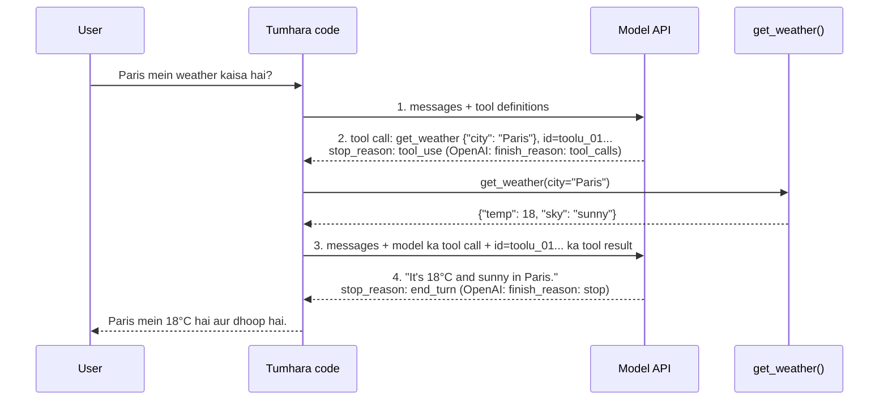

🏠 [Home](../../README.md) › [03 · Tools & Function Calling](./README.md) › 3.3 Function calling kaise kaam karta hai

# 3.3 Function calling kaise kaam karta hai

> **Level:** 🟢 Beginner · **Padhne ka time:** ~12 min · **Pehle padho:** [3.1 Tool kya hota hai?](./03.1-what-is-a-tool.md), [3.2 Tool definitions ke liye JSON Schema](./03.2-json-schema-for-tools.md)

**Ek line mein:** Function calling ek chaar step ka round trip hai (tum tools aur sawal bhejte ho, model tool call ke saath reply karta hai, tum tool ka result wapas bhejte ho, model jawab deta hai). Anthropic aur OpenAI same steps karte hain, bas JSON ka shape alag hota hai.

📑 **Is page par**

- [Yeh kyun zaroori hai?](#-yeh-kyun-zaroori-hai)
- [Idea, simple words mein](#-idea-simple-words-mein)
- [Diagram se samjho](#-diagram-se-samjho)
- [Kaise kaam karta hai, step by step](#-kaise-kaam-karta-hai-step-by-step)
- [Example se samjho](#-example-se-samjho)
- [Code](#-code)
- [Aam galtiyan aur dhyan dene wali baatein](#-aam-galtiyan-aur-dhyan-dene-wali-baatein)
- [Yaad rakhne wali baatein](#-yaad-rakhne-wali-baatein)
- [Khud try karo](#-khud-try-karo)
- [Aur padhne ke liye](#-aur-padhne-ke-liye)

## 🤔 Yeh kyun zaroori hai?

Tool-calling ke zyadatar bugs format bugs hote hain. Result galat role mein chala gaya. ID match nahi hui. Tool call wala assistant message append hi nahi hua. Arguments dict ki jagah string the. Inme se har ek error deta hai, ya usse bhi bura, chupchaap model ko confuse kar deta hai.

Frameworks aur provider-neutral clients yeh details chhupa dete hain. Yeh convenient hai, jab tak kuch toot na jaaye. Yeh page dono providers ka asli JSON step by step dikhata hai. Taaki tum fail hoti request padh ke dekh sako ki galat kya hai.

## 🧠 Idea, simple words mein

Function calling ek conversation hai jiske beech mein ek pause aata hai:

1. **Tum:** "Yeh tools tum use kar sakte ho. User pooch raha hai: what's the weather in Paris?"
2. **Model:** "Please `get_weather` chalao, `city = "Paris"` ke saath." (aur woh ruk jaata hai)
3. **Tum:** "Us call ka result yeh raha: 18°C, sunny."
4. **Model:** "It's 18°C and sunny in Paris."

Step 2 [tool call](../../GLOSSARY.md#tool-call) hai. Step 3 [tool result](../../GLOSSARY.md#tool-result) hai. Dono ek **ID** se jude hote hain. Model step 2 mein ID banata hai, aur tum step 3 mein wahi ID wapas bhejte ho. API [stateless](../../GLOSSARY.md#stateless) hai, isliye step 3 mein sab kuch dobara jaata hai: sawal, model ka tool call, aur result.

Socho tapri par chai ka order. Tumne token number 17 liya. Chai banne tak tum ruke. Jab chai aayi, "17 number" bol ke di gayi, taaki galat insaan ko na chali jaaye. Tool call ki ID bhi wahi token number hai.

## 👀 Diagram se samjho



*Ek jawab ke liye do model calls. Model khud kabhi `get_weather` call nahi karta. Tumhara code karta hai, dono calls ke beech mein. ID result ko call se jodti hai.*

## 🔍 Kaise kaam karta hai, step by step

### Step 1: tum sawal aur tools bhejte ho

Dono APIs messages ki list aur tools ki list leti hain. Farq sirf wrapping mein hai:

| | Anthropic Messages API | OpenAI Chat Completions |
| --- | --- | --- |
| Endpoint | `POST /v1/messages` | `POST /v1/chat/completions` |
| System prompt | top-level `system` field | pehla message, `role: "system"` |
| Tool definition | `{"name", "description", "input_schema"}` | `{"type": "function", "function": {"name", "description", "parameters"}}` |
| Output limit | `max_tokens` | `max_completion_tokens` |

### Step 2: model tool call ke saath reply karta hai

| | Anthropic | OpenAI |
| --- | --- | --- |
| Kahan milta hai | `content` mein ek `tool_use` block (aksar ek `text` block ke baad) | `choices[0].message.tool_calls[]` |
| ID | `id`, jaise `toolu_01...` | `id`, jaise `call_...` |
| Arguments | `input`: ek JSON **object** | `function.arguments`: ek JSON **string** jo tumhe parse karni hogi |
| Signal | `stop_reason: "tool_use"` | `finish_reason: "tool_calls"` |

### Step 3: tum tool chalate ho aur result bhejte ho

History mein tum **do** cheezein append karte ho: pehle model ka reply bilkul waisa hi jaisa mila, phir result.

| | Anthropic | OpenAI |
| --- | --- | --- |
| Result message ka role | `user` | `tool` |
| Shape | `{"type": "tool_result", "tool_use_id": ..., "content": ...}` block | `{"role": "tool", "tool_call_id": ..., "content": ...}` |
| Kai results | saare `tool_result` blocks **ek** user message mein, kisi bhi text se pehle | **har** result ke liye ek `tool` message |
| Failure batana | `"is_error": true` | koi flag nahi: `content` mein likh do |

### Step 4: model jawab deta hai

Model result padhta hai. Phir ya to jawab deta hai (`end_turn` / `stop`), ya ek aur tool maangta hai, aur tum wapas step 2 par ho. Yahi repetition [chapter 02](../02-the-agent-loop/README.md) wala [agent loop](../../GLOSSARY.md#agent-loop) hai.

### Model tool call kare ya nahi, yeh control karna: `tool_choice`

[Tool choice](../../GLOSSARY.md#tool-choice) setting decide karti hai ki is turn par model tool call kar sakta hai, karna hi padega, ya bilkul nahi kar sakta:

| Behaviour | Anthropic | OpenAI Chat Completions |
| --- | --- | --- |
| Model decide kare (default) | `{"type": "auto"}` | `"auto"` |
| Koi na koi tool call karna hi hai | `{"type": "any"}` | `"required"` |
| Yahi tool call karna hai | `{"type": "tool", "name": "get_weather"}` | `{"type": "function", "function": {"name": "get_weather"}}` |
| Is turn koi tool nahi | `{"type": "none"}` | `"none"` |

**Current Claude models ke liye zaroori baat:** Claude Opus 5.5 aur Claude Sonnet 5.5 par (aur kuch aur recent models par), `{"type": "any"}` ya `{"type": "tool", ...}` se call force karoge to **400 error** aayega. `auto` use karo. Prompt mein bata do ki kaun sa tool use karna hai ("Use the get_weather tool to answer"). Tool par `strict: true` set karo taaki arguments schema-valid hon ([3.2](./03.2-json-schema-for-tools.md)). Aur check karo ki tool call sach mein wapas aaya. Agar tum call sirf JSON nikalne ke liye force kar rahe the, to uski jagah structured outputs use karo.

## 💡 Example se samjho

Ek round trip ke asli payloads. (Step 2 ke responses har provider ke asli shape mein samples hain. Unki IDs aur token counts sirf illustration ke liye hain.)

**Step 1, Anthropic request body:**

```json
{
  "model": "claude-opus-5-5",
  "max_tokens": 1024,
  "system": "You are a helpful assistant. Use tools for live data.",
  "tools": [
    {
      "name": "get_weather",
      "description": "Get the current weather for one city. Call this whenever the user asks about weather.",
      "input_schema": {
        "type": "object",
        "properties": {
          "city": {"type": "string", "description": "City name, e.g. 'Paris'."},
          "unit": {"type": "string", "enum": ["celsius", "fahrenheit"], "description": "Defaults to celsius."}
        },
        "required": ["city"]
      }
    }
  ],
  "messages": [{"role": "user", "content": "What's the weather in Paris?"}]
}
```

**Step 1, OpenAI request body** (wahi tool, alag wrapping; system prompt pehle message ki tarah):

```json
{
  "model": "YOUR_OPENAI_MODEL",
  "max_completion_tokens": 1024,
  "tools": [
    {
      "type": "function",
      "function": {
        "name": "get_weather",
        "description": "Get the current weather for one city. Call this whenever the user asks about weather.",
        "parameters": {"type": "object", "properties": {"...": "the same JSON Schema"}, "required": ["city"]}
      }
    }
  ],
  "messages": [
    {"role": "system", "content": "You are a helpful assistant. Use tools for live data."},
    {"role": "user", "content": "What's the weather in Paris?"}
  ]
}
```

**Step 2, Anthropic ka reply:**

```json
{
  "role": "assistant",
  "content": [
    {"type": "text", "text": "I'll check the current weather in Paris."},
    {"type": "tool_use", "id": "toolu_01A09q90qw90lq", "name": "get_weather", "input": {"city": "Paris"}}
  ],
  "stop_reason": "tool_use"
}
```

**Step 2, OpenAI ka reply** (`choices[0]` ke andar):

```json
{
  "finish_reason": "tool_calls",
  "message": {
    "role": "assistant",
    "content": null,
    "tool_calls": [
      {"id": "call_abc123", "type": "function",
       "function": {"name": "get_weather", "arguments": "{\"city\": \"Paris\"}"}}
    ]
  }
}
```

`arguments` ko dhyan se dekho: OpenAI par yeh ek *string hai jiske andar JSON hai*. Ise tumhe `json.loads()` karna padega. Parse karne ke baad dono replies mein same teen cheezein hain:

```text
anthropic -> id='toolu_01A09q90qw90lq', name='get_weather', arguments={'city': 'Paris'}
openai    -> id='call_abc123', name='get_weather', arguments={'city': 'Paris'}
```

**Step 3, Anthropic:** agli request ke aakhri do messages. Assistant turn bina badle wapas jaata hai, phir ek **user** message mein `tool_result` hota hai:

```json
[
  {"role": "assistant", "content": [
    {"type": "text", "text": "I'll check the current weather in Paris."},
    {"type": "tool_use", "id": "toolu_01A09q90qw90lq", "name": "get_weather", "input": {"city": "Paris"}}
  ]},
  {"role": "user", "content": [
    {"type": "tool_result", "tool_use_id": "toolu_01A09q90qw90lq",
     "content": "{\"city\": \"Paris\", \"temp\": 18, \"unit\": \"celsius\", \"sky\": \"sunny\"}"}
  ]}
]
```

**Step 3, OpenAI:** `tool_calls` wala assistant message, phir ek **tool** message:

```json
[
  {"role": "assistant", "content": null, "tool_calls": [
    {"id": "call_abc123", "type": "function", "function": {"name": "get_weather", "arguments": "{\"city\": \"Paris\"}"}}
  ]},
  {"role": "tool", "tool_call_id": "call_abc123",
   "content": "{\"city\": \"Paris\", \"temp\": 18, \"unit\": \"celsius\", \"sky\": \"sunny\"}"}
]
```

**Step 4:** `Answer: It's 18°C and sunny in Paris right now.`

## 💻 Code

Raw Anthropic SDK par poora round trip (`ANTHROPIC_API_KEY` chahiye; `WEATHER_TOOL` aur `get_weather` wahi hain jo [3.1](./03.1-what-is-a-tool.md#-code) mein the):

```python
import anthropic

client = anthropic.Anthropic()
messages = [{"role": "user", "content": "What's the weather in Paris?"}]

first = client.messages.create(model="claude-opus-5-5", max_tokens=1024, tools=[WEATHER_TOOL], messages=messages)
messages.append({"role": "assistant", "content": first.content})           # step 2: bina badle rakho
results = [
    {"type": "tool_result", "tool_use_id": block.id, "content": get_weather(**block.input)}
    for block in first.content if block.type == "tool_use"
]
messages.append({"role": "user", "content": results})                      # step 3: ek user message
final = client.messages.create(model="claude-opus-5-5", max_tokens=1024, tools=[WEATHER_TOOL], messages=messages)
print("".join(b.text for b in final.content if b.type == "text"))         # step 4 (thinking blocks chhod do)
```

Aur raw OpenAI SDK par (`OPENAI_API_KEY` aur ek model ID chahiye):

```python
import json
from openai import OpenAI

client = OpenAI()
tools = [{"type": "function", "function": {"name": WEATHER_TOOL["name"], "description": WEATHER_TOOL["description"],
                                           "parameters": WEATHER_TOOL["input_schema"]}}]
messages = [{"role": "user", "content": "What's the weather in Paris?"}]

first = client.chat.completions.create(model="YOUR_OPENAI_MODEL", messages=messages, tools=tools)
message = first.choices[0].message
messages.append(message)                                                   # step 2: ise rakho
for call in message.tool_calls or []:
    args = json.loads(call.function.arguments)                             # yeh string hai: parse karo
    messages.append({"role": "tool", "tool_call_id": call.id, "content": get_weather(**args)})   # step 3
final = client.chat.completions.create(model="YOUR_OPENAI_MODEL", messages=messages, tools=tools)
print(final.choices[0].message.content)                                    # step 4
```

OpenAI ki nayi **Responses API** yahi round trip alag naamon ke saath karti hai. Tools flat hote hain (`{"type": "function", "name", "parameters"}`). Model `call_id` ke saath `function_call` items lautata hai. Aur tum `{"type": "function_call_output", "call_id": ..., "output": ...}` items se reply karte ho.

## 🚨 Aam galtiyan aur dhyan dene wali baatein

- **Model ka tool-call message append na karna.** Result us call ke baad hi aana chahiye jisne use maanga. Iske bina dono providers request reject kar dete hain.
- **IDs match na hona.** `tool_use_id` (Anthropic) ya `tool_call_id` (OpenAI) bilkul wahi ID honi chahiye jo model ke call mein thi.
- **Anthropic results galat jagah.** Yeh `user` message mein `tool_result` blocks ki tarah jaate hain, sab ek saath, tumhare add kiye kisi bhi text se pehle. `assistant` message mein nahi, aur har result ke liye alag message nahi.
- **OpenAI `arguments` ko dict samajhna.** Yeh string hai. Ise `try` ke andar parse karo, kyunki kabhi-kabhi yeh invalid JSON ho sakti hai ([2.5](../02-the-agent-loop/02.5-handling-errors-in-the-loop.md)).
- **Claude Opus 5.5 ya Sonnet 5.5 par tool calls force karna.** Wahan `tool_choice` `any` ya `tool` 400 deta hai. `auto` + instructions + `strict: true` use karo, aur check karo ki call wapas aaya.
- **Yeh maan lena ki har reply mein ek hi tool call hoga.** Dono providers ek turn mein kai calls lauta sakte hain. Sab par loop karo ([3.5](./03.5-parallel-tool-calls.md)).

## ✅ Yaad rakhne wali baatein

- Round trip yeh hai: tools ke saath request → tool call (stop reason `tool_use` / `tool_calls`) → tool result → jawab.
- Anthropic calls ko `tool_use` blocks mein aur results ko **user** message ke andar `tool_result` blocks mein rakhta hai. OpenAI `tool_calls` use karta hai aur har result ke liye ek **tool**-role message.
- IDs har result ko uske call se jodti hain. Unhe hamesha exact wapas bhejo.
- OpenAI arguments JSON string ki tarah bhejta hai. Anthropic parsed object bhejta hai.
- `tool_choice` control karta hai ki call force ho ya nahi. Lekin current Claude Opus aur Sonnet models forced calls reject karte hain: `auto` ke saath saaf instruction use karo.

## 🧪 Khud try karo

1. Upar wale do step 3 payloads dekho. Agar `get_weather` fail ho jaata, to har provider par tum model ko kaise bataoge ki result error hai?
2. Model do `tool_use` blocks ke saath reply karta hai. Anthropic par jo user message tum wapas bhejoge, woh likho.
3. Round trip ki dusri request pehli se zyada input tokens kyun khaati hai?

<details>
<summary>Answer dekho</summary>

1. Anthropic par `tool_result` block mein `"is_error": true` add karo (upar yeh set nahi hai kyunki call successful thi). OpenAI ke tool message mein aisa koi field nahi hai, isliye content ko "Error:" se shuru karo.
2. `{"role": "user", "content": [{"type": "tool_result", "tool_use_id": "<first id>", "content": "..."}, {"type": "tool_result", "tool_use_id": "<second id>", "content": "..."}]}`: ek message, do blocks, har ek ki apni ID.
3. Kyunki API stateless hai. Dusri request sawal aur tool definitions dobara bhejti hai, aur saath mein model ka tool call aur tool result bhi jodti hai.

</details>

## 📚 Aur padhne ke liye

- [Tool use with Claude](https://platform.claude.com/docs/en/agents-and-tools/tool-use/overview) aur [Handle tool calls](https://platform.claude.com/docs/en/agents-and-tools/tool-use/handle-tool-calls) (Anthropic). Poora Anthropic round trip aur `tool_result` ke rules.
- [Function calling](https://developers.openai.com/api/docs/guides/function-calling) (OpenAI). Chat Completions aur Responses API ke liye OpenAI round trip, `tool_choice` samet.
- [Define tools](https://platform.claude.com/docs/en/agents-and-tools/tool-use/implement-tool-use) (Anthropic). Tool definitions aur `tool_choice` ke options.

<!-- FOOTER -->

---

⬅️ **Pichla:** [3.2 Tool definitions ke liye JSON Schema](./03.2-json-schema-for-tools.md) ·
🏠 [Chapter home](./README.md) ·
➡️ **Agla:** [3.4 Achhe tools kaise design karein](./03.4-designing-good-tools.md)
