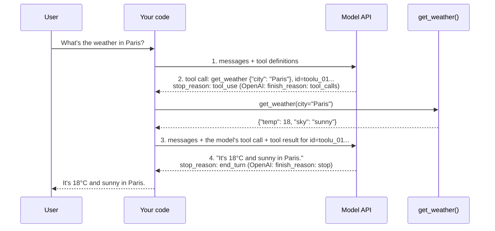

🏠 [Home](../../README.md) › [03 · Tools & Function Calling](./README.md) › 3.3 How function calling works

# 3.3 How function calling works

> **Difficulty:** 🟢 Beginner · **Reading time:** ~12 min · **Prerequisites:** [3.1 What is a tool?](./03.1-what-is-a-tool.md), [3.2 JSON Schema for tool definitions](./03.2-json-schema-for-tools.md)

**In one sentence:** Function calling is a four-step round trip (you send tools and a question, the model replies with a tool call, you send back the tool's result, the model answers), and Anthropic and OpenAI do the same steps with differently shaped JSON.

📑 **On this page**

- [Why does this matter?](#-why-does-this-matter)
- [The idea, in plain words](#-the-idea-in-plain-words)
- [Picture it](#-picture-it)
- [How it works, step by step](#-how-it-works-step-by-step)
- [Worked example](#-worked-example)
- [Code](#-code)
- [Common mistakes & gotchas](#-common-mistakes--gotchas)
- [Key takeaways](#-key-takeaways)
- [Try it yourself](#-try-it-yourself)
- [Further reading](#-further-reading)

## 🤔 Why does this matter?

Most tool-calling bugs are format bugs. The result goes in the wrong role. The ID does not match. The assistant message with the tool call was not appended. The arguments were a string, not a dict. Each of these returns an error or, worse, silently confuses the model.

Frameworks and provider-neutral clients hide these details, which is convenient until something breaks. This page shows the actual JSON, step by step, for both providers, so you can read a failing request and see what is wrong.

## 🧠 The idea, in plain words

Function calling is a conversation with a pause in the middle:

1. **You:** "Here are the tools you may use. The user asks: what's the weather in Paris?"
2. **Model:** "Please run `get_weather` with `city = "Paris"`." (and it stops)
3. **You:** "Here is the result of that call: 18°C, sunny."
4. **Model:** "It's 18°C and sunny in Paris."

Step 2 is the [tool call](../../GLOSSARY.md#tool-call). Step 3 is the [tool result](../../GLOSSARY.md#tool-result). The two are linked by an **ID** that the model generates in step 2 and you echo back in step 3. Because the API is [stateless](../../GLOSSARY.md#stateless), step 3 resends everything: the question, the model's tool call, and the result.

## 👀 Picture it



*Two model calls for one answer. The model never calls `get_weather` itself; your code does, between the two calls. The ID ties the result to the call.*

## 🔍 How it works, step by step

### Step 1: you send the question and the tools

Both APIs take a list of messages and a list of tools. The differences are in the wrapping:

| | Anthropic Messages API | OpenAI Chat Completions |
| --- | --- | --- |
| Endpoint | `POST /v1/messages` | `POST /v1/chat/completions` |
| System prompt | top-level `system` field | first message, `role: "system"` |
| Tool definition | `{"name", "description", "input_schema"}` | `{"type": "function", "function": {"name", "description", "parameters"}}` |
| Output limit | `max_tokens` | `max_completion_tokens` |

### Step 2: the model replies with a tool call

| | Anthropic | OpenAI |
| --- | --- | --- |
| Where it is | a `tool_use` block in `content` (often after a `text` block) | `choices[0].message.tool_calls[]` |
| ID | `id`, e.g. `toolu_01...` | `id`, e.g. `call_...` |
| Arguments | `input`: a JSON **object** | `function.arguments`: a JSON **string** you must parse |
| Signal | `stop_reason: "tool_use"` | `finish_reason: "tool_calls"` |

### Step 3: you run the tool and send the result

You append **two** things to the history: the model's reply exactly as received, then the result.

| | Anthropic | OpenAI |
| --- | --- | --- |
| Result message role | `user` | `tool` |
| Shape | `{"type": "tool_result", "tool_use_id": ..., "content": ...}` block | `{"role": "tool", "tool_call_id": ..., "content": ...}` |
| Several results | all `tool_result` blocks in **one** user message, before any text | one `tool` message **per** result |
| Marking failure | `"is_error": true` | no flag: say so in `content` |

### Step 4: the model answers

The model reads the result and either answers (`end_turn` / `stop`) or asks for another tool, and you are back at step 2. That repetition is the [agent loop](../../GLOSSARY.md#agent-loop) from [chapter 02](../02-the-agent-loop/README.md).

### Controlling whether the model calls a tool: `tool_choice`

The [tool choice](../../GLOSSARY.md#tool-choice) setting decides whether the model may, must, or must not call a tool on this turn:

| Behaviour | Anthropic | OpenAI Chat Completions |
| --- | --- | --- |
| Model decides (default) | `{"type": "auto"}` | `"auto"` |
| Must call some tool | `{"type": "any"}` | `"required"` |
| Must call this tool | `{"type": "tool", "name": "get_weather"}` | `{"type": "function", "function": {"name": "get_weather"}}` |
| No tools this turn | `{"type": "none"}` | `"none"` |

**Important for current Claude models:** on Claude Opus 5.5 and Claude Sonnet 5.5 (and some other recent models), forcing a call with `{"type": "any"}` or `{"type": "tool", ...}` returns a **400 error**. Use `auto`, say in the prompt which tool to use ("Use the get_weather tool to answer"), set `strict: true` on the tool so the arguments are schema-valid ([3.2](./03.2-json-schema-for-tools.md)), and check that a tool call actually came back. If you only forced a call to get JSON out, use structured outputs instead.

## 💡 Worked example

The real payloads for one round trip. (The step 2 responses are samples in each provider's real shape; their IDs and token counts are illustrative.)

**Step 1, Anthropic request body:**

```json
{
  "model": "claude-opus-5-5",
  "max_tokens": 1024,
  "system": "You are a helpful assistant. Use tools for live data.",
  "tools": [
    {
      "name": "get_weather",
      "description": "Get the current weather for one city. Call this whenever the user asks about weather.",
      "input_schema": {
        "type": "object",
        "properties": {
          "city": {"type": "string", "description": "City name, e.g. 'Paris'."},
          "unit": {"type": "string", "enum": ["celsius", "fahrenheit"], "description": "Defaults to celsius."}
        },
        "required": ["city"]
      }
    }
  ],
  "messages": [{"role": "user", "content": "What's the weather in Paris?"}]
}
```

**Step 1, OpenAI request body** (same tool, wrapped differently; system prompt as the first message):

```json
{
  "model": "YOUR_OPENAI_MODEL",
  "max_completion_tokens": 1024,
  "tools": [
    {
      "type": "function",
      "function": {
        "name": "get_weather",
        "description": "Get the current weather for one city. Call this whenever the user asks about weather.",
        "parameters": {"type": "object", "properties": {"...": "the same JSON Schema"}, "required": ["city"]}
      }
    }
  ],
  "messages": [
    {"role": "system", "content": "You are a helpful assistant. Use tools for live data."},
    {"role": "user", "content": "What's the weather in Paris?"}
  ]
}
```

**Step 2, the Anthropic reply:**

```json
{
  "role": "assistant",
  "content": [
    {"type": "text", "text": "I'll check the current weather in Paris."},
    {"type": "tool_use", "id": "toolu_01A09q90qw90lq", "name": "get_weather", "input": {"city": "Paris"}}
  ],
  "stop_reason": "tool_use"
}
```

**Step 2, the OpenAI reply** (inside `choices[0]`):

```json
{
  "finish_reason": "tool_calls",
  "message": {
    "role": "assistant",
    "content": null,
    "tool_calls": [
      {"id": "call_abc123", "type": "function",
       "function": {"name": "get_weather", "arguments": "{\"city\": \"Paris\"}"}}
    ]
  }
}
```

Look at `arguments`: on OpenAI it is a *string containing JSON*, which you must `json.loads()`. Once parsed, both replies carry the same three facts:

```text
anthropic -> id='toolu_01A09q90qw90lq', name='get_weather', arguments={'city': 'Paris'}
openai    -> id='call_abc123', name='get_weather', arguments={'city': 'Paris'}
```

**Step 3, Anthropic:** the last two messages of the next request. The assistant turn goes back unchanged, then a **user** message holds the `tool_result`:

```json
[
  {"role": "assistant", "content": [
    {"type": "text", "text": "I'll check the current weather in Paris."},
    {"type": "tool_use", "id": "toolu_01A09q90qw90lq", "name": "get_weather", "input": {"city": "Paris"}}
  ]},
  {"role": "user", "content": [
    {"type": "tool_result", "tool_use_id": "toolu_01A09q90qw90lq",
     "content": "{\"city\": \"Paris\", \"temp\": 18, \"unit\": \"celsius\", \"sky\": \"sunny\"}"}
  ]}
]
```

**Step 3, OpenAI:** the assistant message with `tool_calls`, then a **tool** message:

```json
[
  {"role": "assistant", "content": null, "tool_calls": [
    {"id": "call_abc123", "type": "function", "function": {"name": "get_weather", "arguments": "{\"city\": \"Paris\"}"}}
  ]},
  {"role": "tool", "tool_call_id": "call_abc123",
   "content": "{\"city\": \"Paris\", \"temp\": 18, \"unit\": \"celsius\", \"sky\": \"sunny\"}"}
]
```

**Step 4:** `Answer: It's 18°C and sunny in Paris right now.`

## 💻 Code

The whole round trip on the raw Anthropic SDK (needs `ANTHROPIC_API_KEY`; `WEATHER_TOOL` and `get_weather` are the ones from [3.1](./03.1-what-is-a-tool.md#-code)):

```python
import anthropic

client = anthropic.Anthropic()
messages = [{"role": "user", "content": "What's the weather in Paris?"}]

first = client.messages.create(model="claude-opus-5-5", max_tokens=1024, tools=[WEATHER_TOOL], messages=messages)
messages.append({"role": "assistant", "content": first.content})           # step 2: keep it unchanged
results = [
    {"type": "tool_result", "tool_use_id": block.id, "content": get_weather(**block.input)}
    for block in first.content if block.type == "tool_use"
]
messages.append({"role": "user", "content": results})                      # step 3: one user message
final = client.messages.create(model="claude-opus-5-5", max_tokens=1024, tools=[WEATHER_TOOL], messages=messages)
print("".join(b.text for b in final.content if b.type == "text"))         # step 4 (skip any thinking blocks)
```

And on the raw OpenAI SDK (needs `OPENAI_API_KEY` and a model ID):

```python
import json
from openai import OpenAI

client = OpenAI()
tools = [{"type": "function", "function": {"name": WEATHER_TOOL["name"], "description": WEATHER_TOOL["description"],
                                           "parameters": WEATHER_TOOL["input_schema"]}}]
messages = [{"role": "user", "content": "What's the weather in Paris?"}]

first = client.chat.completions.create(model="YOUR_OPENAI_MODEL", messages=messages, tools=tools)
message = first.choices[0].message
messages.append(message)                                                   # step 2: keep it
for call in message.tool_calls or []:
    args = json.loads(call.function.arguments)                             # a string: parse it
    messages.append({"role": "tool", "tool_call_id": call.id, "content": get_weather(**args)})   # step 3
final = client.chat.completions.create(model="YOUR_OPENAI_MODEL", messages=messages, tools=tools)
print(final.choices[0].message.content)                                    # step 4
```

OpenAI's newer **Responses API** does the same round trip with different names: tools are flat (`{"type": "function", "name", "parameters"}`), the model returns `function_call` items with a `call_id`, and you reply with `{"type": "function_call_output", "call_id": ..., "output": ...}` items.

## 🚨 Common mistakes & gotchas

- **Not appending the model's tool-call message.** The result must follow the call that asked for it. Without it, both providers reject the request.
- **Mismatched IDs.** `tool_use_id` (Anthropic) or `tool_call_id` (OpenAI) must be the ID from the model's call, exactly.
- **Anthropic results in the wrong place.** They go in a `user` message as `tool_result` blocks, all together, before any text you add. Not in an `assistant` message, and not one message per result.
- **Treating OpenAI `arguments` as a dict.** It is a string. Parse it, inside `try`, because it can occasionally be invalid JSON ([2.5](../02-the-agent-loop/02.5-handling-errors-in-the-loop.md)).
- **Forcing tool calls on Claude Opus 5.5 or Sonnet 5.5.** `tool_choice` `any` or `tool` returns 400 there. Use `auto` plus instructions plus `strict: true`, and check a call came back.
- **Assuming one tool call per reply.** Both providers can return several in one turn. Loop over all of them ([3.5](./03.5-parallel-tool-calls.md)).

## ✅ Key takeaways

- The round trip is: request with tools → tool call (stop reason `tool_use` / `tool_calls`) → tool result → answer.
- Anthropic puts calls in `tool_use` blocks and results in `tool_result` blocks inside a **user** message; OpenAI uses `tool_calls` and one **tool**-role message per result.
- IDs link each result to its call. Always echo them exactly.
- OpenAI sends arguments as a JSON string; Anthropic sends a parsed object.
- `tool_choice` controls whether a call is forced, but current Claude Opus and Sonnet models reject forced calls: use `auto` with a clear instruction.

## 🧪 Try it yourself

1. Look at the two step 3 payloads above. If `get_weather` had failed, how would you tell the model the result is an error on each provider?
2. The model replies with two `tool_use` blocks. Write the user message you send back on Anthropic.
3. Why does the second request in the round trip cost more input tokens than the first?

<details>
<summary>Show answer</summary>

1. On Anthropic, add `"is_error": true` to the `tool_result` block (it is not set above because the call succeeded). OpenAI's tool message has no such field, so start the content with "Error:" instead.
2. `{"role": "user", "content": [{"type": "tool_result", "tool_use_id": "<first id>", "content": "..."}, {"type": "tool_result", "tool_use_id": "<second id>", "content": "..."}]}`: one message, two blocks, each with its own ID.
3. Because the API is stateless: the second request resends the question and the tool definitions, and adds the model's tool call and the tool result.

</details>

## 📚 Further reading

- [Tool use with Claude](https://platform.claude.com/docs/en/agents-and-tools/tool-use/overview) and [Handle tool calls](https://platform.claude.com/docs/en/agents-and-tools/tool-use/handle-tool-calls) (Anthropic). The full Anthropic round trip and the rules for `tool_result`.
- [Function calling](https://developers.openai.com/api/docs/guides/function-calling) (OpenAI). The OpenAI round trip for Chat Completions and the Responses API, including `tool_choice`.
- [Define tools](https://platform.claude.com/docs/en/agents-and-tools/tool-use/implement-tool-use) (Anthropic). Tool definitions and `tool_choice` options.

<!-- FOOTER -->

---

⬅️ **Previous:** [3.2 JSON Schema for tool definitions](./03.2-json-schema-for-tools.md) ·
🏠 [Chapter home](./README.md) ·
➡️ **Next:** [3.4 Designing good tools](./03.4-designing-good-tools.md)
