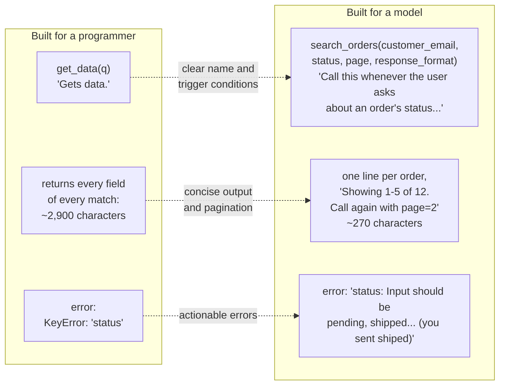

🏠 [Home](../../README.md) › [03 · Tools & Function Calling](./README.md) › 3.4 Designing good tools

# 3.4 Designing good tools

> **Difficulty:** 🟡 Intermediate · **Reading time:** ~12 min · **Prerequisites:** [3.2 JSON Schema for tool definitions](./03.2-json-schema-for-tools.md), [3.3 How function calling works](./03.3-how-function-calling-works.md)

**In one sentence:** A good tool is designed for a model, not a programmer: it matches a real task, says clearly when to use it, takes few well-named and validated inputs, returns short high-signal output, and fails with messages that say how to fix the call.

📑 **On this page**

- [Why does this matter?](#-why-does-this-matter)
- [The idea, in plain words](#-the-idea-in-plain-words)
- [Picture it](#-picture-it)
- [How it works, step by step](#-how-it-works-step-by-step)
- [Worked example](#-worked-example)
- [Code](#-code)
- [Common mistakes & gotchas](#-common-mistakes--gotchas)
- [Key takeaways](#-key-takeaways)
- [Try it yourself](#-try-it-yourself)
- [Further reading](#-further-reading)

## 🤔 Why does this matter?

Two teams give the same model the same database. The first wraps every API endpoint as a tool: `list_users`, `list_orders`, `get_order`, `list_shipments`. The second writes one tool, `search_orders(customer_email, status)`, which returns one line per order. The second agent answers more questions correctly, faster, and for a fraction of the tokens.

Same model, same data. The difference is tool design. Anthropic's engineering team put it this way in [Writing effective tools for AI agents](https://www.anthropic.com/engineering/writing-tools-for-agents): tools are *"a new kind of software which reflects a contract between deterministic systems and non-deterministic agents"*, so you design them for the agent, not the way you would design an API for another program. They report that even small refinements to tool descriptions can produce dramatic improvements.

## 🧠 The idea, in plain words

Imagine briefing a capable new hire who has never seen your systems. You would not hand them 40 raw database tables. You would give them a few clear jobs ("look up a customer's orders"), explain when each one applies, tell them which details you need ("their email, and optionally the status"), give them short answers ("order 1041: shipped, arriving Saturday"), and when they get something wrong, say exactly what to change.

That briefing *is* the tool's name, description, input schema, output and error messages. The model reads nothing else.

## 👀 Picture it



*Each improvement saves the model a guess: which tool to use, how to read the result, and how to fix a bad call. The numbers come from the example below.*

## 🔍 How it works, step by step

**1. Build tools for tasks, not endpoints.** A model has a limited [context window](../../GLOSSARY.md#context-window); a computer's memory is cheap. A `list_contacts` tool that returns everyone makes the model read every contact token by token. Anthropic's post suggests `search_contacts` instead, and more generally: a `schedule_event` tool rather than `list_users` + `list_events` + `create_event`, a `search_logs` tool rather than `read_logs`, a `get_customer_context` tool rather than three separate lookups. Fewer, more capable tools leave less room for wrong choices.

**2. Give each tool one clear purpose and a clear name.** Overlapping tools confuse the model. When you have many tools, group them with prefixes (*namespacing*), such as `asana_search` and `jira_search`, so the boundaries are obvious.

**3. Write the description for a new hire.** Say what the tool does, **when to call it**, and what it returns. Make implicit knowledge explicit: formats, units, what an ID looks like. Anthropic's tool-use guidance recommends being prescriptive about *when* to use a tool ("Call this whenever the user asks about...") because recent models reach for tools more conservatively.

**4. Design inputs that are hard to get wrong.**

- Unambiguous names: `user_id`, not `user`; `start_date`, not `date1`.
- Strong types and `enum`s ([3.2](./03.2-json-schema-for-tools.md)). `status: "shipped"` from a list beats free text.
- Few required inputs, sensible defaults for the rest.
- **Validate** every call before running it, for example with pydantic. Strict mode guarantees the shape; validation also checks ranges and business rules.

**5. Return high-signal output.** Return what the model needs for its next decision, in words it can use: names over UUIDs, `"shipped, ETA 2026-11-15"` over a raw JSON record. Anthropic found that replacing cryptic IDs with meaningful names, or even simple 0-indexed IDs, reduced hallucinations in retrieval tasks. When the model sometimes *does* need IDs for a follow-up call, add a `response_format` parameter: `"concise"` by default, `"detailed"` on request. In their example, concise responses used about a third of the tokens.

**6. Keep output small, and say when you cut it.** Use pagination, filtering, range selection or truncation, with sensible defaults. Tell the model what was left out and how to get more: *"Showing 1-5 of 12 orders. Call again with page=2 for more."* For reference, Anthropic says Claude Code limits tool responses to 25,000 tokens by default.

**7. Make errors actionable.** Not `Error 422` or a stack trace, but *which* input is wrong, what was expected, and an example of a valid call. A good error message often fixes the next call by itself ([2.5](../02-the-agent-loop/02.5-handling-errors-in-the-loop.md)).

**8. Mark tools that change things.** Say in the description that a tool sends, deletes or charges, and when it may be called ("only after the user confirms"). Gate risky ones behind approval ([13.5](../13-safety-and-guardrails/13.5-human-approval-for-risky-actions.md)). MCP has tool annotations for exactly this ([chapter 04](../04-model-context-protocol/README.md)).

**9. Test with real tasks, and measure.** Write realistic tasks, run the agent, and read the transcripts: which tools did it call, with what arguments, how many errors, how many tokens? Tool design is one of the highest-leverage things an [eval](../../GLOSSARY.md#eval) can tune ([chapter 12](../12-evaluation/README.md)).

## 💡 Worked example

[`examples/03-tool-design`](../../examples/03-tool-design/README.md) puts a bad tool and a good tool side by side over the same 12 fake orders.

What the model sees for the **bad** tool:

```json
{"name": "get_data", "description": "Gets data.", "input_schema": {"type": "object", "properties": {"q": {"type": "string"}}}}
```

For the **good** tool, the description says what it does and when to call it (the schema is generated by pydantic; shortened here):

```text
search_orders: "Search one customer's orders by email address, newest first. Call this whenever the
user asks about an order's status, delivery date or history. Returns one line per order and says when
there are more pages. Do not guess order details: call this tool."
  customer_email   string, required        "The customer's email address, e.g. 'sam@example.com'."
  status           enum or null            pending | shipped | delivered | cancelled
  page             integer >= 1            default 1
  page_size        integer 1-20            default 5
  response_format  enum                    concise | detailed, default concise
```

The same question, answered by each:

```text
BAD  get_data returns  2926 characters (about 731 tokens): every field of all 12 orders
GOOD search_orders returns 270 characters (about 67 tokens):
#1041 Blue kettle: shipped, ETA 2026-11-15
#1022 Tea towels (3): delivered, ETA 2026-10-30
#1010 Mug #10: delivered, ETA 2026-09-01
#1009 Mug #9: delivered, ETA 2026-09-01
#1008 Mug #8: delivered, ETA 2026-09-01
Showing 1-5 of 12 orders. Call again with page=2 for more.
```

And an agent run where the model's first call is wrong in two ways:

```text
call 1: search_orders({'customer_email': 'sam@example.com', 'status': 'shiped', 'page_size': 50})
ERROR Invalid arguments for search_orders:
- status: Input should be 'pending', 'shipped', 'delivered' or 'cancelled' (you sent 'shiped')
- page_size: Input should be less than or equal to 20 (you sent 50)
Example of a valid call: {"customer_email": "sam@example.com", "status": "shipped"}

call 2: search_orders({'customer_email': 'sam@example.com', 'status': 'shipped'})
#1041 Blue kettle: shipped, ETA 2026-11-15
Showing 1-1 of 1 order.

Answer: Yes. Sam's blue kettle (order #1041) has shipped and is due on 15 November 2026.
```

The error message lists both problems at once, quotes what was sent, and shows a valid call. The model fixed both on the next try.

## 💻 Code

A small `Tool` class that keeps the function, its pydantic input model and its description together, validates every call, and turns failures into messages. From [`examples/03-tool-design/main.py`](../../examples/03-tool-design/main.py):

```python
from dataclasses import dataclass
from pydantic import BaseModel, ValidationError

@dataclass
class Tool:
    name: str
    description: str
    input_model: type[BaseModel]          # validates inputs AND generates the JSON Schema
    fn: Callable[[Any], str]

    @property
    def spec(self) -> dict:
        return {"name": self.name, "description": self.description,
                "input_schema": clean_schema(self.input_model)}   # model_json_schema() minus "title" keys

    def __call__(self, arguments: dict) -> tuple[str, bool]:
        """Validate, then run. Returns (content, is_error)."""
        try:
            args = self.input_model.model_validate(arguments)
        except ValidationError as exc:
            return friendly_errors(self.name, exc), True
        try:
            return self.fn(args), False
        except Exception as exc:
            return f"{self.name} failed unexpectedly ({type(exc).__name__}). Try again or ask the user.", True


def friendly_errors(tool_name: str, exc: ValidationError) -> str:
    """pydantic's errors as one short, actionable message for the model."""
    problems = []
    for err in exc.errors():
        field = ".".join(str(p) for p in err["loc"]) or "arguments"
        sent = f" (you sent {err['input']!r})" if err["type"] != "missing" else ""
        problems.append(f"- {field}: {err['msg']}{sent}")
    example = '{"customer_email": "sam@example.com", "status": "shipped"}'
    return f"Invalid arguments for {tool_name}:\n" + "\n".join(problems) + f"\nExample of a valid call: {example}"
```

Concise output with pagination, the part that saves the most tokens:

```python
lines = [f"#{o['order_no']} {o['item']}: {o['status']}, ETA {o['eta']}" for o in page]   # names, not UUIDs
shown = f"Showing {start + 1}-{start + len(page)} of {len(found)} orders."
more = f" Call again with page={args.page + 1} for more." if start + len(page) < len(found) else ""
return "\n".join(lines) + f"\n{shown}{more}"
```

## 🚨 Common mistakes & gotchas

- **One tool per API endpoint.** It forces the model to chain many calls and read lots of irrelevant data. Build tools around tasks.
- **Descriptions that say what, not when.** "Searches orders" leaves the model unsure whether to use it. "Call this whenever the user asks about an order's status" does not.
- **Returning raw records.** Internal IDs, timestamps in seconds, and 30 fields the model never needs. Every character is a token the model must read.
- **Truncating silently.** If you cut output, say so and say how to get the rest. Otherwise the model treats a partial list as complete.
- **Opaque errors.** `KeyError`, `400`, or a 50-line traceback gives the model nothing to act on.
- **Overlapping tools.** `search_orders` and `find_orders` with slightly different behaviour guarantees the wrong one gets picked sometimes.
- **Never testing with a real model.** Tool design is empirical. Read transcripts of real runs and fix what confuses the model.

## ✅ Key takeaways

- Design tools for the model: few, task-shaped, each with one clear purpose.
- The description should say what the tool does, **when** to call it, and what it returns.
- Inputs: clear names, strong types, enums, few required fields, and validation on every call.
- Output: short and high-signal by default, with pagination, a `response_format` option, and a note whenever something was cut.
- Errors: say which input is wrong, what was expected, and show a valid example.

## 🧪 Try it yourself

1. Rewrite this tool for a model: `{"name": "db", "description": "Database access", "input_schema": {"type": "object", "properties": {"sql": {"type": "string"}}}}`, for an agent that answers questions about a customer's subscriptions.
2. A `search_docs` tool returns the full text of the top 10 documents, about 40,000 tokens. Suggest three changes.
3. In [`03-tool-design`](../../examples/03-tool-design/README.md), what does the model receive if it calls `search_orders` with `{"email": "sam@example.com"}`?

<details>
<summary>Show answer</summary>

1. For example: `get_customer_subscriptions(customer_email, status)` with the description *"List a customer's subscriptions with plan name, price, status and renewal date. Call this whenever the user asks about a customer's plan, billing or renewal."*, `customer_email` as a required string and `status` as an optional enum (`active`, `cancelled`, `past_due`). It runs one fixed, safe query, returns one line per subscription, and cannot touch any other table.
2. Return snippets (the matching passage plus a title and ID) instead of full documents; return 3 to 5 results by default with a `max_results` input; and add a `get_doc(doc_id, section)` tool so the model can read more of the one document it needs. Say in the output how many more matches exist.
3. An error result: `Invalid arguments for search_orders:`, then `- customer_email: Field required` and `- email: Extra inputs are not permitted (you sent 'sam@example.com')`, then the example of a valid call. The test `test_missing_and_unknown_arguments` checks exactly this.

</details>

## 📚 Further reading

- [Writing effective tools for AI agents](https://www.anthropic.com/engineering/writing-tools-for-agents) (Anthropic). The source for most of this page: choosing tools, namespacing, meaningful context, token efficiency, and prompt-engineering descriptions.
- [Define tools](https://platform.claude.com/docs/en/agents-and-tools/tool-use/implement-tool-use) (Anthropic). Best practices for tool definitions on the Claude API.
- [Function calling](https://developers.openai.com/api/docs/guides/function-calling) (OpenAI). OpenAI's guidance on defining functions, including tips for many tools.
- [Validation errors](https://docs.pydantic.dev/latest/errors/validation_errors/) (pydantic docs). Every error type pydantic can report, useful when writing friendly messages.

<!-- FOOTER -->

---

⬅️ **Previous:** [3.3 How function calling works](./03.3-how-function-calling-works.md) ·
🏠 [Chapter home](./README.md) ·
➡️ **Next:** [3.5 Parallel tool calls](./03.5-parallel-tool-calls.md)
