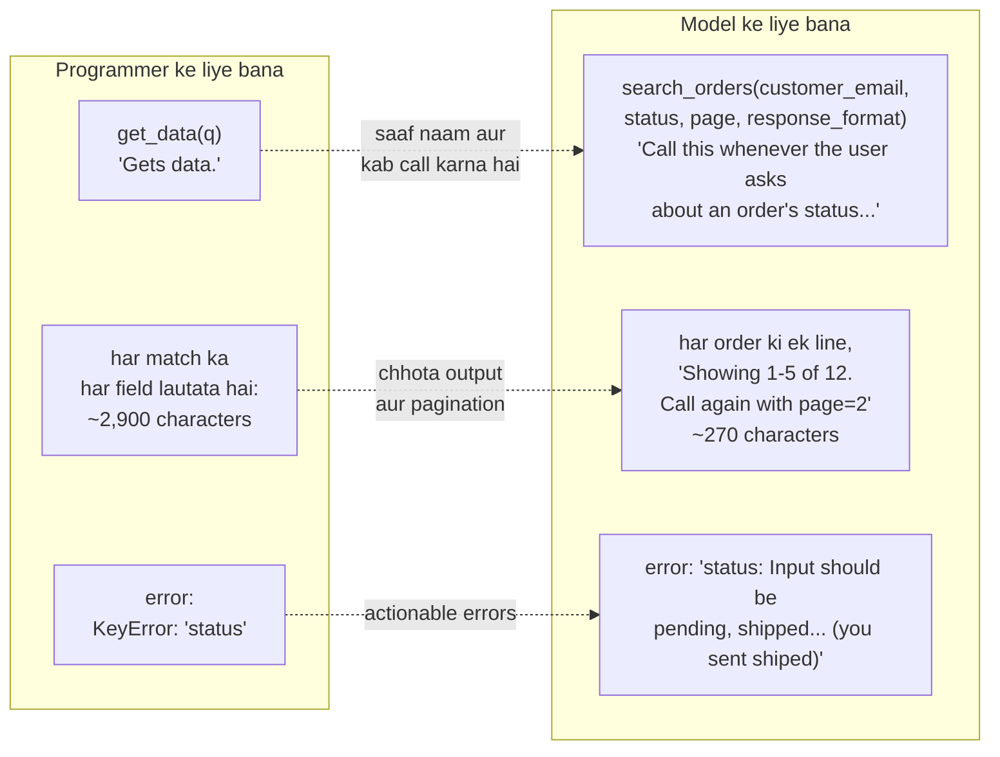

🏠 [Home](../../README.md) › [03 · Tools & Function Calling](./README.md) › 3.4 Achhe tools kaise design karein

# 3.4 Achhe tools kaise design karein

> **Level:** 🟡 Intermediate · **Padhne ka time:** ~12 min · **Pehle padho:** [3.2 Tool definitions ke liye JSON Schema](./03.2-json-schema-for-tools.md), [3.3 Function calling kaise kaam karta hai](./03.3-how-function-calling-works.md)

**Ek line mein:** Achha tool model ke liye design hota hai, programmer ke liye nahi. Woh ek asli task se match karta hai, saaf batata hai ki kab use karna hai, kam aur achhe naam wale validated inputs leta hai, chhota aur kaam ka output deta hai, aur fail ho to aisa message deta hai jo bataye ki call kaise theek karni hai.

📑 **Is page par**

- [Yeh kyun zaroori hai?](#-yeh-kyun-zaroori-hai)
- [Idea, simple words mein](#-idea-simple-words-mein)
- [Diagram se samjho](#-diagram-se-samjho)
- [Kaise kaam karta hai, step by step](#-kaise-kaam-karta-hai-step-by-step)
- [Example se samjho](#-example-se-samjho)
- [Code](#-code)
- [Aam galtiyan aur dhyan dene wali baatein](#-aam-galtiyan-aur-dhyan-dene-wali-baatein)
- [Yaad rakhne wali baatein](#-yaad-rakhne-wali-baatein)
- [Khud try karo](#-khud-try-karo)
- [Aur padhne ke liye](#-aur-padhne-ke-liye)

## 🤔 Yeh kyun zaroori hai?

Do teams ek hi model ko ek hi database dete hain. Pehli team har API endpoint ko tool bana deti hai: `list_users`, `list_orders`, `get_order`, `list_shipments`. Dusri team ek hi tool likhti hai, `search_orders(customer_email, status)`, jo har order ke liye ek line lautata hai. Dusra agent zyada sawalon ke sahi jawab deta hai, tezi se, aur tokens ke chhote se hisse mein.

Same model, same data. Farq hai tool design ka. Anthropic ki engineering team ne [Writing effective tools for AI agents](https://www.anthropic.com/engineering/writing-tools-for-agents) mein yeh baat aise kahi: tools *"a new kind of software which reflects a contract between deterministic systems and non-deterministic agents"* hain. Matlab tools ek naye tarah ka software hain, ek fixed system aur ek unpredictable agent ke beech ka contract. Isliye unhe agent ke liye design karo, waise nahi jaise kisi dusre program ke liye API banate ho. Unka kehna hai ki tool descriptions mein chhote se sudhaar bhi bahut bade improvements la sakte hain.

## 🧠 Idea, simple words mein

Socho tum ek kaabil naye employee ko brief kar rahe ho jisne tumhare systems kabhi nahi dekhe. Tum use 40 raw database tables nahi pakda doge. Tum use kuch saaf kaam doge ("customer ke orders dekho"). Bataoge ki har kaam kab lagta hai. Bataoge ki kaun si details chahiye ("unka email, aur chaho to status"). Use chhote jawab doge ("order 1041: shipped, Saturday tak aayega"). Aur jab woh kuch galat kare, to exact bataoge ki kya badalna hai.

Wahi briefing tool ka name, description, input schema, output aur error messages *hai*. Model iske alawa kuch nahi padhta.

## 👀 Diagram se samjho



*Har improvement model ka ek andaaza bachata hai: kaun sa tool use kare, result kaise padhe, aur galat call kaise theek kare. Numbers neeche wale example se aaye hain.*

## 🔍 Kaise kaam karta hai, step by step

**1. Tools tasks ke liye banao, endpoints ke liye nahi.** Model ka [context window](../../GLOSSARY.md#context-window) limited hai. Computer ki memory sasti hai. `list_contacts` tool jo sabko lautata hai, model ko har contact token by token padhne par majboor karta hai. Anthropic ki post iski jagah `search_contacts` suggest karti hai. Aur general taur par: `list_users` + `list_events` + `create_event` ki jagah ek `schedule_event` tool. `read_logs` ki jagah `search_logs` tool. Teen alag lookups ki jagah ek `get_customer_context` tool. Kam lekin zyada capable tools galat choice ki gunjaish kam karte hain.

**2. Har tool ka ek saaf purpose aur saaf naam ho.** Overlap karne wale tools model ko confuse karte hain. Jab bahut tools hon, to unhe prefixes se group karo (*namespacing*), jaise `asana_search` aur `jira_search`, taaki boundaries saaf dikhein.

**3. Description naye employee ke liye likho.** Batao ki tool kya karta hai, **kab call karna hai**, aur kya lautata hai. Jo baatein "sabko pata hain", unhe bhi likh do: formats, units, ID kaisi dikhti hai. Anthropic ki tool-use guidance kehti hai ki *kab* use karna hai, yeh clearly batao ("Call this whenever the user asks about..."). Kyunki recent models tools ka use zyada sambhal ke karte hain.

**4. Aise inputs design karo jinhe galat bharna mushkil ho.**

- Bina confusion wale naam: `user` nahi, `user_id`. `date1` nahi, `start_date`.
- Strong types aur `enum`s ([3.2](./03.2-json-schema-for-tools.md)). List se `status: "shipped"` free text se behtar hai.
- Kam required inputs, baaki ke liye sensible defaults.
- Har call ko chalane se pehle **validate** karo, jaise pydantic se. Strict mode shape guarantee karta hai. Validation ranges aur business rules bhi check karta hai.

**5. Kaam ka (high-signal) output lautao.** Wahi lautao jo model ko agle decision ke liye chahiye, aise words mein jo woh use kar sake. UUIDs ki jagah names. Raw JSON record ki jagah `"shipped, ETA 2026-11-15"`. Anthropic ne paaya ki cryptic IDs ki jagah meaningful names, ya simple 0-indexed IDs bhi, dene se retrieval tasks mein hallucinations kam hue. Jab model ko kabhi agli call ke liye IDs *chahiye* hon, to ek `response_format` parameter add karo: default `"concise"`, maangne par `"detailed"`. Unke example mein concise responses ne lagbhag ek-tihaai tokens use kiye.

**6. Output chhota rakho, aur kaato to batao.** Pagination, filtering, range selection ya truncation use karo, sensible defaults ke saath. Model ko batao ki kya chhoot gaya aur aur kaise milega: *"Showing 1-5 of 12 orders. Call again with page=2 for more."* Reference ke liye, Anthropic kehta hai ki Claude Code by default tool responses ko 25,000 tokens tak limit karta hai.

**7. Errors actionable banao.** `Error 422` ya stack trace nahi. Batao *kaun sa* input galat hai, kya expected tha, aur ek valid call ka example. Achha error message aksar agli call ko khud hi theek kar deta hai ([2.5](../02-the-agent-loop/02.5-handling-errors-in-the-loop.md)). Jaise exam mein teacher sirf "galat" likhe to tum kuch nahi seekhte. Lekin "formula sahi, unit galat: cm ki jagah m likho" likhe to agli baar sahi karoge.

**8. Jo tools cheezein badalte hain, unhe mark karo.** Description mein likho ki tool kuch bhejta hai, delete karta hai ya charge karta hai, aur kab call ho sakta hai ("only after the user confirms"). Risky tools ko approval ke peeche rakho ([13.5](../13-safety-and-guardrails/13.5-human-approval-for-risky-actions.md)). MCP mein isi kaam ke liye tool annotations hain ([chapter 04](../04-model-context-protocol/README.md)).

**9. Asli tasks se test karo, aur measure karo.** Realistic tasks likho, agent chalao, aur transcripts padho: kaun se tools call hue, kin arguments ke saath, kitne errors, kitne tokens? Tool design un cheezon mein se hai jinhe [eval](../../GLOSSARY.md#eval) se tune karne ka sabse zyada fayda hota hai ([chapter 12](../12-evaluation/README.md)).

## 💡 Example se samjho

Ek bura tool aur ek achha tool, side by side, same 12 fake orders par.

**Bure** tool ke liye model yeh dekhta hai:

```json
{"name": "get_data", "description": "Gets data.", "input_schema": {"type": "object", "properties": {"q": {"type": "string"}}}}
```

**Achhe** tool ki description batati hai ki woh kya karta hai aur kab call karna hai (schema pydantic se generate hua hai; yahan chhota karke dikhaya hai):

```text
search_orders: "Search one customer's orders by email address, newest first. Call this whenever the
user asks about an order's status, delivery date or history. Returns one line per order and says when
there are more pages. Do not guess order details: call this tool."
  customer_email   string, required        "The customer's email address, e.g. 'sam@example.com'."
  status           enum or null            pending | shipped | delivered | cancelled
  page             integer >= 1            default 1
  page_size        integer 1-20            default 5
  response_format  enum                    concise | detailed, default concise
```

Same sawal, dono ka jawab:

```text
BAD  get_data returns  2926 characters (about 731 tokens): every field of all 12 orders
GOOD search_orders returns 270 characters (about 67 tokens):
#1041 Blue kettle: shipped, ETA 2026-11-15
#1022 Tea towels (3): delivered, ETA 2026-10-30
#1010 Mug #10: delivered, ETA 2026-09-01
#1009 Mug #9: delivered, ETA 2026-09-01
#1008 Mug #8: delivered, ETA 2026-09-01
Showing 1-5 of 12 orders. Call again with page=2 for more.
```

Aur ek agent run jisme model ki pehli call do tarah se galat hai:

```text
call 1: search_orders({'customer_email': 'sam@example.com', 'status': 'shiped', 'page_size': 50})
ERROR Invalid arguments for search_orders:
- status: Input should be 'pending', 'shipped', 'delivered' or 'cancelled' (you sent 'shiped')
- page_size: Input should be less than or equal to 20 (you sent 50)
Example of a valid call: {"customer_email": "sam@example.com", "status": "shipped"}

call 2: search_orders({'customer_email': 'sam@example.com', 'status': 'shipped'})
#1041 Blue kettle: shipped, ETA 2026-11-15
Showing 1-1 of 1 order.

Answer: Yes. Sam's blue kettle (order #1041) has shipped and is due on 15 November 2026.
```

Error message dono problems ek saath batata hai, jo bheja gaya woh quote karta hai, aur ek valid call dikhata hai. Model ne agli try mein dono theek kar diye.

## 💻 Code

Ek chhoti `Tool` class jo function, uska pydantic input model aur uski description ek saath rakhti hai. Yeh har call validate karti hai aur failures ko messages mein badalti hai:

```python
from dataclasses import dataclass
from pydantic import BaseModel, ValidationError

@dataclass
class Tool:
    name: str
    description: str
    input_model: type[BaseModel]          # inputs validate karta hai AUR JSON Schema bhi banata hai
    fn: Callable[[Any], str]

    @property
    def spec(self) -> dict:
        return {"name": self.name, "description": self.description,
                "input_schema": clean_schema(self.input_model)}   # model_json_schema() bina "title" keys ke

    def __call__(self, arguments: dict) -> tuple[str, bool]:
        """Pehle validate, phir run. (content, is_error) lautata hai."""
        try:
            args = self.input_model.model_validate(arguments)
        except ValidationError as exc:
            return friendly_errors(self.name, exc), True
        try:
            return self.fn(args), False
        except Exception as exc:
            return f"{self.name} failed unexpectedly ({type(exc).__name__}). Try again or ask the user.", True


def friendly_errors(tool_name: str, exc: ValidationError) -> str:
    """pydantic ke errors ko model ke liye ek chhote, actionable message mein badalta hai."""
    problems = []
    for err in exc.errors():
        field = ".".join(str(p) for p in err["loc"]) or "arguments"
        sent = f" (you sent {err['input']!r})" if err["type"] != "missing" else ""
        problems.append(f"- {field}: {err['msg']}{sent}")
    example = '{"customer_email": "sam@example.com", "status": "shipped"}'
    return f"Invalid arguments for {tool_name}:\n" + "\n".join(problems) + f"\nExample of a valid call: {example}"
```

Pagination ke saath concise output, woh hissa jo sabse zyada tokens bachata hai:

```python
lines = [f"#{o['order_no']} {o['item']}: {o['status']}, ETA {o['eta']}" for o in page]   # names, UUIDs nahi
shown = f"Showing {start + 1}-{start + len(page)} of {len(found)} orders."
more = f" Call again with page={args.page + 1} for more." if start + len(page) < len(found) else ""
return "\n".join(lines) + f"\n{shown}{more}"
```

## 🚨 Aam galtiyan aur dhyan dene wali baatein

- **Har API endpoint ke liye ek tool.** Isse model ko bahut saari calls chain karni padti hain aur bahut faltu data padhna padta hai. Tools tasks ke around banao.
- **Descriptions jo "kya" batati hain, "kab" nahi.** "Searches orders" se model ko pakka nahi pata ki use kare ya nahi. "Call this whenever the user asks about an order's status" se pata chal jaata hai.
- **Raw records lautana.** Internal IDs, seconds mein timestamps, aur 30 fields jo model ko kabhi nahi chahiye. Har character ek token hai jo model ko padhna padta hai.
- **Chupchaap truncate karna.** Output kaato to batao, aur batao ki baaki kaise milega. Warna model adhoori list ko poori samajh lega.
- **Samajh na aane wale errors.** `KeyError`, `400`, ya 50 line ka traceback model ko karne ke liye kuch nahi deta.
- **Overlap karne wale tools.** `search_orders` aur `find_orders` thode alag behaviour ke saath ho, to kabhi na kabhi galat wala chuna hi jaayega.
- **Asli model se kabhi test na karna.** Tool design experiment se seekha jaata hai. Asli runs ke transcripts padho aur jo cheez model ko confuse kare use theek karo.

## ✅ Yaad rakhne wali baatein

- Tools model ke liye design karo: kam, task ke shape ke, har ek ka ek saaf purpose.
- Description batao ki tool kya karta hai, **kab** call karna hai, aur kya lautata hai.
- Inputs: saaf naam, strong types, enums, kam required fields, aur har call par validation.
- Output: by default chhota aur kaam ka, pagination ke saath, ek `response_format` option, aur jab bhi kuch kaata jaaye to ek note.
- Errors: batao kaun sa input galat hai, kya expected tha, aur ek valid example dikhao.

## 🧪 Khud try karo

1. Is tool ko model ke liye dobara likho: `{"name": "db", "description": "Database access", "input_schema": {"type": "object", "properties": {"sql": {"type": "string"}}}}`. Yeh ek aise agent ke liye hai jo customer ke subscriptions ke baare mein sawalon ke jawab deta hai.
2. Ek `search_docs` tool top 10 documents ka poora text lautata hai, lagbhag 40,000 tokens. Teen changes suggest karo.
3. Achha `search_orders` tool upar wali `Tool` class mein wrapped hai, aur uska input model extra fields forbid karta hai. Agar model `search_orders` ko `{"email": "sam@example.com"}` ke saath call kare, to use kya milega?

<details>
<summary>Answer dekho</summary>

1. Jaise: `get_customer_subscriptions(customer_email, status)`, description ke saath *"List a customer's subscriptions with plan name, price, status and renewal date. Call this whenever the user asks about a customer's plan, billing or renewal."*. `customer_email` required string ho, aur `status` optional enum (`active`, `cancelled`, `past_due`). Yeh ek fixed, safe query chalata hai, har subscription ki ek line lautata hai, aur kisi aur table ko touch nahi kar sakta.
2. Poore documents ki jagah snippets lautao (matching passage + title aur ID). By default 3 se 5 results lautao, ek `max_results` input ke saath. Aur ek `get_doc(doc_id, section)` tool add karo taaki model jis ek document ki zaroorat hai uska aur hissa padh sake. Output mein batao ki aur kitne matches hain.
3. Ek error result: `Invalid arguments for search_orders:`, phir `- customer_email: Field required` aur `- email: Extra inputs are not permitted (you sent 'sam@example.com')`, phir valid call ka example.

</details>

## 📚 Aur padhne ke liye

- [Writing effective tools for AI agents](https://www.anthropic.com/engineering/writing-tools-for-agents) (Anthropic). Is page ka zyadatar source: tools chunna, namespacing, meaningful context, token efficiency, aur descriptions ki prompt engineering.
- [Define tools](https://platform.claude.com/docs/en/agents-and-tools/tool-use/implement-tool-use) (Anthropic). Claude API par tool definitions ki best practices.
- [Function calling](https://developers.openai.com/api/docs/guides/function-calling) (OpenAI). Functions define karne par OpenAI ki guidance, bahut saare tools ke tips samet.
- [Validation errors](https://docs.pydantic.dev/latest/errors/validation_errors/) (pydantic docs). Har error type jo pydantic report kar sakta hai, friendly messages likhte waqt kaam ka.

<!-- FOOTER -->

---

⬅️ **Pichla:** [3.3 Function calling kaise kaam karta hai](./03.3-how-function-calling-works.md) ·
🏠 [Chapter home](./README.md) ·
➡️ **Agla:** [3.5 Parallel tool calls](./03.5-parallel-tool-calls.md)
