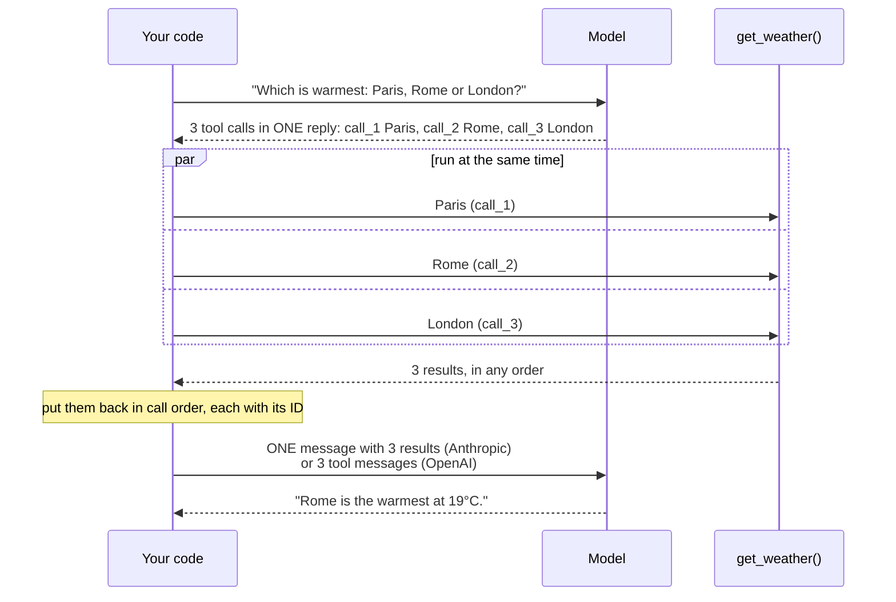

🏠 [Home](../../README.md) › [03 · Tools & Function Calling](./README.md) › 3.5 Parallel tool calls

# 3.5 Parallel tool calls

> **Difficulty:** 🟡 Intermediate · **Reading time:** ~8 min · **Prerequisites:** [3.3 How function calling works](./03.3-how-function-calling-works.md)

**In one sentence:** A model can ask for several tools in one turn; your code may run them at the same time, but must return one result per call, matched by ID, which on Anthropic means all results in a single user message.

📑 **On this page**

- [Why does this matter?](#-why-does-this-matter)
- [The idea, in plain words](#-the-idea-in-plain-words)
- [Picture it](#-picture-it)
- [How it works, step by step](#-how-it-works-step-by-step)
- [Worked example](#-worked-example)
- [Code](#-code)
- [Common mistakes & gotchas](#-common-mistakes--gotchas)
- [Key takeaways](#-key-takeaways)
- [Try it yourself](#-try-it-yourself)
- [Further reading](#-further-reading)

## 🤔 Why does this matter?

*"Which is warmest right now: Paris, Rome or London?"* needs three weather lookups. Done one per turn, that is three tool calls plus three extra model calls, each resending the whole conversation. Done in one turn, it is one model call that asks for all three, and if each lookup takes 300 ms, running them at once takes 300 ms instead of 900 ms.

Both Anthropic and OpenAI models do this by default when the calls are independent. Your loop has to handle it correctly, or you get errors, or a model that quietly stops doing it.

## 🧠 The idea, in plain words

You ask a colleague to check three suppliers' prices. They could phone one, hang up, phone the next... or send three emails at once and wait for all the replies. The replies come back in any order, but each one says which question it answers.

[Parallel tool calls](../../GLOSSARY.md#parallel-tool-calls) work the same way. The model sends several [tool calls](../../GLOSSARY.md#tool-call) in one reply, each with its own ID. Your code runs them, in parallel if it likes, and sends back one [tool result](../../GLOSSARY.md#tool-result) per call, each tagged with the matching ID. Then the model sees all the answers together.

## 👀 Picture it



*One model call asked for three tools, and one model call read all three results. In between, your code chooses how to run them; running them concurrently costs nothing extra and saves time.*

## 🔍 How it works, step by step

**1. Expect several calls in every reply.** `reply.tool_calls` is a list. Always loop over all of it, even if your tests only ever see one.

**2. Decide how to run them.** The APIs do not prescribe an order. Anthropic's docs say independent, read-only calls are usually safe to run concurrently, while tools with side effects, shared state or ordering requirements may be better run one after another. In practice:

| Run them concurrently | Run them one by one |
| --- | --- |
| Lookups: weather, search, `get_order` | Writes that depend on each other: create, then update |
| Independent API calls | Anything sharing a file, a session or a database transaction |
| Slow network I/O | A backend with a strict rate limit (or cap the workers) |

**3. Return one result per call, matched by ID.** Even if one call fails, or you decide not to run it: send an error result for it, such as *"Not executed: the preceding write_file call failed."* (the example Anthropic's docs give).

**4. Send them back in the right shape.**

- **Anthropic:** all `tool_result` blocks for the turn in **one** `user` message, before any text you add. Anthropic's parallel tool use docs warn that sending each result in its own message "teaches" the model to stop making parallel calls.
- **OpenAI:** one `{"role": "tool", "tool_call_id": ...}` message per result, right after the assistant message.

Keeping the results in the same order as the calls is not required (the IDs do the matching), but it makes logs and tests easier to read.

**5. Turn it off when you need to.** On Anthropic, add `"disable_parallel_tool_use": true` to `tool_choice` (for example `{"type": "auto", "disable_parallel_tool_use": true}`) and the model makes at most one call per turn. On OpenAI, set `parallel_tool_calls=False` and it calls zero or one tool.

**A special case: batches that must run in order.** Anthropic's computer use and browser use tools ([3.7](./03.7-computer-use-and-browser-agents.md)) can also return several calls in one turn, such as *click, type, screenshot*. Those depend on each other, so the docs say to run them sequentially, in order, and stop at the first failure.

## 💡 Worked example

From [`examples/03-parallel-tools`](../../examples/03-parallel-tools/README.md). The model asks for three cities in one turn; each fake `get_weather` call sleeps 0.3 seconds to stand in for a network request:

```text
The model asked for 3 tool calls in one turn:
  call_1: get_weather({'city': 'Paris'})
  call_2: get_weather({'city': 'Rome'})
  call_3: get_weather({'city': 'London'})

1) One by one vs at the same time
  sequential: 0.9s
  threads   : 0.3s
  asyncio   : 0.3s

2) How the results go back to each provider
  Anthropic: 3 messages; the last is ONE user message with 3 tool_result blocks:
    {'type': 'tool_result', 'tool_use_id': 'call_1', 'content': '{"city": "Paris", "temp_c": 14}'}
    {'type': 'tool_result', 'tool_use_id': 'call_2', 'content': '{"city": "Rome", "temp_c": 19}'}
    {'type': 'tool_result', 'tool_use_id': 'call_3', 'content': '{"city": "London", "temp_c": 11}'}
  OpenAI: 5 messages; the last 3 are separate role='tool' messages:
    {'role': 'tool', 'tool_call_id': 'call_1', 'content': '{"city": "Paris", "temp_c": 14}'}
    {'role': 'tool', 'tool_call_id': 'call_2', 'content': '{"city": "Rome", "temp_c": 19}'}
    {'role': 'tool', 'tool_call_id': 'call_3', 'content': '{"city": "London", "temp_c": 11}'}

3) The full agent run
  Answer: Rome is the warmest at 19°C (Paris 14°C, London 11°C).
```

The same three results, from the same neutral `tool_result()` messages, become one Anthropic message or three OpenAI messages. The shared wrapper's `to_anthropic_messages()` does that merging for you.

## 💻 Code

Running a batch in a thread pool. `ThreadPoolExecutor.map` returns results in the same order as its input, whatever order they finish in. From [`examples/03-parallel-tools/main.py`](../../examples/03-parallel-tools/main.py):

```python
from concurrent.futures import ThreadPoolExecutor
from common import ToolCall, tool_result

def run_one(call: ToolCall, tools: dict) -> dict:
    """Run one call. A failure becomes an error result; it never stops the other calls."""
    try:
        if call.name not in tools:
            raise LookupError(f"unknown tool {call.name!r}")
        return tool_result(call.id, tools[call.name](**call.arguments))
    except Exception as exc:
        return tool_result(call.id, f"Error: {exc}", is_error=True)

def run_parallel(calls: list[ToolCall], tools: dict, max_workers: int = 8) -> list[dict]:
    if not calls:
        return []
    with ThreadPoolExecutor(max_workers=min(max_workers, len(calls))) as pool:
        return list(pool.map(lambda call: run_one(call, tools), calls))   # results in call order
```

The `asyncio` version. `asyncio.gather` also keeps the order of its arguments; `asyncio.to_thread` runs an ordinary blocking function in a thread. If your tools are already `async def`, await them directly instead:

```python
import asyncio

async def run_parallel_async(calls: list[ToolCall], tools: dict) -> list[dict]:
    return list(await asyncio.gather(*(asyncio.to_thread(run_one, call, tools) for call in calls)))
```

In the loop, append every result, then make the next model call:

```python
reply = llm.chat(messages, tools=specs)
messages.append(reply.to_message())
messages.extend(run_parallel(reply.tool_calls, TOOLS))   # the wrapper merges these into ONE Anthropic message
```

Turning parallel calls off, on the raw SDKs:

```python
client.messages.create(..., tool_choice={"type": "auto", "disable_parallel_tool_use": True})   # Anthropic
client.chat.completions.create(..., parallel_tool_calls=False)                                # OpenAI
```

Threads are the right tool for I/O-bound tools (network calls, databases), which is most of them. For CPU-heavy tools, threads in CPython will not speed things up much; use a `ProcessPoolExecutor` or run the work elsewhere.

## 🚨 Common mistakes & gotchas

- **Handling only the first call.** `reply.tool_calls[0]` works in tests and breaks the first time a real model asks for two. The unanswered call makes the next request fail.
- **One Anthropic user message per result.** Send all results for the turn together. Separate messages make the model less likely to call tools in parallel.
- **Losing track of which result is which.** Always build results from the call's own `id`, never by position in a list that may have been reordered.
- **Letting one failure cancel the batch.** Catch exceptions per call, so the other results still go back.
- **Running dependent writes concurrently.** If call B relies on call A having happened, run them in order, or turn parallel calls off for that agent.
- **Unbounded concurrency.** Twenty parallel calls to a rate-limited API can trigger 429 errors. Cap `max_workers`.

## ✅ Key takeaways

- Models can return several tool calls in one turn; always handle the whole list.
- Running independent calls concurrently (threads or `asyncio`) saves wall-clock time at no extra token cost.
- Return exactly one result per call, matched by ID, including errors and calls you skipped.
- Anthropic: all results in **one** user message. OpenAI: one `tool` message per result.
- Turn parallel calls off with `disable_parallel_tool_use` (Anthropic) or `parallel_tool_calls=False` (OpenAI) when order matters.

## 🧪 Try it yourself

1. Three calls take 0.2 s, 0.5 s and 0.3 s. How long does the batch take sequentially, and in parallel?
2. The model asks for `create_folder("reports")` and `write_file("reports/q3.txt")` in the same turn. Should you run them in parallel?
3. In the example, set `max_workers=2` in `run_parallel` and run it. How long does the three-city batch take now?

<details>
<summary>Show answer</summary>

1. Sequentially 1.0 s (the sum). In parallel about 0.5 s (the slowest call), plus a little overhead.
2. No. `write_file` depends on the folder existing. Run them in the order the model gave them, and if `create_folder` fails, return an error result for `write_file` saying it was not executed. A model that keeps sending dependent calls together is a sign to turn parallel calls off for that tool set.
3. About 0.6 s. Two calls run together (0.3 s), then the third waits for a free worker (another 0.3 s).

</details>

## 📚 Further reading

- [Parallel tool use](https://platform.claude.com/docs/en/agents-and-tools/tool-use/parallel-tool-use) (Anthropic). Execution choices, formatting results, `disable_parallel_tool_use` and troubleshooting.
- [Function calling](https://developers.openai.com/api/docs/guides/function-calling) (OpenAI). Parallel function calling and `parallel_tool_calls`.
- [concurrent.futures](https://docs.python.org/3/library/concurrent.futures.html) and [Coroutines and tasks](https://docs.python.org/3/library/asyncio-task.html) (Python docs). `ThreadPoolExecutor`, `asyncio.gather` and `asyncio.to_thread`.

<!-- FOOTER -->

---

⬅️ **Previous:** [3.4 Designing good tools](./03.4-designing-good-tools.md) ·
🏠 [Chapter home](./README.md) ·
➡️ **Next:** [3.6 Code execution as a tool](./03.6-code-execution-as-a-tool.md)
