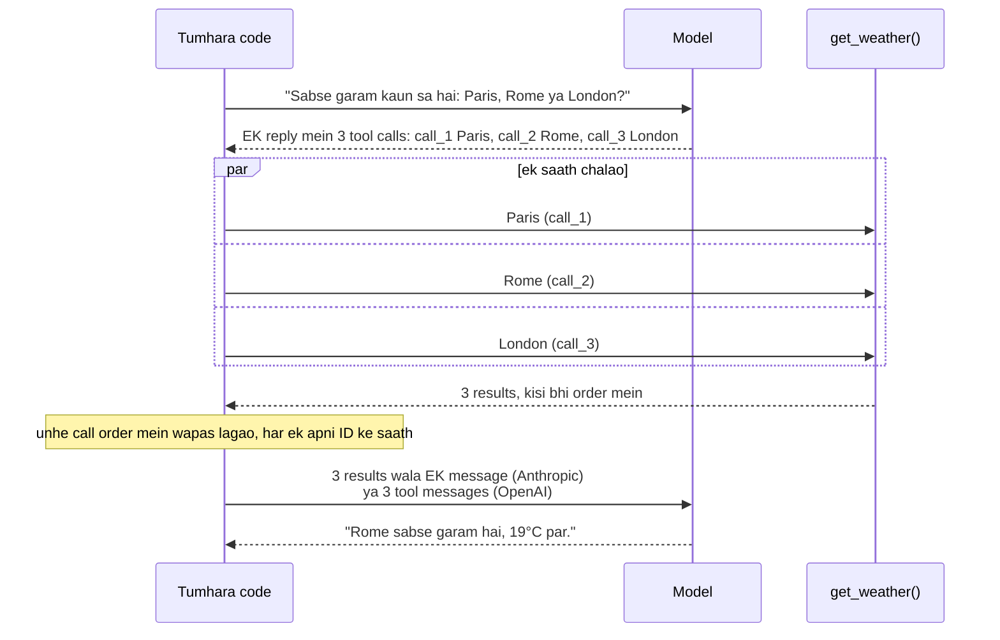

🏠 [Home](../../README.md) › [03 · Tools & Function Calling](./README.md) › 3.5 Parallel tool calls

# 3.5 Parallel tool calls

> **Level:** 🟡 Intermediate · **Padhne ka time:** ~8 min · **Pehle padho:** [3.3 Function calling kaise kaam karta hai](./03.3-how-function-calling-works.md)

**Ek line mein:** Model ek turn mein kai tools maang sakta hai. Tumhara code unhe ek saath chala sakta hai, lekin har call ka ek result lautana zaroori hai, ID se match karke. Anthropic par iska matlab hai saare results ek hi user message mein.

📑 **Is page par**

- [Yeh kyun zaroori hai?](#-yeh-kyun-zaroori-hai)
- [Idea, simple words mein](#-idea-simple-words-mein)
- [Diagram se samjho](#-diagram-se-samjho)
- [Kaise kaam karta hai, step by step](#-kaise-kaam-karta-hai-step-by-step)
- [Example se samjho](#-example-se-samjho)
- [Code](#-code)
- [Aam galtiyan aur dhyan dene wali baatein](#-aam-galtiyan-aur-dhyan-dene-wali-baatein)
- [Yaad rakhne wali baatein](#-yaad-rakhne-wali-baatein)
- [Khud try karo](#-khud-try-karo)
- [Aur padhne ke liye](#-aur-padhne-ke-liye)

## 🤔 Yeh kyun zaroori hai?

*"Which is warmest right now: Paris, Rome or London?"* ke liye teen weather lookups chahiye. Ek turn mein ek karoge, to teen tool calls aur teen extra model calls lagengi. Har model call poori conversation dobara bhejegi. Ek hi turn mein karoge, to ek model call teeno maang leti hai. Aur agar har lookup 300 ms leta hai, to teeno ek saath chalane mein 900 ms ki jagah 300 ms lagenge.

Anthropic aur OpenAI dono ke models by default yeh karte hain jab calls ek dusre par depend nahi karti. Tumhare loop ko ise sahi se handle karna hoga. Warna errors aayenge, ya model chupchaap aisa karna band kar dega.

## 🧠 Idea, simple words mein

Tum ek colleague ko teen suppliers ke daam check karne ko kehte ho. Woh ek ko phone kar sakta hai, phone rakh ke agle ko kar sakta hai... ya teeno ko ek saath email bhej ke saare replies ka wait kar sakta hai. Replies kisi bhi order mein aate hain, lekin har reply batata hai ki woh kis sawal ka jawab hai.

[Parallel tool calls](../../GLOSSARY.md#parallel-tool-calls) bhi aise hi kaam karti hain. Model ek reply mein kai [tool calls](../../GLOSSARY.md#tool-call) bhejta hai, har ek ki apni ID ke saath. Tumhara code unhe chalata hai, chahe to parallel mein. Phir har call ke liye ek [tool result](../../GLOSSARY.md#tool-result) wapas bhejta hai, matching ID ke saath. Phir model saare jawab ek saath dekhta hai.

Kirana dukaan par socho. Tumhari list mein chawal, daal aur tel hai. Dukaandaar teen ladkon ko ek saath teen racks par bhej deta hai. Kaun pehle lauta, farq nahi padta. Har packet par naam likha hai, to bill sahi banta hai.

## 👀 Diagram se samjho



*Ek model call ne teen tools maange, aur ek model call ne teeno results padhe. Beech mein tumhara code decide karta hai ki unhe kaise chalana hai. Concurrently chalane mein kuch extra kharcha nahi, aur time bachta hai.*

## 🔍 Kaise kaam karta hai, step by step

**1. Har reply mein kai calls expect karo.** `reply.tool_calls` ek list hai. Hamesha poori list par loop karo, chahe tumhare tests mein hamesha ek hi aaye.

**2. Decide karo ki unhe kaise chalana hai.** APIs koi order fix nahi karti. Anthropic ke docs kehte hain ki independent, read-only calls ko aam taur par concurrently chalana safe hai. Lekin side effects, shared state ya order ki zaroorat wale tools ko ek ke baad ek chalana behtar ho sakta hai. Practice mein:

| Concurrently chalao | Ek-ek karke chalao |
| --- | --- |
| Lookups: weather, search, `get_order` | Ek dusre par depend karne wale writes: create, phir update |
| Independent API calls | Jo bhi file, session ya database transaction share karta ho |
| Slow network I/O | Strict rate limit wala backend (ya workers cap karo) |

**3. Har call ka ek result lautao, ID se match karke.** Chahe koi call fail ho jaaye, ya tum use chalane ka decide na karo: uske liye ek error result bhejo, jaise *"Not executed: the preceding write_file call failed."* (yeh example Anthropic ke docs dete hain).

**4. Unhe sahi shape mein wapas bhejo.**

- **Anthropic:** us turn ke saare `tool_result` blocks **ek** `user` message mein, tumhare add kiye kisi bhi text se pehle. Anthropic ke parallel tool use docs warn karte hain ki har result alag message mein bhejne se model parallel calls karna band karna "seekh" jaata hai.
- **OpenAI:** har result ke liye ek `{"role": "tool", "tool_call_id": ...}` message, assistant message ke turant baad.

Results ko calls wale order mein rakhna zaroori nahi hai (matching IDs karti hain). Lekin isse logs aur tests padhna aasaan hota hai.

**5. Zaroorat ho to ise band karo.** Anthropic par `tool_choice` mein `"disable_parallel_tool_use": true` add karo (jaise `{"type": "auto", "disable_parallel_tool_use": true}`). Phir model ek turn mein zyada se zyada ek call karega. OpenAI par `parallel_tool_calls=False` set karo, phir woh zero ya ek tool call karega.

**Ek special case: batches jo order mein hi chalne chahiye.** Anthropic ke computer use aur browser use tools ([3.7](./03.7-computer-use-and-browser-agents.md)) bhi ek turn mein kai calls lauta sakte hain, jaise *click, type, screenshot*. Yeh ek dusre par depend karte hain. Isliye docs kehte hain ki inhe sequentially, order mein chalao, aur pehli failure par ruk jao.

## 💡 Example se samjho

Model ek turn mein teen cities maangta hai. Har fake `get_weather` call 0.3 second sleep karta hai, network request ki jagah:

```text
The model asked for 3 tool calls in one turn:
  call_1: get_weather({'city': 'Paris'})
  call_2: get_weather({'city': 'Rome'})
  call_3: get_weather({'city': 'London'})

1) One by one vs at the same time
  sequential: 0.9s
  threads   : 0.3s
  asyncio   : 0.3s

2) How the results go back to each provider
  Anthropic: 3 messages; the last is ONE user message with 3 tool_result blocks:
    {'type': 'tool_result', 'tool_use_id': 'call_1', 'content': '{"city": "Paris", "temp_c": 14}'}
    {'type': 'tool_result', 'tool_use_id': 'call_2', 'content': '{"city": "Rome", "temp_c": 19}'}
    {'type': 'tool_result', 'tool_use_id': 'call_3', 'content': '{"city": "London", "temp_c": 11}'}
  OpenAI: 5 messages; the last 3 are separate role='tool' messages:
    {'role': 'tool', 'tool_call_id': 'call_1', 'content': '{"city": "Paris", "temp_c": 14}'}
    {'role': 'tool', 'tool_call_id': 'call_2', 'content': '{"city": "Rome", "temp_c": 19}'}
    {'role': 'tool', 'tool_call_id': 'call_3', 'content': '{"city": "London", "temp_c": 11}'}

3) The full agent run
  Answer: Rome is the warmest at 19°C (Paris 14°C, London 11°C).
```

Wahi teen results Anthropic mein ek message ban jaate hain, ya OpenAI mein teen messages. Agar tum results ek neutral format mein rakhte ho, to Anthropic request banate waqt unhe ek user message mein merge kar do.

## 💻 Code

Thread pool mein batch chalana. `ThreadPoolExecutor.map` results usi order mein lautata hai jis order mein input tha, chahe woh kisi bhi order mein khatam hon:

```python
from concurrent.futures import ThreadPoolExecutor

# Har call (ek ToolCall) mein .id, .name aur .arguments (ek dict) hai. tool_result(id, content, is_error=False)
# ek neutral result message banata hai: {"role": "tool", "tool_call_id": id, "content": content, ...}.

def run_one(call: ToolCall, tools: dict) -> dict:
    """Ek call chalao. Failure error result ban jaata hai; yeh baaki calls ko kabhi nahi rokta."""
    try:
        if call.name not in tools:
            raise LookupError(f"unknown tool {call.name!r}")
        return tool_result(call.id, tools[call.name](**call.arguments))
    except Exception as exc:
        return tool_result(call.id, f"Error: {exc}", is_error=True)

def run_parallel(calls: list[ToolCall], tools: dict, max_workers: int = 8) -> list[dict]:
    if not calls:
        return []
    with ThreadPoolExecutor(max_workers=min(max_workers, len(calls))) as pool:
        return list(pool.map(lambda call: run_one(call, tools), calls))   # results call order mein
```

`asyncio` version. `asyncio.gather` bhi apne arguments ka order rakhta hai. `asyncio.to_thread` ek normal blocking function ko thread mein chalata hai. Agar tumhare tools pehle se `async def` hain, to unhe seedha await karo:

```python
import asyncio

async def run_parallel_async(calls: list[ToolCall], tools: dict) -> list[dict]:
    return list(await asyncio.gather(*(asyncio.to_thread(run_one, call, tools) for call in calls)))
```

Loop mein (`llm` koi bhi chat-model client hai), har result append karo, phir agli model call karo:

```python
reply = llm.chat(messages, tools=specs)
messages.append(reply.to_message())
messages.extend(run_parallel(reply.tool_calls, TOOLS))   # Anthropic ke liye inhe EK user message ki tarah bhejo
```

Raw SDKs par parallel calls band karna:

```python
client.messages.create(..., tool_choice={"type": "auto", "disable_parallel_tool_use": True})   # Anthropic
client.chat.completions.create(..., parallel_tool_calls=False)                                # OpenAI
```

I/O-bound tools (network calls, databases) ke liye threads sahi tarika hain, aur zyadatar tools aise hi hote hain. CPU-heavy tools ke liye CPython mein threads zyada speed nahi badhayenge. Wahan `ProcessPoolExecutor` use karo, ya kaam kahin aur chalao.

## 🚨 Aam galtiyan aur dhyan dene wali baatein

- **Sirf pehli call handle karna.** `reply.tool_calls[0]` tests mein chal jaata hai, aur jab pehli baar asli model do maangta hai tab toot jaata hai. Bina jawab wali call agli request ko fail kar deti hai.
- **Anthropic mein har result ka alag user message.** Turn ke saare results ek saath bhejo. Alag messages se model ke parallel tool calls karne ke chances kam ho jaate hain.
- **Bhool jaana ki kaun sa result kiska hai.** Results hamesha call ki apni `id` se banao. Kabhi list mein position se mat banao, list reorder ho sakti hai.
- **Ek failure se poora batch cancel ho jaana.** Har call par alag se exceptions catch karo, taaki baaki results phir bhi wapas jaayein.
- **Dependent writes concurrently chalana.** Agar call B ke liye call A ka pehle hona zaroori hai, to unhe order mein chalao, ya us agent ke liye parallel calls band kar do.
- **Bina limit ki concurrency.** Rate-limited API par bees parallel calls 429 errors de sakti hain. `max_workers` cap karo.

## ✅ Yaad rakhne wali baatein

- Models ek turn mein kai tool calls lauta sakte hain. Hamesha poori list handle karo.
- Independent calls ko concurrently (threads ya `asyncio`) chalane se wall-clock time bachta hai, bina extra token kharche ke.
- Har call ka bilkul ek result lautao, ID se match karke, errors aur skip ki hui calls samet.
- Anthropic: saare results **ek** user message mein. OpenAI: har result ka ek `tool` message.
- Jab order matter kare, to parallel calls band karo: `disable_parallel_tool_use` (Anthropic) ya `parallel_tool_calls=False` (OpenAI).

## 🧪 Khud try karo

1. Teen calls 0.2 s, 0.5 s aur 0.3 s leti hain. Batch sequentially kitna time lega, aur parallel mein kitna?
2. Model ek hi turn mein `create_folder("reports")` aur `write_file("reports/q3.txt")` maangta hai. Kya inhe parallel chalana chahiye?
3. Upar `run_parallel` mein `max_workers=2` set karo. Ab example wala teen cities ka batch (har call 0.3 s) kitna time lega?

<details>
<summary>Answer dekho</summary>

1. Sequentially 1.0 s (sabka jod). Parallel mein lagbhag 0.5 s (sabse slow call), plus thoda overhead.
2. Nahi. `write_file` folder ke exist karne par depend karta hai. Unhe usi order mein chalao jo model ne diya. Agar `create_folder` fail ho, to `write_file` ke liye error result lautao ki woh execute nahi hua. Agar model baar-baar dependent calls ek saath bhejta hai, to yeh signal hai ki us tool set ke liye parallel calls band kar do.
3. Lagbhag 0.6 s. Do calls ek saath chalti hain (0.3 s), phir teesri free worker ka wait karti hai (aur 0.3 s).

</details>

## 📚 Aur padhne ke liye

- [Parallel tool use](https://platform.claude.com/docs/en/agents-and-tools/tool-use/parallel-tool-use) (Anthropic). Execution ke choices, results ki formatting, `disable_parallel_tool_use` aur troubleshooting.
- [Function calling](https://developers.openai.com/api/docs/guides/function-calling) (OpenAI). Parallel function calling aur `parallel_tool_calls`.
- [concurrent.futures](https://docs.python.org/3/library/concurrent.futures.html) aur [Coroutines and tasks](https://docs.python.org/3/library/asyncio-task.html) (Python docs). `ThreadPoolExecutor`, `asyncio.gather` aur `asyncio.to_thread`.

<!-- FOOTER -->

---

⬅️ **Pichla:** [3.4 Achhe tools kaise design karein](./03.4-designing-good-tools.md) ·
🏠 [Chapter home](./README.md) ·
➡️ **Agla:** [3.6 Code execution ek tool ki tarah](./03.6-code-execution-as-a-tool.md)
