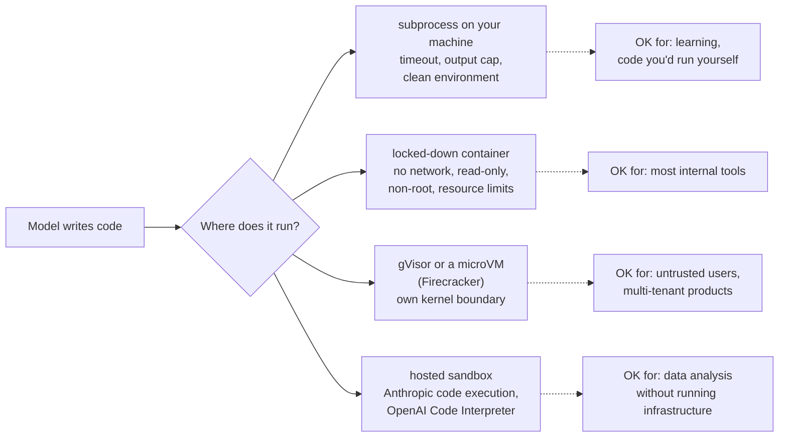

🏠 [Home](../../README.md) › [03 · Tools & Function Calling](./README.md) › 3.6 Code execution as a tool

# 3.6 Code execution as a tool

> **Difficulty:** 🟡 Intermediate · **Reading time:** ~10 min · **Prerequisites:** [3.4 Designing good tools](./03.4-designing-good-tools.md), [2.5 Handling errors in the loop](../02-the-agent-loop/02.5-handling-errors-in-the-loop.md)

**In one sentence:** Letting the model write and run code turns one tool into thousands, which is why it is so useful and so dangerous: run it with limits for convenience, but only real isolation (a locked-down container, gVisor, a microVM or a hosted sandbox) makes untrusted code safe.

📑 **On this page**

- [Why does this matter?](#-why-does-this-matter)
- [The idea, in plain words](#-the-idea-in-plain-words)
- [Picture it](#-picture-it)
- [How it works, step by step](#-how-it-works-step-by-step)
- [Worked example](#-worked-example)
- [Code](#-code)
- [Common mistakes & gotchas](#-common-mistakes--gotchas)
- [Key takeaways](#-key-takeaways)
- [Try it yourself](#-try-it-yourself)
- [Further reading](#-further-reading)

## 🤔 Why does this matter?

Models are poor calculators. Ask one for the standard deviation of a column of numbers and it may produce a plausible, wrong figure. Give it a Python tool and it writes three lines of code and gets the exact answer. The same tool can parse a CSV, draw a chart, test a regular expression or check its own code.

That flexibility is also the risk. A `run_python` tool is a tool that can do *anything your computer can do*: read your SSH keys, delete files, call the internet. The code comes from a model, and the model's input can come from anyone, including a web page or document with hidden instructions ([prompt injection](../../GLOSSARY.md#prompt-injection)). So the real question on this page is not *how* to run code, but *where*.

## 🧠 The idea, in plain words

Think of a chemistry lab. A student can mix anything, which is the point. But you do not let them do it on the kitchen table. You give them a lab bench behind safety glass, with no gas line they can open, a timer, and the door locked from outside.

Running model-written code works the same way. You need:

- **A timer:** kill the code if it runs too long.
- **Walls:** the code cannot see your files, your secrets or your network.
- **A small bench:** limited memory, CPU and disk.
- **A report back:** what it printed, what errors it hit.

A plain Python subprocess gives you the timer and the report. It does **not** give you walls. For walls you need a [sandbox](../../GLOSSARY.md#sandbox): a container, a microVM, or a sandbox the model provider runs for you.

## 👀 Picture it



*Isolation gets stronger from the first option to the last. A subprocess only limits time and output; each option after it puts a stronger wall between the model's code and everything you care about.*

## 🔍 How it works, step by step

### A local runner, and what it really protects

The runner in the Code section below runs model-written Python with `subprocess`. Each limit it applies, and why:

| Limit | How | What it stops |
| --- | --- | --- |
| Wall-clock timeout | `subprocess.run(..., timeout=5)`, which kills the child on expiry | Infinite loops, hung code |
| Output cap | Truncate stdout and stderr to 4,000 characters, with a note | A `print` of 1 GB filling the context window |
| Clean environment | `env={"PATH": ...}` only, no inherited variables | Reading `ANTHROPIC_API_KEY` and other secrets from `os.environ` |
| Empty temporary folder | `cwd=tempfile.TemporaryDirectory()`, deleted afterwards | Accidental clutter in your project folder |
| Isolated Python | `python -I` | Loading `PYTHON*` variables, user site-packages, or modules from the script's folder |
| No input | `stdin=subprocess.DEVNULL` | Code waiting forever for input |
| Memory, CPU, file limits (Linux/macOS) | `resource.setrlimit` in the child | Using all your RAM or CPU, writing huge files |

And what it does **not** stop. The code still runs as **your user**, so it can:

- read and delete any file you can (`open(os.path.expanduser("~/.ssh/id_rsa"))`);
- open network connections and send your data anywhere;
- start other programs, including ones that outlive the timeout if it detaches them;
- see other processes and system information.

**A subprocess is not a security sandbox.** Use it for learning, and for code you would be happy to run yourself.

### Real isolation

For anything else, run the code somewhere that cannot reach what matters:

- **A locked-down container.** For example `docker run --rm --network none --read-only --memory 512m --cpus 1 --pids-limit 64 --user 1000:1000 --cap-drop ALL --security-opt no-new-privileges python:3.12-slim python -c "..."`: no network, a read-only filesystem, a memory, CPU and process limit, a non-root user and no extra privileges. Containers share the host's kernel, so a kernel bug can still let code escape.
- **A stronger boundary.** [gVisor](https://gvisor.dev/) gives containers their own user-space kernel (Docker can use it with `--runtime=runsc`). [Firecracker](https://firecracker-microvm.github.io/) runs each job in a lightweight virtual machine. Either is a sensible default for code from untrusted users.
- **A hosted sandbox.** Let the provider run it (below), or use a dedicated sandbox service.

[13.3 Least-privilege tools & sandboxing](../13-safety-and-guardrails/13.3-least-privilege-and-sandboxing.md) covers isolation in more depth.

### Hosted code execution: the provider runs it

Both providers offer code execution as a **[server tool](../../GLOSSARY.md#server-tool)**: you add it to `tools`, and the code runs on their infrastructure inside the API call. There is no client-side loop to write for it.

**Anthropic: the code execution tool.** Declare `{"type": "code_execution_20260521", "name": "code_execution"}` (the latest version as of November 2026; no beta header). Claude gets two sub-tools, `bash_code_execution` and `text_editor_code_execution`, and runs them in a container with 1 CPU, 5 GiB of RAM, 5 GiB of disk, Python 3.11 with common data libraries, and **no internet access**. The response contains `server_tool_use` blocks (what Claude ran) and `bash_code_execution_tool_result` blocks with `stdout`, `stderr` and `return_code`. Containers can be reused across requests by passing back the container ID, and expire after 30 days. A long turn can end with `stop_reason: "pause_turn"`: send the conversation back to let it continue. Pricing (November 2026): free when used alongside the web search or web fetch tools; otherwise 1,550 free hours per organisation per month, then $0.05 per container-hour.

**OpenAI: Code Interpreter.** In the Responses API, add `{"type": "code_interpreter", "container": {"type": "auto"}}`. OpenAI describes the container as a fully sandboxed virtual machine where the model runs Python; it can read files you upload and produce files. An active container expires after 20 minutes without use.

| | Your own runner | Anthropic code execution | OpenAI Code Interpreter |
| --- | --- | --- | --- |
| Who runs the code | You | Anthropic | OpenAI |
| Isolation | Whatever you build | Provider's sandboxed container, no internet | Provider's sandboxed container |
| Your loop handles calls? | Yes | No (server tool) | No (built-in tool) |
| Access to your systems | Possible (and risky) | None, except files you upload | None, except files you upload |
| Cost | Your compute | Container-hours (free allowance) | See OpenAI pricing |

## 💡 Worked example

The model's replies are scripted here, but the code really runs in a subprocess. The user asks for the mean and standard deviation of five delivery times, and whether any is an outlier. The model's first script has a bug:

```text
--- tool call 1
code:
import statistics as st
times = [12, 15, 11, 30, 14]
print(st.mean(times), st.stdev(times))
print(stats.median(times))

result:
[exit code 1]
stdout:
16.4 7.765307463326871

stderr:
Traceback (most recent call last):
  File "snippet.py", line 4, in <module>
    print(stats.median(times))
          ^^^^^
NameError: name 'stats' is not defined
```

The traceback goes back to the model as an ordinary observation. It is useful information, so the tool result is **not** marked as an error: the tool did its job, the *script* failed. The model fixes the name and tries again:

```text
--- tool call 2
code:
import statistics as st
times = [12, 15, 11, 30, 14]
mean, sd = st.mean(times), st.stdev(times)
print(f"mean={mean:.1f} sd={sd:.2f}")
print("z-scores:", {t: round((t - mean) / sd, 2) for t in times})

result:
[exit code 0]
stdout:
mean=16.4 sd=7.77
z-scores: {12: -0.57, 15: -0.18, 11: -0.7, 30: 1.75, 14: -0.31}

--- answer
The mean is 16.4 minutes and the standard deviation is about 7.77 minutes. The 30-minute delivery
stands out: it is 1.75 standard deviations above the mean, while every other value is within 0.7.
```

Two details: the runner rewrites the temporary path in tracebacks to `snippet.py`, so your user name and folder layout never reach the model; and every number in the answer came from code, not from the model's head.

## 💻 Code

The local runner (resource limits and output trimming shortened):

```python
import os, subprocess, sys, tempfile
from pathlib import Path

def run_python(code: str, *, timeout: float = 5.0) -> ExecResult:
    """Run code in a fresh interpreter, in an empty temp folder. NOT a security sandbox."""
    env = {"PATH": os.environ.get("PATH", ""), "PYTHONIOENCODING": "utf-8"}   # no API keys
    if os.name == "nt" and "SYSTEMROOT" in os.environ:
        env["SYSTEMROOT"] = os.environ["SYSTEMROOT"]                         # Windows needs it
    extra = {"preexec_fn": limit_resources(512, int(timeout) + 1)} if os.name == "posix" else {}

    with tempfile.TemporaryDirectory(prefix="agent-code-") as workdir:
        script = Path(workdir) / "snippet.py"
        script.write_text(code, encoding="utf-8")
        try:
            proc = subprocess.run(
                [sys.executable, "-I", str(script)],      # -I: isolated mode
                cwd=workdir, env=env, stdin=subprocess.DEVNULL,
                capture_output=True, text=True, encoding="utf-8", errors="replace",
                timeout=timeout, **extra,                  # on timeout, run() kills the child
            )
        except subprocess.TimeoutExpired as exc:
            return ExecResult(trim(exc.stdout), trim(exc.stderr), None, timed_out=True)
    return ExecResult(trim(proc.stdout), trim(proc.stderr.replace(str(script), "snippet.py")), proc.returncode)
```

The tool description tells the model the rules of the bench:

```python
RUN_PYTHON_SPEC = {
    "name": "run_python",
    "description": "Run a short Python 3 script and return its exit code, stdout and stderr. Use it for "
                   "arithmetic, statistics and data processing instead of calculating in your head. Print "
                   "the values you need: only printed output comes back. Standard library only, no "
                   "network, no files kept between calls, 5 second time limit.",
    "input_schema": {"type": "object", "properties": {"code": {"type": "string"}},
                     "required": ["code"], "additionalProperties": False},
}
```

The hosted alternative, Anthropic's code execution tool (needs `ANTHROPIC_API_KEY`; the code runs in Anthropic's sandbox, not on your machine):

```python
import anthropic

client = anthropic.Anthropic()
response = client.messages.create(
    model="claude-opus-5-5",
    max_tokens=16000,
    tools=[{"type": "code_execution_20260521", "name": "code_execution"}],
    messages=[{"role": "user", "content": "Mean and standard deviation of 12, 15, 11, 30, 14?"}],
)
for block in response.content:
    if block.type == "server_tool_use":
        print("ran:", block.input)
    elif block.type == "bash_code_execution_tool_result" and block.content.type == "bash_code_execution_result":
        print("stdout:", block.content.stdout, "return code:", block.content.return_code)
    elif block.type == "text":
        print(block.text)
```

And OpenAI's Code Interpreter, in the Responses API (needs `OPENAI_API_KEY`):

```python
from openai import OpenAI

client = OpenAI()
response = client.responses.create(
    model="YOUR_OPENAI_MODEL",
    tools=[{"type": "code_interpreter", "container": {"type": "auto"}}],
    input="Mean and standard deviation of 12, 15, 11, 30, 14? Use the python tool.",
)
print(response.output_text)
```

## 🚨 Common mistakes & gotchas

- **Calling a subprocess a sandbox.** It limits time and output. It does not stop file, network or process access. Say so in your code and your docs.
- **Passing your environment through.** `subprocess.run(...)` without `env=` hands the child every secret in your environment, API keys included.
- **Using `exec()` or `eval()` in your own process.** Then the code can read your variables, monkey-patch your agent, and crash it. Always use a separate process at least.
- **No timeout, or a timeout that does not kill.** `subprocess.run(timeout=...)` kills the child; a thread with `future.result(timeout=...)` does not stop anything, it just stops waiting.
- **Marking every non-zero exit as a tool failure.** A traceback is a useful observation; the model reads it and fixes its code. Reserve `is_error` for "the tool itself broke", such as a timeout or a sandbox that would not start.
- **Unbounded output.** A loop that prints a million lines will flood the context window. Truncate, and say you did.
- **Running a container as root, with the network on.** Most of a container's protection comes from the flags: `--network none`, `--read-only`, a non-root `--user`, `--cap-drop ALL`, and resource limits.

## ✅ Key takeaways

- Code execution makes agents precise at maths and data work, and turns one tool into almost any capability.
- A local subprocess gives you a timeout, output limits and a clean environment, but **no security isolation**.
- For untrusted input, use real isolation: a locked-down container, gVisor or a microVM, or a hosted sandbox.
- Anthropic's code execution tool (`code_execution_20260521`) and OpenAI's Code Interpreter run code on the provider's sandboxed infrastructure, with no client-side loop.
- Return tracebacks to the model as observations; it can usually fix its own bug.

## 🧪 Try it yourself

1. List three things a malicious script could still do through the `run_python` runner above, on Windows.
2. Why does the runner strip environment variables, even though it is "not a sandbox anyway"?
3. You are building a product where any user can upload a CSV and ask questions about it. Which execution option would you pick, and why?

<details>
<summary>Show answer</summary>

1. For example: read any file your account can read, such as browser profiles or `~/.ssh`; send that data to the internet with `urllib.request`; delete or encrypt files in your home folder; start a background process that keeps running after the timeout. (On Windows the runner cannot even apply memory or CPU limits, because `resource` is POSIX-only.)
2. Defence in depth, and the most common accident. Leaking `os.environ` takes one line of code (`print(os.environ)`), and the output goes straight back into the conversation, logs and traces. Removing secrets from the child's environment closes the easiest path, even though determined code could still look elsewhere.
3. Not a local subprocess: the code is driven by untrusted users. Either a hosted sandbox (Anthropic's code execution tool or OpenAI's Code Interpreter, where you upload the CSV as a file), or your own strong isolation per user (gVisor or a microVM, no network, strict limits, destroyed after each session). The hosted option is usually the fastest to ship safely.

</details>

## 📚 Further reading

- [Code execution tool](https://platform.claude.com/docs/en/agents-and-tools/tool-use/code-execution-tool) (Anthropic). Tool versions, containers, response format, limits and pricing.
- [Code Interpreter](https://developers.openai.com/api/docs/guides/tools-code-interpreter) (OpenAI). OpenAI's hosted Python sandbox and its containers.
- [subprocess](https://docs.python.org/3/library/subprocess.html) and [resource](https://docs.python.org/3/library/resource.html) (Python docs). Timeouts, environments and resource limits.
- [docker container run](https://docs.docker.com/reference/cli/docker/container/run/) and [Docker Engine security](https://docs.docker.com/engine/security/) (Docker docs). The flags used above, and what containers do and do not isolate.
- [What is gVisor?](https://gvisor.dev/docs/) and [Firecracker](https://firecracker-microvm.github.io/). Two widely used stronger isolation layers.

<!-- FOOTER -->

---

⬅️ **Previous:** [3.5 Parallel tool calls](./03.5-parallel-tool-calls.md) ·
🏠 [Chapter home](./README.md) ·
➡️ **Next:** [3.7 Computer use & browser agents](./03.7-computer-use-and-browser-agents.md)
