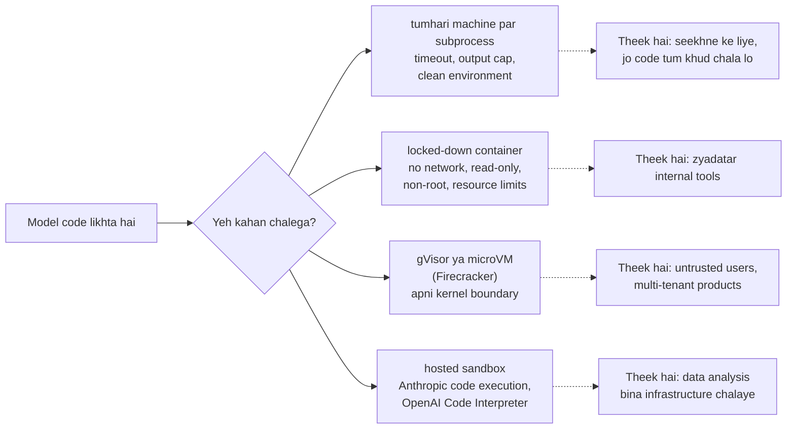

🏠 [Home](../../README.md) › [03 · Tools & Function Calling](./README.md) › 3.6 Code execution ek tool ki tarah

# 3.6 Code execution ek tool ki tarah

> **Level:** 🟡 Intermediate · **Padhne ka time:** ~10 min · **Pehle padho:** [3.4 Achhe tools kaise design karein](./03.4-designing-good-tools.md), [2.5 Loop mein errors kaise sambhalein](../02-the-agent-loop/02.5-handling-errors-in-the-loop.md)

**Ek line mein:** Model ko code likhne aur chalane dena ek tool ko hazaaron tools bana deta hai. Isiliye yeh itna useful bhi hai aur itna khatarnak bhi. Suvidha ke liye limits ke saath chalao, lekin untrusted code ko safe sirf asli isolation banata hai (locked-down container, gVisor, microVM ya hosted sandbox).

📑 **Is page par**

- [Yeh kyun zaroori hai?](#-yeh-kyun-zaroori-hai)
- [Idea, simple words mein](#-idea-simple-words-mein)
- [Diagram se samjho](#-diagram-se-samjho)
- [Kaise kaam karta hai, step by step](#-kaise-kaam-karta-hai-step-by-step)
- [Example se samjho](#-example-se-samjho)
- [Code](#-code)
- [Aam galtiyan aur dhyan dene wali baatein](#-aam-galtiyan-aur-dhyan-dene-wali-baatein)
- [Yaad rakhne wali baatein](#-yaad-rakhne-wali-baatein)
- [Khud try karo](#-khud-try-karo)
- [Aur padhne ke liye](#-aur-padhne-ke-liye)

## 🤔 Yeh kyun zaroori hai?

Models kamzor calculator hote hain. Kisi column ke numbers ka standard deviation poocho, to woh ek sahi lagne wala lekin galat number de sakta hai. Use Python tool do, to woh code ki teen lines likhta hai aur exact jawab nikaal leta hai. Wahi tool CSV parse kar sakta hai, chart bana sakta hai, regular expression test kar sakta hai, ya apna code check kar sakta hai.

Yahi flexibility risk bhi hai. `run_python` tool aisa tool hai jo *woh sab kar sakta hai jo tumhara computer kar sakta hai*: tumhari SSH keys padhna, files delete karna, internet call karna. Code model se aata hai. Aur model ka input kisi se bhi aa sakta hai, chhupe instructions wale web page ya document se bhi ([prompt injection](../../GLOSSARY.md#prompt-injection)). To is page ka asli sawal yeh nahi ki code *kaise* chalayein, balki *kahan* chalayein.

## 🧠 Idea, simple words mein

Ek chemistry lab socho. Student kuch bhi mix kar sakta hai, yahi to lab ka matlab hai. Lekin tum use kitchen ki table par yeh nahi karne doge. Tum use safety glass ke peeche ek lab bench doge. Wahan koi gas line nahi jo woh khol sake, ek timer hai, aur darwaza bahar se lock hai.

Model ka likha code chalana bhi aise hi hai. Tumhe chahiye:

- **Ek timer:** code bahut der chale to use kill kar do.
- **Deewarein:** code tumhari files, secrets ya network nahi dekh sakta.
- **Ek chhoti bench:** limited memory, CPU aur disk.
- **Ek report:** usne kya print kiya, kaun se errors aaye.

Plain Python subprocess tumhe timer aur report deta hai. Woh deewarein **nahi** deta. Deewaron ke liye tumhe [sandbox](../../GLOSSARY.md#sandbox) chahiye: ek container, ek microVM, ya model provider ka chalaya hua sandbox.

## 👀 Diagram se samjho



*Pehle option se aakhri tak isolation mazboot hota jaata hai. Subprocess sirf time aur output limit karta hai. Uske baad ka har option model ke code aur tumhari zaroori cheezon ke beech ek mazboot deewar lagata hai.*

## 🔍 Kaise kaam karta hai, step by step

### Ek local runner, aur woh asal mein kis cheez se bachata hai

Neeche Code section wala runner model ka likha Python `subprocess` se chalata hai. Yeh raha har limit jo woh lagata hai, aur kyun:

| Limit | Kaise | Kya rokta hai |
| --- | --- | --- |
| Wall-clock timeout | `subprocess.run(..., timeout=5)`, jo time khatam hone par child ko kill kar deta hai | Infinite loops, atka hua code |
| Output cap | stdout aur stderr ko 4,000 characters tak kaato, ek note ke saath | 1 GB ka `print` jo context window bhar de |
| Clean environment | Sirf `env={"PATH": ...}`, koi inherited variables nahi | `os.environ` se `ANTHROPIC_API_KEY` aur dusre secrets padhna |
| Khaali temporary folder | `cwd=tempfile.TemporaryDirectory()`, baad mein delete | Project folder mein galti se kachra |
| Isolated Python | `python -I` | `PYTHON*` variables, user site-packages, ya script ke folder se modules load karna |
| Koi input nahi | `stdin=subprocess.DEVNULL` | Code jo hamesha input ka wait karta rahe |
| Memory, CPU, file limits (Linux/macOS) | Child mein `resource.setrlimit` | Saari RAM ya CPU kha jaana, bahut badi files likhna |

Aur yeh kya **nahi** rokta. Code ab bhi **tumhare user** ki tarah chalta hai, to woh:

- koi bhi file padh aur delete kar sakta hai jo tum kar sakte ho (`open(os.path.expanduser("~/.ssh/id_rsa"))`);
- network connections khol ke tumhara data kahin bhi bhej sakta hai;
- dusre programs start kar sakta hai, aise bhi jo detach hone par timeout ke baad bhi chalte rahein;
- dusre processes aur system ki information dekh sakta hai.

**Subprocess security sandbox nahi hai.** Ise seekhne ke liye use karo, aur aise code ke liye jo tum khud khushi se chala lete.

### Asli isolation

Baaki sab ke liye code aisi jagah chalao jahan se zaroori cheezein pahunch mein hi na hon:

- **Ek locked-down container.** Jaise `docker run --rm --network none --read-only --memory 512m --cpus 1 --pids-limit 64 --user 1000:1000 --cap-drop ALL --security-opt no-new-privileges python:3.12-slim python -c "..."`: koi network nahi, read-only filesystem, memory, CPU aur process ki limit, non-root user aur koi extra privileges nahi. Containers host ka kernel share karte hain, isliye kernel ka koi bug ab bhi code ko bahar nikalne de sakta hai.
- **Ek mazboot boundary.** [gVisor](https://gvisor.dev/) containers ko unka apna user-space kernel deta hai (Docker ise `--runtime=runsc` se use kar sakta hai). [Firecracker](https://firecracker-microvm.github.io/) har job ko ek halki virtual machine mein chalata hai. Untrusted users ke code ke liye dono mein se koi bhi samajhdaar default hai.
- **Ek hosted sandbox.** Provider ko chalane do (neeche dekho), ya koi dedicated sandbox service use karo.

Isolation ki aur gehri baat [13.3 Least-privilege tools aur sandboxing](../13-safety-and-guardrails/13.3-least-privilege-and-sandboxing.md) mein hai.

### Hosted code execution: provider chalata hai

Dono providers code execution ek **[server tool](../../GLOSSARY.md#server-tool)** ki tarah dete hain. Tum ise `tools` mein add karte ho, aur code API call ke andar unke infrastructure par chalta hai. Iske liye tumhe client-side loop nahi likhna padta.

**Anthropic: code execution tool.** `{"type": "code_execution_20260521", "name": "code_execution"}` declare karo (November 2026 tak ka latest version; koi beta header nahi). Claude ko do sub-tools milte hain, `bash_code_execution` aur `text_editor_code_execution`. Woh inhe ek container mein chalata hai: 1 CPU, 5 GiB RAM, 5 GiB disk, common data libraries wala Python 3.11, aur **koi internet access nahi**. Response mein `server_tool_use` blocks hote hain (Claude ne kya chalaya) aur `bash_code_execution_tool_result` blocks, jinme `stdout`, `stderr` aur `return_code` hote hain. Container ID wapas bhej ke containers ko requests ke beech reuse kar sakte ho, aur yeh 30 din baad expire hote hain. Lamba turn `stop_reason: "pause_turn"` ke saath khatam ho sakta hai: aage badhane ke liye conversation wapas bhejo. Pricing (November 2026): web search ya web fetch tools ke saath use karo to free. Warna har organisation ko har mahine 1,550 free hours, phir $0.05 per container-hour.

**OpenAI: Code Interpreter.** Responses API mein `{"type": "code_interpreter", "container": {"type": "auto"}}` add karo. OpenAI container ko ek fully sandboxed virtual machine batata hai jahan model Python chalata hai. Yeh tumhari upload ki hui files padh sakta hai aur files bana sakta hai. Active container 20 minute tak use na ho to expire ho jaata hai.

| | Tumhara apna runner | Anthropic code execution | OpenAI Code Interpreter |
| --- | --- | --- | --- |
| Code kaun chalata hai | Tum | Anthropic | OpenAI |
| Isolation | Jo tum banao | Provider ka sandboxed container, koi internet nahi | Provider ka sandboxed container |
| Calls tumhara loop handle karta hai? | Haan | Nahi (server tool) | Nahi (built-in tool) |
| Tumhare systems tak access | Ho sakta hai (aur risky hai) | Koi nahi, sirf upload ki hui files | Koi nahi, sirf upload ki hui files |
| Cost | Tumhara compute | Container-hours (free allowance) | OpenAI pricing dekho |

## 💡 Example se samjho

Yahan model ke replies scripted hain, lekin code sach mein subprocess mein chalta hai. User paanch delivery times ka mean aur standard deviation poochta hai, aur yeh bhi ki koi outlier hai kya. Socho food delivery app ke paanch orders, jinme ek bahut late aaya. Model ki pehli script mein bug hai:

```text
--- tool call 1
code:
import statistics as st
times = [12, 15, 11, 30, 14]
print(st.mean(times), st.stdev(times))
print(stats.median(times))

result:
[exit code 1]
stdout:
16.4 7.765307463326871

stderr:
Traceback (most recent call last):
  File "snippet.py", line 4, in <module>
    print(stats.median(times))
          ^^^^^
NameError: name 'stats' is not defined
```

Traceback model ke paas ek normal observation ki tarah wapas jaata hai. Yeh kaam ki information hai, isliye tool result ko error mark **nahi** kiya jaata: tool ne apna kaam kiya, *script* fail hui. Model naam theek karta hai aur dobara try karta hai:

```text
--- tool call 2
code:
import statistics as st
times = [12, 15, 11, 30, 14]
mean, sd = st.mean(times), st.stdev(times)
print(f"mean={mean:.1f} sd={sd:.2f}")
print("z-scores:", {t: round((t - mean) / sd, 2) for t in times})

result:
[exit code 0]
stdout:
mean=16.4 sd=7.77
z-scores: {12: -0.57, 15: -0.18, 11: -0.7, 30: 1.75, 14: -0.31}

--- answer
The mean is 16.4 minutes and the standard deviation is about 7.77 minutes. The 30-minute delivery
stands out: it is 1.75 standard deviations above the mean, while every other value is within 0.7.
```

Do baatein dhyan do. Pehli: runner tracebacks mein temporary path ko `snippet.py` se badal deta hai, taaki tumhara user name aur folder layout kabhi model tak na pahunche. Dusri: jawab ka har number code se aaya, model ke dimaag se nahi.

## 💻 Code

Local runner (resource limits aur output trimming chhota karke dikhaya hai):

```python
import os, subprocess, sys, tempfile
from pathlib import Path

def run_python(code: str, *, timeout: float = 5.0) -> ExecResult:
    """Code ko fresh interpreter mein, ek khaali temp folder mein chalao. Yeh security sandbox NAHI hai."""
    env = {"PATH": os.environ.get("PATH", ""), "PYTHONIOENCODING": "utf-8"}   # koi API keys nahi
    if os.name == "nt" and "SYSTEMROOT" in os.environ:
        env["SYSTEMROOT"] = os.environ["SYSTEMROOT"]                         # Windows ko yeh chahiye
    extra = {"preexec_fn": limit_resources(512, int(timeout) + 1)} if os.name == "posix" else {}

    with tempfile.TemporaryDirectory(prefix="agent-code-") as workdir:
        script = Path(workdir) / "snippet.py"
        script.write_text(code, encoding="utf-8")
        try:
            proc = subprocess.run(
                [sys.executable, "-I", str(script)],      # -I: isolated mode
                cwd=workdir, env=env, stdin=subprocess.DEVNULL,
                capture_output=True, text=True, encoding="utf-8", errors="replace",
                timeout=timeout, **extra,                  # timeout hone par run() child ko kill karta hai
            )
        except subprocess.TimeoutExpired as exc:
            return ExecResult(trim(exc.stdout), trim(exc.stderr), None, timed_out=True)
    return ExecResult(trim(proc.stdout), trim(proc.stderr.replace(str(script), "snippet.py")), proc.returncode)
```

Tool description model ko bench ke rules batati hai:

```python
RUN_PYTHON_SPEC = {
    "name": "run_python",
    "description": "Run a short Python 3 script and return its exit code, stdout and stderr. Use it for "
                   "arithmetic, statistics and data processing instead of calculating in your head. Print "
                   "the values you need: only printed output comes back. Standard library only, no "
                   "network, no files kept between calls, 5 second time limit.",
    "input_schema": {"type": "object", "properties": {"code": {"type": "string"}},
                     "required": ["code"], "additionalProperties": False},
}
```

Hosted alternative, Anthropic ka code execution tool (`ANTHROPIC_API_KEY` chahiye; code Anthropic ke sandbox mein chalta hai, tumhari machine par nahi):

```python
import anthropic

client = anthropic.Anthropic()
response = client.messages.create(
    model="claude-opus-5-5",
    max_tokens=16000,
    tools=[{"type": "code_execution_20260521", "name": "code_execution"}],
    messages=[{"role": "user", "content": "Mean and standard deviation of 12, 15, 11, 30, 14?"}],
)
for block in response.content:
    if block.type == "server_tool_use":
        print("ran:", block.input)
    elif block.type == "bash_code_execution_tool_result" and block.content.type == "bash_code_execution_result":
        print("stdout:", block.content.stdout, "return code:", block.content.return_code)
    elif block.type == "text":
        print(block.text)
```

Aur OpenAI ka Code Interpreter, Responses API mein (`OPENAI_API_KEY` chahiye):

```python
from openai import OpenAI

client = OpenAI()
response = client.responses.create(
    model="YOUR_OPENAI_MODEL",
    tools=[{"type": "code_interpreter", "container": {"type": "auto"}}],
    input="Mean and standard deviation of 12, 15, 11, 30, 14? Use the python tool.",
)
print(response.output_text)
```

## 🚨 Aam galtiyan aur dhyan dene wali baatein

- **Subprocess ko sandbox kehna.** Yeh time aur output limit karta hai. File, network ya process access nahi rokta. Yeh baat apne code aur docs mein saaf likho.
- **Apna environment aage pass kar dena.** `env=` ke bina `subprocess.run(...)` child ko tumhare environment ka har secret de deta hai, API keys samet.
- **Apne process mein `exec()` ya `eval()` use karna.** Tab code tumhare variables padh sakta hai, tumhare agent ko monkey-patch kar sakta hai, aur use crash kar sakta hai. Kam se kam hamesha alag process use karo.
- **Timeout na hona, ya aisa timeout jo kill na kare.** `subprocess.run(timeout=...)` child ko kill karta hai. `future.result(timeout=...)` wala thread kuch nahi rokta, bas wait karna band kar deta hai.
- **Har non-zero exit ko tool failure mark karna.** Traceback kaam ka observation hai. Model use padh ke apna code theek karta hai. `is_error` sirf tab lagao jab "tool khud toot gaya", jaise timeout ya sandbox start hi na ho.
- **Bina limit ka output.** Ek loop jo million lines print kare, context window ko bhar dega. Truncate karo, aur batao ki kiya.
- **Container ko root ki tarah, network on ke saath chalana.** Container ki zyadatar protection flags se aati hai: `--network none`, `--read-only`, non-root `--user`, `--cap-drop ALL`, aur resource limits.

## ✅ Yaad rakhne wali baatein

- Code execution agents ko maths aur data ke kaam mein precise banata hai, aur ek tool ko lagbhag koi bhi capability bana deta hai.
- Local subprocess tumhe timeout, output limits aur clean environment deta hai, lekin **koi security isolation nahi**.
- Untrusted input ke liye asli isolation use karo: locked-down container, gVisor ya microVM, ya hosted sandbox.
- Anthropic ka code execution tool (`code_execution_20260521`) aur OpenAI ka Code Interpreter code ko provider ke sandboxed infrastructure par chalate hain, bina client-side loop ke.
- Tracebacks model ko observations ki tarah lautao. Woh aksar apna bug khud theek kar leta hai.

## 🧪 Khud try karo

1. Upar wale `run_python` runner se, Windows par, ek malicious script ab bhi kya teen kaam kar sakti hai? List karo.
2. Runner environment variables kyun hata deta hai, jab woh "waise bhi sandbox nahi hai"?
3. Tum ek product bana rahe ho jahan koi bhi user CSV upload karke uske baare mein sawal pooch sakta hai. Kaun sa execution option chunoge, aur kyun?

<details>
<summary>Answer dekho</summary>

1. Jaise: koi bhi file padhna jo tumhara account padh sakta hai, jaise browser profiles ya `~/.ssh`. Woh data `urllib.request` se internet par bhejna. Tumhare home folder ki files delete ya encrypt karna. Ek background process start karna jo timeout ke baad bhi chalta rahe. (Windows par runner memory ya CPU limits bhi nahi laga sakta, kyunki `resource` sirf POSIX par hai.)
2. Defence in depth, aur sabse common accident se bachne ke liye. `os.environ` leak karne ke liye code ki ek line kaafi hai (`print(os.environ)`), aur output seedha conversation, logs aur traces mein chala jaata hai. Child ke environment se secrets hatane se sabse aasaan raasta band ho jaata hai, chahe zid wala code phir bhi kahin aur dhoondh sake.
3. Local subprocess nahi: code untrusted users chala rahe hain. Ya to hosted sandbox (Anthropic ka code execution tool ya OpenAI ka Code Interpreter, jahan tum CSV ko file ki tarah upload karte ho). Ya har user ke liye tumhara apna mazboot isolation (gVisor ya microVM, koi network nahi, strict limits, har session ke baad destroy). Hosted option se aam taur par sabse jaldi safely ship kar paoge.

</details>

## 📚 Aur padhne ke liye

- [Code execution tool](https://platform.claude.com/docs/en/agents-and-tools/tool-use/code-execution-tool) (Anthropic). Tool versions, containers, response format, limits aur pricing.
- [Code Interpreter](https://developers.openai.com/api/docs/guides/tools-code-interpreter) (OpenAI). OpenAI ka hosted Python sandbox aur uske containers.
- [subprocess](https://docs.python.org/3/library/subprocess.html) aur [resource](https://docs.python.org/3/library/resource.html) (Python docs). Timeouts, environments aur resource limits.
- [docker container run](https://docs.docker.com/reference/cli/docker/container/run/) aur [Docker Engine security](https://docs.docker.com/engine/security/) (Docker docs). Upar use hue flags, aur containers kya isolate karte hain aur kya nahi.
- [What is gVisor?](https://gvisor.dev/docs/) aur [Firecracker](https://firecracker-microvm.github.io/). Do bahut use hone wali mazboot isolation layers.

<!-- FOOTER -->

---

⬅️ **Pichla:** [3.5 Parallel tool calls](./03.5-parallel-tool-calls.md) ·
🏠 [Chapter home](./README.md) ·
➡️ **Agla:** [3.7 Computer use aur browser agents](./03.7-computer-use-and-browser-agents.md)
