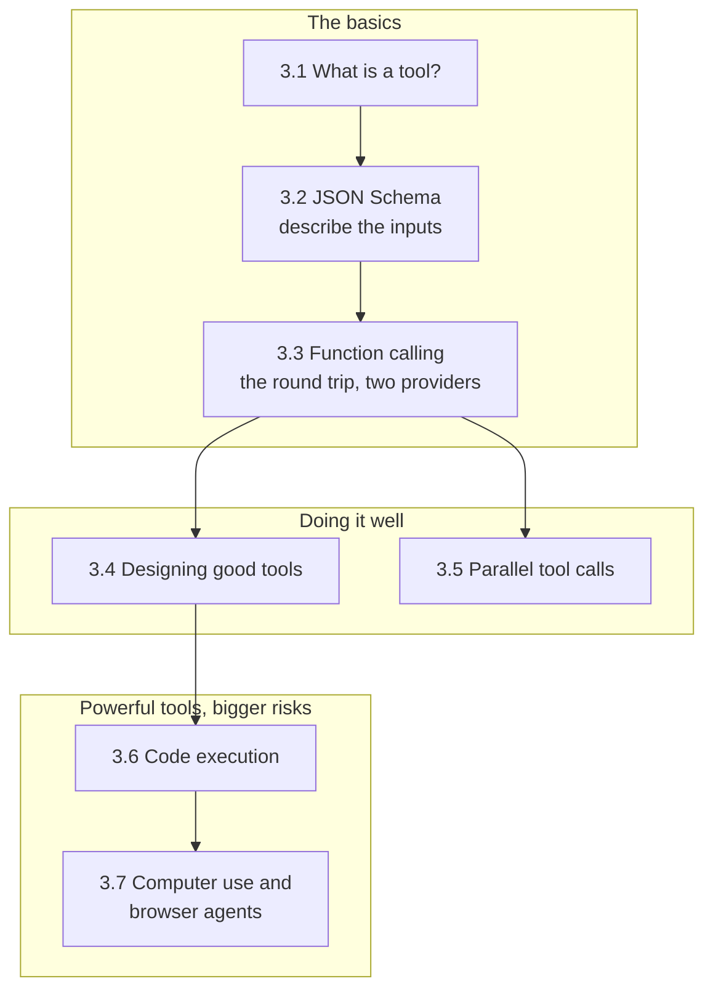

🏠 [Home](../../README.md) › 03 · Tools & Function Calling

# 03 · Tools & Function Calling

> **Estimated reading time:** ~68 min · **Difficulty:** 🟢 Beginner to 🔴 Advanced · **Prerequisites:** [02 · The Agent Loop](../02-the-agent-loop/README.md)

Tools are how an agent acts on the world: look something up, run a calculation, send a message, click a button. This chapter explains what a tool is, how to describe one with JSON Schema, and the exact request → tool call → tool result round trip on both Anthropic and OpenAI. Then it turns to craft and power: designing tools that models use well, running several calls at once, letting the model write and run code safely, and agents that operate screens and browsers.

## 🎯 What you'll learn

- What a tool is: a function your code runs, plus a description the model reads
- How to write JSON Schema for tool inputs, and how strict mode differs between Anthropic and OpenAI
- The full function-calling round trip, with the real JSON payloads for both providers, and `tool_choice`
- How to design tools models use well: task-shaped, clearly described, validated, concise, with actionable errors
- How to handle several tool calls in one turn, and run them concurrently
- How to give an agent code execution, and why a subprocess is not a sandbox
- How computer-use and browser agents work, and why everything on screen is untrusted input

## 📋 Prerequisites

- [2.1 The observe–think–act loop](../02-the-agent-loop/02.1-the-observe-think-act-loop.md) and [2.3 A 50-line agent from scratch](../02-the-agent-loop/02.3-a-50-line-agent-from-scratch.md): the loop these tools plug into
- [2.5 Handling errors in the loop](../02-the-agent-loop/02.5-handling-errors-in-the-loop.md): error results and `is_error`
- Basic familiarity with JSON

## 👀 Chapter overview

*Read 3.1 to 3.3 in order; they are the mechanics every later chapter relies on. 3.4 and 3.5 make tools work well. 3.6 and 3.7 cover the most capable tools, where safety and isolation matter most.*

## 📄 Pages in this chapter

<!-- PAGES:START -->
| # | Page | Level | Time |
| --- | --- | --- | --- |
| 3.1 | [What is a tool?](./03.1-what-is-a-tool.md) — A function the model can ask you to run, and why that changes everything. | 🟢 Beginner | ~6 min |
| 3.2 | [JSON Schema for tool definitions](./03.2-json-schema-for-tools.md) — Describe a tool's inputs so the model calls it correctly. | 🟢 Beginner | ~10 min |
| 3.3 | [How function calling works](./03.3-how-function-calling-works.md) — The request → tool call → tool result round trip, for two providers. | 🟢 Beginner | ~12 min |
| 3.4 | [Designing good tools](./03.4-designing-good-tools.md) — Names, descriptions, inputs and error messages that models understand. | 🟡 Intermediate | ~12 min |
| 3.5 | [Parallel tool calls](./03.5-parallel-tool-calls.md) — Several tool calls in one turn, and how to return their results. | 🟡 Intermediate | ~8 min |
| 3.6 | [Code execution as a tool](./03.6-code-execution-as-a-tool.md) — Let the model write and run code, safely. | 🟡 Intermediate | ~10 min |
| 3.7 | [Computer use & browser agents](./03.7-computer-use-and-browser-agents.md) — An overview of agents that see screens and click buttons. | 🔴 Advanced | ~10 min |
<!-- PAGES:END -->

<!-- FOOTER -->

---

⬅️ **Previous chapter:** [02 · The Agent Loop](../02-the-agent-loop/README.md) ·
▶️ **Start reading:** [3.1 What is a tool?](./03.1-what-is-a-tool.md) ·
➡️ **Next chapter:** [04 · Model Context Protocol (MCP)](../04-model-context-protocol/README.md)
