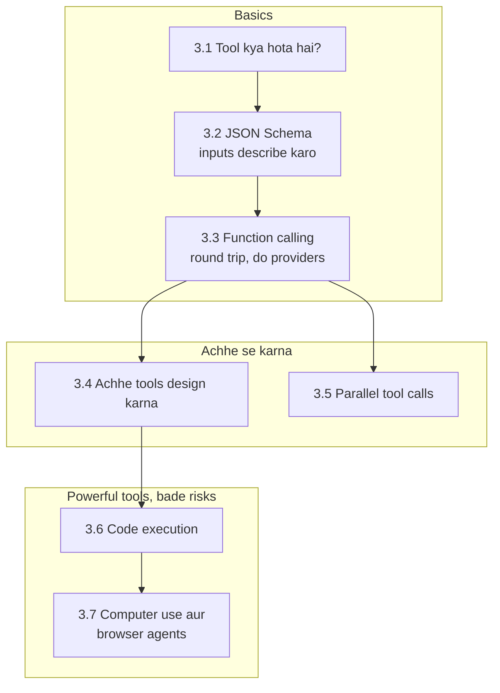

🏠 [Home](../../README.md) › 03 · Tools & Function Calling

# 03 · Tools & Function Calling

> **Padhne ka time:** ~68 min · **Level:** 🟢 Beginner se 🔴 Advanced tak · **Pehle padho:** [02 · The Agent Loop](../02-the-agent-loop/README.md)

Tools se hi agent duniya mein kaam karta hai: kuch dhoondhna, calculation chalana, message bhejna, button click karna. Yeh chapter samjhata hai ki tool kya hota hai, use JSON Schema se kaise describe karte hain, aur Anthropic aur OpenAI dono par exact request → tool call → tool result round trip kaisa hota hai. Phir hum craft aur power ki taraf badhte hain. Aise tools design karna jinhe models achhe se use karein. Ek saath kai calls chalana. Model ko safely code likhne aur chalane dena. Aur aise agents jo screens aur browsers chalate hain.

## 🎯 Is chapter mein kya seekhoge

- Tool kya hai: ek function jo tumhara code chalata hai, plus ek description jo model padhta hai
- Tool inputs ke liye JSON Schema kaise likhein, aur Anthropic aur OpenAI mein strict mode kaise alag hai
- Poora function-calling round trip, dono providers ke asli JSON payloads ke saath, aur `tool_choice`
- Aise tools kaise design karein jinhe models achhe se use karein: task ke shape ke, saaf describe kiye hue, validated, chhote, actionable errors ke saath
- Ek turn mein kai tool calls kaise handle karein, aur unhe concurrently kaise chalayein
- Agent ko code execution kaise dein, aur subprocess sandbox kyun nahi hai
- Computer-use aur browser agents kaise kaam karte hain, aur screen par sab kuch untrusted input kyun hai

## 📋 Pehle se kya aana chahiye

- [2.1 Observe–think–act loop](../02-the-agent-loop/02.1-the-observe-think-act-loop.md) aur [2.3 50 lines mein agent, bilkul zero se](../02-the-agent-loop/02.3-a-50-line-agent-from-scratch.md): woh loop jisme yeh tools lagte hain
- [2.5 Loop mein errors kaise sambhalein](../02-the-agent-loop/02.5-handling-errors-in-the-loop.md): error results aur `is_error`
- JSON ki basic samajh

## 👀 Chapter ek nazar mein

*3.1 se 3.3 order mein padho. Yahi mechanics hain jin par aage ka har chapter tika hai. 3.4 aur 3.5 tools ko achhe se kaam karwate hain. 3.6 aur 3.7 sabse capable tools cover karte hain, jahan safety aur isolation sabse zyada matter karte hain.*

## 📄 Is chapter ke pages

<!-- PAGES:START -->
| # | Page | Level | Time |
| --- | --- | --- | --- |
| 3.1 | [Tool kya hota hai?](./03.1-what-is-a-tool.md) — Ek function jise chalane ko model tumse keh sakta hai, aur isse sab kuch kyun badal jaata hai. | 🟢 Beginner | ~6 min |
| 3.2 | [Tool definitions ke liye JSON Schema](./03.2-json-schema-for-tools.md) — Tool ke inputs aise describe karo ki model use sahi call kare. | 🟢 Beginner | ~10 min |
| 3.3 | [Function calling kaise kaam karta hai](./03.3-how-function-calling-works.md) — Request → tool call → tool result round trip, do providers ke liye. | 🟢 Beginner | ~12 min |
| 3.4 | [Achhe tools kaise design karein](./03.4-designing-good-tools.md) — Aise names, descriptions, inputs aur error messages jo models samjhein. | 🟡 Intermediate | ~12 min |
| 3.5 | [Parallel tool calls](./03.5-parallel-tool-calls.md) — Ek turn mein kai tool calls, aur unke results kaise lautayein. | 🟡 Intermediate | ~8 min |
| 3.6 | [Code execution ek tool ki tarah](./03.6-code-execution-as-a-tool.md) — Model ko code likhne aur chalane do, safely. | 🟡 Intermediate | ~10 min |
| 3.7 | [Computer use aur browser agents](./03.7-computer-use-and-browser-agents.md) — Screens dekhne aur buttons click karne wale agents ka overview. | 🔴 Advanced | ~10 min |
<!-- PAGES:END -->

<!-- FOOTER -->

---

⬅️ **Pichla chapter:** [02 · The Agent Loop](../02-the-agent-loop/README.md) ·
▶️ **Padhna shuru karo:** [3.1 Tool kya hota hai?](./03.1-what-is-a-tool.md) ·
➡️ **Agla chapter:** [04 · Model Context Protocol (MCP)](../04-model-context-protocol/README.md)
